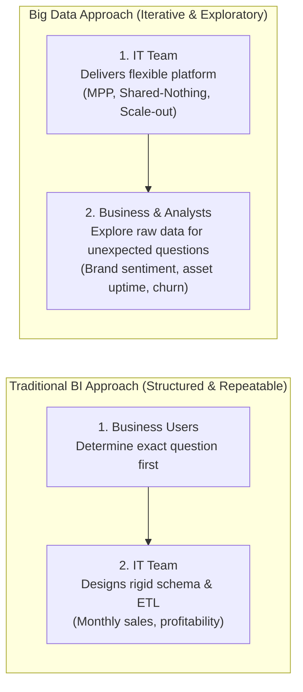
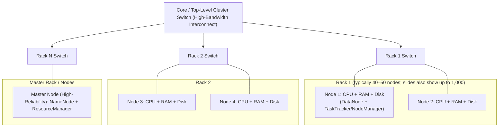
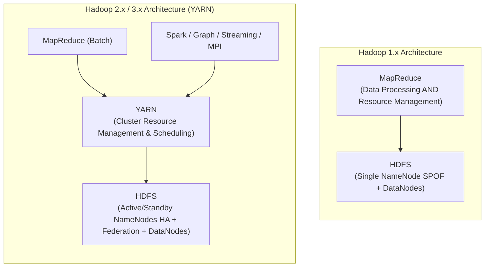
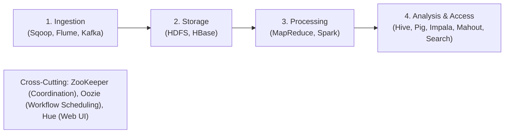

# Module 1: Introduction to Big Data and Hadoop

**Course:** Big Data and Social Media Analytics (`26CMPC71` — VESIT 2026 NEP & Autonomy Scheme, Sem VII)  
**Course Outcome:** `CO1` — *Understand the building blocks of Big Data Analytics.* (`04` Theory Hours + Lab Experiment 1)  
**Primary Slides & Curriculum Sources Used:**
- `module_1/ch 01 A Introduction to Big Data.pptx.pdf` (136 slides)
- `module_1/Module_ 01 B Introduction_to_Hadoop.pptx.pdf` (93 slides)
- `module_2/Module _02 Hadoop HDFS and Mapreduce.pptx.pdf` (Slides 3–9: *Distributed File Systems — Physical Organization of Compute Nodes & Large-Scale File-System Organization*, mapped here per official `26CMPC71` Topic 1.2)
- Official Syllabus: `Final year B. E. (Computer Engineering) (Sem-VII & VIII) Batch  [2023-2027] (2026 ‘NEP & Autonomy’ Scheme).pdf` (`26CMPC71` Topics `1.1`, `1.2`, and Lab Exp 1)

---

## Scope & Topic Checklist

| # | Topic / Subtopic | Official Syllabus Ref | Slide Coverage | Status |
|---|---|---|---|---|
| 1 | What Is Big Data, Growth Stats, Definitions & Byte Scale | `1.1` | `1A` pp. 1–20, 40–43, 58–64, 70–83, 106, 111 | `[x]` |
| 2 | Characteristics of Big Data (3Vs, 4Vs, 5Vs, Valence/Validity, 10Vs) | `1.1` | `1A` pp. 21–22, 81–97, 107 | `[x]` |
| 3 | Sources & Types of Big Data (Structured, Semi-Structured, Unstructured; Big vs. Small Data) | `1.1` | `1A` pp. 65–69, 98–106, 128 | `[x]` |
| 4 | Traditional vs. Big Data Business Approach & Data Science Technologies | `1.1` | `1A` pp. 47–50, 98, 108–120 | `[x]` |
| 5 | Case Studies & Use Cases of Big Data Solutions (Netflix, IMDb, Ad Trends, Insurance, BT) | `1.1` | `1A` pp. 26–39, 44–57, 121–125 | `[x]` |
| 6 | Distributed File Systems: Physical Organization & Large-Scale File-System Organization | `1.2` | `2A` pp. 3–9; `1B` pp. 9–21, 52–60, 84–91 | `[x]` |
| 7 | Concept of Hadoop, Core Components, HDFS, YARN & Hadoop 1.x vs. 2.x/3.x | `1.1` | `1B` pp. 3–8, 12–37, 52–91 | `[x]` |
| 8 | Hadoop Ecosystem & Processing Stages | `1.1` | `1A` pp. 7–13, 129–135; `1B` pp. 7, 22–24, 35–51 | `[x]` |
| 9 | Lab Practical 1 Connection: HDFS CLI (`hdfs dfs`) for `PR & OR` Viva | Lab Exp 1 | `1B` p. 3 (`hadoop fs -put`) + Official Docs | `[x]` |

**Assumptions & Source Notes:**
- **Zero-prior-knowledge assumption:** Database concepts (Relational Database Management Systems [RDBMS], Structured Query Language [SQL]), storage units, networking, and distributed systems are explained from scratch.
- **Official syllabus vs. slide structure:** Notice in `ch 01 A` Slides 2–6 that the slide deck displays screenshots from the older University of Mumbai `CSC702` syllabus, while your current college scheme is **`26CMPC71`**. Module 1 (`1.1` + `1.2`) in `26CMPC71` explicitly includes *Distributed File Systems: Physical Organization of Compute Nodes, Large Scale File-System Organization*, which appears at the start of `Module _02` Slides 3–9 and inside `Module_ 01 B`. Both are unified cleanly below.

---

## 1. What Is Big Data, Why It Exists, Definitions & Data Size Scale

### 1.1 Basic Idea (Assuming Zero Background)

Before talking about "Big Data", let us start with three everyday building blocks:
- **Data:** Raw, unorganized facts — like individual numbers, clicks, photos, sensor readings, or tweets (for example, `"User 42 paused Stranger Things at 18:42"`).
- **Information / Knowledge:** Meaningful patterns extracted after organizing and analyzing raw data (for example, `"65% of viewers drop off at minute 18 of Episode 1"`).
- **Value (`ch 01 A` p. 106):** Using that knowledge to make a better decision — such as fixing a boring opening scene, preventing fraud, or recommending the right product (`Data -> Explore -> Knowledge -> Value`).

For decades, companies stored their data in **traditional Relational Database Management Systems (RDBMS)** — software such as MySQL, Oracle Database, or Microsoft SQL Server that stores neat tables of rows and columns on a single powerful server.

**Big Data** refers to a situation (`ch 01 A` p. 59) where datasets become **so massive, fast-moving, and varied in format** that traditional single-machine databases and conventional software tools can no longer store, search, share, analyze, or visualize them within a useful time and reasonable cost.

### 1.2 Why Do We Need It? (What Problem Does It Solve?)

In the past (`ch 01 A` p. 89), we lived under the **Old Model** of data generation:
- A **few organizations** (newspapers, TV channels, banks, governments) generated data, and **everyone else** consumed it.

Today, we live under the **New Model** (`ch 01 A` p. 89):
- **All of us** generate data *and* consume data continuously — every Instagram reel, WhatsApp voice note, UPI payment, GPS ping, smartwatch heartbeat, and online shopping click leaves a digital trace (`ch 01 A` p. 106).

Why do traditional RDBMS tools break under this flood? (`ch 01 A` pp. 47, 58, 127–128):
1. **Capture / Acquisition:** Sensors, logs, and web streams write data much faster than traditional database insert pipelines can handle (`data reading and writing speeds differ across devices`).
2. **Storage:** Single-server hard drives cannot hold petabytes of video, images, and logs affordably.
3. **Curation (Create, Manage, Maintain, Validate):** Raw social and sensor feeds are messy and duplicated.
4. **Searching:** Scanning terabytes of unindexed logs with traditional SQL queries to detect a trending topic takes so long that the trend is already over before the query finishes (`ch 01 A` p. 47).
5. **Sharing & Transfer:** Moving terabytes across networks saturates bandwidth.
6. **Analysis & Visualization:** Classical statistical tools and spreadsheet charts crash or freeze when fed millions of unstructured records.

### 1.3 Global Data Growth Statistics & Authoritative Definitions

Your slides (`ch 01 A` pp. 15–20, 60–64, 111) cite several famous industry quotes and global growth statistics:
- **Chris Lynch (Vertica Systems):** *"Big Data is at the foundation of all the megatrends that are happening today, from social to mobile to cloud to gaming."*
- **Peter Sondergaard (Gartner Research):** *"Information is the oil of the 21st century, and analytics is the combustion engine."* (Meaning: raw data alone sits idle like crude oil; analytics refines it into useful motion/decisions.)
- **Gartner Definition (`ch 01 A` p. 62):** *"Big Data in general is defined as **high-volume, velocity and variety** information assets that demand **cost-effective, innovative forms of information processing** for **enhanced insight and decision making**."*
- **Oracle Definition (`ch 01 A` p. 63):** Data containing greater **variety**, arriving in increasing **volumes**, and with more **velocity** (the **three Vs**) — too voluminous and complex for traditional software, yet usable to solve previously unsolvable business problems.
- **IBM Definition (`ch 01 A` p. 64):** Datasets whose size or type goes beyond traditional relational databases' ability to capture, manage, and process with **low latency** (short delay), driven by AI, mobile devices, social media, and the **Internet of Things (IoT)** (sensors, video/audio, logs, transactional apps).
- **McKinsey Global Institute (2011) Definition (`ch 01 A` p. 111):** Data whose **scale, distribution, diversity, and/or timeliness** require **new technical architectures and analytics** to unlock new sources of business value.

> [!NOTE]
> **PPT Verification Check — Daily Data Generation (`ch 01 A` Slides 17–18, 58, 82):**
> - **PPT says:** Slide 17 ("Statistics (2025)") places two numbers side by side: *"Around 2.5 quintillion bytes worth of data are generated each day"* AND *"According to the latest estimates, 402.74 million terabytes of data are created each day"*, while Slide 18 shows global data reaching ~181 zettabytes (ZB) in 2025. Slide 15 says *"Over 80 percent of data generated today is unstructured"*.
> - **Verified clarification:** `2.5 quintillion bytes/day` ($2.5 \times 10^{18}$ bytes = **2.5 exabytes/day**) is a widely cited **~2012 IBM estimate**, whereas `402.74 million terabytes/day` (**402.74 exabytes/day**, or ~`147–149 ZB / 365`) comes from **~2024 IDC/Statista** global datasphere estimates (which count data *created, captured, copied, and consumed* — over 160× larger than the 2012 figure!). Likewise, the "80% unstructured" figure is a long-standing **industry rule of thumb** (Gartner/IDC), not an exact census measurement.
> - **What to say in the viva:** *"Historically, around 2012, data creation was estimated at roughly 2.5 quintillion bytes (2.5 exabytes) per day, whereas recent 2024–2025 industry estimates put total daily data created, captured, copied, and consumed at over 400 million terabytes per day (hundreds of exabytes daily), with roughly 80% estimated to be unstructured."*

### 1.4 Data Size Units & Perspective (`ch 01 A` pp. 71–83)

To help beginners visualize how huge Big Data is, the professor's slides compare bytes to **grains of rice**:

| Unit | Symbol | Slide Rice Analogy (`1A` pp. 71–80) | Binary Size (Slide Table p. 83) | Computing Era (`1A` p. 80) |
|---|---|---|---:|---|
| **Bit** | b | — | `1/8` byte (`0` or `1`) | — |
| **Nibble** | — | — | `4` bits (`1/2` byte) | — |
| **Byte** | B | 1 grain of rice | `1` byte (`8` bits) | Hobbyist |
| **Kilobyte** | KB | 1 cup of rice | $1{,}024$ B ($2^{10}$) | Hobbyist |
| **Megabyte** | MB | 8 bags of rice | $1{,}024$ KB $= 1{,}048{,}576$ B | Desktop |
| **Gigabyte** | GB | 3 semi-trucks | $1{,}024$ MB $\approx 1.07 \times 10^9$ B | Desktop |
| **Terabyte** | TB | 2 container ships | $1{,}024$ GB $\approx 1.10 \times 10^{12}$ B | Internet |
| **Petabyte** | PB | Buildings of an entire city | $1{,}024$ TB $\approx 1.13 \times 10^{15}$ B | Internet |
| **Exabyte** | EB | Covers half of India | $1{,}024$ PB $\approx 1.15 \times 10^{18}$ B | Big Data (Google, Facebook, Amazon) |
| **Zettabyte** | ZB | Fills the Pacific Ocean | $1{,}024$ EB $\approx 1.18 \times 10^{21}$ B | Global Datasphere |
| **Yottabyte** | YB | An Earth-sized ball of rice | $1{,}024$ ZB $\approx 1.21 \times 10^{24}$ B | Future / Beyond |

> [!WARNING]
> **PPT Verification Check — Unit Spelling, Binary vs. Decimal, and Official SI Prefixes (`ch 01 A` Slide 83):**
> - **PPT says:** Slide 83 writes *"Terrabyte"* (typo for **Terabyte**), uses powers of `1024` for KB–YB, and lists **"Brontobyte"** ($\approx 1.24 \times 10^{27}$ bytes) and **"Geopbyte"** ($\approx 1.24 \times 10^{30}$ bytes).
> - **Verified clarification (BIPM Resolution 3, Nov 2022 & NPL UK):**
>   1. *Binary vs. Decimal:* Memory/OS tools often use powers of $1024 = 2^{10}$ (formally IEC binary prefixes **KiB, MiB, GiB, TiB**), whereas hard-drive makers and the International System of Units (SI) use powers of $1000 = 10^3$ (KB, MB, GB, TB).
>   2. *Brontobyte / Geopbyte:* Those were **informal, non-standard internet names**. In **November 2022**, the International Bureau of Weights and Measures (BIPM) officially adopted **`ronna` (R = $10^{27}$)** and **`quetta` (Q = $10^{30}$)** — making **Ronnabyte (RB)** and **Quettabyte (QB)** the true standard units after Yottabyte!
> - **What to say in the viva:** *"Our slides list Brontobyte and Geopbyte after Yottabyte, which were older informal terms, though in 2022 the international SI standard officially named $10^{27}$ **Ronnabyte** and $10^{30}$ **Quettabyte**."*

### 1.5 Everyday Analogy

Think of traditional databases like a **personal diary with neat ruled lines** — great for writing down your daily expenses. Big Data is like **every security camera feed, traffic sensor, WhatsApp chat, and credit card swipe across an entire city happening at the same time**. You cannot write all of that into one notebook; you need a coordinated team of thousands of notebooks working together.  
*(Where the analogy stops being accurate: human note-takers have low throughput and don't automatically checksum or replicate pages across racks on hardware failure like HDFS does.)*

### 1.6 Viva Preparation — What Is Big Data?

- **Quick definition:** Big Data refers to datasets whose **volume, velocity, and variety** exceed the storage, processing, and latency capabilities of traditional relational databases, requiring distributed, cost-effective computing architectures to extract insights and business value.
- **Explain it to the examiner (30–60 seconds):** *"Sir/Ma'am, Big Data isn't just 'a lot of files' — it describes datasets that are too huge in size, arrive too fast, and come in too many messy formats for a traditional single-server SQL database to handle efficiently. Earlier, only a few organizations produced data and people consumed it; today, every user generates videos, posts, clicks, and sensor logs continuously. To turn that raw data into business value — like Netflix recommending movies or banks catching fraud in milliseconds — we need distributed platforms like Hadoop that split storage and processing across many commodity servers."*
- **Practical example:** Every time you stream a movie, pause it, search titles, or tap like on Netflix, events flow continuously alongside millions of other users; storing and mining those interactions exceeds a single RDBMS.
- **Examiner follow-ups:**
  1. *Q: How much data makes something "Big Data"? Is 1 TB Big Data?*  
     **A:** There is no single fixed GB/TB cutoff. Data becomes "Big Data" relative to your tools — when its size, speed, or unstructured format breaks traditional single-machine databases and requires distributed storage/processing (typically tens of terabytes to petabytes+ in industry).
  2. *Q: What is the difference between Data, Information, Knowledge, and Value?*  
     **A:** Data is raw facts (a temperature reading `39°C`), Information adds context (`patient fever is 39°C`), Knowledge finds patterns (`spikes correlate with infection`), and Value is the outcome (`early clinical intervention saves lives/cost`).
  3. *Q: What did Gartner mean by "cost-effective, innovative forms of processing"?*  
     **A:** Instead of buying one ultra-expensive supercomputer, organizations use clusters of inexpensive commodity servers running open-source distributed frameworks like Hadoop and Spark.
- **Common mistakes to avoid:** Defining Big Data only by size ("lots of data") and forgetting velocity, variety, and traditional tool failure; confusing *Brontobyte/Geopbyte* as official SI units instead of *Ronnabyte/Quettabyte*.

---

## 2. Characteristics of Big Data (3Vs, 4Vs, 5Vs, Valence, Validity & 10Vs)

### 2.1 Basic Idea & Why We Need the "Vs"

Saying "Big Data is big" is vague. Industry frameworks describe Big Data through **"V" characteristics** so engineers know *which* technical bottleneck they are solving — storage space (Volume), processing speed (Velocity), parsing diverse formats (Variety), cleaning noisy data (Veracity), or proving ROI (Value).

### 2.2 Detailed Breakdown of the Vs (`ch 01 A` pp. 21–22, 81–97, 107)

1. **Volume (Scale):** The sheer quantity of data (Terabytes $\to$ Petabytes $\to$ Exabytes $\to$ Zettabytes). Driven by social media, video (>50% of internet traffic), IoT, and logs. **Technical challenge solved:** Distributed **storage** (e.g., HDFS).
2. **Velocity (Speed):** How rapidly data is generated and how quickly it must be processed (`"Sometimes 2 minutes is too late"`, `ch 01 A` p. 86).
   - *Slide evolution diagram (`ch 01 A` p. 88):* Newspaper (yesterday's event) $\to$ TV/Radio News (today's event) $\to$ Social Media posts (seconds old) $\to$ Real-time Social Streams (fractions of a second).
   - *Slide examples (`ch 01 A` pp. 86–87):* Scanning **5 million daily trade events** for fraud; analyzing **500 million daily Call Detail Records (CDRs)** in telecom to predict customer churn; **E-promotions** (location + purchase history $\to$ instant store coupon as you walk past); **Healthcare monitoring** (abnormal heart sensor spikes trigger immediate alerts). **Technical challenge solved:** Fast stream **processing** (Kafka, Spark Streaming, Flink).
3. **Variety (Complexity):** Different formats, structures, and sources (`Texts, Numbers, Websites/Logs, Audio/Video/Images, Sensor/GPS Data` — `ch 01 A` pp. 84–85). One app can emit structured tables, JSON logs, and images simultaneously; extracting knowledge requires linking them together. **Technical challenge solved:** Schema-flexible **integration & presentation** (NoSQL, data lakes).
4. **Veracity (Uncertainty / Trustworthiness):** Biases, noise, spam, fake reviews, missing fields, and abnormality in data (`ch 01 A` pp. 91–92, 96). Slide 92 cites *"1 in 3 business leaders don't trust the information they use to make decisions."* **Technical challenge solved:** Data **correctness, cleaning, and provenance**.
5. **Value (Business Worth):** The usefulness and measurable benefit extracted after analysis (e.g., better disease detection, lower hospital cost, higher revenue — `ch 01 A` pp. 21, 90, 107). Without Value, storing huge noisy data is just an expensive cost!

#### Additional Dimensions Mentioned in Slides (`ch 01 A` pp. 93–95, 97)
- **Valence (Connectedness, p. 93):** How tightly connected data items are in graph networks (e.g., social follower graphs, co-authorship, hyperlink networks — central to Module 4!).
- **Validity (Context Accuracy, p. 94):** Whether data is accurate *for a specific purpose*. Slide 94 gives a great contrast: to gauge **physical storm intensity**, *satellite imagery* has high validity for weather prediction quality, whereas *social media posts* have higher validity for measuring **human impact** on the ground!
- **10 Vs Diagram (`ch 01 A` p. 97 — shown in a construction-industry context):** Adds **Variability** (changing data meaning/models over time), **Volatility** (how long data stays valid/relevant before expiring), **Vulnerability** (security & privacy risks of big datasets), and **Visualization** (making complex high-dimensional patterns readable).

| Framework | Included Dimensions | Primary Focus |
|---|---|---|
| **3 Vs** (Gartner / Doug Laney) | Volume, Velocity, Variety | Core technical scaling challenges |
| **4 Vs** (`ch 01 A` p. 91) | Volume, Velocity, Variety, Veracity | Adds data reliability / trustworthiness |
| **5 Vs** (`ch 01 A` pp. 21, 107) | Volume, Velocity, Variety, Veracity, Value | Adds business impact / ROI |
| **6 Vs** (`ch 01 A` p. 95) | 5 Vs + **Valence** *(or Validity, p. 94)* | Adds graph connectedness / use-case fitness |
| **10 Vs** (`ch 01 A` p. 97) | 5 Vs + Validity, Variability, Volatility, Vulnerability, Visualization | Comprehensive enterprise/domain view |

### 2.3 Viva Preparation — Characteristics of Big Data

- **Quick definition:** The core characteristics of Big Data are the **5 Vs** — **Volume** (massive scale), **Velocity** (high speed of generation and processing), **Variety** (diverse structured/unstructured formats), **Veracity** (trustworthiness and noise), and **Value** (actionable business insights) — sometimes extended with **Valence** and **Validity**.
- **Explain it to the examiner (30–60 seconds):** *"Big Data is commonly characterized by five Vs. First, **Volume** means massive scale from terabytes to zettabytes. Second, **Velocity** means high-speed generation and real-time processing — for example, detecting credit-card fraud in milliseconds rather than next week. Third, **Variety** means data arrives as tables, JSON logs, text, images, and videos. Fourth, **Veracity** deals with data quality, noise, and trustworthiness because garbage-in gives garbage-out. Finally, **Value** is the real goal — turning all that data into measurable benefits like cost savings or better healthcare. Our slides also highlight **Valence** for graph connectedness and **Validity** for fitness to a specific task."*
- **Practical example:** During a cyclone, weather sensors emit high-**Velocity** streams (**Volume**), mixed with satellite images and tweets (**Variety**), where fake rumors reduce **Veracity**; yet combining valid feeds (**Validity**) helps emergency teams evacuate neighborhoods faster (**Value**).
- **Examiner follow-ups:**
  1. *Q: What is the difference between Veracity and Validity?*  
     **A:** **Veracity** asks *"Is this data truthful, clean, and free from noise/bias?"* **Validity** asks *"Is this accurate data actually relevant and valid for the specific decision I am making?"* (For example, an accurate GPS reading of a weather station is high veracity, but low validity for measuring how many citizens need shelter compared to verified distress posts.)
  2. *Q: Why is Value considered the most important V for a business?*  
     **A:** Collecting petabytes of high-speed data costs significant money in infrastructure and engineering; without converting it into actionable value (revenue, cost reduction, safety), Big Data is just a liability.
  3. *Q: Give an example of high Velocity where "2 minutes is too late".*  
     **A:** Algorithmic stock trading, fraudulent credit card blocking at checkout, or real-time ICU patient vitals monitoring.
- **Common mistakes to avoid:** Confusing **Variety** (different data formats) with **Variability** (inconsistent/changing meanings or flow rates over time); ignoring **Veracity** when discussing social media data.

---

## 3. Sources & Types of Big Data (Structured, Semi-Structured, Unstructured & Big vs. Small Data)

### 3.1 Sources of Big Data (`ch 01 A` pp. 65–69, 128)

Big Data originates from internal enterprise systems and massive external digital streams:
- **Social Media & Public Web:** Facebook, YouTube, X (Twitter), Instagram, LinkedIn, Wikipedia, news sites, blogs, reviews.
- **Internet of Things (IoT) & Sensors:** Smart electric meters, GPS vehicle trackers, factory sensors, medical monitors, weather stations, road/surveillance cameras.
- **Machine & Application Logs:** Web server clickstreams, telecom Call Detail Records (CDRs), security audit logs.
- **Enterprise & Financial Data:** Enterprise Resource Planning (ERP — e.g., SAP, Oracle), Customer Relationship Management (CRM), credit card/payment gateways.
- **Multimedia & Documents:** Photos, CCTV/streaming video, call-center audio/transcriptions, PDFs, emails, Word/Excel files, scanned medical archives.

### 3.2 Types of Data: Structured vs. Semi-Structured vs. Unstructured (`ch 01 A` pp. 100–105)

Think of organizing items in a kitchen:
- **Structured Data** is like a **spice rack with labeled, uniform jars** — every item fits an exact slot (row and column).
- **Semi-Structured Data** is like **labeled moving boxes** — each box contains different items, but printed tags (`<sender>`, `"address":`) tell you what is inside.
- **Unstructured Data** is like an **unlabelled storage room full of photo albums, voice cassettes, and handwritten letters** — rich in content, but no fixed grid or tags.

| Dimension | Structured Data | Semi-Structured Data | Unstructured Data |
|---|---|---|---|
| **Schema / Data Model** | **Predefined, rigid schema** (rows, columns, strict data types) | **Self-describing tags/markers**, flexible schema (no rigid table rows) | **No predefined data model** or structure |
| **Typical Formats** | SQL tables, CSV files, spreadsheets, OLAP cubes | **XML**, **JSON**, HTML, email headers + body, NoSQL documents | Video (`Antarctica` video p. 104), audio, images, raw tweets, PDFs, Word docs |
| **Estimated Share (Gartner)** | ~**20%** of enterprise data (`1A` p. 100) | Included alongside/between structured & unstructured | ~**80%** of enterprise data (`1A` p. 100) |
| **Where It Resides** | Relational Databases (RDBMS), Data Warehouses | NoSQL databases (MongoDB, Cassandra), Data Lakes | HDFS, Object Storage, NoSQL, Data Lakes, File Systems |
| **Ease of Search & Legacy Protection** | Easy to index, query with SQL, and secure with legacy tools | Moderate — parseable using tag/key parsers | Hard to search and parse; requires NLP, computer vision, or speech-to-text |
| **Examples (`1A` pp. 101, 103–105)** | Airline reservation systems, ERP/CRM records, Summer Food Service Program table | EMC webpage HTML/XML metadata tags (`<meta name="keywords" ...>`), JSON logs | Customer call recordings, surveillance video, IMDb review text |

### 3.3 Big Data vs. Small Data (`ch 01 A` p. 99)

Students often wonder: *"Isn't a 50 GB company SQL database also big?"* Slide 99 compares **Small Data** (traditional enterprise data) vs. **Big Data**:

| Category | Big Data | Small Data |
|---|---|---|
| **Data Sources** | Mostly **outside the enterprise** / non-traditional: social media, sensors, machine logs, clickstreams, video/images | **Traditional internal enterprise systems**: ERP transactions, CRM, general ledger finance, standard web orders |
| **Volume** | Terabytes ($10^{12}$), Petabytes ($10^{15}$), Exabytes ($10^{18}$), Zettabytes ($10^{21}$) | Gigabytes ($10^{9}$) to low Terabytes ($10^{12}$) |
| **Velocity** | Often real-time / streaming; demands immediate response | Batch or near-real-time; rarely needs sub-second response |
| **Variety** | Structured, unstructured, and multi-structured | Primarily structured (with minor unstructured attachments) |
| **Value** | Complex, advanced, predictive & prescriptive insights | Standard Business Intelligence (BI), dashboards, historical reporting |

### 3.4 Viva Preparation — Types of Data & Big vs. Small Data

- **Quick definition:** **Structured data** follows a fixed tabular schema (RDBMS), **semi-structured data** lacks rigid tables but uses self-describing tags/keys like XML or JSON, and **unstructured data** has no predefined format (text, video, audio, images).
- **Explain it to the examiner (30–60 seconds):** *"Enterprise data falls into three categories. **Structured data** fits neatly into rows and columns with a fixed schema, like bank transaction tables in SQL — it makes up roughly 20% of data. **Unstructured data** has no fixed schema, such as videos, photos, voice recordings, and social media posts — making up roughly 80%, which is why traditional SQL databases struggle with it. In between is **semi-structured data** like XML and JSON, which doesn't sit in rigid tables but uses tags or key-value markers so software can still parse it automatically."*
- **Practical example:** On an e-commerce site, your order ID and price (`$49.99`) are **structured**, the product specification sheet stored as JSON (`{"ram": "16GB", "color": "black"}`) is **semi-structured**, and your uploaded product review photo and paragraph are **unstructured**.
- **Examiner follow-ups:**
  1. *Q: Why is XML called semi-structured rather than unstructured?*  
     **A:** Even though XML is a plain text file and doesn't require uniform columns across records, it contains explicit hierarchical tags (`<title>...</title>`, `<author>...</author>`) that give it a discernible, machine-parseable pattern (`ch 01 A` p. 105).
  2. *Q: Why do slides say "Spreadsheets" under Unstructured Data on Slide 100?*  
     **A:** Good catch! Slide 100's infographic groups Word files, emails, and Excel spreadsheets together on the right side because spreadsheets often mix freeform text, merged headers, charts, and comments rather than enforcing strict database schema constraints — though cleanly formatted CSVs/tables act like structured data (`ch 01 A` p. 103).
- **Common mistakes to avoid:** Calling JSON/XML "unstructured" (they are *semi-structured*); forgetting that both machines and humans generate both structured and unstructured data (`ch 01 A` p. 101).

---

## 4. Traditional vs. Big Data Business Approach & Technologies Under Data Science

### 4.1 Traditional BI / Data Warehouse vs. Big Data Approach (`ch 01 A` pp. 41, 47, 98, 109, 119–120)

Historically, companies built a **Data Warehouse (DW)** appliance (like Oracle Exadata or Teradata). Look at the contrast shown in `ch 01 A` Slide 119:

1. **Workflow Flip (`ch 01 A` p. 119):**
   - **Traditional Approach:** Business decides the question *upfront* $\to$ IT structures and cleans only the required data to answer that fixed question (monthly sales, customer surveys). If you think of a new question later, IT must rebuild the schema!
   - **Big Data Approach:** IT builds a scalable **shared-nothing, Massively Parallel Processing (MPP), scale-out** platform storing raw multi-format data first (**schema-on-read**) $\to$ Business iteratively explores what questions *can* be asked (brand sentiment, preventative maintenance, asset optimization).
2. **Complexity vs. Business Value (`ch 01 A` p. 98):**
   - *Business Intelligence (Lower-left quadrant):* Ad-hoc querying & reporting on small-to-mid-size structured datasets.
   - *Predictive Analytics & Data Mining (Upper-right quadrant):* Complex statistical optimization across all data types, many sources, very large datasets, closer to real time — unlocking much higher business value.
3. **Time-to-Value (`ch 01 A` p. 109):** Traditional DW appliances require heavy upfront hardware and schema modeling (negative cumulative cash flow for ~15+ months before breaking even), whereas scale-out Big Data analytics starts smaller on commodity nodes/cloud and reaches positive cash flow much faster.
4. **Single View of the Customer (`ch 01 A` p. 41):** Big Data links **Social Media** (Facebook, X, Pinterest) + **Gaming** (Xbox, Zynga) + **Entertainment** (Netflix, Hulu) + **Banking/Finance** (Visa, Amex, Chase) + **Purchase History** (Amazon, Nordstrom) + **Internal History** (SAP, IBM) into one 360-degree profile.

### 4.2 Five Technologies Under Data Science & Analytics Pipeline (`ch 01 A` pp. 108, 112–117, 120)

Your slides (`ch 01 A` pp. 108, 112–116) organize Data Science technologies into five pillars:
1. **Traditional Business Intelligence (BI):** Gathering, storing, and analyzing structured business/application data to give historical, current, and basic predictive views for actionable decisions.
2. **Data Modeling:** Analyzing data from multiple perspectives and building models for knowledge discovery, emphasizing *predictive* summaries over purely descriptive reporting on archived/at-rest data.
3. **Statistical Application:** Applying statistical algorithms (estimation, hypothesis testing, surveys, polls, census, experimental sampling).
4. **Predictive Analysis:** A subset of statistical applications examining historical trends to forecast future risks and opportunities (for markets, operations, manufacturing).
5. **Data Mining:** Running algorithms across multiple datasets for **"what-if" scenarios** (note: Slide 116 also emphasizes pairing data mining/modeling with **data visualization** so hidden patterns lead to business action).

#### Class Exercise Solved: "Think & Answer" (`ch 01 A` Slide 117)
Slide 117 asks you to map 4 real-life campus/Indian scenarios onto the 5 hexagons:
- **`Traditional baniya dukan` (local grocery shop):** **Traditional Business Intelligence** (tracks daily ledger sales, inventory, and regular customers using familiar historical records).
- **`No. of students per section in BDA`:** **Data Modeling / Traditional BI** (organizing structured student records by section/elective counts to plan classroom capacity).
- **`Polling about the experience of online learning`:** **Statistical Application** (survey/poll sampling analyzed using statistical estimation and testing).
- **`Subject choice selection & mail` (recommending/predicting student elective choices & mailing):** **Data Mining / Predictive Analysis** (mining historical student selection patterns across datasets to predict demand and test "what-if" seat allocations).

#### Big Data Analytics Pipeline (`ch 01 A` p. 120)
Data enters **Storage** $\to$ **Formatting & Cleaning** $\to$ **Data Understanding**, then splits/combines via **Data Access** and **Data Integration** $\to$ **Data Analysis**, and reaches business users via **Data Visualization**.

### 4.3 Viva Preparation — Traditional vs. Big Data Approach

- **Quick definition:** Traditional BI uses rigid schemas on centralized data warehouses to answer known, repeatable questions, whereas the Big Data approach uses scale-out, shared-nothing architectures on diverse raw data to support iterative, exploratory, and real-time discovery.
- **Explain it to the examiner (30–60 seconds):** *"In a traditional Data Warehouse approach, business managers first decide a fixed question like 'what were monthly sales?', and IT designs a strict SQL schema just to answer that report. In Big Data, we flip the workflow: IT provides a distributed, scale-out platform that stores all kinds of raw data first without forcing an upfront schema, and analysts iteratively explore the data to discover unexpected insights like churn risk, brand sentiment, or machine failure patterns."*
- **Common mistakes to avoid:** Saying "Big Data replaces SQL Data Warehouses completely" (in reality, organizations use *both*: RDBMS/DWs for crisp financial accounting, and Big Data platforms for raw/streaming exploration).

---

## 5. Case Studies & Use Cases of Big Data Solutions (`ch 01 A` pp. 26–39, 44–57, 121–125)

Every examiner loves asking *"Give me a real-world example of Big Data!"* Your slides provide **six rich case studies** (plus an industry list on Slide 121):

### 5.1 Case Study 1: Netflix Personalization & Retention (`ch 01 A` pp. 27–33, 35–38)
- **What data Netflix collects (Slide 32):** Exact date/time watched, device type (phone, TV, laptop), whether you pause and resume, whether and how fast you binge-watch an entire season, explicit ratings (`Not for me`, `I like this`, `Love this` — Slide 37), and every search query.
- **Verified Business Impact (Gomez-Uribe & Hunt, *ACM TMIS* 2015):**
  - Roughly **80% of hours streamed** on Netflix come from **personalized algorithmic recommendations** (only ~20% from manual search).
  - Combined personalization and recommendations save Netflix **over \$1 billion per year** primarily by reducing subscriber cancellations (**churn** — keeping users hooked within the critical 60–90 second browsing window).
- **Thumbnail / Artwork Personalization (Slide 33 + Netflix TechBlog):** Even for the *same movie*, Netflix displays different cover thumbnails to different users (e.g., showing a romantic scene to romance fans vs. an action actor to action fans). Technically, Netflix selects thumbnails using **Contextual Multi-Armed Bandit** machine learning models (balancing *exploitation* of proven artwork with *exploration* of new images) served at >20 million requests/sec via precomputation and caching.

> [!NOTE]
> **PPT Verification Check — Netflix Subscriber Numbers (`ch 01 A` Slide 29):**
> - **PPT says:** *"232.5 million paid subscribers"* globally; India numbers *"Netflix 6.1 million, Disney+ Hotstar 51 million, Amazon Prime Video 22.3 million"*.
> - **Verified clarification:** Those subscriber figures reflect **2023-era** industry estimates captured when the slides were compiled (early 2023 Q4-2022 Netflix report was ~230.75M–232.5M; global subscribers and Indian OTT numbers have changed significantly since 2023).
> - **What to say in the viva:** Focus on the architectural mechanism and the peer-reviewed business metrics (*~80% recommendation-driven viewing* and *\$1B+ annual retention value*), and explicitly qualify subscriber counts as *"around 232.5 million as of the 2023 slide snapshot."*

### 5.2 Case Study 2: Delivery & Route Optimization (`ch 01 A` p. 34)
Combines **historical delivery logs**, **real-time traffic pattern analysis**, and **weather condition assessment** to optimize driver routing, improve **accurate delivery time estimates (ETAs)**, and boost customer satisfaction (used by food delivery & logistics apps like Swiggy, Zomato, Uber Eats, Amazon).

### 5.3 Case Study 3: IMDb Movie Reviews & "Data Detective" Thinking (`ch 01 A` pp. 43–57)
- Uses **IMDb** (`Pathaan` 2023 review screenshots on pp. 53–57) to show two types of Big Data together: **structured 1–10 numerical user ratings** aggregated into a single score, and **unstructured binary sentiment reviews** (positive 10/10 vs. negative 1/10 text full of slang, mixed languages, sarcasm, and typos).
- **4 "Data Detective" Brainstorming Questions before analysis (`ch 01 A` pp. 43, 50):** (1) What is the business problem & objective? (2) What kind of analysis and why? (3) What business impact will the results create? (4) Who are the end-users/consumers of the report?

### 5.4 Case Study 4: NYT & Clickstream Trend Detection for Advertising (`ch 01 A` p. 122)
- **Pipeline:** `Log Files (~100M page clicks/day)` + `NYT Articles (Content)` $\to$ merged into **User Profiles** $\to$ **Stream of Profiles** fed into a **Trend Detection System** $\to$ produces updated **Audience Segments** (`Stock Market`, `Health`, `Green Energy`, `Hybrid Cars`, `Travel`) $\to$ **Sales** sells targeted ad campaigns to **Advertisers** for `$`.

### 5.5 Case Study 5: Car Insurance Risk Pricing (`ch 01 A` pp. 123–124)
- Combines **Internal Data** (CRM customer history, policy claims) with **External Data** (social media behavior, sentiment analysis on car reviews/ratings).
- Cars with strong reliability reviews get **lower insurance premiums**, while brands/models plagued by frequent breakdown complaints get **higher premiums** — plus social network links help detect **fraudulent claims**.

### 5.6 Case Study 6: British Telecom (BT) Network Monitoring (`ch 01 A` p. 125)
- **Scale:** `~25,000` telecom network devices sending `~10–100 alarms/sec` $\to$ **Alarms Server** $\to$ live feed to **Alarms Explorer Server** $\to$ powers **Operator UI** and **Big Board Display**.
- **3 Real-Time Scenarios:** (1) **Root-Cause Analysis (RCA)** (finding which single faulty router caused an "alarm flood"); (2) **Short-Term Fault Prediction** (predicting which device will fail in the next **15 minutes**); (3) **Long-Term Anomaly Detection** (spotting unusual degradation trends).

---

## 6. Distributed File Systems: Physical Organization & Large-Scale File-System Organization (`26CMPC71` Topic 1.2)

*(Synthesized from `Module _02` Slides 3–9 + `Module_ 01 B` Slides 9–11, 52–60, 84–91 per `26CMPC71` Topic 1.2.)*

### 6.1 Why Move from Single Big Computers to Distributed Clusters?

In the early days (`Module_ 01 B` p. 9), computation was **processor-bound**: small datasets, lots of math, solved by **scaling up** (buying a faster CPU and larger RAM in one mainframe/supercomputer).  
With Big Data, computation became **I/O-bound and data-bound**: even the fastest single machine cannot read 100 TB from one disk quickly. The better solution is **scaling out** using a **distributed system** — hundreds or thousands of inexpensive **commodity computers** working together as one **cluster**.

#### Three Brutal Realities of Cluster Computing (`Module _02` pp. 5–6; `Module_ 01 B` p. 11)
1. **Partial / Hardware Failures Are Normal:** Suppose a single commodity server stays up on average for ~3 years (**1,000 days** Mean Time To Failure [MTTF]).
   - In a cluster of **1,000 servers**: expect roughly **1 server failure every day**.
   - In a cluster of **1,000,000 servers**: expect roughly **1,000 server failures every day**!
   - *Design rule:* A Big Data file system MUST keep data available even when disks or whole nodes die mid-job.
2. **Network Bandwidth Bottleneck:** Suppose network speed is **1 Gbps** ($\approx 125\text{ MB/s}$ theoretical max). Moving **10 TB** across the network takes:
   $$\frac{10 \times 10^{12}\text{ bytes}}{1.25 \times 10^8\text{ bytes/sec}} = 80{,}000\text{ seconds} \approx 22.2\text{ hours} \approx \mathbf{1\text{ day}}$$
   - *Design rule:* **Do not move terabytes of data across the network to a central compute server!** Keep data local and **"bring computation directly to the data"** (`Module _02` pp. 7–8; `Module_ 01 B` pp. 15–16).
3. **Distributed Programming Complexity:** Keeping processes synchronized across machines over unreliable networks is hard unless a framework hides that complexity.

### 6.2 Physical Organization of Compute Nodes (`Module _02` pp. 3–4; `Module_ 01 B` pp. 52–53, 84–85)

A cluster is organized physically into a **two-level tree topology** inside a **Data Center**:

- **Cluster:** A group of computers networked together to act as one storage and compute pool.
- **Node:** An individual physical (or virtual) machine inside the cluster.
  - **Worker / Slave Nodes** (`Module_ 01 B` pp. 3, 68, 70): Commodity hardware (standard servers/PCs with local RAM, multi-core CPU, and local disks — e.g., whiteboard p. 3 notes `64 GB RAM, 4 TB SSD, 30 cores` vs. beefier Master `128 GB RAM, 2 TB SSD, 30 cores`). They **both store data blocks AND run computation** on those local blocks!
  - **Master Nodes** (`Module_ 01 B` pp. 3, 62): Manage metadata and job scheduling.
- **Rack:** A physical metal cabinet holding multiple server nodes (around **40–50 DataNodes** in typical enterprise racks per `Module_ 01 B` p. 84; `Module _02` p. 3 uses 1,000 nodes/rack as an abstract scale illustration) connected to a single **Top-of-Rack (ToR) Switch**.
  - **Why Racks Matter:** Communication between nodes on the **same rack** stays within one fast switch, whereas communication **between different racks** must climb up to the core switch (lower bandwidth, higher latency). Furthermore, if a rack's switch or power fails, the **entire rack** goes offline at once (`Module_ 01 B` p. 84).
- **Daemon:** A background service/program running continuously on a node to perform a specific cluster role (e.g., `NameNode`, `DataNode`, `ResourceManager`, `NodeManager`).

### 6.3 Large-Scale File-System Organization (`Module _02` pp. 8–9; `Module_ 01 B` pp. 54–60)

How does a Distributed File System (DFS) like Google File System (GFS) or Hadoop Distributed File System (HDFS) store huge files safely across those racks?
1. **Large Contiguous Chunks (Blocks):** Instead of storing a 10 GB file as tiny 4 KB OS blocks on one disk, HDFS splits large files into **large blocks — `64 MB` in Hadoop 1.x, `128 MB` by default in Hadoop 2.x/3.x** (often 256 MB in huge clusters). *Why so large?* To minimize metadata overhead in NameNode RAM and minimize disk seek time during sequential streaming reads!
2. **Sits on Top of Native OS Filesystems (`Module_ 01 B` p. 54):** HDFS is a user-space filesystem written in **Java** that stores its blocks as ordinary files inside each DataNode's native Linux filesystem (`ext3`, `ext4`, or `xfs`) on disk.
3. **Chunk Replication Across Racks (`Module _02` pp. 8–9):** Each block is copied (**replicated**, typically `2x` or **`3x` default**) onto different nodes — ideally spanning multiple **racks** so neither a disk failure nor a rack switch failure loses data.
4. **Master Metadata Separation:** A dedicated **Master Node (`NameNode`)** stores the *directory tree and file-to-block mapping* (metadata) separately from the **Chunk Servers (`DataNodes`)** that store the actual raw bytes. Clients ask the NameNode *where* blocks live, then read/write data *directly* with the DataNodes so the Master never becomes a data-transfer bottleneck.

---

## 7. Concept of Hadoop, Core Components, HDFS, YARN & Hadoop Versions

### 7.1 Origins & Core Philosophy (`Module_ 01 B` pp. 12–21)

- **Founders & Timeline:** In **2005**, **Doug Cutting** and **Michael J. Cafarella** created Hadoop (named after Cutting's son's yellow toy elephant!) to power distributed indexing for the **Nutch** open-source web search engine, funded by **Yahoo**. In **2006**, Yahoo donated Hadoop to the **Apache Software Foundation** (Hadoop 1.0.0 released later in Dec 2012, `ch 01 A` p. 129).
- **Inspired by Three Landmark Google Papers (`Module_ 01 B` pp. 15, 20):**
  1. **2003 — Google File System (GFS)** (Ghemawat, Gobioff, Leung) $\to$ inspired **HDFS**.
  2. **2004 — MapReduce** (Dean & Ghemawat) $\to$ inspired **Hadoop MapReduce**.
  3. **2006 — Bigtable** (Chang et al.) $\to$ inspired **Apache HBase**.

#### Six Core Assumptions of Hadoop/HDFS (`Module_ 01 B` p. 16)
1. **Hardware *will* fail** (automatic detection & recovery in software, not expensive RAID hardware).
2. **Batch processing over low latency** (optimized for high *throughput* — gigabytes/sec — not millisecond interactive queries).
3. **Large datasets** (typical HDFS files are gigabytes to terabytes; millions of tiny 1 KB files hurt NameNode RAM!).
4. **Scale to hundreds/thousands of nodes** and tens of millions of files per cluster.
5. **Write-Once-Read-Many (WORM)** access model (files are written once and read/analyzed repeatedly; random in-place updates are avoided).
6. **Moving computation is cheaper than moving data.**

#### Four Key Advantages (`Module_ 01 B` pp. 17–18)
**Scalable** (add nodes seamlessly without changing schemas) • **Cost-Effective** (commodity hardware lowers \$/TB) • **Flexible** (**schema-less / schema-on-read** — store structured, semi-structured, or unstructured data together) • **Fault-Tolerant** (node death redirects tasks automatically to another replica).

### 7.2 Four Core Components of Hadoop (`Module_ 01 B` p. 4)

| Core Component | Role | Analogy (`Module_ 01 B` p. 7 whiteboard) |
|---|---|---|
| **1. HDFS (Hadoop Distributed File System)** | Distributed, fault-tolerant data **Storage** | Cluster's **File System** (like `NTFS`/`ext4`, spread across machines) |
| **2. YARN (Yet Another Resource Negotiator)** *(Hadoop 2.x+)* | Cluster **Resource Management & Scheduling** | Cluster's **Operating System (OS)** |
| **3. MapReduce** | Distributed parallel batch **Data Processing** | Cluster's **CPU / Execution Engine** |
| **4. Hadoop Common** | Shared **Java libraries, utilities, and scripts** needed by all Hadoop modules | Foundation plumbing / standard library |

### 7.3 HDFS Architecture, Daemons, Write/Read Flow & Rack Awareness (`Module_ 01 B` pp. 34, 56–71, 84–91)

#### A. HDFS Storage & Retrieval Step-by-Step (`Module_ 01 B` pp. 56–60)
Suppose you upload a **300 MB file** with default **128 MB** block size and **Replication Factor (RF) = 3** (`Module_ 01 B` p. 90; also `ch 01 A` pp. 23–24):
- **Block Split:** $300\text{ MB} = \text{Block A (128 MB)} + \text{Block B (128 MB)} + \text{Block C (44 MB)}$ (**3 blocks**). *(Notice Block C only occupies **44 MB** on disk — HDFS does NOT waste empty space up to 128 MB!)*
  - *Whiteboard Exercise (`Module_ 01 B` p. 3):* A **1 GB (`1,024 MB`)** file splits into $1024 / 128 = \mathbf{8\text{ blocks}}$ ($b_0 \dots b_7$).
- **Writing a File:**
  1. Client contacts the **NameNode** to register the new file path (e.g., `/logs/042313.log`).
  2. NameNode checks permissions/duplicates, assigns block IDs (`B4, B5`), and returns a list of target **DataNodes** using Rack Awareness.
  3. Client streams Block 1 directly to the first DataNode, which pipelines/replicates it to the 2nd and 3rd DataNodes (`Module_ 01 B` p. 58).
- **Reading a File (`Module_ 01 B` pp. 59–60):**
  1. Client asks NameNode: *"Where are blocks of `/logs/042313.log`?"*
  2. NameNode returns metadata: `B4 -> {Node A, B, E}`, `B5 -> {Node C, E, D}` (ordered closest-first!).
  3. Client reads `B4` directly from nearest healthy DataNode (e.g., `Node E`) and `B5` from `Node C` in parallel — never streaming file bytes through the NameNode!

#### B. NameNode, `FsImage`, `EditLog` & Secondary NameNode (`Module_ 01 B` pp. 63–67)
- **NameNode (Master Daemon):**
  - Holds **metadata** (file names, directory hierarchy, permissions, block counts, block-to-DataNode locations — *never* actual file bytes!) in **RAM** for fast lookups, persisted to two local disk files:
    1. **`FsImage` (File System Image):** A complete checkpoint snapshot of the HDFS namespace at a point in time.
    2. **`EditLog`:** An append-only transaction log recording every recent filesystem change (creating, renaming, deleting files) since the last `FsImage`.
  - **DataNode Heartbeats (`Module_ 01 B` p. 71):** Every DataNode sends a **Heartbeat** signal to the NameNode every **3 seconds** (plus periodic **Blockreports** listing all blocks it holds). If a DataNode misses heartbeats past a timeout (default ~10 minutes in standard HDFS), the NameNode marks it **dead** and orders surviving DataNodes to create new **replicas** of the lost blocks so RF stays at 3!

> [!CAUTION]
> **Critical PPT Clarification — Secondary NameNode Is NOT a Failover Backup (`Module_ 01 B` Slides 65–66 vs. 83):**
> - **PPT says:** Slide 65 correctly opens with *"It is not a backup Name node."* However, Slide 66 then writes: *"As the Name Node is the single point of failure in HDFS, if Name Node fails entire HDFS file system is lost. So in order to overcome this, Hadoop implemented Secondary NameNode whose main function is to store a copy of Fs Image file and edits log file."* And Slide 83 lists *both* `Secondary Namenode` and `Active/Standby NameNodes` under Hadoop 2.
> - **Verified clarification (Apache HDFS Architecture Guide & HDFS HA with QJM):**
>   1. The **Secondary NameNode** is strictly a **checkpointing helper** (`CheckpointNode`), **NOT** a hot backup or automatic failover node! Every ~1 hour (by default), it pulls `FsImage` + `EditLog` from the NameNode, merges them into a clean `FsImage` checkpoint so the `EditLog` doesn't grow infinitely, and sends the merged `FsImage` back while retaining a local copy.
>   2. If the primary NameNode crashes in **Hadoop 1.x**, the Secondary NameNode **cannot** take over live client traffic — the cluster stops until an admin manually recovers from the latest checkpoint (meaning Hadoop 1.x NameNode IS a Single Point of Failure [SPOF], and updates after the last hourly checkpoint could still be lost).
>   3. To solve SPOF, **Hadoop 2.x/3.x introduced HDFS High Availability (HA)** with an **Active NameNode** and a hot **Standby NameNode** sharing edits via **Quorum Journal Manager (JournalNodes)**. In an HA cluster, the Standby NameNode performs checkpointing natively — **you do NOT run a Secondary NameNode alongside HA** (Hadoop treats configuring both as an error).
> - **What to say in the viva:** *"The Secondary NameNode is a misleading name — it is NOT a hot failover backup for the NameNode. Its real job is periodic **checkpointing**: every hour it merges the `FsImage` and `EditLog` so the edit log stays small. In Hadoop 1.x, the NameNode is still a Single Point of Failure. True failover came in Hadoop 2.x/3.x with **Active and Standby NameNodes** synchronized via JournalNodes, which actually replaces the Secondary NameNode."*

#### C. Rack Awareness Algorithm (`Module_ 01 B` pp. 84–91)
Why does HDFS care which rack each DataNode sits on?
1. **Prevent data loss if a whole rack fails** (power outage / top-of-rack switch failure).
2. **Minimize expensive cross-rack write bandwidth** while keeping reads fast.

> [!NOTE]
> **PPT Verification Check — Rack Awareness Placement Rule (`Module_ 01 B` Slide 89 vs. Official `HdfsDesign.html`):**
> - **PPT says (Slide 88–89):** Never place >1 replica on one node, and never >2 replicas on the same rack (for RF=3): *1st replica on local rack $\to$ 2nd replica on another DataNode in the **same rack** $\to$ 3rd replica on a **different rack**.*
> - **Verified clarification (Apache `HdfsDesign.html` — *"Replica Placement: The First Baby Steps"*):** In Hadoop's actual default policy (`BlockPlacementPolicyDefault`) for Replication Factor = 3:
>   - **1st replica:** On the **local node** (or a random node if client is outside the cluster) in Rack 1.
>   - **2nd replica:** On a node in a **different (remote) rack** (Rack 2).
>   - **3rd replica:** On a **different node in that SAME remote rack** (Rack 2).
>   *(Notice both designs keep 2 replicas on one rack and 1 on another — limiting cross-rack write traffic to a single inter-rack hop while guaranteeing survival if any single rack fails!)*
> - **What to say in the viva:** State the general principle clearly (*"never two replicas on the same node, and never all three on the same rack — spread across 2 racks with 1 local and 2 on a remote rack in standard HDFS [or 2 local, 1 remote as described in class notes]"*), and explain why it balances fault tolerance against cross-rack network traffic.

### 7.4 Hadoop 1.x vs. Hadoop 2.x (YARN) vs. Hadoop 3.x (`Module_ 01 B` pp. 72–83)

#### Why Hadoop 1.x Failed at Massive Scale (`Module_ 01 B` p. 73)
1. **Single NameNode SPOF:** No automatic failover.
2. **MapReduce-Only:** Could not run non-MapReduce engines (Spark, Storm, Giraph, MPI) natively on the same cluster.
3. **Overloaded `JobTracker`:** One master daemon handled *both* cluster resource allocation and per-job task tracking (`TaskTrackers` on slaves), limiting scalability to **~4,000 nodes**.
4. **Batch-only:** Poor support for real-time streaming or interactive workloads.

#### How YARN ("Yet Another Resource Negotiator") Fixed It (`Module_ 01 B` pp. 74–83)
Introduced in Hadoop 2.0 (2012, Yahoo & Hortonworks), YARN splits resource management into three clean roles:
1. **`ResourceManager` (RM — Global Master Daemon):** Arbitrates resources across the entire cluster via two internal sub-components (`Module_ 01 B` pp. 78–79):
   - **Scheduler:** Purely allocates resource **Containers** (`RAM + CPU + disk`) based on queues/policies (Capacity/Fair Scheduler). Performs *no* per-task monitoring or restart on failure.
   - **ApplicationsManager (ASM):** Accepts client job submissions, negotiates the first container to launch an `ApplicationMaster`, and restarts failed ApplicationMasters.
2. **`NodeManager` (NM — Per-Node Slave Daemon):** Runs on every worker node (replaces `TaskTracker`), launches/monitors Containers on that machine, reports node health to RM, and runs auxiliary services (such as MapReduce Shuffle).
3. **`ApplicationMaster` (AM — Per-Application Coordinator):** One instance launched *per job* inside a Container! Negotiates Containers from RM, coordinates with NodeManagers, monitors task progress, and handles task retries.

#### Hadoop 1.x vs. Hadoop 2.x vs. Hadoop 3.x Summary (`Module_ 01 B` p. 83 + Verified Docs)

| Feature | Hadoop 1.x | Hadoop 2.x | Hadoop 3.x *(Modern Verified Update)* |
|---|---|---|---|
| **Resource Manager** | MapReduce (`JobTracker` + `TaskTracker`) | **YARN** (`ResourceManager` + `NodeManager` + `ApplicationMaster`) | YARN (adds **Timeline Service v.2**, GPU/FPGA support) |
| **Supported Engines** | Batch MapReduce only | MapReduce + Spark, Tez, Flink, Giraph, MPI, HBase coprocessors | Same multi-engine YARN support |
| **NameNode HA** | Single NameNode (SPOF) + Secondary NN | Active & Standby NameNodes (HA) + HDFS Federation | Supports **>2 NameNodes** (multiple Standby NNs) + Router-Based Federation |
| **Storage Redundancy** | 3x replication (**200% overhead**) | 3x replication (**200% overhead**) | Adds **HDFS Erasure Coding** (Reed-Solomon e.g. RS-6-3 reduces overhead to **~50%**) |
| **Default Block Size** | 64 MB | 128 MB | 128 MB |
| **Cluster Scale** | Up to ~4,000 nodes | Up to ~10,000+ nodes | >10,000 nodes + Intra-DataNode disk balancer |

### 7.5 Viva Preparation — HDFS, Secondary NameNode & YARN

- **Quick definition:** **HDFS** is Hadoop's distributed, fault-tolerant storage layer (NameNode + DataNodes), **YARN** is Hadoop's cluster resource management and scheduling layer (ResourceManager + NodeManagers + ApplicationMasters), and **MapReduce** is Hadoop's batch processing framework.
- **Explain it to the examiner (30–60 seconds):** *"Hadoop solves Big Data storage and processing using commodity hardware based on two key ideas: split and replicate data across nodes in HDFS, and move computation to where the data sits. In HDFS, the **NameNode** keeps metadata in RAM (`FsImage` plus `EditLog`), while **DataNodes** store the actual 128 MB blocks with 3x rack-aware replication and send heartbeats every 3 seconds. In Hadoop 1, the `JobTracker` did both resource management and job scheduling, which bottlenecked at ~4,000 nodes and only ran MapReduce. Hadoop 2 introduced **YARN** to separate cluster resource management (`ResourceManager` and `NodeManager`) from per-job execution (`ApplicationMaster`), allowing Spark, Hive, and streaming engines to share one cluster."*
- **Examiner follow-ups:**
  1. *Q: Why is the default HDFS block size 128 MB instead of 4 KB like Linux?*  
     **A:** Two reasons: (a) minimizing **disk seek overhead** relative to sequential transfer time, and (b) keeping **NameNode RAM metadata** small — a 1 TB file in 128 MB blocks creates ~8,192 block entries instead of 268 million!
  2. *Q: If I store a 10 MB file in HDFS with a 128 MB block size, does it waste 118 MB on disk?*  
     **A:** No! 128 MB is the *maximum* block size; a 10 MB file occupies only 10 MB on the underlying OS filesystem (per replica).
  3. *Q: What happens if a DataNode crashes?*  
     **A:** When its 3-second heartbeats stop arriving past the NameNode timeout, the NameNode marks it dead and schedules re-replication of all under-replicated blocks from surviving copies on healthy DataNodes.
- **Common mistakes to avoid:** Calling Secondary NameNode a failover backup for NameNode; saying NameNode stores actual file data; saying `Scheduler` inside YARN restarts failed tasks (it only allocates resources — `ApplicationMaster` handles task retries, and `ApplicationsManager` restarts failed AMs!).

---

## 8. Hadoop Ecosystem & Processing Stages (`Module_ 01 B` pp. 7, 22–51; `ch 01 A` pp. 7–13, 129–135)

### 8.1 Four Big Data Processing Stages (`Module_ 01 B` pp. 23–24)

### 8.2 Ecosystem Tools Explained Simply

| Tool | Category | What It Does & Key Details from Slides | Verified Modern Status / Viva Note |
|---|---|---|---|
| **HDFS** | Storage | Distributed fault-tolerant file system (128 MB blocks, 3x replication) | Core Hadoop storage layer (with Cloud S3/ADLS object stores also common) |
| **Apache HBase** | NoSQL Column-Family DB | Java non-relational DB built **on top of HDFS**, modeled on **Google Bigtable** (`1B` pp. 35–36). Gives fast **random real-time read/write** on huge sparse tables (e.g., finding `"complaint"` across billions of emails quickly) | Active; contrasted with HDFS which only does batch sequential scans |
| **MapReduce** | Batch Processing | Two-phase parallel model: **Map** (split, filter, emit `<key, value>`) + **Shuffle/Sort** + **Reduce** (aggregate/summarize). WordCount example (`1B` pp. 25–29) | Foundational batch engine; slower on iterative jobs due to disk I/O |
| **Apache Spark** | Fast In-Memory Processing | Written in **Scala** (UC Berkeley); processes data **in-memory** via RDDs & DAGs. Includes **Spark SQL, Spark Streaming, MLlib, GraphX** (`1A` p. 7). Claims **"up to 100x faster"** than MapReduce (`1B` p. 44) | **Qualification:** 100x speedup applies specifically to *iterative ML/graph workloads* cached in RAM (vs. ~10x on disk), per `spark.apache.org` |
| **Apache Hive** | SQL Data Warehousing | Created by **Facebook**; provides **HiveQL (HQL)** SQL-like queries over HDFS files; uses CLI & JDBC/ODBC drivers (`1B` p. 40; `1A` p. 132) | Originally compiled HQL to MapReduce; modern Hive runs on Tez or Spark |
| **Apache Pig** | Dataflow Scripting (ETL) | Created by **Yahoo**; two parts: **Pig Latin** language + **Pig Runtime** (`1B` pp. 38–39). **10 lines of Pig Latin $\approx$ 200 lines of MapReduce Java!** Great for ETL (`LOAD`, `GROUP`, `FOREACH`, `JOIN`, `DUMP`) | Mostly superseded in new projects by PySpark/Spark SQL, but very common in exams |
| **Apache Sqoop** | Batch RDBMS Ingestion | Transfers structured tables **between RDBMS (MySQL, Oracle) and HDFS/Hive** (`import` & `export`, `1B` p. 45) | **Retired to Apache Attic (June/July 2021)** — replaced by Kafka Connect / Spark JDBC / cloud ETL, still important for syllabus/lab! |
| **Apache Flume** | Streaming Log Ingestion | Reliable distributed service (`Source -> Channel -> Sink` inside a **Flume Agent**) to ingest streaming web logs, tweets, emails into HDFS/HBase (`1B` pp. 46–48) | **Terminated by Apache Board (Nov 2023)** and merged into Apache Logging Services; Kafka largely replaced it |
| **Apache Kafka** | Distributed Event Streaming | High-throughput distributed event streaming platform for real-time data pipelines (`1A` p. 9) | Industry standard for real-time streaming ingestion (`26CMPC71` Lab Microproject!) |
| **Apache Mahout** | Scalable Machine Learning | ML library on Hadoop covering **Collaborative Filtering** (recommendations), **Clustering**, **Classification**, and **Frequent Itemset Mining** *(note slide typo `"missing"` on `1B` pp. 42–43)* | Historically MapReduce-based; later shifted toward Apache Spark/Samsara (and Spark MLlib) |
| **Apache Oozie** | Workflow Scheduler | Binds Hadoop jobs together (`1B` p. 50): **Oozie Workflow** (sequential relay race DAG) & **Oozie Coordinator** (triggered by time or **data availability** — stimuli-response analogy) | Modern alternatives include Apache Airflow |
| **Apache ZooKeeper** | Distributed Coordination | Maintains shared **configuration, synchronization, grouping, and naming** across distributed cluster services (`1B` p. 51) | Still critical for HBase, HDFS HA failover controllers, legacy Kafka |
| **Hue** | Web Console | **Hadoop User Experience** (Cloudera): open-source Web UI hiding CLI complexity (`1B` p. 49) | Visual editor for HDFS, Hive, Impala, Spark, Oozie |
| **Apache Storm / Solr** | Streaming / Search | **Storm:** real-time stream processing; **Lucene/Solr:** enterprise text search indexing (`1A` p. 7) | Covered in ecosystem stack diagram |

### 8.3 High-Frequency Exam Comparison: Apache Hive vs. Apache Pig (`Module_ 01 B` p. 41)

| Criteria | Apache Pig | Apache Hive |
|---|---|---|
| **Origin** | Yahoo | Facebook |
| **Language** | **Pig Latin** | **HiveQL (HQL)** |
| **Paradigm / Style** | **Dataflow / Procedural** step-by-step pipeline (`LOAD -> FILTER -> GROUP -> DUMP`) | **Declarative** SQL-like query language (`SELECT ... FROM ... WHERE ...`) |
| **Data Types Handled** | Structured, semi-structured, and unstructured data (ETL-friendly) | Primarily **structured** tabular data (Data Warehousing) |
| **Typical Users** | Programmers & data engineers building ETL pipelines | Data analysts & SQL users running ad-hoc reporting queries |

---

## 9. Lab Practical 1 Connection (`26CMPC71` `PR & OR` Viva — HDFS CLI)

Your official `26CMPC71` syllabus (`Exp 1`) tests practical HDFS file-system commands in the Practical & Oral (`PR & OR`) exam (and `Module_ 01 B` Slide 3 explicitly writes `hadoop fs -put data.txt /tmp/1`):

| Task | Modern `hdfs dfs` Command (`hadoop fs` also works) | What It Does & Viva Note |
|---|---|---|
| **List directory** | `hdfs dfs -ls /user/bda` (add `-R` for recursive, `-h` for human-readable sizes) | Lists files, permissions, replication factor, size, and timestamps in HDFS |
| **Make directory** | `hdfs dfs -mkdir -p /user/bda/input` | Creates directory in HDFS (`-p` creates parent folders) |
| **Upload local file** | `hdfs dfs -put local.txt /user/bda/input/` | Copies file(s) from **local FS (or stdin)** to HDFS |
| **Upload local-only** | `hdfs dfs -copyFromLocal local.txt /user/bda/input/` | Identical to `-put`, except source **must** be a local file path (not `stdin`) |
| **Download to local** | `hdfs dfs -get /user/bda/out/part-r-00000 ./local.txt` | Copies file from HDFS to local filesystem (`-copyToLocal` restricts destination strictly to local FS) |
| **View file contents** | `hdfs dfs -cat /user/bda/input/local.txt` | Prints HDFS file content to terminal (`-tail` shows last 1 KB) |
| **Move / Rename** | `hdfs dfs -mv /user/bda/a.txt /user/bda/b.txt` | Moves or renames files *within* HDFS (cannot move across two different filesystems) |
| **Delete file / dir** | `hdfs dfs -rm /user/bda/a.txt` (or `-rm -r /user/bda/dir`; `-skipTrash` bypasses trash) | Removes file/directory from HDFS |

> **Likely Lab Viva Question:** *"What is the difference between `hdfs dfs -put` and `hdfs dfs -copyFromLocal`?"*  
> **Answer:** Both copy local files into HDFS, and both behave identically for normal local files; however, `-put` is more general (it can accept multiple sources or read from standard input `stdin`), whereas `-copyFromLocal` restricts the source strictly to a local filesystem path.

---

## 10. Module Summary, Key Terms, Comparisons & High-Priority Viva Questions

### 10.1 Module 1 Summary
Big Data arises because modern applications generate massive (**Volume**), fast (**Velocity**), multi-format (**Variety**), noisy (**Veracity**) data that exceeds traditional single-machine SQL databases. Unlocking **Value** requires switching from rigid Traditional BI to scale-out, shared-nothing distributed architectures. **Apache Hadoop** solves this on commodity hardware across two-level rack-switched clusters by keeping storage (**HDFS**: 128 MB blocks, 3x rack-aware replication, `NameNode` metadata + `DataNode` blocks) and resource scheduling (**YARN**: `ResourceManager`, `NodeManager`, `ApplicationMaster`) alongside processing engines (**MapReduce**, **Spark**) and ecosystem tools (**Hive**, **Pig**, **HBase**, **Sqoop**, **Flume**, **Kafka**, **Oozie**, **ZooKeeper**, **Hue**, **Mahout**).

### 10.2 Key Terms and Acronyms

| Acronym / Term | Expansion & Plain-Language Meaning |
|---|---|
| **BDSMA** | Big Data and Social Media Analytics (`26CMPC71`) |
| **RDBMS / SQL** | Relational Database Management System / Structured Query Language (fixed-schema tabular DBs) |
| **DFS / GFS / HDFS** | Distributed File System / Google File System (2003 paper) / Hadoop Distributed File System |
| **WORM** | Write-Once-Read-Many (HDFS file access pattern) |
| **MPP** | Massively Parallel Processing (shared-nothing scale-out computing across independent nodes) |
| **YARN** | Yet Another Resource Negotiator (Hadoop 2.x+ cluster resource management & scheduling layer) |
| **RM / NM / AM** | ResourceManager (Scheduler + ApplicationsManager) / NodeManager / ApplicationMaster |
| **SPOF** | Single Point of Failure (e.g., single NameNode in Hadoop 1.x; solved by Active/Standby HA in 2.x/3.x) |
| **QJM** | Quorum Journal Manager (JournalNodes sharing edits between Active & Standby NameNodes in HDFS HA) |
| **EC** | Erasure Coding (Hadoop 3.0 Reed-Solomon parity saving ~150% space vs 3x replication) |
| **HiveQL (HQL) / ETL** | Hive Query Language / Extract, Transform, Load |
| **CDR / IoT** | Call Detail Record (telecom logs) / Internet of Things (connected physical sensors) |

### 10.3 High-Priority Practice Viva Questions (Likely Questions for Oral & `PR & OR`)

1. **Define Big Data and explain the 5 Vs with one integrated example.** *(Answered in Sections 1 & 2)*
2. **Distinguish Structured, Semi-Structured, and Unstructured data, and give examples of each.** *(Answered in Section 3.2)*
3. **Compare Traditional BI/Data Warehousing vs. the Big Data Business Approach.** *(Answered in Section 4.1)*
4. **How does Netflix use Big Data to save over \$1 billion per year? How does thumbnail personalization work?** *(Answered in Section 5.1)*
5. **Why does Hadoop say "Moving computation is cheaper than moving data"? Prove it using network bandwidth math.**  
   *Answer:* Over a 1 Gbps link, transferring 10 TB takes ~1 day, whereas sending a tiny few-kilobyte program to the nodes already holding the HDFS blocks lets all nodes read local disks in parallel in minutes.
6. **Explain HDFS architecture and what happens during a file read and write.** *(Answered in Section 7.3A)*
7. **Is the Secondary NameNode a backup for the NameNode? Explain `FsImage` and `EditLog`.** *(Answered in Section 7.3B)*
8. **How does Rack Awareness place 3 replicas of a block, and why?** *(Answered in Section 7.3C)*
9. **Compare Hadoop 1.x vs. Hadoop 2.x (YARN) vs. Hadoop 3.x.** *(Answered in Section 7.4)*
10. **Compare Apache Hive vs. Apache Pig, and Apache MapReduce vs. Apache Spark.** *(Answered in Sections 8.2 & 8.3)*
11. **How is HBase different from HDFS? Can HBase replace HDFS?**  
    *Answer:* No — HBase runs **on top of HDFS**! HDFS is a batch-oriented distributed *file system* (append/sequential scan), while HBase is a non-relational *NoSQL database* providing low-latency random read/write lookups using HDFS for durable underlying storage.
12. *(Lab `PR & OR`)* **A 300 MB file (or 1 GB file) is uploaded to HDFS with default 128 MB blocks and RF=3. How many blocks are created, what are their sizes, and how many total block copies exist across the cluster?**  
    *Answer:* For 300 MB: **3 blocks** (`128 MB`, `128 MB`, `44 MB`), creating $3 \times 3 = \mathbf{9\text{ block replicas}}$ ($900\text{ MB}$ total storage). For 1 GB (`1024 MB`): **8 blocks** of `128 MB` each, creating $8 \times 3 = \mathbf{24\text{ replicas}}$ ($3\text{ GB}$ total).

---

## 11. Sources and Further Reading

- **Course Slides & Official Curriculum:**
  - `module_1/ch 01 A Introduction to Big Data.pptx.pdf` (Dr. Rohini Temkar)
  - `module_1/Module_ 01 B Introduction_to_Hadoop.pptx.pdf` (Dr. Rohini Temkar)
  - `module_2/Module _02 Hadoop HDFS and Mapreduce.pptx.pdf` (Slides 3–9)
  - VESIT `26CMPC71` Official Syllabus PDF (2026 NEP & Autonomy Scheme)
- **Verified External Sources (Consulted 2026-11-19):**
  - **S01:** [Apache Hadoop — HDFS Architecture Guide (`HdfsDesign.html`)](https://hadoop.apache.org/docs/stable/hadoop-project-dist/hadoop-hdfs/HdfsDesign.html) — NameNode/DataNode, `FsImage`/`EditLog`, Secondary NameNode checkpointing, and Replica Placement rules.
  - **S02:** [Apache Hadoop — HDFS High Availability with QJM](https://hadoop.apache.org/docs/r3.3.5/hadoop-project-dist/hadoop-hdfs/HDFSHighAvailabilityWithQJM.html) — Active/Standby NameNodes, JournalNodes, and why Secondary NameNode is omitted in HA.
  - **S03:** [Apache Hadoop — YARN Architecture](https://hadoop.apache.org/docs/stable/hadoop-yarn/hadoop-yarn-site/YARN.html) — `ResourceManager`, `NodeManager`, `ApplicationMaster`, `Container`.
  - **S05 & S06:** [BIPM 27th CGPM Resolution 3 (2022)](https://www.bipm.org/en/-/2022-12-19-si-prefixes) & [NPL UK SI Prefixes](https://www.npl.co.uk/resources/the-si-units/si-prefix) — Official `ronna` ($10^{27}$) and `quetta` ($10^{30}$) prefixes vs. informal `brontobyte`/`geopbyte`.
  - **S11:** [Apache Hadoop 3.0.0 — HDFS Erasure Coding](https://hadoop.apache.org/docs/r3.0.0/hadoop-project-dist/hadoop-hdfs/HDFSErasureCoding.html) — Reed-Solomon EC reducing 200% replication overhead to ~50%.
  - **S12:** [Apache Hadoop — FileSystem Shell (`FileSystemShell.html`)](https://hadoop.apache.org/docs/stable/hadoop-project-dist/hadoop-common/FileSystemShell.html) — Official `-ls`, `-put`, `-copyFromLocal`, `-get`, `-copyToLocal`, `-mv`, `-rm`, `-cat` specifications.
  - **S13:** [Apache Spark Official FAQ (`spark.apache.org`)](https://spark.apache.org/faq.html) — Context on Spark in-memory RDD computation vs. MapReduce.
  - **S14:** [Apache Attic — Apache Sqoop](https://attic.apache.org/projects/sqoop.html) — Sqoop retirement notice (June/July 2021).
  - **S15:** [Gomez-Uribe & Hunt (2015), *The Netflix Recommender System: Algorithms, Business Value, and Innovation* (ACM TMIS, Semantic Scholar record)](https://www.semanticscholar.org/paper/The-Netflix-Recommender-System-Gomez-Uribe-Hunt/e9dd899f0e599eafb4fe47696c83d07d971c0088) — Verifies ~80% stream discovery and \$1B+ annual retention value (plus Chandrashekar et al., *"Artwork Personalization at Netflix"*, Netflix TechBlog).

---

## 12. Module 1 Coverage Verification Report

| Item / Slide Section | Verification Status | Notes |
|---|---|---|
| All `ch 01 A` topics (pp. 1–136) | **Covered** | Verified stats (`2.5 EB` vs `402.74 EB`), SI units (`ronna`/`quetta`), all 5–10 Vs, 3 data types, Big vs Small Data, 5 Data Science Tech + p. 117 scenarios, all 6 case studies. |
| All `Module_ 01 B` topics (pp. 1–93) | **Covered** | Distributed motivation, Google papers, assumptions, core components, HDFS read/write + `FsImage`/`EditLog`, Secondary NN clarification, Rack Awareness clarification, YARN, Hadoop 1 vs 2 vs 3, complete Ecosystem + Hive vs Pig, MU exam questions. |
| `26CMPC71` Topic 1.2 (DFS Physical & Large-Scale Org) | **Covered** | Integrated `Module _02` pp. 3–9 (2-level switch topology, MTTF failure math, 1 Gbps bottleneck, chunk/compute co-location) + Lab Exp 1 HDFS CLI. |
| Unresolved / Unreadable Files | **None** | 100% of slides and whiteboard photos inspected cleanly. |
