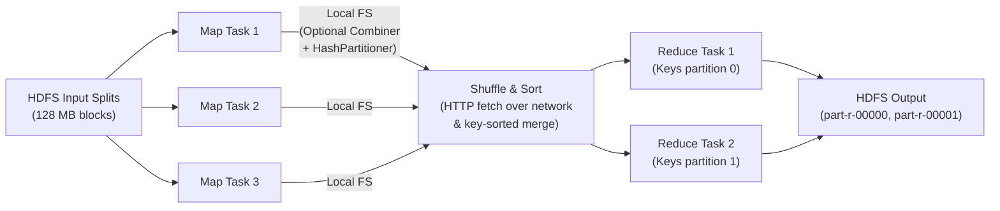
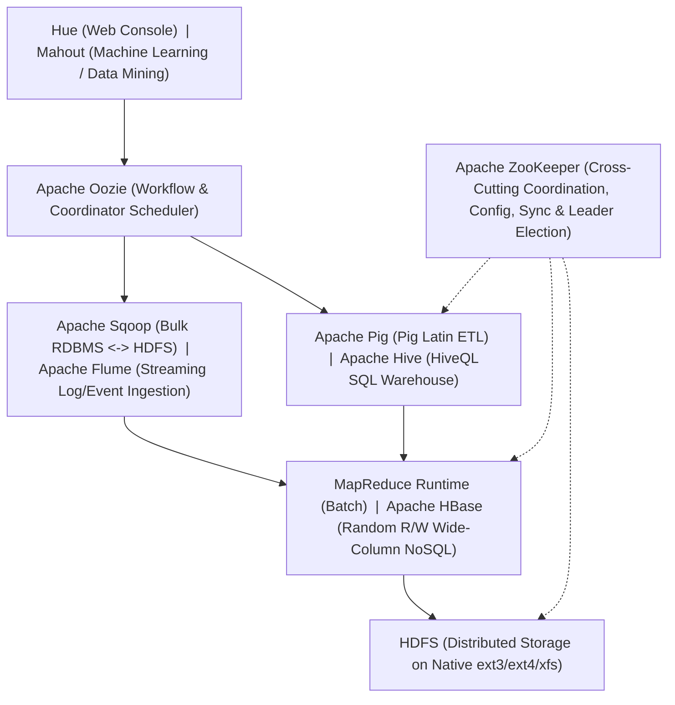
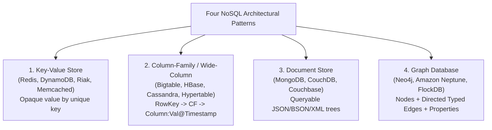
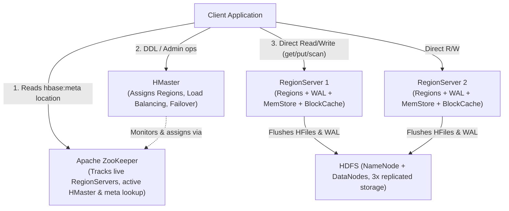
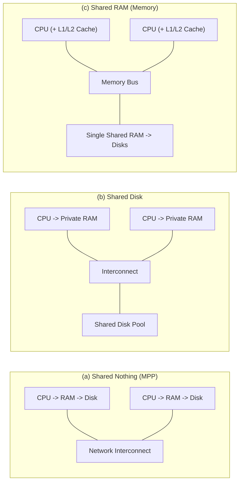

# Module 2: Hadoop HDFS, MapReduce Algorithms, and NoSQL

**Course:** Big Data and Social Media Analytics (`26CMPC71` — VESIT 2026 NEP & Autonomy Scheme, Sem VII)  
**Course Outcome:** `CO2` — *Apply MapReduce algorithms and NoSQL data architecture patterns to store and process large-scale datasets.* (`08` Theory Hours + Lab Experiments `2, 3, 4`)  
**Primary Slides & Curriculum Sources Used:**
- `module_2/Module _02 Hadoop HDFS and Mapreduce.pptx.pdf` (184 slides — compiled by Dr. Rohini Temkar)
- `module_2/Mod 2_NoSQL.pptx.pdf` (214 slides — compiled by Dr. Rohini Temkar)
- Official Syllabus: `Final year B. E. (Computer Engineering) (Sem-VII & VIII) Batch  [2023-2027] (2026 ‘NEP & Autonomy’ Scheme).pdf` (`26CMPC71` Topics `2.1`, `2.2`, `2.3`, and Lab Experiments `2, 3, 4`)

---

## Scope & Topic Checklist

| # | Topic / Subtopic | Official Syllabus Ref | Slide Coverage | Status |
|---|---|---|---|---|
| 1 | Cluster Architecture, Bottlenecks & DFS Bridge from Module 1 | Cross-ref `1.2` | `Mod 2A` pp. 3–9 | `[x]` |
| 2 | MapReduce Model, Shuffle & Sort, Master Coordination, `M`/`R` Sizing | `2.1` | `Mod 2A` pp. 10–30 | `[x]` |
| 3 | **Combiners** (Associativity/Commutativity, `(sum, count)` Average) | `2.1` *(omitted in slides)* | Added from `hadoop.apache.org` & `mmds.org` | `[x]` |
| 4 | **Coping With Node Failures** & Speculative Execution (Stragglers) | `2.1` *(omitted in slides)* | Added from Dean & Ghemawat (2004), `mmds.org` | `[x]` |
| 5 | WordCount Trace & Fixed Java Implementation (`MyMapper`, `MyReducer`, Driver, CLI) | `2.1` & Lab Exp 3 | `Mod 2A` pp. 18–23, 31–36 | `[x]` |
| 6 | Relational-Algebra Operations by MapReduce ($\sigma, \pi, \cup, \cap, -, \bowtie, \gamma$) | `2.2` | `Mod 2A` pp. 37–96 | `[x]` |
| 7 | Matrix-Vector & Two-Step Matrix Multiplication by MapReduce | `2.2` | `Mod 2A` pp. 97–134 | `[x]` |
| 8 | **One-Step Matrix Multiplication** & Hadoop Limitations | `2.2` / MU Qs *(omitted in slides)* | Listed on `Mod 2A` pp. 2, 38, 181; added from `mmds.org` | `[x]` |
| 9 | Hadoop Ecosystem Deep Dive (Flume, Sqoop, Hive, Pig, Oozie, HBase, Hue, Mahout, ZooKeeper) & Cloudera VM | `2.1`–`2.2` & Lab Exp 4 | `Mod 2A` pp. 135–184 | `[x]` |
| 10 | Database Fundamentals, ACID, NoSQL History, Scale-Up vs. Scale-Out & 4 Business Drivers | `2.3` | `Mod 2B` pp. 1–28, 42–45 | `[x]` |
| 11 | CAP Theorem, PACELC Theorem & BASE vs. ACID | `2.3` | `Mod 2B` pp. 29–41 | `[x]` |
| 12 | 4 NoSQL Patterns + Case Studies (Key-Value, Wide-Column, Document, Graph/Neo4j) | `2.3` & Lab Exp 2 | `Mod 2B` pp. 46–167 | `[x]` |
| 13 | Store Selection, `[DEWI92]` Shared Architectures, Sharding, Replication & Quizzes | `2.3` | `Mod 2B` pp. 168–214 | `[x]` |
| 14 | Lab Practicals 2, 3, 4 (`PR & OR` Viva Prep — NoSQL, MapReduce, HiveQL) | Lab Exps `2, 3, 4` | Syllabus + Cloudera VM pp. 182–184 | `[x]` |

**Assumptions & Source Notes:**
- **Zero-prior-knowledge assumption:** Set operations, matrix multiplication, Java Hadoop classes, relational algebra symbols, distributed consistency guarantees, and database JSON/Cypher queries are explained from scratch.
- **Deck numbering note:** `Mod 2_NoSQL` Slide 1 says `MODULE 2: NOSQL`, whereas Slide 2 says `Module 3- Contents` (an older `CSC702` leftover). Under your current `26CMPC71` syllabus, MapReduce, MapReduce Algorithms, and NoSQL together form **Module 2**.
- **Critical syllabus gaps filled:** `26CMPC71` Topic `2.1` explicitly requires **Combiners** and **Coping With Node Failures**, and `Mod 2A` Slides 2, 38, and 181 explicitly list **Matrix Multiplication with One MapReduce Step** and **Hadoop Limitations**, yet none of those four topics had body slides in the PDF. Full beginner-friendly coverage is provided here from primary textbook (`mmds.org`) and official Apache documentation.

---

## 1. Distributed Cluster Context & MapReduce Execution (`26CMPC71` Topic 2.1)

### 1.1 Brief Bridge from Module 1: Cluster Architecture & DFS (`Module _02` pp. 3–9)

Slides 3–9 of `Module _02` introduce the physical cluster foundation already mapped in detail inside [Module 1 Notes (Section 6)](file:///d:/Jai/Study%20Material/Sem%207/BDSMA/VIVA_NOTES/Module_1_Notes.md):
- **Two-level switch cluster (`Mod 2A` p. 3):** Commodity servers (each with its own CPU, RAM, and disk) sit inside racks (~1,000 nodes/rack in the textbook diagram; ~40–50 nodes/rack in typical Hadoop installations), connected by top-of-rack switches and higher-level aggregation switches.
- **Hardware failure is normal (`Mod 2A` p. 5):** If one commodity server stays up on average for ~3 years (`1,000 days` Mean Time To Failure [MTTF]), a 1,000-server cluster suffers **~1 server failure per day**, and a 1-million-server cluster suffers **~1,000 failures per day**.
- **Network bottleneck (`Mod 2A` p. 6):** On a `1 Gbps` (1 gigabit per second) link, copying `10 TB` of data takes roughly **1 day** ($\approx 22.2\text{ hours}$ at $10^{12}$ decimal bytes, or $\approx 24.4\text{ hours}$ at $2^{40}$ binary bytes). Moving petabytes to one compute node is impossible in practice.
- **Core solution (`Mod 2A` pp. 7–9):** Split files into **64 MB or 128 MB chunks (blocks)** replicated `2x` or `3x` across different racks in a **Distributed File System (DFS)** like **Hadoop Distributed File System (HDFS)** (metadata managed by the **NameNode**), and **bring computation directly to the chunk servers** so storage nodes also act as compute nodes.

---

### 1.2 MapReduce Programming Model (`Module _02` pp. 10–18)

#### Basic Idea & Why We Need It
Writing raw multi-machine networking code (sockets, thread locks, retries, partial failure recovery) for every analytics problem is brutally difficult (`Mod 2A` p. 6). **MapReduce** — introduced by **Jeffrey Dean and Sanjay Ghemawat (Google, 2004)** and implemented in open source by Apache Hadoop — gives programmers a tiny, clean abstraction: you write **only two functions (`Map` and `Reduce`)**, and the framework handles splitting data, scheduling across hundreds of machines, moving intermediate outputs across the network, sorting/grouping by key, and restarting crashed tasks (`Mod 2A` p. 24).

#### Everyday Analogy
Imagine a university wants to count **every vote cast across 500 polling booths** in an election:
1. **Map phase:** At each polling booth, a volunteer reads every ballot paper and writes down sticky notes: `(CandidateName, 1)`. Volunteers work completely in parallel without talking to each other.
2. **Shuffle & Sort (Group by Key):** Runners gather all sticky notes from all booths and put every `(Alice, 1)` note into Alice's basket, every `(Bob, 1)` note into Bob's basket, and arrange the baskets alphabetically by candidate name.
3. **Reduce phase:** One counter sits at each candidate's basket, adds up all the `1`s inside it, and announces the final total `(Alice, 42150)`.
*(Where the analogy stops being accurate: human volunteers don't store intermediate sticky notes on local disks with partition hashes or automatically rerun crashed booths on another table.)*

#### Formal MapReduce Signatures (`Mod 2A` p. 17)
- **Input:** A set of `<key, value>` pairs (for example, `key = byte offset or filename`, `value = one line of text`).
- **Map function (`programmer writes`):**
  $$\text{Map}(k, v) \longrightarrow \langle k', v' \rangle^*$$
  Takes one input `(k, v)` pair and emits zero, one, or many intermediate `<k', v'>` pairs (`*` means "zero or more"). There is one `Map` call per input record.
- **Group by Key / Shuffle & Sort (`framework performs automatically`):**
  Collects all intermediate pairs sharing the **exact same intermediate key `k'`** from all mappers across the cluster into a grouped list `(k', [v'1, v'2, ...])`.
- **Reduce function (`programmer writes`):**
  $$\text{Reduce}(k', \langle v' \rangle^*) \longrightarrow \langle k', v'' \rangle^*$$
  Receives one unique key `k'` and an iterator over all its associated values, combines/filters/aggregates them, and emits zero or more final output `<k', v''>` pairs. There is **one `Reduce` call per unique intermediate key `k'`**.

> [!WARNING]
> **PPT Verification Check — Does Reduce Process Values in `v'` Order? (`Module _02` Slide 17):**
> - **PPT says:** Slide 17 prints *"All values $v'$ with same key $k'$ are reduced together **and processed in $v'$ order**."*
> - **Verified clarification (Apache Hadoop MapReduce Tutorial & MMDS Ch. 2):** Standard Hadoop MapReduce sorts and groups intermediate outputs **by intermediate KEY (`k'`), NOT by value (`v'`)**! Inside `reduce(k', Iterable<v'>)`, values arrive in an **arbitrary order** determined by network fetch and merge order across mappers. If an application strictly needs values sorted inside each key group (for example, sorting sensor readings by timestamp per sensor ID), you must implement a **Secondary Sort** — putting both the natural key and sort value into a **composite key**, writing a custom `Partitioner` (routing by natural key only), a custom sort `WritableComparable` comparator (sorting by natural key + secondary value), and a custom `GroupingComparator` (grouping by natural key only).
> - **What to say in the viva:** *"Standard MapReduce automatically sorts intermediate pairs by **key**, not by value. So inside `reduce()`, values for a key arrive in arbitrary order unless we explicitly implement Secondary Sort using a composite key, custom partitioner, and grouping comparator."*

#### Two WordCount Memory Cases (`Mod 2A` pp. 10–11)
Why can't we just count words on one machine?
- **Case 1:** The text file is too huge for RAM, **but** all distinct `<word, count>` pairs fit in RAM — a single-machine hash table reading the file line by line still works.
- **Case 2 (`captures the essence of MapReduce`):** Both the file **and** the resulting `<word, count>` table (say, counting every distinct web URL, n-gram, or user ID across petabytes of logs) are too huge for one machine's memory and disk — requiring distributed MapReduce!

---

### 1.3 Worked Trace: WordCount (`Module _02` pp. 18–23)

Let us trace Slide 20's sentence:  
> `"The doctor ate an apple and an engineer ate banana and an apple."`

1. **Mapping Phase (`Mod 2A` p. 21):** Splits the line into words and emits `(word, 1)` for each token:  
   `(The, 1), (doctor, 1), (ate, 1), (an, 1), (apple, 1), (and, 1), (an, 1), (engineer, 1), (ate, 1), (banana, 1), (and, 1), (an, 1), (apple, 1)` *(13 tokens total)*.
2. **Shuffle & Sort Phase (`Mod 2A` p. 22):** Routes matching keys to the same reducer, sorts keys, and groups values into lists:
   - `An -> [1, 1, 1]`
   - `And -> [1, 1]`
   - `Apple -> [1, 1]`
   - `Ate -> [1, 1]`
   - `Banana -> [1]`
   - `Doctor -> [1]`
   - `Engineer -> [1]`
   - `The -> [1]`
3. **Reduce Phase (`Mod 2A` p. 23):** Sums each value list:  
   `(An, 3), (And, 2), (Apple, 2), (Ate, 2), (Banana, 1), (Doctor, 1), (Engineer, 1), (The, 1)` *(sum of counts = $3+2+2+2+1+1+1+1 = 13$)*.

> [!NOTE]
> **PPT Verification Check — WordCount Case-Sensitivity & Sorting (`Module _02` Slides 20–22):**
> - **PPT says:** Slide 20 uses lowercase words (`doctor, ate, an, apple, and, engineer, banana`), Slide 21 capitalizes most of them (`Doctor, Ate, An, Apple`) while keeping `"and"` and `"And"` mixed, and Slide 22 sorts `Ate` ahead of `And`.
> - **Verified clarification:** Real Hadoop `StringTokenizer` splits strictly on whitespace and is **case-sensitive** — `"and"` and `"And"` would become two separate keys, and `"apple."` (with a trailing period) would be counted separately from `"apple"` unless your mapper converts to lowercase and strips punctuation! Also, Shuffle & Sort orders keys strictly lexicographically (`And` comes before `Ate`).

---

### 1.4 Execution Details: Master Coordination, Task Sizing & Storage (`Module _02` pp. 24–30)



1. **Where Data Lives (`Mod 2A` p. 28):**
   - **Input and final output** are stored on the **Distributed File System (HDFS)** with replication for durability. The scheduler tries to launch each Map task **on (or rack-close to) the node holding its input chunk** (data locality).
   - **Intermediate Map outputs** are written to the **local filesystem** of the Map worker (NOT HDFS!). Why? Because intermediate data is temporary and thrown away once the job ends — replicating temporary shuffle files 3x over HDFS would triple network and disk overhead needlessly.
2. **Master Coordination (`Mod 2A` p. 29):**
   - The Master (or YARN `ApplicationMaster`) tracks every Map and Reduce task's status: **`idle`**, **`in-progress`**, or **`completed`**.
   - As worker nodes finish work, the Master assigns idle tasks.
   - When a Map task finishes, it writes **$R$ intermediate partition files** on its local disk (one file per Reduce task, assigned by `Partitioner`, default `HashPartitioner`: `hash(key) % R`) and sends their **locations and sizes** to the Master.
   - The Master pushes these file locations to the Reduce tasks, which pull their respective partitions over HTTP, merge-sort them by key, and run `reduce()`.
   - The Master **periodically pings workers** (heartbeats) to detect crashes.
3. **Choosing $M$ (Map Tasks) and $R$ (Reduce Tasks) (`Mod 2A` p. 30):**
   - **Rule of thumb for $M$:** Make **$M$ much larger than the number of cluster nodes** — typically **1 Map task per DFS chunk (64 MB or 128 MB)**. For example, `50 GB` on `128 MB` blocks $\approx 400$ Map tasks (`Mod 2A` p. 25). Why? Smaller chunks improve **dynamic load balancing** (fast nodes grab more tasks) and **speed up recovery** if a worker fails (another node only reruns one 128 MB chunk!).
   - **Rule of thumb for $R$:** Usually **$R$ is smaller than $M$** (`R < M`), because final output is spread across **$R$ separate output files** (`part-r-00000` to `part-r-(R-1)`). Too many reducers create thousands of tiny output files that bloat NameNode memory.

---

### 1.5 Combiners (`26CMPC71` Topic 2.1 — Missing in Slides, Essential for Viva)

#### Basic Idea & Why We Need It
In WordCount, a single 128 MB chunk might contain the word `"the"` **500,000 times**. Without a Combiner, the mapper writes `("the", 1)` 500,000 times to disk and ships all 500,000 tiny pairs across the cluster network during Shuffle! A **Combiner** acts as a **mini-reducer running locally on the Mapper's output** before network transfer, collapsing those 500,000 local pairs into **one single pair `("the", 500000)`**.

#### How It Works & Crucial Correctness Condition
- **Pipeline position:** `Mapper -> [Combiner (Optional)] -> Partitioner -> Disk -> Network Shuffle -> Sort/Group -> Reducer`.
- **Execution guarantee:** Hadoop makes **no guarantee** on how many times a Combiner runs — depending on memory buffer spills, Hadoop may invoke it **0 times, 1 time, or multiple times**!
- **Mathematical rule:** Therefore, a Combiner is valid **ONLY if**:
  1. Its input and output `<key, value>` types match the Mapper's intermediate output type (`<k', v'> -> <k', v'>`), **AND**
  2. The aggregation operation is both **Associative** (`(a ⊕ b) ⊕ c = a ⊕ (b ⊕ c)`) and **Commutative** (`a ⊕ b = b ⊕ a`).

#### Worked Example: Why SUM Works with a Combiner, but Naive AVERAGE Fails!
- **Works (`SUM`, `COUNT`, `MAX`, `MIN`):** $(1 + 1) + 1 = 1 + (1 + 1) = 3$. In `WordCount`, `job.setCombinerClass(MyReducer.class)` works directly because adding partial sums gives the exact same total!
- **Fails (`Naive AVERAGE`):** Suppose Mapper 1 sees `[10, 20]` (local average = `15`) and Mapper 2 sees `[30, 40, 50, 60]` (local average = `45`). If the Reducer averages those two partial averages, it gets $(15 + 45)/2 = \mathbf{30}$ — **WRONG!** The true average of `[10, 20, 30, 40, 50, 60]` is $210 / 6 = \mathbf{35}$! Averaging is **not associative** when group sizes differ.
- **How to fix Average so a Combiner CAN be used:** Emit composite pairs **`(sum, count)`** instead of a scalar average!
  - Mapper emits `(key, (val, 1))`.
  - Combiner sums both components locally: Mapper 1 emits `(key, (30, 2))`, Mapper 2 emits `(key, (180, 4))`.
  - Reducer sums partial sums and counts: `(30 + 180, 2 + 4) = (210, 6)`, and divides once at the end: $210 / 6 = \mathbf{35}$!

---

### 1.6 Coping With Node Failures & Speculative Execution (`26CMPC71` Topic 2.1 — Missing in Slides)

Because MapReduce runs across thousands of cheap servers, **failures during a job are expected** (`Mod 2A` p. 5). Here is how Dean & Ghemawat (2004), *MMDS* (Section 2.2.6), and Apache Hadoop handle every failure mode:

| Failure / Slowdown Type | What Happens & Why | Exact Recovery Action |
|---|---|---|
| **1. Map Worker Fails** | The Master detects missed heartbeats (`ping` timeout). | **ALL map tasks assigned to that worker — BOTH `in-progress` AND already `completed`!** — are reset to `idle` and rescheduled on healthy nodes. *Why rerun completed maps?* Because their intermediate outputs sat on that failed node's **local disk**, which is now unreachable! Master notifies Reducers of the new Map locations. |
| **2. Reduce Worker Fails** | Master detects missed heartbeats from a Reduce worker. | **ONLY `in-progress` reduce tasks** are reset to `idle` and rescheduled. Already **`completed` reduce tasks do NOT rerun**, because their final output files were written safely to replicated **DFS (HDFS)**! |
| **3. Master Fails** | Single node holding global task states dies (`JobTracker` in Hadoop 1.x / `ApplicationMaster` in YARN). | Originally (Dean & Ghemawat 2004 / Hadoop 1.x), the entire job **aborts** and the client must resubmit (though periodic Master checkpoints can resume state). In **Hadoop YARN**, the `ResourceManager`'s `ApplicationsManager` detects `ApplicationMaster` failure and automatically **restarts the AM** in a new container (recovering completed task state if enabled). |
| **4. Stragglers (Slow Nodes)** | A task runs abnormally slowly near job completion due to a dying disk, CPU throttling, or bad RAM — delaying the entire job. | **Speculative Execution (Backup Tasks):** When a job is close to finishing, the Master launches a **duplicate backup copy** of the slow in-progress task on another idle node. **Whichever copy finishes first wins**, commits its output, and the duplicate is immediately killed! *(Note: only safe when tasks are side-effect-free / idempotent.)* |

---

### 1.7 Fixed Java WordCount Program & CLI Execution (`Module _02` pp. 31–36)

A Hadoop MapReduce Java program has three parts (`Mod 2A` p. 31): **Mapper**, **Reducer**, and **Driver**.

> [!WARNING]
> **PPT Verification Check — Syntax & Deprecation Bugs in Slides 32–35:**
> The code screenshots on Slides 32–35 contain several compile errors if typed verbatim into an IDE or lab terminal:
> 1. **Slide 32 (`MyMapper`):** Missing `import java.util.StringTokenizer;`; stray extra `)` after `InterruptedException)`; `private final static IntWritable one` and `private Text word` are placed *inside* `map()` (illegal Java — `private`/`static` modifiers are invalid on method-local variables!); and the class is missing one closing `}`.
> 2. **Slide 33 (`MyReducer`):** Missing imports (`IOException`, `IntWritable`, `Text`, `Reducer`) and has a stray dangling `int` at the end of `System.out.println("Word= "+word.toString());   int`.
> 3. **Slides 34–35 (`WordCount` Driver):** Slide 34 closes `main()` and `class WordCount` prematurely *before* Slide 35's `Job` setup code; and `Job job = new Job();` is **deprecated** in Hadoop 2.x/3.x (use `Job.getInstance(conf, "Word Count")`).

Here is the **clean, corrected, ready-to-compile** version preserving the professor's exact class and variable names (`WordCount`, `MyMapper`, `MyReducer`):

```java
// File: WordCount.java (all three components cleanly organized in one file, or separate .java files)
import java.io.IOException;
import java.util.StringTokenizer;
import org.apache.hadoop.conf.Configuration;
import org.apache.hadoop.fs.Path;
import org.apache.hadoop.io.IntWritable;
import org.apache.hadoop.io.LongWritable;
import org.apache.hadoop.io.Text;
import org.apache.hadoop.mapreduce.Job;
import org.apache.hadoop.mapreduce.Mapper;
import org.apache.hadoop.mapreduce.Reducer;
import org.apache.hadoop.mapreduce.lib.input.FileInputFormat;
import org.apache.hadoop.mapreduce.lib.output.FileOutputFormat;

public class WordCount {

    // 1. MAPPER: InputKey=LongWritable (byte offset), InputVal=Text (line) -> Output=<Text, IntWritable>
    public static class MyMapper extends Mapper<LongWritable, Text, Text, IntWritable> {
        private static final IntWritable one = new IntWritable(1);
        private final Text word = new Text();

        @Override
        public void map(LongWritable key, Text value, Context context)
                throws IOException, InterruptedException {
            String line = value.toString();
            StringTokenizer tokenizer = new StringTokenizer(line);
            while (tokenizer.hasMoreTokens()) {
                word.set(tokenizer.nextToken());
                context.write(word, one);
            }
        }
    }

    // 2. REDUCER (also works as Combiner!): Input=<Text, Iterable<IntWritable>> -> Output=<Text, IntWritable>
    public static class MyReducer extends Reducer<Text, IntWritable, Text, IntWritable> {
        @Override
        protected void reduce(Text word, Iterable<IntWritable> it, Context context)
                throws IOException, InterruptedException {
            int count = 0;
            for (IntWritable i : it) {
                count = count + i.get();
            }
            context.write(word, new IntWritable(count));
        }
    }

    // 3. DRIVER: Configures and submits the MapReduce job
    public static void main(String[] args) throws Exception {
        if (args.length != 2) {
            System.out.printf("Usage: WordCount <input dir> <output dir>\n");
            System.exit(-1);
        }

        Configuration conf = new Configuration();
        Job job = Job.getInstance(conf, "Word Count"); // Replaces deprecated new Job()
        job.setJarByClass(WordCount.class);

        FileInputFormat.setInputPaths(job, new Path(args[0]));
        FileOutputFormat.setOutputPath(job, new Path(args[1]));

        job.setMapperClass(MyMapper.class);
        job.setCombinerClass(MyReducer.class); // Optional optimization (safe for SUM)
        job.setReducerClass(MyReducer.class);

        job.setMapOutputKeyClass(Text.class);
        job.setMapOutputValueClass(IntWritable.class);
        job.setOutputKeyClass(Text.class);
        job.setOutputValueClass(IntWritable.class);

        boolean success = job.waitForCompletion(true);
        System.exit(success ? 0 : 1);
    }
}
```

#### Compiling & Running on Hadoop CLI (`Mod 2A` p. 36)
```bash
javac -cp $(hadoop classpath) WordCount.java
jar -cvf wc.jar WordCount*.class
hadoop jar wc.jar WordCount /user/bda/file1.txt /user/bda/out1
hdfs dfs -cat /user/bda/out1/part-r-00000
```
*(Lab exam reminder: the output HDFS directory `/user/bda/out1` **must not already exist** before running `hadoop jar`, or Hadoop aborts with `FileAlreadyExistsException` to protect existing outputs!)*

#### Why Hadoop Types (`Text`, `IntWritable`, `LongWritable`) Instead of Java `String`/`int`?
Hadoop ships key-value pairs over networks and spills them to disks; Java's built-in serialization is bulky. Hadoop's `Writable` interface provides compact binary serialization, and `WritableComparable` (used by Keys like `Text` and `LongWritable`) also lets Hadoop compare and sort keys cleanly during Shuffle & Sort.

---

### 1.8 Viva Preparation — MapReduce Execution, Combiners & Fault Tolerance

- **Quick definition:** **MapReduce** is a distributed batch-processing model that divides computation into parallel **Map** tasks (`<k,v> -> <k',v'>*`), an automatic **Shuffle & Sort** phase that groups values by key, and parallel **Reduce** tasks (`<k', [v']> -> <k',v''>*`), achieving fault tolerance through task re-execution and speculative backup tasks.
- **Explain it to the examiner (30–60 seconds):** *"MapReduce works in three main stages. First, **Map tasks** run directly on the worker nodes holding the HDFS input chunks and emit intermediate key-value pairs. Next, the framework performs **Shuffle and Sort**: an optional **Combiner** runs locally on the mapper to aggregate values like partial sums, the **Partitioner** sends matching keys to the same reducer via hashing, and pairs are sorted by key. Finally, **Reduce tasks** receive each unique key with its list of values and write final results back to HDFS. To handle failures, if a Map worker crashes, even completed map tasks on it must rerun because intermediate files lived on its local disk; if a Reduce worker crashes, only in-progress tasks rerun because completed outputs are already replicated in HDFS."*
- **Practical example:** Counting hashtag frequencies across 1 TB of tweets: Map emits `(#IPL, 1)`, Combiner sums locally per machine to `(#IPL, 4500)` to cut network traffic, and Reduce sums across all machines for the final count.
- **Examiner follow-ups:**
  1. *Q: Why are intermediate Map outputs stored on the local filesystem instead of HDFS, and what failure consequence does that cause?*  
     **A:** Intermediate files are temporary and deleted once the job ends, so 3x HDFS replication would waste disk and network bandwidth. The trade-off is that if a Map worker crashes, *even already completed map tasks on it* must be re-executed because their local files are lost.
  2. *Q: When can a Combiner NOT be used directly as the Reducer?*  
     **A:** Whenever the operation is not associative and commutative, or changes types — for instance, computing an **Average** or **Median** directly. To use a Combiner for Average, emit `(sum, count)` tuples instead of raw averages.
  3. *Q: What is Speculative Execution (Backup Tasks)?*  
     **A:** When a slow node ("straggler") delays job completion near the end, the Master launches a duplicate copy of that task on another idle node and takes whichever finishes first.
  4. *Q: Does MapReduce sort values as well as keys by default?*  
     **A:** No — it only sorts by **intermediate key**. Sorting values requires **Secondary Sort** (composite key + custom partitioner + grouping comparator).
- **Common mistakes to avoid:** Saying Reduce can run before all Map tasks finish (reducers can start *copying/shuffling* outputs as soon as early mappers finish, **but `reduce()` cannot begin** until all mappers complete because any mapper could still emit keys belonging to that reducer!); saying a Combiner is guaranteed to execute exactly once; writing `new Job()` instead of `Job.getInstance()` in modern Hadoop.

---

## 2. Relational-Algebra Operations by MapReduce (`Module _02` pp. 37–96; `26CMPC71` 2.2)

### 2.1 Beginner's Primer: What Is Relational Algebra?
Before running SQL-like queries on petabyte-scale tables in MapReduce, computer scientists break queries down into **7 fundamental Relational-Algebra operations** on relations (tables):
1. **Selection** ($\sigma_C(R)$): Keep only rows matching a condition (`WHERE`).
2. **Projection** ($\pi_S(R)$): Keep only specific columns (`SELECT col1, col2`).
3. **Union** ($R \cup S$): Combine rows from two tables vertically, removing duplicates (`UNION`).
4. **Intersection** ($R \cap S$): Keep only rows present in **both** tables (`INTERSECT`).
5. **Difference** ($R - S$): Keep rows in $R$ that are **not** in $S$ (`EXCEPT / MINUS`).
6. **Natural Join** ($R \bowtie S$): Merge matching rows across two tables (`JOIN`).
7. **Grouping & Aggregation** ($\gamma_X(R)$): Group rows by column(s) and calculate `SUM/COUNT/AVG/MIN/MAX` (`GROUP BY`).

*(Important textbook assumption from MMDS Ch. 2: Relational algebra treats relations as **sets**, meaning duplicate rows are eliminated unless noted otherwise!)*

---

### 2.2 Selection $\sigma_C(R)$ (`Module _02` pp. 39–48)

- **What it does:** Filters relation $R$ and outputs only tuples $t$ that satisfy condition $C$ (like SQL `SELECT * FROM R WHERE C`).
- **MapReduce algorithm (`Mod 2A` pp. 45, 48):**
  - **`Map(key, value)`:** For each tuple $t$ in `value`, check if $t$ satisfies $C$. If yes, `emit(t, t)`.
  - **`Reduce(key, values)`:** Simply passes each key-value pair to output: `emit(key, key)` (collapsing duplicate identical tuples into one).
- **Worked example (`Mod 2A` pp. 40–43):** Input tuples across 2 Map Workers with condition $B \le 2$:  
  MW1 holds `(1,2), (3,1)` and `(1,2), (3,5)`; MW2 holds `(2,3), (4,5)` and `(1,1), (2,1)`.  
  Mappers drop `(3,5), (2,3), (4,5)` and emit `(1,2)` twice, `(3,1)`, `(1,1)`, `(2,1)`. Reducers deduplicate `(1,2)` and output the 4 surviving rows `(1,2), (1,1), (3,1), (2,1)`.
- **Performance tip:** If input relation $R$ already contains no duplicates (e.g., primary key exists), Selection is embarrassingly parallel and needs **zero reducers** (`Map`-only job, `job.setNumReduceTasks(0)`).

> [!NOTE]
> **PPT Verification Check — Selection Symbol Typo (`Module _02` Slide 44):**
> - **PPT says:** Slide 44 introduces selection as **sigma $\sigma_C(R)$**, then writes **`Result = Delta` $\delta_{\text{Grade} > 5}(\text{Students})$** at the bottom.
> - **Verified clarification:** $\sigma$ (sigma) is the standard symbol for **Selection**; $\delta$ (delta) is used in relational algebra for duplicate elimination in bags. Treat Slide 44's $\delta$ as a typo for $\sigma_{\text{Grade} > 5}(\text{Students})$.

---

### 2.3 Projection $\pi_S(R)$ (`Module _02` pp. 49–60)

- **What it does:** Extracts only a subset $S$ of columns from each tuple in $R$, **and removes duplicate rows** resulting from dropping columns (like SQL `SELECT DISTINCT S FROM R`).
- **MapReduce algorithm (`Mod 2A` pp. 50, 56):**
  - **`Map(key, value)`:** For each tuple $t$ in $R$, strip out columns not in $S$ to form projected tuple $t'$, and `emit(t', t')`.
  - **`Reduce(key, values)`:** For each unique key $t'$, receives `(t', [t', t', ..., t'])` and emits **one** `(t', t')` — **Reduce performs duplicate elimination!**
- **Worked example (`Mod 2A` pp. 57–60):** Projecting `(A, B)` from 12 rows of `(A, B, C)` across MW1 and MW2:
  - `(1, 2)` appeared with `C = 3, 1, 5` (3 times), `(6, 8)` with `C = 4, 9` (twice), and `(3, 2)` with `C = 2, 1` (twice).
  - Reducers collapse duplicates into **8 unique `(A, B)` rows**: RW1 outputs `(1,2), (2,2), (4,2), (2,3), (1,3)`; RW2 outputs `(6,8), (3,2), (3,4)`.

> [!NOTE]
> **PPT Verification Check — Slide 50 Cutoff & Slide 59 Typo (`Module _02` pp. 50, 59):**
> - **Slide 50** screenshot cuts off line 3 at `ts = tuple with only the components for the at` — complete line: `...for the attributes in S`.
> - **Slide 59** Reduce Worker 2 table shows key **`(6, 8)`** with value `[(6, 8), (1, 8)]` — `(1, 8)` is a typo for `(6, 8)` (Slide 58 had `(6, 8)` in both MW1 and MW2, and Slide 60 outputs `(6, 8)` cleanly).

---

### 2.4 Union $R \cup S$ (`Module _02` pp. 61–67)

- **What it does:** Vertically combines two relations $R$ and $S$ that share the **same schema** (columns) and removes duplicate tuples (`Mod 2A` p. 61: `(Smith, 16)` appears in both tables, so it appears once in the output; `(Tom, 17)` and `(Tom, 19)` are different and both stay).
- **MapReduce algorithm (`Mod 2A` pp. 62–63):**
  - **`Map`:** Same as Selection (without condition) — turn every tuple $t$ from $R$ or $S$ into `(t, t)`.
  - **`Reduce`:** Associated with key $t$ will be either `[t]` (in one table) or `[t, t]` (in both tables); emit `(t, t)` in either case!
- **Worked example (`Mod 2A` pp. 64–67):** Notice how Slide 64 remarks: *"This operation has the map function of selection and reduce function of projection"* (identity map + duplicate-eliminating reduce!). Out of 12 total rows across `Table 1` and `Table 2`, `(2,3)` and `(6,1)` occur twice, leaving **10 unique tuples** across RW1 and RW2.

---

### 2.5 Intersection $R \cap S$ (`Module _02` pp. 68–71)

- **What it does:** Returns only tuples that appear in **both** $R$ and $S$ (assuming same schema).
- **MapReduce algorithm (`Mod 2A` pp. 69, 71):**
  - **`Map`:** For each tuple $t \in R \cup S$, emit `(t, t)`.
  - **`Reduce`:** If key $t$ has value list **`[t, t]`** (length 2), emit `(t, t)`. Otherwise, **produce nothing**.

> [!WARNING]
> **PPT Verification Check — Two Critical Issues in Intersection (`Module _02` Slides 69–71):**
> 1. **Slide 70 vs. Slides 69 & 71 conflict:** Slide 70 writes *"Otherwise, emit a key/value pair `(t, NULL)`"*, whereas Slides 69 and 71 state *"Otherwise, produce nothing"*. In true set intersection, non-matching tuples must **not** be emitted (`produce nothing`) — emitting `(t, NULL)` leaves non-intersecting keys inside the output!
> 2. **Set vs. Bag (Duplicate) Limitation:** Counting length `== 2` (`[t, t]`) ONLY works if $R$ and $S$ are strict sets (no duplicates inside $R$ alone or $S$ alone). If $R$ had `(Tom, 17)` twice and $S$ didn't have it at all, `[t, t]` would falsely include `(Tom, 17)`! **Safer production fix:** tag the relation name in the Map output (`(t, "R")` and `(t, "S")`, just like Difference), and emit `(t, t)` in Reduce **iff both `"R"` and `"S"` appear in `values`**.

---

### 2.6 Difference $R - S$ (`Module _02` pp. 72–78)

- **What it does:** Keeps tuples present in the first table $R$ that do **NOT** appear in the second table $S$ (order matters: $R - S \neq S - R$).
- **Why tagging is mandatory:** Unlike Union and Intersection, Difference is **asymmetric** — the Reducer must know *which* table each tuple came from!
- **MapReduce algorithm (`Mod 2A` pp. 73, 78):**
  - **`Map(key, value)`:** If tuple $t$ comes from $R$, emit **`(t, 'R')`**. If tuple $t$ comes from $S$, emit **`(t, 'S')`**.
  - **`Reduce(key, values)`:** Emit `(t, t)` **only if** the value list is **`['R']`** (strictly from $R$ and absent from $S$; for bags with intra-$R$ duplicates, check `'R' in values and 'S' not in values`).
- **Worked trace (`Mod 2A` pp. 74–77):** Using `Table 1 (T1)` and `Table 2 (T2)` from Union:
  - `(1,2), (5,6), (6,3), (7,6)` have `[T1]` $\implies$ **Emitted in output (`T1 - T2`)**.
  - `(2,3), (6,1)` have `[T1, T2]` $\implies$ Dropped (present in `T2`).
  - `(4,4), (9,8), (3,3), (0,1)` have `[T2]` $\implies$ Dropped (only in `T2`).

---

### 2.7 Natural Join $R \bowtie S$ (`Module _02` pp. 79–87)

- **What it does:** Combines pairs of tuples $(t_R, t_S)$ from $R(A, B)$ and $S(B, C)$ whenever they share the **same value $b$ on their common join attribute $B$**, producing $(a, b, c)$.
- **MapReduce algorithm (`Mod 2A` pp. 81–82):**
  - **`Map`:**
    - For each tuple `(a, b)` in $R$: emit **`(b, ('R', a))`** *(join key is `b`, value is tagged with table `'R'` and payload `a`)*.
    - For each tuple `(b, c)` in $S$: emit **`(b, ('S', c))`** *(join key is `b`, value is tagged with table `'S'` and payload `c`)*.
  - **`Reduce`:** For each join key `b`, separate incoming values into all `('R', a)` tuples and all `('S', c)` tuples, compute their **Cartesian product**, and output `(a, b, c)` for every pair `('R', a)` and `('S', c)`! *(Notice: if key `b` only has tuples from `R` or only from `S`, such as `(y, n)` and `(r, 7)` on Slide 81, the cross-product is empty and nothing is emitted — an inner natural join!)*
- **Worked Trace (`Mod 2A` pp. 83–87 — `Employee` & `Assigned Departments`):**
  - `Employee` (`Sue, 999999999`, `Tony, 777777777`) and `Department` (`999999999, Accounts`, `777777777, Sales`, `777777777, Marketing`) are tagged with their table names and fed to Map.
  - Map extracts the SSN as key: e.g., `key=777777777, value=(Employee, Tony, 777777777)` and `key=777777777, value=(Department, 777777777, Sales)`.
  - Reduce groups by `777777777` and crosses `Tony` with both `Sales` and `Marketing`, outputting 2 joined rows!

> [!NOTE]
> **PPT Clarification — Natural Join vs. Equijoin (`Module _02` Slides 83–87):**
> Slide 83 labels `"Emplyee ⋈ Assigned Departments"` (note `"Emplyee"` typo) where the columns are `SSN` and `EmpSSN` and the output retains **both** `SSN` and `EmpSSN` columns (`Sue, 999999999, 999999999, Accounts`). Technically in relational algebra, joining on columns with different names (`Employee.SSN = Dept.EmpSSN`) and keeping both columns is an **Equijoin**, whereas a strict **Natural Join** matches identically named attributes and keeps the shared attribute once (`(a, b, c)` as on Slides 81–82). Know both so you can explain it smoothly in the viva!

---

### 2.8 Grouping and Aggregation $\gamma_X(R)$ (`Module _02` pp. 88–96)

- **What it does:** Partitions rows of $R$ into groups sharing the same values in grouping columns $G$ (`SQL GROUP BY`), then applies an aggregate function $\theta \in \{\text{SUM, COUNT, AVG, MIN, MAX}\}$ to another column (`Mod 2A` pp. 88–89 — note Slide 88 cuts off after `"such as SUM,"`).
- **MapReduce algorithm (`Mod 2A` pp. 90–92):**
  - **`Map`:** Grouping comes **for free** from MapReduce's Shuffle & Sort! Emit **`(grouping_attributes, aggregated_attribute)`** and discard unneeded columns. (For example, on `R(A, B, C, D)` computing `GROUP BY (A, B)` with `SUM(C)`, emit `((A, B), C)` and discard `D`!).
  - **`Reduce`:** Receives `(key, [v1, v2, ..., vn])` and applies $\theta$ (`sum`, `count`, `min`, `max`, `avg`) to output `(key, result)`.
- **Worked trace (`Mod 2A` pp. 93–96):**
  - Across MW1 and MW2, group `(1, 2)` gets values `[3, 1]` from MW1 and `[5]` from MW2 $\to$ RW1 sums `[3, 1, 5] = 9`.
  - Group `(2, 3)` gets `[2, 9]` from MW2 $\to$ RW1 sums `2 + 9 = 11` *(note Slide 95 RW1 visually misprints `[(2, 9)]` instead of `[2, 9]`, while Slide 96 outputs the correct sum `11`)*.

---

### 2.9 Master Summary Table of MapReduce Relational Operations

| Operation | Symbol | `Map` Emits `(k', v')` | `Reduce` Action | Needs Table Tag? |
|---|---|---|---|---|
| **Selection** | $\sigma_C(R)$ | `(t, t)` if $t$ satisfies $C$ | `emit(t, t)` (dedup) | No (can be Map-only if unique) |
| **Projection** | $\pi_S(R)$ | `(t', t')` keeping cols in $S$ | `emit(t', t')` (dedup) | No |
| **Union** | $R \cup S$ | `(t, t)` for $t \in R \cup S$ | `emit(t, t)` (dedup) | No |
| **Intersection** | $R \cap S$ | `(t, t)` (or `(t, 'R')`/`(t, 'S')` safely) | Emit `(t, t)` iff `[t, t]` (or both `'R'` & `'S'`) | Recommended for bags |
| **Difference** | $R - S$ | `(t, 'R')` or `(t, 'S')` | Emit `(t, t)` iff values has `'R'` and no `'S'` | **Yes** |
| **Natural Join** | $R(A,B)\bowtie S(B,C)$ | `(b, ('R', a))` and `(b, ('S', c))` | Cross-product of `'R'` and `'S'` values $\to (a,b,c)$ | **Yes** |
| **Group & Agg** | $\gamma_{G, \theta(C)}(R)$ | `(g, c)` | Apply $\theta$ (`SUM/MAX/MIN/COUNT/AVG`) to `[c1, c2, ...]` | No |

*(Viva prep for Relational-Algebra Operations is combined at the end of Section 3.5 below alongside Matrix Multiplication!)*

---

## 3. Matrix-Vector & Matrix-Matrix Multiplication by MapReduce (`Module _02` pp. 97–134, 181; `26CMPC71` 2.2)

### 3.1 Why Sparse Coordinate Format? (`Module _02` pp. 104–108)
Real-world Big Data matrices — like web link graphs (`10 billion x 10 billion` pages) or user-movie ratings (`millions x thousands`) — are **mostly zeros (sparse)**. Storing all zeros would waste petabytes! So MapReduce stores only **non-zero entries** as text lines:
- **Input format:** `<MatrixName>, <row_i>, <col_j>, <value>` — e.g., `A,0,1,1.0` (`Mod 2A` pp. 104–107).
- **Output format:** `<row_i>, <col_k>, <value>` — e.g., `0,0,90.0` (`Mod 2A` p. 108).

---

### 3.2 Matrix-Vector Multiplication (`Module _02` pp. 97–114)

#### Mathematical Formula (`Mod 2A` pp. 97–98)
Given an $m \times n$ matrix $A = [a_{ij}]$ and a vector $\mathbf{v} = [v_j]$ of length $n$, the product $\mathbf{x} = A\mathbf{v}$ is a vector of length $m$ whose $i$-th element is:
$$x_i = \sum_{j=1}^{n} a_{ij} \cdot v_j$$

- **What it achieves:** Computes the dot product of each row $i$ of $A$ with vector $\mathbf{v}$ in parallel.
- **MapReduce Algorithm (when $\mathbf{v}$ fits in RAM on each worker, `Mod 2A` p. 109):**
  - **`Map(key, value)`:** Read $\mathbf{v}$ into memory at mapper startup. For each matrix entry $(i, j, a_{ij})$, emit **`(i, a_ij * v[j])`**.
  - **`Reduce(key, values)`:** For row key `i`, sum all partial products: `result = sum(values)`, and emit **`(i, result)`**.
- **Worked $3\times 2$ Example (`Mod 2A` pp. 101–103, 110–114):**
  $$A = \begin{bmatrix} 1 & 3 \\ 4 & 0 \\ 2 & 1 \end{bmatrix}, \quad \mathbf{v} = \begin{bmatrix} 1 \\ 5 \end{bmatrix}$$
  - **Map emits `(i, a[i][j] * v[j])`:**
    - Row 1: `(1, 1*1) = (1, 1)` and `(1, 3*5) = (1, 15)`
    - Row 2: `(2, 4*1) = (2, 4)` and `(2, 0*5) = (2, 0)`
    - Row 3: `(3, 2*1) = (3, 2)` and `(3, 1*5) = (3, 5)`
  - **Reduce sums per key `i`:**
    - `i = 1`: $1 + 15 = \mathbf{16}$
    - `i = 2`: $4 + 0 = \mathbf{4}$
    - `i = 3`: $2 + 5 = \mathbf{7}$
    - Final vector: $\mathbf{[16, 4, 7]^T}$.

**Prerequisite Assumption & Fix (`MMDS` Ch. 2.3.1):** What if vector $\mathbf{v}$ is *too large* to fit in a single Map worker's RAM (e.g., PageRank vector for 10 billion web pages)? Divide matrix $A$ into **vertical stripes** of $k$ columns and $\mathbf{v}$ into matching **horizontal stripes** of length $k$ so each stripe of $\mathbf{v}$ fits in RAM, then emit `(i, a_ij * v_j)` and sum in Reduce!

---

### 3.3 Two-Step Matrix-Matrix Multiplication (`Module _02` pp. 115–134)

#### Mathematical Formula (`Mod 2A` pp. 99–100, 116)
Given matrix $M$ of size $m \times n$ (entries $m_{ij}$) and matrix $N$ of size $n \times p$ (entries $n_{jk}$), their product $P = MN$ has size $m \times p$ where:
$$p_{ik} = \sum_{j=1}^{n} m_{ij} \cdot n_{jk}$$
*(Constraint: columns of $M$ MUST equal rows of $N$, both equal to $n$, so the sum over inner index $j$ is valid!)*

#### Intuition (`Mod 2A` pp. 120–121)
Matrix multiplication $P = MN$ is literally **two relational operations back-to-back**:
1. **Job 1 (Natural Join on inner index $J$ + Multiply):** Pair every $m_{ij}$ with every $n_{jk}$ that shares the same $j$, and multiply $m_{ij} \times n_{jk}$.
2. **Job 2 (Group by `(i, k)` + Sum):** Group all products targeting the same output cell `(i, k)` and sum them!

#### Algorithm Steps (`Mod 2A` pp. 122, 124, 131, 133)
- **Step 1 (Join on `j` and Multiply):**
  - **`Map1`:** For $m_{ij}$, emit **`(j, ('M', i, m_ij))`**. For $n_{jk}$, emit **`(j, ('N', k, n_jk))`**.
  - **`Reduce1`:** For each `j`, cross every `('M', i, m_ij)` with every `('N', k, n_jk)` and emit **`((i, k), m_ij * n_jk)`**.
- **Step 2 (Group on `(i, k)` and Sum):**
  - **`Map2`:** Identity function — passes **`((i, k), product)`** straight through!
  - **`Reduce2`:** Sums all `product` values sharing key `(i, k)` and emits **`((i, k), p_ik)`**.

#### Worked $2\times 3 \times 3\times 2$ Example & Slide Typo Correction (`Mod 2A` pp. 117–134)
$$M = \begin{bmatrix} 1 & 2 & 3 \\ 4 & 5 & 6 \end{bmatrix}_{2\times 3}, \quad N = \begin{bmatrix} 1 & 3 \\ 2 & 2 \\ 1 & 1 \end{bmatrix}_{3\times 2}$$

1. **`Map1` outputs (grouped by inner key `j = 1, 2, 3`, `Mod 2A` p. 123):**
   - `j = 1`: `(M, 1, 1), (M, 2, 4)` and `(N, 1, 1), (N, 2, 3)`
   - `j = 2`: `(M, 1, 2), (M, 2, 5)` and `(N, 1, 2), (N, 2, 2)`
   - `j = 3`: `(M, 1, 3), (M, 2, 6)` and `(N, 1, 1), (N, 2, 1)`
2. **`Reduce1` / `Map2` products `((i, k), m_ij * n_jk)` (`Mod 2A` pp. 125–132):**
   - From `j = 1`: `(1,1)->1*1=1`, `(1,2)->1*3=3`, `(2,1)->4*1=4`, `(2,2)->4*3=12`
   - From `j = 2`: `(1,1)->2*2=4`, `(1,2)->2*2=4`, `(2,1)->5*2=10`, `(2,2)->5*2=10`
   - From `j = 3`: `(1,1)->3*1=3`, `(1,2)->3*1=3`, `(2,1)->6*1=6`, **`(2,2)->6*1=6`**

> [!WARNING]
> **PPT Verification Check — Arithmetic Typo on Slides 129 & 132 (`Module _02` pp. 129, 132):**
> - **PPT says:** In the `J=3` table on Slide 129 and Slide 132, entry **`(2, 2)`** prints $M_{ij} \times N_{jk} = \mathbf{10}$.
> - **Verified clarification:** Looking at `j=3`, $m_{23} = 6$ (`(3, (M, 2, 6))`) and $n_{32} = 1$ (`(3, (N, 2, 1))`), so the exact product is $6 \times 1 = \mathbf{6}$ (just as written on the handwritten notebook photo on Slide 118/130: `12 + 10 + 6 = 28`!). Using `10` would give $12 + 10 + 10 = 32$, contradicting Slide 134's correct final output **`28`**.
> - **What to say in the viva:** Walk through $m_{23} \times n_{32} = 6 \times 1 = 6$, yielding $12 + 10 + 6 = 28$.

3. **`Reduce2` sums by `(i, k)` (`Mod 2A` pp. 133–134):**
   - `(1, 1)`: $1 + 4 + 3 = \mathbf{8}$
   - `(1, 2)`: $3 + 4 + 3 = \mathbf{10}$
   - `(2, 1)`: $4 + 10 + 6 = \mathbf{20}$
   - `(2, 2)`: $12 + 10 + \mathbf{6} = \mathbf{28}$
   - Final product matrix: $P = \begin{bmatrix} 8 & 10 \\ 20 & 28 \end{bmatrix}$.

---

### 3.4 One-Step Matrix-Matrix Multiplication (`Mod 2A` pp. 2, 38 & MU FH-2016 COMP p. 181)

Even though Slide 2 (`Contents`), Slide 38 (`Outline`), and Slide 181 (`MU FH-2016 COMP`) all ask for **Matrix Multiplication with One MapReduce Step**, the slides jump directly from 2-step (p. 134) to Ecosystem (p. 135). Here is the exact algorithm from *Mining of Massive Datasets* (`mmds.org`, Section 2.3.10):

#### Core Idea
Instead of joining on $j$ first and summing in a second job, each Mapper **immediately tags every element with ALL output coordinates `(i, k)` it could possibly contribute to**!
- $m_{ij}$ affects **every** cell in row $i$ of $P$ (for all columns $k = 1, \dots, p$).
- $n_{jk}$ affects **every** cell in column $k$ of $P$ (for all rows $i = 1, \dots, m$).

#### Pseudocode (`MMDS` Section 2.3.10)
- **`Map(key, value)`:**
  - For each element `(M, i, j, m_ij)`:  
    `for k = 1 to p:` `emit( (i, k), ('M', j, m_ij) )`
  - For each element `(N, j, k, n_jk)`:  
    `for i = 1 to m:` `emit( (i, k), ('N', j, n_jk) )`
- **`Reduce((i, k), values)`:**
  - Group incoming `values` by inner index $j$.
  - For each $j = 1 \dots n$: multiply $m_{ij} \cdot n_{jk}$ (treating missing sparse values as $0$).
  - Sum all $n$ products: `p_ik = sum(m_ij * n_jk)` and `emit((i, k), p_ik)`.

#### Same $2\times 3 \times 3\times 2$ Example in One Step ($m=2, p=2$)
- Element `m_12 = 2` (row 1, col 2) emits **twice** ($k=1,2$): `((1,1), (M, 2, 2))` and `((1,2), (M, 2, 2))`.
- Element `n_21 = 2` (row 2, col 1) emits **twice** ($i=1,2$): `((1,1), (N, 2, 2))` and `((2,1), (N, 2, 2))`.
- Reducer for key `(1, 1)` receives:
  - `j=1`: `(M,1,1), (N,1,1)` $\to 1\times 1 = 1$
  - `j=2`: `(M,2,2), (N,2,2)` $\to 2\times 2 = 4$
  - `j=3`: `(M,3,3), (N,3,1)` $\to 3\times 1 = 3$
  - Emits **`((1, 1), 8)`** in a **single MapReduce pass**!

| Criterion | 1-Step Matrix Multiplication | 2-Step Matrix Multiplication |
|---|---|---|
| **Number of MR Jobs** | **1 job** (avoids writing intermediate DFS job between steps) | **2 cascaded jobs** (Step 1 writes intermediate HDFS output for Step 2) |
| **Mapper Replication** | Replicates every $m_{ij}$ **$p$ times** and every $n_{jk}$ **$m$ times** over network! | **Zero replication** in `Map1` (each entry emitted once) |
| **Reducer Memory** | Must hold up to $2n$ entries per `(i, k)` to match `j` | `Reduce1` joins on `j`; `Reduce2` simply streams & sums (`O(1)` memory) |
| **Best When** | Dimensions $m, p$ are moderate or disk I/O between jobs dominates | Huge, sparse matrices where $m, p$ are very large (avoids $O(mnp)$ shuffle explosion) |

---

### 3.5 Viva Preparation — MapReduce Relational & Matrix Algorithms

- **Quick definition:** Relational algebra operations ($\sigma, \pi, \cup, \cap, -, \bowtie, \gamma$) and matrix multiplications are translated into MapReduce by picking the **grouping/join attribute** (or output coordinate) as the **intermediate Map key** so Shuffle & Sort brings matching records together automatically.
- **Explain it to the examiner (30–60 seconds):** *"In MapReduce, Shuffle and Sort automatically groups matching keys together, which makes relational and matrix algorithms remarkably clean. Unary operations like Selection and Projection emit `(tuple, tuple)` and let Reduce eliminate duplicates. Symmetric binary operations like Union and Set Intersection also emit `(tuple, tuple)`, whereas asymmetric ones like Difference and Natural Join must tag each value with its source table (`R` or `S`) so Reduce knows which relation each tuple came from. For Matrix Multiplication, the 2-step method acts like a Natural Join on the shared inner index `j` followed by a Group-By sum on `(i, k)`, while the 1-step method replicates each matrix entry across all matching `(i, k)` output keys so Reduce computes the entire dot product in one pass."*
- **Practical example:** Joining a 10 TB `Orders(CustomerID, Amount)` log with `Customers(CustomerID, City)` using MapReduce Natural Join (`key = CustomerID`, tagged values `('Orders', Amount)` and `('Customers', City)`).
- **Examiner follow-ups:**
  1. *Q: Why do Difference and Join require tagging the relation name (`R` or `S`), while Union does not?*  
     **A:** In Union, order doesn't matter (`R U S = S U R`), so any copy suffices. In Difference (`R - S`), you must ensure the tuple came *only* from `R` and not `S`; in Join, you must only pair an `R`-tuple with an `S`-tuple (never `R` with `R`).
  2. *Q: Why does naive Intersection (`values == [t, t]`) fail if a table has duplicate rows?*  
     **A:** If `t` appears twice in `R` and zero times in `S`, `[t, t]` still has length 2 and falsely emits `t`. Tagging `'R'` and `'S'` fixes it.
  3. *Q: Compare 1-step vs. 2-step matrix multiplication.*  
     **A:** 1-step saves writing/reading a second MapReduce job on HDFS, but multiplies network shuffle volume by replicating every $M$ cell $p$ times and every $N$ cell $m$ times. 2-step avoids mapper replication and handles ultra-large sparse matrices better.
- **Common mistakes to avoid:** Emitting `(t, NULL)` in Intersection (Slide 70 typo); using `10` instead of `6` for $m_{23}n_{32}$ in the 2-step matrix trace; forgetting that Grouping & Aggregation (`γ`) puts the **`GROUP BY` attributes as the Map key**.

---

## 4. Hadoop Ecosystem Deep Dive, Limitations & Lab VM Context (`Module _02` pp. 135–184)

Slides 135–179 build the classic **Hadoop Ecosystem Stack** layer by layer on top of HDFS and MapReduce. (For the introductory overview, see [Module 1 Notes Section 8](file:///d:/Jai/Study%20Material/Sem%207/BDSMA/VIVA_NOTES/Module_1_Notes.md); here are the deeper configurations, diagrams, and corrections in Module 2.)



### 4.1 Data Ingestion: Apache Flume & Apache Sqoop (`Mod 2A` pp. 140–157)

1. **Apache Flume (`Mod 2A` pp. 140–148):**
   - **What it is:** A distributed service for reliably collecting, aggregating, and moving large volumes of **streaming event/log data** (web server logs, clickstreams, social feeds) into HDFS or HBase.
   - **Core abstractions (`Mod 2A` p. 147):**
     - **Event:** One unit of data flowing through Flume (headers + byte payload).
     - **Agent:** A JVM (Java Virtual Machine) process hosting three connected components (`Mod 2A` pp. 144, 146):
       - **Source:** Listens for incoming events (e.g., `TwitterSource` on Slide 145, HTTP, Avro, Syslog) and writes them to a Channel.
       - **Channel:** Temporary staging queue buffering events as transactions until a Sink commits them.
       - **Sink:** Drains events from the Channel and writes them to the target destination (e.g., HDFS or HBase), removing them from the Channel upon acknowledgment.
   - **Real `flume.conf` example (`Mod 2A` p. 145):** Configures `TwitterAgent` *(note the left margin crops the `T` into `witterAgent`)* with `TwitterSource` (filtering keywords `spark, hadoop, bigdata, analytics...`), `MemChannel` (`capacity=10000`, `transactionCapacity=100`), and an `HDFS` sink (`hdfs://localhost:9000/Flume_tweets`, `DataStream`, `Text`, `batchSize=1000`, `rollCount=10000`, `rollInterval=600`).

> [!NOTE]
> **PPT Verification Check — Flume Channels & Project Status (`Module _02` Slides 145, 148):**
> - **PPT says (Slide 148):** Channels have *"Two types – memory or jdbc based"* and *"Maintains two copies, original + replica; Original writen in sys mem and replica send to sink"*.
> - **Verified clarification (Apache Flume 1.11.0 User Guide & ASF Records):**
>   1. *Channel types:* Official Flume supports **Memory Channel** (fast in-RAM queue, volatile if agent crashes), **File Channel** (persists events to a local disk write-ahead log so nothing is lost on crash — widely preferred over JDBC in production!), **JDBC Channel** (embedded Derby database), **Spillable Memory Channel**, and **Kafka Channel**.
>   2. *How reliability actually works:* Flume uses **two-phase transactional `put` and `take` commits** between Source $\to$ Channel and Channel $\to$ Sink — an event is only deleted from the Channel after the Sink confirms it reached HDFS/HBase, rather than literally splitting an "original in memory + replica sent to sink".
>   3. *Current status:* Apache Flume's standalone Project Management Committee (PMC) retired (`2024-03` in `projects.apache.org`), moving Flume as a largely dormant subproject under **Apache Logging Services** (`logging.apache.org`; last release `1.11.0` in Oct 2022). Moreover, the legacy Twitter v1.1 Streaming API in `TwitterSource` is deprecated — modern production streaming pipelines (like your `26CMPC71` Lab Microproject) prefer **Apache Kafka**.

2. **Apache Sqoop (`Mod 2A` pp. 149–157):**
   - **What it is:** *"SQL-to-Hadoop"* bulk data transfer tool moving structured tables **between RDBMS (MySQL, Oracle, PostgreSQL) and HDFS / Hive / HBase** using **parallel Map-only MapReduce jobs** (`Mod 2A` p. 152).
   - **Key features (`Mod 2A` p. 151):** Full Load, Incremental Load (append/lastmodified), Direct load into Hive, Parallel import/export, Compression, Kerberos security.
   - **Core commands (`Mod 2A` pp. 153–155):**
     - `sqoop import --connect jdbc:mysql://<ip>/<db> --table <tbl> --username <u> --password <p> --target-dir <hdfs_dir>` (RDBMS $\to$ HDFS).
     - `sqoop export --connect jdbc:mysql://<ip>/<db> --table <tbl> --username <u> --password <p> --export-dir <hdfs_dir>` (HDFS $\to$ RDBMS).

> [!WARNING]
> **PPT Verification Check — Sqoop Diagram Error, CLI Typo & Attic Retirement (`Module _02` Slides 152, 155):**
> 1. **Slide 152 Diagram Error:** Under the right half (**`Sqoop Export`**), the graphic accidentally duplicates the `Sqoop Import` arrows pointing *from* `Map` tasks *into* `HDFS Storage`! In reality, `Sqoop Export` reads files **from HDFS** into Map tasks and writes rows **out to the external RDBMS** (correctly shown on Slides 154 and 156).
> 2. **Slide 155 CLI Typo:** Prints `$ sqoop list databases` (missing the hyphen!) AND includes `--table <mysql_table name>` (which is irrelevant when listing databases). The valid command is:  
>    `sqoop list-databases --connect jdbc:mysql://<ip>/ --username <user> -P` (and `sqoop list-tables` to list tables in one database).
> 3. **Retirement status (`attic.apache.org`):** Apache Sqoop was officially **retired to the Apache Attic in June 2021**; modern pipelines use Kafka Connect JDBC, Spark JDBC, or cloud ELT tools. Still required for `26CMPC71` exams and Cloudera labs!

### 4.2 Analytical Languages & Scheduling: Hive, Pig & Oozie (`Mod 2A` pp. 158–168)

- **Apache Hive (`Mod 2A` pp. 159–160):**
  - Abstraction layer giving SQL-like queries (**HiveQL**) over HDFS files without writing Java MapReduce.
  - The Hive Interpreter parses HiveQL (e.g., `SELECT stock.product, SUM(orders.purchases) FROM stock JOIN orders ON (stock.id = orders.stock_id) WHERE orders.quarter = 'Q1' GROUP BY stock.product;`), translates it into execution jobs, and submits them to the cluster.
  - **Crucial exam caution (`Mod 2A` p. 159):** *"Note: this does **not** turn the cluster into a relational database server!"* Hive is a **batch data warehouse** (schema-on-read over immutable HDFS files), not a low-latency OLTP database.
  - *Verified modern update (`hive.apache.org`):* Legacy Hive compiled HiveQL strictly to disk-heavy MapReduce; modern Hive compiles to DAG engines like **Apache Tez** or **Apache Spark** for much faster query execution!
- **Apache Pig (`Mod 2A` pp. 161–165):**
  - Created by **Yahoo**; consists of the **Pig Latin** procedural dataflow language + **Pig Execution** engine (`10 lines of Pig Latin ≈ 200 lines of MapReduce Java`, `1/16` development time, `Mod 2A` p. 162).
  - Supports **nested complex data types (`tuples, bags, maps`)** which raw Java MapReduce lacks (`Mod 2A` p. 163), and optional schemas for semi-/unstructured ETL (`LOAD -> GROUP -> FOREACH GENERATE -> JOIN -> DUMP`, `Mod 2A` p. 164).
  - *Pig vs. Hive (`Mod 2A` p. 165):* Pig = procedural dataflow for **engineers/ETL** on semi/unstructured data (optional schema); Hive = declarative SQL (`HiveQL`) for **analysts/BI reporting** on structured tables (mandatory table schema in Metastore). *(Note: Like Hive, Pig added Tez and Spark backends per `pig.apache.org`, though PySpark/Spark SQL largely superseded Pig in new industry projects.)*
- **Apache Oozie (`Mod 2A` pp. 166–168):**
  - Server-based **workflow & coordinator scheduler** that chains multiple Hadoop jobs (MapReduce, Hive, Pig, Spark, Scala, Sqoop) into Directed Acyclic Graphs (DAGs) running steps sequentially or in parallel (`Mod 2A` pp. 167–168).

### 4.3 HBase, Hue, Mahout & ZooKeeper (`Mod 2A` pp. 169–179)

- **Apache HBase (`Mod 2A` pp. 170–171):** "The Hadoop database" — Java non-relational wide-column datastore built **on top of HDFS** for petabyte-scale sparse tables (`hundreds of thousands of writes/sec`), constrained to `get/put/scan` via a single indexed **`row key`** (contrasted with RDBMS on p. 171: covered deeply in Section 6.2 below!).
- **Hue — Hadoop User Experience (`Mod 2A` p. 173):** Open-source (Apache v2) web UI created by **Cloudera** providing a browser console for HDFS, Hive, Pig, Impala, Spark, and Oozie without CLI memorization.
- **Apache Mahout (`Mod 2A` pp. 175–176):** Originally a scalable machine learning library on MapReduce supporting **4 main use cases**: (1) **Collaborative Filtering** (recommendations), (2) **Clustering**, (3) **Classification**, and (4) **Frequent Itemset Mining** (market basket/shopping cart co-occurrence). *Modern update (`mahout.apache.org`):* Mahout transitioned away from slow MapReduce toward its backend-agnostic **Samsara** algebra engine running on **Apache Spark** (and later quantum computing toolsets like Qumat), while Spark MLlib handles most general distributed ML today.
- **Apache ZooKeeper (`Mod 2A` p. 178):** Centralized distributed coordination service maintaining **configuration, distributed synchronization, status, and naming/location metadata** so distributed frameworks (HBase, HDFS HA, YARN) handle partial failures safely.

### 4.4 Cloudera QuickStart VM Lab Context, Hadoop Limitations & MU Questions (`Mod 2A` pp. 2, 181–184)

- **Cloudera QuickStart VM `5.13.0` Photos (`Mod 2A` pp. 182–184):** Show an actual VESIT lab session running `Hue` Web Editor (`default.sales` Hive table), MySQL (`SELECT * FROM sales WHERE invoice_id=11111;` verifying `11111 | Mumbai | Bicycles | ...`), and a terminal displaying a `sqoop` `ExportJobBase` error (`Transferred 0 bytes` / `Exported 0 records` — a classic practical lab troubleshooting scenario caused by null/date format mismatches such as `0000-00-00` or schema mismatch between CSV in HDFS and MySQL columns!).
- **Hadoop & MapReduce Limitations (`Mod 2A` Slide 2 TOC `2.4` — missing body slides):**
  1. *MapReduce Disk-I/O Bottleneck:* Every MapReduce stage writes intermediate/output data to disk (`local FS` + `HDFS`), making **iterative algorithms** (PageRank, k-means, neural nets) and **multi-step chains** (2-step Matrix Multiplication) slow compared to in-memory **Apache Spark**.
  2. *Batch-Only Latency:* High job-startup and shuffle overhead make MapReduce unsuitable for real-time sub-second queries or OLTP updates (use HBase/Spark/Kafka/NoSQL instead).
  3. *Java Boilerplate & Rigid 2-Stage Structure:* Simple joins or multi-step pipelines require verbose Java code (solved by Hive, Pig, and Spark DataFrames).
  4. *Hadoop 1.x Architectural Limits (`Mod 1B` p. 73):* Single NameNode SPOF and overloaded `JobTracker` (~4,000-node limit) — fixed by **YARN** + **HDFS HA/Federation** in Hadoop 2.x/3.x.
- **University Questions (`Mod 2A` p. 181):**
  1. *MapReduce pseudocode for (i) Join of two relations with an example, and (ii) Multiplication of two matrices with one MapReduce step (`MU FH-2016 COMP`).* $\to$ Covered in Sections `2.7` & `3.4`.
  2. *Explain Matrix-Vector multiplication algorithm by MapReduce (`MU FH-2016 IT`).* $\to$ Covered in Section `3.2`.
  3. *Give 2-Step MapReduce algorithm to multiply two large matrices (`MU SH-2016 COMP`).* $\to$ Covered in Section `3.3`.
  4. *Give MapReduce algorithm for Natural Join (`MU SH-2016 COMP`) and Group By + Aggregation.* $\to$ Covered in Sections `2.7` & `2.8`.

---

## 5. NoSQL Foundations, Business Drivers, CAP, PACELC & BASE (`Mod 2_NoSQL` pp. 1–45; `26CMPC71` 2.3)

### 5.1 Database Fundamentals & Types (`Mod 2_NoSQL` pp. 3–14)

A **Database Management System (DBMS)** (`Mod 2B` p. 3) is software acting as the interface between users/applications (via APIs or query languages) and stored data. Your slides categorize databases (`Mod 2B` pp. 4–14) along architecture, model, and usage scope:
1. **Centralized Database (`p. 5`):** All data lives on a single server (e.g., single-node MySQL, Oracle DB, MS SQL Server) — risks **slow fetch time** and **single-server failure loss**.
2. **Distributed Database (`p. 6`):** Data spread across interconnected nodes (**Homogeneous DDB** = same DBMS software on all sites; **Heterogeneous DDB** = different DBMS/schemas across sites) — modular scaling and fault tolerance (e.g., Cassandra, HBase, MongoDB, HDFS).
3. **Cloud Database / DBaaS (`p. 7`):** Database as a Service hosted on cloud infrastructure (`Amazon DynamoDB`, `Microsoft Azure Cosmos DB`, `Oracle Cloud`, `Google Cloud SQL`).
4. **Object-Oriented Database (`p. 8`):** Stores data directly as OOP objects supporting Classes, Inheritance, Polymorphism, and Encapsulation (e.g., `ObjectDB`).
5. **Hierarchical Database (`p. 9`):** Organizes records in a strict **tree** (parent-child links where every child has **exactly one parent**; e.g., `IBM IMS`, `RDM Mobile`).
6. **Network Database (`p. 10`):** Generalizes hierarchical trees into a **graph** allowing multiple parents per child (e.g., HP `TurboIMAGE`).
7. **By Scale/Purpose (`p. 11`):** **Personal DB** (single user), **Operational DB** (real-time daily business transactions), **Enterprise DB** (massive multi-user concurrent organizational workloads).
8. **Relational Database (RDBMS) & SQL (`pp. 12–14`):** Stores **structured data** inside **Tables (`Relations`)** made of **Rows (`Tuples`)** and **Columns (`Attributes`)** with unique **Primary Keys**, queried declaratively via **Structured Query Language (SQL)** (`MySQL`, `Oracle`, `MS SQL Server`, `IBM DB2`).

---

### 5.2 RDBMS Pressures & ACID Properties (`Mod 2_NoSQL` pp. 15–20)

As web applications exploded, single-node RDBMSs faced **seven major pressures (`Mod 2B` p. 16):** Scalability, Reliability, Large Data Sets, OLAP/Data Warehousing, Document-Data, Agile Schema-Free iteration, Linked Data, and Social Networks.

> [!NOTE]
> **PPT Verification Check — "Homogeneous" Wording Confusion (`Mod 2_NoSQL` Slides 15 & 21):**
> - **PPT says:** Slide 15 states *"Homogeneous data storage is not possible with RDBMS, which stores data in fixed schema and big data is having variety of data."* Then Slide 21 states *"The major purpose of using a NoSQL database is for distributed data stores with homogeneous data storage needs."*
> - **Verified clarification:** Those two bullets accidentally swap/confuse the word **homogeneous** (uniform/same format) with **heterogeneous** (diverse formats) or **humongous** (massive volume)! Traditional **RDBMS** is specifically designed for **homogeneous, fixed-schema** rows, whereas Big Data brings **heterogeneous** (varied) and **humongous** (massive) data — which is why **NoSQL** handles diverse, schema-flexible distributed data stores!

#### ACID Properties of Relational Transactions (`Mod 2B` pp. 17–20)
A **transaction** is a logical unit of database work (such as transferring money between bank accounts). Traditional RDBMSs guarantee **ACID**:
1. **A — Atomicity ("All or Nothing"):** Either every step of a transaction commits successfully, or if any step fails, the entire transaction aborts and rolls back completely.
2. **C — Consistency (Invariant Preservation, `pp. 18–19`):** A transaction must move the database from one **valid state** to another valid state, obeying all constraints and business invariants.
   - *Slide 19 bank transfer trace:* Initially `X = 500`, `Y = 200` (total = `700`). Transaction `T` subtracts `100` from `X` and adds `100` to `Y`, leaving `X = 400`, `Y = 300` (total = **`700`**).
   - *Clarifying Slide 18 wording:* Slide 18 says *"its value before and after the operation should be preserved."* Be precise: individual account balances (`X` and `Y`) *change*, while the **system invariant** (`X + Y = 700` and schema constraints) is preserved!
3. **I — Isolation (`pp. 18, 20`):** Concurrent transactions running at the same time must not expose half-finished intermediate changes to each other — the final state must match a valid serial order. *(Slide 20 illustrates concurrent schedules `T` modifying `X` and `Y` while `T''` reads `X` and `Y` to compute `Z = X + Y` — without isolation, `T''` could read `T`'s new `X` and old `Y`, creating an inconsistent `Z`!)*
4. **D — Durability (`p. 18`):** Once a transaction commits, its changes survive power outages or crashes permanently (via Write-Ahead Logs and non-volatile disk storage).

---

### 5.3 What Is NoSQL? History, Scale-Up vs. Scale-Out & Comparison (`Mod 2_NoSQL` pp. 21–27)

- **Definition:** **NoSQL ("Not Only SQL")** (`Mod 2B` p. 21) refers to non-relational, distributed database management systems designed for horizontal scaling, schema flexibility, high velocity, and massive datasets — typically avoiding cross-node SQL joins and relaxing strict ACID for high availability/performance (**BASE**).
- **Timeline (`Mod 2B` p. 26):**
  - **1998:** **Carlo Strozzi** *(spelled `"Carl Strozz"` on Slide 21; `Carlo Strozzi` on Slide 26)* coined `NoSQL` for his lightweight open-source relational database lacking a SQL interface.
  - **2000:** Graph database **Neo4j** launched.
  - **2004:** **Google Bigtable** built (paper published 2006).
  - **2005:** **CouchDB** launched (document store).
  - **2007:** **Amazon Dynamo** research paper published (key-value, eventual consistency, consistent hashing).
  - **2008:** **Facebook** open-sources **Apache Cassandra** (combining Dynamo's peer-to-peer ring + Bigtable's column-family model).
  - **2009:** The term **NoSQL** was reintroduced (by Johan Oskarsson & Eric Evans) to mean **"Not Only SQL"** for modern non-relational distributed data stores.
- **Scale-Up (Vertical Scaling) vs. Scale-Out (Horizontal Scaling) (`Mod 2B` pp. 22–23):**
  - **Scale-Up (Vertical):** Buy a bigger single machine (more RAM, faster CPU, bigger HDD). Hits physical hardware limits quickly and gets exponentially expensive.
  - **Scale-Out (Horizontal):** Distribute data and traffic across a cluster of inexpensive **commodity servers**. Cheaper, virtually unlimited growth, and resilient if individual machines fail.

> [!NOTE]
> **PPT Verification Check — RDBMS vs. NoSQL Table Typo (`Mod 2_NoSQL` Slide 25):**
> - **PPT says:** In the bottom-right cell under column **`Relational Database`**, Slide 25 prints **`NoSQL databases are used to handle moderate volume of data.`**
> - **Verified clarification:** That cell is a copy-paste typo — it clearly means **`Relational databases`** handle moderate volumes of structured data on a single/few servers, whereas NoSQL handles massive high-velocity Big Data across distributed clusters.

---

### 5.4 Four Business Drivers of NoSQL (`Mod 2_NoSQL` pp. 28, 42–45)

| Driver | Core Bottleneck in Traditional RDBMS | How NoSQL Solves It |
|---|---|---|
| **1. Volume** (`p. 42`) | Single-server disk/RAM ceilings and expensive vertical scale-up. | **Horizontal scale-out** on clusters of commodity nodes using parallel divide-and-conquer partitioning. |
| **2. Velocity** (`p. 43`) | Single-processor RDBMSs choke under massive real-time read/write spikes on social/e-commerce storefronts. | Distributed ingestion across multiple nodes (append-only logs, memory caching, sharded writes) keeps latency low during bursts. |
| **3. Variability** (`p. 44`) | Adding custom fields for a few customers forces `NULL`-filled columns for all rows or expensive `ALTER TABLE` downtime/table locks. | **Schema-less / schema-on-read** design lets each record/document carry only its own relevant attributes with zero downtime. |
| **4. Agility** (`p. 45`) | Nested application objects don't fit flat tables ("impedance mismatch"), requiring heavy **Object-Relational Mapping (ORM)** layers generating complex `INSERT/UPDATE/DELETE/SELECT` joins. | Document/JSON/Graph structures mirror in-memory application objects directly, accelerating feature iteration! |

---

### 5.5 CAP Theorem, PACELC Theorem & BASE vs. ACID (`Mod 2_NoSQL` pp. 29–41)

#### 1. Brewer's CAP Theorem (`Mod 2B` pp. 29–39)
Proposed by **Eric Brewer (PODC 2000)** and formally proven by **Seth Gilbert and Nancy Lynch (2002)**, the **CAP Theorem** states that in any networked shared-data distributed system, you can simultaneously guarantee **at most two** of three properties during a failure:
- **C — Consistency (Linearizability):** Every read receives the **most recent write** (all replicas appear to hold the exact same up-to-date data at the same time).
- **A — Availability:** Every request sent to a **non-failing node** receives a **non-error (successful) response** (without a guarantee that it contains the latest write).
- **P — Partition Tolerance:** The system continues operating even when network failures drop or delay messages between subsets of nodes (**network partition**).

> [!WARNING]
> **PPT Verification Check — CAP Availability Definition (`Mod 2_NoSQL` Slide 37 vs. Slide 31):**
> - **PPT says:** Slide 31 says *"Availability: reads and writes always succeed"*, whereas Slide 37 prints *"Availability: Every reads and writes are guaranteed to receive a **success or failure** response."*
> - **Verified clarification (Gilbert & Lynch 2002; Brewer 2012):** Returning a "failure/error" response because a node cannot reach its peers is **refusing the operation — i.e., sacrificing Availability to preserve Consistency**! True CAP Availability guarantees that every non-failing node returns a **valid non-error response** (even if stale). Keep Slide 31's wording (qualified per Gilbert & Lynch: *"non-error response from any non-failing node"*).

#### Why "Pick Any 2 of 3" Is Misleading (Brewer, *CAP Twelve Years Later*, 2012)
In a distributed multi-node network, **you CANNOT opt out of Partition Tolerance (P)** — cables get cut, switches drop packets, and GC pauses happen! So in reality:
- When **no partition** exists (normal operation), a distributed system **can have both C and A**.
- When a **partition happens**, you must choose between **CP** (deny/timeout requests on the minority side so no stale/divergent data is served) and **AP** (keep answering reads/writes everywhere, accepting temporary divergence to merge later).
- **CA systems** (like single-node RDBMS) only provide both C and A as long as there is no network partition across independent storage nodes.

| CAP Choice | Trade-off Under Partition | Slide & Verified System Examples |
|---|---|---|
| **CA** | Consistent + Available only when unpartitioned; halts/unavailable across split nodes | Single-node RDBMS (`MySQL`, `Oracle`, `MS SQL Server`) |
| **CP** | Preserves **Consistency**; minority/partitioned side becomes unavailable or rejects writes | **Apache HBase**, **Google Bigtable**, **MongoDB** *(default primary-write / majority-concern)* |
| **AP** | Stays **Available** everywhere; clients may read stale/divergent data until healed | **Apache Cassandra**, **Amazon Dynamo** *(and CouchDB / Riak)* |

*(Nuance from Brewer 2012 & Official Docs: Modern databases offer **Tunable Consistency**! For example, Cassandra defaults toward AP, yet setting `QUORUM` reads and writes such that $R + W > N$ achieves strong consistency per query; MongoDB is CP by default, yet reading from secondaries with `readConcern: "local"` trades consistency for availability/low latency!)*

#### 2. Abadi's PACELC Theorem (2012) — Beyond Partitions
**Daniel Abadi (2012)** noticed CAP's blind spot: **what happens the 99.9% of the time when there is NO network partition?** Even with a healthy network, coordinating replicas across datacenters adds delay! Hence **PACELC**:
> **If there is a Partition (`P`),** trade off **Availability (`A`) vs. Consistency (`C`)**;  
> **Else (`E` — normal operation),** trade off **Latency (`L`) vs. Consistency (`C`)**!

- **PA/EL** (`Cassandra`, `DynamoDB` eventual reads): Chooses Availability under partition, and **Low Latency** (local/async reads) during normal operation.
- **PC/EC** (`HBase`, `Google Spanner`, strict synchronous RDBMS): Chooses Consistency under partition, and **Consistency** even during normal operation (accepting higher coordination latency).
- **PC/EL** (`MongoDB` with secondary/local reads, `PNUTS`): Prefers Consistency under partition, but can serve **Low Latency** reads during normal operation.

#### 3. BASE Properties vs. ACID (`Mod 2B` pp. 34, 40–41; Dan Pritchett, 2008)
To achieve massive horizontal scalability and availability, many NoSQL systems swap strict **ACID** for **BASE**:
- **BA — Basically Available:** System guarantees availability (a valid response to requests) even during partial failures, though returned data might temporarily reflect stale or changing state (Slide 40 analogy: like waiting for a bank cheque to clear).
- **S — Soft State:** Data state in the system can change over time even *without* new user input, because background replication and anti-entropy synchronization are propagating updates across nodes.
- **E — Eventually Consistent:** Once new writes stop, all replicas will *eventually* converge to the exact same value over time (good for social feeds, likes, product catalogs, blogs — less ideal for bank account balances unless guarded by quorum/ACID!).

| Dimension | ACID (Traditional RDBMS) | BASE (Classic Distributed NoSQL) |
|---|---|---|
| **Consistency Type** | **Strong Consistency** (immediate linearizability/serializability) | **Weak / Eventual Consistency** (converges asynchronously) |
| **Priority Under CAP** | **Consistency & Isolation** over high partition availability | **Availability & Partition Tolerance** over immediate consistency |
| **Concurrency Control** | **Pessimistic** (locks, two-phase commit) | **Optimistic** (version vectors, last-write-wins, conflict resolution) |
| **Scaling Pattern** | Typically **Vertical (Scale-Up)**; complex sharding | Native **Horizontal (Scale-Out)** across commodity clusters |
| **Best Use Cases** | Banking, inventory stock deduction, ticket booking | Social media posts/likes, IoT telemetry, carts, catalogs |

---

### 5.6 Viva Preparation — NoSQL Drivers, CAP, PACELC & BASE

- **Quick definition:** **NoSQL ("Not Only SQL")** databases are non-relational, schema-flexible distributed data stores built for horizontal scale-out across commodity clusters, trading strict relational **ACID** guarantees for **BASE** availability and low latency per the **CAP** and **PACELC** trade-offs.
- **Explain it to the examiner (30–60 seconds):** *"Businesses adopt NoSQL over traditional RDBMS because of four drivers: **Volume** (terabytes-to-petabytes requiring horizontal scale-out instead of costly vertical scale-up), **Velocity** (massive real-time read/write spikes), **Variability** (sparse, evolving schemas without `ALTER TABLE` downtime), and **Agility** (storing nested objects directly without complex ORM joins). Under **Brewer's CAP theorem**, when a network partition (`P`) occurs, a distributed database must choose between **Consistency (`C`)** — like HBase or MongoDB refusing minority writes — and **Availability (`A`)** — like Cassandra answering from surviving replicas under **BASE** eventual consistency. **PACELC** adds that even when there is no partition, systems still trade off **Latency (`L`)** against **Consistency (`C`)**."*
- **Practical example:** When a user posts a photo on Instagram, their feed count or "likes" can be **Eventually Consistent (BASE / AP)** for ~1 second across global replicas so the app stays ultra-fast and never throws an error, whereas deducting money from a UPI bank wallet needs **Strong Consistency (ACID / CP)**.
- **Examiner follow-ups:**
  1. *Q: Why can't a distributed system simply pick "CA" and ignore Partition Tolerance?*  
     **A:** Real networks inevitably drop packets or sever links between racks/datacenters (`P` is a fact of physics, not a choice). Only a single-node non-distributed DB is purely CA; distributed DBs are practically **CP** or **AP**.
  2. *Q: What is the difference between Consistency in ACID and Consistency in CAP?*  
     **A:** **ACID Consistency** means preserving **database invariants and schema rules** (e.g., total money conserved, foreign keys valid). **CAP Consistency** means **linearizability / read-your-latest-write** across distributed replicas at the same instant!
  3. *Q: What does "Soft State" mean in BASE?*  
     **A:** Even if no new client requests arrive, a node's stored data may still change in the background as delayed replication updates catch up.
- **Common mistakes to avoid:** Saying NoSQL means *"No SQL allowed ever"* (it means *"Not Only SQL"*); repeating Slide 37's *"Availability = success or failure response"* without noting that returning a failure error violates CAP Availability; confusing ACID Consistency with CAP Consistency.

---

## 6. Four NoSQL Architectural Patterns & Case Studies (`Mod 2_NoSQL` pp. 46–167; `26CMPC71` 2.3)

Slides 46–51 introduce the four classic NoSQL architectural families alongside a quick relational-vs-non-relational `LECTURER` / `DEPARTMENT` example (`Mod 2B` p. 48 — showing how extra dynamic attributes like `JoiningDate` or `Salary` attach cleanly to individual records without altering a rigid table!).



---

### 6.1 Pattern 1: Key-Value Stores (`Mod 2_NoSQL` pp. 52–75)

#### Basic Idea & Analogy
Think of a **coat-check counter or Python dictionary / hash table**: you hand over a luggage bag (your **Value** — which could be a string, number, JSON blob, list, or image bytes) and get back a unique ticket number (your **Key**). Later, presenting that exact key retrieves your item in $O(1)$ hash-table time (`Mod 2B` pp. 52–54, 61). The database treats the value as mostly opaque — you look up by **exact key**, not by querying fields *inside* the value!

#### Core API Operations (`Mod 2B` pp. 55, 62)
1. `get(key)`: Retrieve the value for a unique key.
2. `put(key, value)`: Insert a new key-value pair or overwrite an existing key's value.
3. `delete(key)`: Remove the key and its value.
4. `execute(key, operation, parameters)` *(in richer stores like Redis)*: Perform an operation directly on structured values stored at `key` (such as pushing onto a `List`, adding to a `Set`, or incrementing a counter).

#### Relational-to-Key-Value Conversions (`Mod 2B` pp. 57–60, 66)
How do you flatten a relational table `table_name` into Key-Value pairs?
- **Composite key convention (`p. 58`):** `table_name : primary_key_value : attribute_name = value`
  - **`STUDENT` (`p. 57`):**  
    `Student:16s143:SFName = "Ahmed"`, `Student:16s143:SPhone = 95214785`  
    `Student:16j7890:SFName = "Wafa"`, `Student:16j7890:SPhone = 99663145`
  - **`EMPLOYEE` (`pp. 59–60`):**  
    `Employee:100:EmpName = "Laika Al-Mamari"`, `Employee:100:EmpAddress = "Al Batinah, Sohar"`, `Employee:100:EmpBdate = 1/21/1980` (and similarly for `101`, `102`).
- **Coarse-grained JSON/Object value (`pp. 63–64, 66`):** Alternatively, store an entire nested object under one key — e.g., `key = CustomerID`, `value = { Customer, Billing Address, Orders: [ { Shipping, Payment, OrderItems } ] }`.

#### Use Cases & Verified Real-World Case Studies (`Mod 2B` pp. 65–75)
- **Session Store (`p. 65`):** Stores user login session tokens, preferences, themes, and recommendations keyed by `SessionID` for millisecond page loads.
- **E-Commerce Shopping Cart (`pp. 65, 72–73`):** Amazon's 24/7 shopping cart scales across availability zones by keeping high-churn **Cart Data** and **Session Data** in a **Key-Value store** (keyed by `userID`, inspired by the 2007 Dynamo paper), and then saving the **Final Completed Order** in an **RDBMS** (`p. 73`) where strict financial ACID transactions apply!
- **Snap Inc. (Snapchat) & Amazon DynamoDB (`pp. 67–71, 74`):**
  - *Profile JSON (`p. 68`):* Shows how user metadata (`username`, `snapScore`, `friendList`, `bitmoji`, `story[]`, `settings`) models cleanly in JSON. *(Note: DynamoDB is officially a serverless key-value and document database!)*
  - *AWS Case Study (`pp. 71, 74` & `aws.amazon.com/dynamodb/customers/`):* **Snap Inc.** migrated core stateful workloads — **Snapchat messaging and the friend graph** — to **Amazon DynamoDB** using provisioned capacity, auto-scaling, and point-in-time recovery (up to 35 days), cutting infrastructure costs and achieving single-digit millisecond latency at **10M+ ops/sec** peak scale!
  - **Zoom (`p. 74`):** Used Amazon DynamoDB global tables + on-demand mode during the 2020 COVID-19 surge when daily meeting participants jumped from **10 million to 300 million**.
  - **Disney+ (`p. 74`):** Uses DynamoDB global tables for its Content Discovery service.
- **Other Key-Value Examples (`pp. 47, 56, 168`):** `Redis`, `Riak`, `Memcached`, `Oracle NoSQL`, `Project Voldemort`, `Scalaris`, `Tokyo Cabinet`, `Azure Table Storage`, `Berkeley DB`.

---

### 6.2 Pattern 2: Column-Family / Wide-Column Stores (`Mod 2_NoSQL` pp. 76–95)

#### Basic Idea & Why Row Storage Struggles on Sparse/Analytical Tables (`Mod 2B` pp. 77–78)
Traditional SQL databases store data **row by row** on disk (`1, 1, 2001-01-01, Smith, Bob | 2, 1, 2002-02-01, Jones, Jim`). If a table has 500 columns and you only want birthdays (`DoB`), a row store still reads every row's irrelevant columns off disk (`Mod 2B` p. 78). Moreover, if 99% of columns are empty for any given user, a fixed relational table wastes space or hits column limits.

*(Playful detail on Slide 78's table: Slide 78 asks for `"birthdays in September"` and highlights row 1 `11/8/1980` (`DoB`) alongside `11-8-2011` (`DoJ`) and `9/5/1971` (row 2) — the sample mixes `D-M-YYYY` and `M/D/YYYY` date formats, since `9/5/1971` in US `M/D/YYYY` would be September 5 while `11/8` would be August 11 in `D/M` or November 8 in `M/D`! Focus on the takeaway: scanning only the `DoB` column avoids reading `Name, Dept Id, DoJ, Hobbies`.)*

> [!WARNING]
> **PPT Verification Check — Columnar Relational DBs vs. Wide-Column NoSQL Stores (`Mod 2_NoSQL` Slides 76, 80, 91):**
> - **PPT says:** Slide 76 lists *"Column database, Column family database, Wide column store, Columnar database"* as interchangeable terms; Slide 80 writes *"Column-Oriented databases are most similar to traditional row based databases since both are **usually relational** ... and are based on BigTable"* and *"inserts and updates are generally slower"*; Slide 91 puts **`Vertica`** alongside **`HBase, Cassandra, Hypertable, Google's Bigtable`**.
> - **Verified clarification:** Two **distinct** database architectures get lumped together in Slide 76–91:
>   1. **Relational Columnar Stores (e.g., HP `Vertica`, Amazon Redshift, ClickHouse):** Strictly **relational SQL** OLAP warehouses storing each column contiguously for ultra-fast `SUM/AVG/COUNT` aggregations — here single-row inserts/updates *are* slower (matching Slide 80 bullet 1 & bullet 5!).
>   2. **Wide-Column / Column-Family NoSQL Stores (e.g., `Google Bigtable`, `Apache HBase`, `Apache Cassandra`, `Hypertable`, `Apache Accumulo`):** **Non-relational** distributed multidimensional sorted maps! Instead of rigid table-wide columns, each row key maps to **Column Families** containing **dynamic `(column_name, value, timestamp)` cells** (`StudentProfile` p. 82, `Performer` p. 84). Far from being slow at writes, HBase and Cassandra use in-memory buffers + append-only commit logs to handle **millions of writes per second** (`Mod 2A` p. 171; `Mod 2B` p. 93)!
> - **What to say in the viva:** Clarify that **Vertica** is a relational columnar analytics engine, whereas **Bigtable, HBase, and Cassandra** are non-relational **wide-column (column-family) NoSQL** stores optimized for sparse dynamic schemas and massive write throughput.

#### Column-Family Data Model Hierarchy (`Mod 2B` pp. 77, 79, 81–84)
1. **Keyspace (`p. 81`):** Outermost namespace (analogous to a `Database/Schema` in RDBMS; sets replication factor).
2. **Column Family (`pp. 79, 81–84`):** A named container grouping related columns stored together physically on disk (analogous to a `Table` — e.g., `StudentProfile` on p. 82 or `contents` and `anchor` in Bigtable).
3. **Row Key (`pp. 82–83`):** Unique sorted identifier for each row (`16J12`, `16S44`, `16A12`). Notice every row in `StudentProfile` can hold **different columns**: row `16J12` has `{Name, Age, Dept}`, `16S44` has `{Name, Phone}`, `16A12` has `{Name, Gender, Country}`!
4. **Column / Cell (`pp. 82–83`):** A triple **`(Column Name, Value, Timestamp)`** — meaning cells are **versioned over time**!

#### Case Study 1: Google Bigtable (`Mod 2B` pp. 85–90; Chang et al., 2006)
- **What it is:** Google's proprietary *Distributed Storage System for Structured Data* built to store web-crawler pages ("a table with a billion rows and a million columns").
- **Formal definition (`p. 87`):** A **sparse, distributed, persistent, multidimensional sorted map**:
  $$(\text{row:string},\ \text{column:string},\ \text{time:int64}) \longrightarrow \text{string (bytes)}$$
- **Webtable Example (`pp. 88–90`):**
  - **Row Key = Reversed URL** (e.g., `"com.cnn.www"`, `"com.example.www"`): Reversing domain names groups all subdomains (`com.cnn.sports`, `com.cnn.www`) next to each other physically on disk for efficient range scans and compression!
  - **Column Families (`CF:col_name`):** `contents:` (column `contents:html` storing HTML versions at timestamps `t3, t5, t6`), `anchor:` (columns `anchor:cnnsi.com = "CNN"` at `t9` and `anchor:my.look.ca = "CNN.com"` at `t8`), and `people:` (`people:author = "John Doe"`).
  - **Sparsity (`p. 88`):** Empty cells take **zero storage space** and literally don't exist in storage.

#### Case Study 2: Apache HBase Architecture (`Mod 2B` pp. 93–94; `hbase.apache.org/book.html`)
Modeled directly on Google Bigtable, **Apache HBase** is a Java wide-column NoSQL store built **on top of HDFS** offering **random, real-time read/write** access and **single-row ACID + strong consistency**:



- **How HBase writes & reads fast (`hbase.apache.org`):**
  1. **Client** checks **ZooKeeper** to locate the `hbase:meta` table, finds which **RegionServer** owns the target **Region** (contiguous range of sorted Row Keys), and talks directly to that RegionServer.
  2. **Write path:** Appends mutation to the **Write-Ahead Log (WAL)** on HDFS for durability, writes to in-memory **MemStore** (sorted buffer), and acknowledges immediately! When MemStore fills up, it flushes sequentially into immutable **HFiles** on HDFS.
  3. **Read path:** Checks **BlockCache** (read cache) + **MemStore** + relevant **HFiles** (accelerated by **Bloom Filters** in Module 3!).
- **Single-Row ACID (`hbase.apache.org`):** Because each Row Key belongs to **exactly one Region** served by **one active RegionServer** at a time, HBase guarantees **strong consistency** and **ACID atomicity at the single-row level** (multi-row cross-table ACID requires external layers like Apache Phoenix).

#### Industry Case Studies (`Mod 2B` p. 95)
- **Spotify (Apache Cassandra):** Uses Cassandra across massive multi-datacenter clusters to store artist/song metadata, playlists, and user personalization profiles with tunable consistency and fast write-heavy streaming ingestion.
- **Facebook (Apache HBase):** Adopted HBase in 2010 for **Facebook Messages** (unifying chat, email, SMS with row key `[UserID][ConversationID][Timestamp]` and strong consistency), search indexing, and **"Nearby Friends"** — later evolving HBase into **HydraBase** (using Raft consensus quorums across region servers for `99.999%` availability).

---

### 6.3 Pattern 3: Document-Oriented Stores (`Mod 2_NoSQL` pp. 96–115)

#### Basic Idea & Analogy
Think of a **digital filing cabinet of self-describing folders**: unlike a Key-Value store (where the database just sees an opaque locked box) or an RDBMS (where one person's data is chopped across 4 normalized tables), a **Document Store** stores each entity as a complete structured document in **JSON**, **BSON** (Binary JSON used internally by MongoDB), or **XML** (`Mod 2B` p. 96). Crucially, **the database can inspect, index, and query fields inside the document** (`p. 96, 114`)!

#### Relational vs. Document Store (`Artists / Albums / Genre`, `Mod 2B` pp. 97–110)
- **Tables vs. Documents (`pp. 103–107`):** In SQL, `Artists`, `Albums`, and `Genre` live in 3 separate tables linked by foreign keys (`ArtistId`, `GenreId`, ER diagram p. 106). In a Document Store (`p. 99`), all four albums of `Iron Maiden` are embedded inside **one single artist document** — zero runtime `JOIN` needed!
- **Schema-on-Read / Schema Flexibility (`pp. 98, 108`):** Order `#1002` can suddenly add `"discount-code": "Y"` (`p. 98`), or one user can omit `dateOfBirth` (`p. 108`), without altering any table schema or storing `NULL` placeholders.
- **Horizontal Scalability (`p. 109`):** Because related data stays inside a single document (self-contained aggregate), documents shard naturally across thousands of nodes.
- **Relationships — Embedding vs. Linking (`pp. 110–111`):**
  - **Embedding (Denormalized):** Nest child records (e.g., an album list or order line items) directly inside the parent document $\to$ 1 fast disk read! Best when child data belongs strictly to parent and stays well under MongoDB's **16 MB** single-document limit.
  - **Linking / Referencing (Normalized):** Store document `_id` references across collections when sub-documents grow unboundedly (e.g., millions of comments on a celebrity video) or are shared by many parents (avoiding update anomalies).

> [!WARNING]
> **PPT Verification Check — Invalid JSON Syntax on Slides 99 & 102 (`Mod 2_NoSQL` pp. 99, 102, 111–112):**
> - **PPT says:**
>   1. **Slide 99** writes single quotes (`'_id': 1`), `'artistName': { 'Iron Maiden' }` (braces `{}` without a key inside!), and unquoted keys/strings mixed in.
>   2. **Slide 102 (`EMPLOYEE`)** omits quotes around keys (`_id`, `EmpName`) and unquoted date tokens (`EmpBdate: 1/21/1980`), and stacks three `{ ... }` objects without `[ ... ]` array commas.
>   3. **Slide 111** misspells title `"MondoDB Data Model"` (for **MongoDB**), and Slide 112 shows `date: Date()` (MongoDB JavaScript shell syntax, not pure strict JSON).
> - **Verified correction (Valid RFC 8259 JSON for `Iron Maiden` & `EMPLOYEE`):**
>   ```json
>   {
>     "_id": 1,
>     "artistName": "Iron Maiden",
>     "albums": [
>       { "albumName": "The Book of Souls", "dateReleased": 2015, "genre": "Hard Rock" },
>       { "albumName": "Killers", "dateReleased": 1981, "genre": "Hard Rock" }
>     ]
>   }
>   ```
>   *(Always use **double quotes `"`** for JSON keys and string values — including dates like `"1980-01-21"` — and wrap multiple JSON documents inside a JSON array `[ { ... }, { ... } ]`!)*

#### MongoDB Data Model & Use Cases (`Mod 2B` pp. 111–115)
- **Hierarchy:** `MongoDB Deployment` $\to$ `Databases` $\to$ `Collections` *(analogous to SQL Tables)* $\to$ `Documents` *(analogous to Rows, stored internally as BSON)* + `Indexes` (`p. 111, 113`).
- **Operations (`p. 114`):** `Insert(key, doc)`, `Fetch(key)` *plus content-based queries* (`find`), `Update`, `Delete`.
- **Best Use Cases (`p. 115`):** Content Management Systems (CMS), blogging platforms, user-generated content (chat sessions, tweets, comments, ratings), e-commerce product catalogs (where laptops, shoes, and books all have completely different attributes!), and real-time analytics.
- **Examples (`pp. 47, 114, 168`):** `MongoDB`, `CouchDB`, `Couchbase`, `OrientDB`, `RavenDB`.

---

### 6.4 Pattern 4: Graph Databases & Neo4j / Cypher (`Mod 2_NoSQL` pp. 116–167)

#### Basic Idea & Why Relational Joins Struggle on Graphs (`Mod 2B` pp. 116–123)
Imagine trying to find **"friends of friends of friends"** (`3` or `4` hops deep) in a social network of 1 billion users (`pp. 121, 130`):
- In an **RDBMS**, finding 4-hop friends requires joining a massive `Friendships(UserID1, UserID2)` table **with itself 4 times** (`JOIN ... JOIN ... JOIN ...`), causing index lookups to explode exponentially in latency!
- A **Graph Database** stores entities and relationships **as first-class citizens (`pp. 116, 122–123`)**:
  - **Nodes (Vertices):** Represent entities (`Student: Ahmed`, `Course: Database`, `User: @jeff`, `Tweet`), holding **Labels** (grouping similar nodes) and **Properties** (key-value attributes on the node).
  - **Edges (Relationships):** Directed, **typed** connections with a **start node**, **end node**, **type** (`FOLLOWS`, `SAYS`, `CONTAINS`, `Register`), **direction**, and optional **properties** (e.g., `FOLLOWS { created: "05-11-2022", source: "iOS" }`, `p. 165`!).
  - **Index-Free Adjacency:** Every node stores direct physical pointers to its adjacent relationships in RAM/disk. Walking from `Howard -> Jack -> Annie -> Sam` (`p. 121`) takes $O(\text{local degree})$ pointer hops regardless of whether the entire database has 100 or 10 billion users!

#### Three-Way Model Comparison: *Student Registers for Courses* (`Mod 2B` pp. 124–127)
Scenario: Many-to-many (`M:N`) relationship where a Student (`SId, SName`) registers for many Courses (`CourseCode, Title`) on `RegDate`:
1. **Relational Model (`p. 125`):** Requires **3 tables**: `STUDENT(SId, SName)`, `COURSE(CourseCode, Title)`, and a junction table `REGISTER(SId, CourseCode, RegDate)` — every query needs multi-table `JOIN`s!
2. **Document Model (`p. 126`):** Embeds a `Course: [ { CourseCode, Title, RegDate }, ... ]` array inside each Student document. Fast for fetching one student's courses, **but duplicates `Course.Title`** across thousands of students and makes reverse queries (*"Who registered for ITDB101?"*) clumsy.
3. **Graph Model (`p. 127`):** `(Student {SId: "16S111"})-[:Register {RegDate}]->(Course {CourseCode: "ITDB101"})`. Zero junction tables, zero duplicated titles, and instant traversal in **either direction**!

| Relational Concept (`p. 131`) | Graph Model Equivalent |
|---|---|
| Tables | Nodes (Labels) & Edges (Relationship Types) |
| Rows | **Nodes / Vertices** |
| Columns | **Key-Value Properties** (on nodes and edges!) |
| Joins | **Direct Edges / Relationships** (traversed via pointers, not runtime index joins) |

#### Major Use Cases (`Mod 2B` pp. 128, 132–134, 164)
1. **Social Networks (`pp. 121, 123, 130, 134`):** Friend-of-friend paths, follower graphs, influencer detection.
2. **Fraud Detection (`p. 132`):** Real-time ring detection — catching multiple bank accounts or purchasers sharing the same email address, credit card, phone, or IP address from different physical locations (something multi-join SQL misses in real time!).
3. **Recommendation Engines (`pp. 128, 133, 164`):** Suggesting friends (*"mutual friends who don't know each other yet"*) or products/games (*"Fallout 3 and Borderlands share traits like RPG, Sci-Fi, First-Person"* on `p. 133`).

#### Neo4j Workspace & Cypher Query Walkthrough (`Mod 2B` pp. 135–167)
Slides 135–151 show importing the classic **Northwind** CSV dataset (`orders.csv`, `products.csv`, `order-details.csv`) in Neo4j Workspace to build `(Order)-[:CONTAINS]->(Product)` graphs (`907` nodes, `2,155` relationships) and switching between **Force-based** and **Hierarchical** layouts.

Slides 152–163 (`twitter.cyp`) and 165–166 demonstrate **Cypher** (Neo4j's ASCII-art graph query language, where `( )` draws a node and `-[:TYPE]->` draws a directed arrow):
```cypher
// 1. Create labeled nodes with properties and a directed relationship
CREATE (j:User {name: "@jeff"})-[r:FOLLOWS]->(n:User {name: "@neo"})
RETURN j, r, n;

// 2. Connect a User to a Tweet with a date property (Slide 161)
CREATE (:User {name: "@alice"})-[:SAYS]->(:Tweet {text: "hi mom", created: date("2023-01-02")});

// 3. Pattern matching + filtering (Slide 163)
MATCH (u:User {name: "@jeff"})-[:FOLLOWS]->(:User)--(t:Tweet)
WHERE t.created > date("2023-01-01")
RETURN t.text;
```

> [!WARNING]
> **PPT Verification Check — Deprecated Constraint Syntax on Slide 157 vs. Neo4j 5.3.0 (`Mod 2_NoSQL` pp. 157, 159):**
> - **PPT says (Slide 157):** `CREATE CONSTRAINT ON (user:User) ASSERT user.name` (legacy Neo4j 4.x `ON ... ASSERT` syntax, cut off mid-command), even though Slide 159 shows Neo4j DBMS **`Version: 5.3.0`**!
> - **Verified clarification (`neo4j.com/docs/cypher-manual/current/schema/constraints/create-constraints/`):** Neo4j 5 removed `ON ... ASSERT` and requires **`FOR ... REQUIRE`**:
>   ```cypher
>   CREATE CONSTRAINT user_name_unique IF NOT EXISTS
>   FOR (u:User) REQUIRE u.name IS UNIQUE;
>   ```
> - **What to say in the viva:** *"In Cypher, constraints ensure schema rules like unique usernames; older Neo4j 4.x used `ON ... ASSERT`, whereas modern Neo4j 5.x uses `CREATE CONSTRAINT ... FOR (u:User) REQUIRE u.name IS UNIQUE`."*

- **Other Graph DB Examples (`pp. 46–47, 168`):** `Neo4j`, `HyperGraphDB`, `InfoGrid`, `InfiniteGraph`, `FlockDB` (Twitter's legacy graph store), `AllegroGraph` *(note Slide 168 double comma `"AllegroGraph,,"` typo)*.

---

### 6.5 Viva Preparation — The Four NoSQL Patterns

- **Quick definition:** The four NoSQL data patterns are **Key-Value** (hash-table lookup by key), **Wide-Column / Column-Family** (distributed sparse multidimensional sorted maps), **Document** (self-describing JSON/BSON/XML objects queryable by internal fields), and **Graph** (nodes and typed directed relationships optimized for multi-hop traversals).
- **Explain it to the examiner (30–60 seconds):** *"Each NoSQL pattern solves a different data shape. **Key-Value stores** like Redis and DynamoDB give ultra-fast $O(1)$ lookups for sessions and shopping carts when you always query by a single ID. **Document stores** like MongoDB store nested JSON/BSON records so applications can query internal attributes and evolve schemas freely for catalogs and CMSs. **Column-family stores** like Bigtable, HBase, and Cassandra organize sparse tables into column families by row key and timestamp, excelling at massive write-heavy workloads like Facebook Messages or Spotify streaming events. Finally, **Graph databases** like Neo4j use nodes, directed typed edges, and index-free adjacency to traverse multi-hop social networks, fraud rings, and recommendation graphs without expensive SQL joins."*
- **Practical example:** In a single e-commerce site: **Redis (Key-Value)** caches active login sessions, **MongoDB (Document)** stores varied product catalogs (laptop specs vs. shirt sizes), **Cassandra (Wide-Column)** logs billions of clickstream time-series events, and **Neo4j (Graph)** detects shared-card fraud rings and *"customers who bought X also bought Y"*.
- **Examiner follow-ups:**
  1. *Q: How is a Document store different from a Key-Value store if both use keys and values?*  
     **A:** In a Key-Value store, the value is **opaque** — you can only fetch/update by the exact key. In a Document store, the database parses the JSON/BSON structure, allowing **secondary indexes, field-level queries, partial updates, and aggregations** inside the value.
  2. *Q: Why does Google Bigtable reverse URLs (`com.cnn.www`) as Row Keys?*  
     **A:** Bigtable sorts rows lexicographically by Row Key; reversing domains puts all pages from the same website (`com.cnn.*`) next to each other physically on disk, improving locality, range scans, and compression.
  3. *Q: When should you Embed vs. Link documents in MongoDB?*  
     **A:** **Embed** bounded `1:few` sub-documents frequently read together (like an Order's shipping address or 5 items). **Link** by `_id` for `1:many`/`many:many` unbounded data (like millions of followers or comments) or shared entities updated independently.
  4. *Q: Why is Graph traversal faster than SQL self-joins for 4-hop friend queries?*  
     **A:** SQL must probe global B-tree indexes at every join hop ($O(\log N)$ scaled across huge intermediate sets), whereas Graph DBs use **index-free adjacency** — jumping directly across memory/disk pointers at $O(\text{node degree})$.
- **Common mistakes to avoid:** Confusing **Vertica** (relational columnar OLAP store) with **HBase/Cassandra** (NoSQL wide-column stores); writing invalid JSON with single quotes or unquoted keys (Slides 99/102); using Neo4j 4's deprecated `ON ... ASSERT` syntax on Neo4j 5 instead of `FOR ... REQUIRE`.

---

## 7. Store Selection, Distributed Computing Architectures, Sharding, Replication & Quizzes (`Mod 2_NoSQL` pp. 168–214)

### 7.1 Selecting the Right Store & Categorizing Workloads (`Mod 2_NoSQL` pp. 168–175)

| Pattern | Choose When (`Mod 2B` pp. 169–173) | Avoid When |
|---|---|---|
| **Key-Value** | Constant stream of small key-based R/W; fast $O(1)$ lookup by unique key (sessions, user settings, carts). | You need range queries across multiple non-key fields or relationships. |
| **Document** | Semi-structured nested JSON/BSON/XML; rapid agile schema evolution; querying inside documents (CMS, catalogs, blogs). | Complex multi-document transactions across highly normalized graphs dominate. |
| **Column-Family** | Massive write loads across huge distributed clusters; sparse wide rows; time-series / event logging / personalization. | Ad-hoc multi-table joins or dynamic querying on arbitrary unindexed columns. |
| **Graph** | Highly connected data where relationships matter as much as entities; shortest path & multi-hop traversals (social, fraud, recommendations). | Massive flat log ingestion or simple aggregate scans (Graph DBs don't shard cleanly across nodes!). |

**Workload Categorization (`Mod 2B` pp. 174–175):**
- **Mostly Read / Append-Once:** Data warehouses, images, clickstream/sensor event logs, blogs/documents — rarely mutated after creation.
- **Read-Write (Transactional / Interactive):** Session management, purchases, forum messages/comments — writes frequently followed immediately by reads of the updated state.

---

### 7.2 Three Distributed Computing Architectures (`[DEWI92]`, `Mod 2_NoSQL` pp. 176–179)

Slides 176–179 reproduce the classic taxonomy from **David DeWitt and Jim Gray (1992)** (`[DEWI92]`, *Parallel Database Systems*):



1. **Shared RAM / Shared Memory (`p. 177`):**
   - **Design:** Multiple CPUs (each with private L1/L2 cache) share **one global physical RAM** over a high-speed bus.
   - **Best fit:** Large in-memory computations and **Graph Stores** (traversing an entire graph quickly in RAM without network hops!). Also, **Key-Value and Document stores** are **cache-friendly** because short keys keep hot index pointers in CPU cache (`pp. 177, 203–206`).
   - **Limitation:** The shared memory bus bottlenecks above dozens of CPUs; cannot scale out cheaply to thousands of servers.
2. **Shared Disk (`p. 178`):**
   - **Design:** Every processor node has its **own private RAM**, while all nodes share access to a **common pool of disks** across an interconnect.
   - **Advantages:** Eliminates memory-bus contention and provides simple **failover** (if one node crashes, another active node takes over reading/writing the shared disks — e.g., Oracle RAC, cloud storage-compute separation).

> [!WARNING]
> **PPT Verification Check — Shared Disk Contradiction on Slide 178 (`Mod 2_NoSQL` p. 178):**
> - **PPT says:** Bullet 1 states *"each node has its own **private memory**"* (and Bullet 5 repeats *"each processor has its own memory"*), yet Bullet 2 states *"The disks have active nodes which **share memory** in case of any failures."*
> - **Verified clarification (`[DEWI92]` diagram on Slide 176):** In a **Shared Disk** architecture, nodes **never share RAM/memory** — each node keeps its own **private memory**, and they share the **disks**! During failover, surviving active nodes take over **access to the shared disks**, not shared memory.

3. **Shared Nothing / MPP (`p. 179`):**
   - **Design:** Every node is completely independent with its **own CPU + private RAM + private local disk**, communicating solely over a network (`Hadoop/HDFS`, `Cassandra`, `MongoDB` sharded clusters).
   - **Why Big Data loves it:** Eliminates all hardware bus/disk contention! Known as **Massively Parallel Processing (MPP)** systems; uses **hash partitioning** to distribute data and queries evenly across nodes and **moves queries to the data** rather than dragging terabytes across the network (`pp. 207–208`).

---

### 7.3 Aggregate Orientation, Sharding & Replication (`Mod 2_NoSQL` pp. 180–184)

#### Aggregate-Oriented Databases (`p. 180`)
An **aggregate** is a collection of related objects treated as one atomic unit (for example, `Customer + Orders + OrderItems` on `p. 66`). **Key-Value, Document, and Column-Family** databases are **aggregate-oriented**: because all related data lives inside one aggregate, the cluster can move or replicate that aggregate across nodes without splitting foreign keys! *(By contrast, **Graph DBs** are NOT aggregate-oriented — edges weave across the entire dataset, which is why sharding large graphs across Shared-Nothing clusters is notoriously difficult!)*

#### Sharding (`pp. 181–182, 209–210`)
**Sharding** partitions a massive dataset into distinct smaller chunks (**shards**) distributed across separate database servers using an indexed **Shard Key**:
- **Horizontal Sharding (`p. 182`):** Splits **rows** across shards (e.g., `HS1` stores `CustomerID 1–2`, `HS2` stores `CustomerID 3–4`), so every row lives on one shard (plus its replicas).
- **Vertical Sharding (`p. 182`):** Splits **columns** across shards while repeating the primary key (`VS1` stores `CustomerID, First Name, Last Name`, `VS2` stores `CustomerID, City`) — keeping hot or sensitive columns separated.
- **Why Consistent Hashing instead of `key mod N` (`pp. 209–210`):** If you assign keys using `hash(key) % N` (`N` = node count), adding or removing even 1 node changes `N`, forcing almost *every* key to move across the network! **Consistent Hashing** (used by Dynamo and Cassandra) maps both nodes and keys onto a virtual **hash ring** (`0` to $2^{128}-1$), so adding/removing a node only shifts $\approx 1/N$ of the keys (only neighboring segments)!

#### Replication: Master-Slave vs. Peer-to-Peer (`pp. 183–184`)
Replication keeps duplicate copies across multiple servers for high availability and read scaling:

| Feature | Master-Slave (Primary-Secondary) (`p. 183`) | Peer-to-Peer (Masterless) (`p. 184`) |
|---|---|---|
| **Who accepts writes?** | **One designated Master/Primary** handles writes; Slaves sync from Master (e.g., oplog/WAL) and serve reads. | **Any node** can accept writes (acting as Coordinator) and sync with peers via Gossip / Quorum. |
| **Write conflicts** | **Low/minimal** (single write authority orders updates). | **Possible** under concurrent partitions (resolved via timestamps/vector clocks/quorum). |
| **Failure impact** | If Master fails, writes pause briefly until failover elects a new Master (or Standby takes over). | **Zero SPOF** — if one node dies, other nodes keep taking both reads and writes seamlessly! |
| **Coordination overhead** | Lower inter-node chatter. | Higher gossip & quorum coordination traffic (`p. 184`). |
| **Examples** | **MongoDB Replica Sets** (Primary + Secondaries), MySQL replication, **HBase** *(see nuance below!)*. | **Apache Cassandra**, **Riak**, **Amazon Dynamo**. |

> [!NOTE]
> **PPT Clarification — How HBase Uses "Master-Slave" (`Mod 2_NoSQL` Slide 183 vs. Slide 94 & `hbase.apache.org`):**
> - **PPT says (p. 183):** *"Hbase uses master slave model."*
> - **Verified clarification:** Yes — architecturally, HBase has a single active **`HMaster`** coordinating metadata/region assignment and **one active `RegionServer`** owning writes/reads for any given Region (avoiding peer-to-peer multi-master write conflicts!). **However**, unlike MySQL or MongoDB Secondaries that replicate table rows for read scaling, **HBase RegionServers do NOT replicate HFiles to "slave RegionServers"** — instead, physical block replication (`3x`) happens underneath inside **HDFS DataNodes**! Meanwhile, **Apache Cassandra** is genuinely **Masterless Peer-to-Peer** (`p. 184`).

---

### 7.4 Slide Quizzes, Corrections & MU Questions (`Mod 2_NoSQL` pp. 185–214)

#### Key Takeaways from All 14 Slide Quizzes (`pp. 185–212`)
1. **CAP under Partition (`pp. 185–186`):** System must **choose between Consistency OR Availability** (`c`).
2. **Social Media Driver (`pp. 187–188`):** **Flexible schema** for evolving user data (`a`).
3. **NoSQL Advantage (`pp. 189–190`):** Handles **diverse data types** like JSON, XML, key-value pairs (`a`).
4. **Cloud Computing Driver (`pp. 191–192`):** **Easy scalability across distributed nodes** (`b`).
5. **High Availability (`pp. 193–194`):** Achieved mainly via **Replication and partition tolerance** (`b`).
6. **MongoDB Category (`pp. 195–196`):** **Document type**.
7. **Not a NoSQL DB (`pp. 197–198`):** **Microsoft SQL** *(note typos `"Anazon DB"` / `"Microsft SQL"` on slide)*.
8. **Nodes + Relationships + Properties (`pp. 199–200`):** **Graph database (Neo4j)**.
9. **Path Query & JSON Quiz (`pp. 201–202`) — IMPORTANT CORRECTION:**
   > [!WARNING]
   > **PPT Verification Check — XPath vs. JSON Mix-Up (`Mod 2_NoSQL` pp. 201–202):**
   > - **PPT says:** Slide 201 lists *"item is searched by the path like `Employee [id =34] / Address/ street/Building/text()`"* AND *"use the JSON format"*, then Slide 202 gives the answer **`MongoDB, Couch base & Couch DB`**.
   > - **Verified clarification:** `Employee[id=34]/Address/street/Building/text()` is **XPath syntax used by XML databases** (e.g., BaseX, eXist-db), **NOT** JSON/MongoDB syntax! MongoDB and Couchbase query JSON/BSON documents using JSON filter predicates and dot notation, e.g., `db.employee.find({"_id": 34}, {"Address.street.Building": 1})`. Both are **Document Stores**, which is why the quiz intended Document DBs!
10. **Cache-Friendly DBs (`pp. 203–204`):** **Column Family & Key-Value pair** (referenced by short keys).
11. **Shared RAM Architecture (`pp. 205–206`):** **Graph Store** (entire graph traverses quickly in memory).
12. **Handling Big Data (`pp. 207–208`):** **Query is moved to node for processing** & **only query + results move over network** (moving computation to data!).
13. **Handling Node Failure (`pp. 209–210`):** **Replication & Consistent hashing** *(NOT naive `key mod N`!)*.
14. **NOT True of NoSQL (`pp. 211–212`):** Slide flags *"It provides ACID properties & They are vertically scalable based on data loads"* as false for traditional NoSQL (since NoSQL prioritizes **horizontal scaling** and **BASE**, though note for advanced follow-ups that modern MongoDB 4.0+ *added* optional multi-document ACID transactions!).

#### MU University Exam Questions (`pp. 213–214`)
*(Note: Slide 214 mistakenly carries the red title `"UNIVERSITY QUESTIONS ON MAP-REDUCE ALGORITHMS"`, even though all 5 questions listed underneath ask about **NoSQL patterns, business drivers, BASE properties, and RDBMS vs NoSQL** from `May 2016–Dec 2019`! Every single question on pp. 213–214 is fully answered in Sections 5, 6, and 7 above.)*

#### Viva Preparation — Distributed Architectures, Sharding & Replication
- **Quick definition:** NoSQL systems scale out using **Shared-Nothing (MPP)** hardware, **horizontal/vertical sharding** with **consistent hashing** to partition data evenly, and **Master-Slave** or **Peer-to-Peer replication** to survive node failures.
- **Explain it to the examiner (30–60 seconds):** *"Big Data NoSQL databases run mostly on a **Shared-Nothing (MPP)** architecture where every server has its own CPU, RAM, and disk, avoiding shared-memory or shared-disk bottlenecks (though **Graph databases** still benefit from **Shared RAM** when fitting an entire graph in memory). To distribute data across nodes, NoSQL uses **Sharding** — splitting rows horizontally or columns vertically using a Shard Key and **consistent hashing** so adding a server doesn't reshuffle the whole cluster. To survive crashes, systems add **Replication**: either **Master-Slave**, where one primary handles writes and cuts conflicts (like MongoDB replica sets), or **Peer-to-Peer**, where any node accepts writes and coordinates via gossip and quorums (like Cassandra) with zero single point of failure."*
- **Examiner follow-ups:**
  1. *Q: Why is Consistent Hashing better than `hash(key) % N`?*  
     **A:** With `mod N`, adding 1 node changes `N` and remaps nearly 100% of keys across the network. Consistent hashing maps nodes and keys onto a ring so adding a node moves only ~1/N of the keys.
  2. *Q: Why are Aggregate-Oriented DBs (KV, Document, Column-Family) easier to shard than Graph DBs?*  
     **A:** An aggregate packs related sub-data together so a single shard holds the whole record; graphs have dense edges linking arbitrary nodes, causing frequent cross-server network hops if split across shards.
- **Common mistakes to avoid:** Saying Shared Disk nodes share RAM on failure (Slide 178 error); using XPath syntax for MongoDB queries (Slide 201 error); claiming HBase replicates rows to "slave RegionServers" instead of relying on HDFS block replication.

---

## 8. Lab Practicals 2, 3 & 4 (`26CMPC71` `PR & OR` Viva Connections)

Since `26CMPC71` carries a **25-mark Practical & Oral (`PR & OR`)** exam, here are the practical commands and oral viva checkpoints linking Experiments 2, 3, and 4 directly to Module 2 theory:

### 8.1 Experiment 2 (`CO1, CO2`): NoSQL Setup & Operations
- **MongoDB Shell (`mongosh`) Core CRUD:**
  ```javascript
  use bdsma_lab;
  db.students.insertOne({ _id: "16s143", SFName: "Ahmed", SPhone: 95214785, courses: ["ITDB101"] });
  db.students.find({ SFName: "Ahmed" }, { SFName: 1, courses: 1 });
  db.students.updateOne({ _id: "16s143" }, { $push: { courses: "BDSMA" } });
  db.students.deleteOne({ _id: "16s143" });
  ```
  - *Likely Oral Question:* *"What is the difference between a SQL `Row` and a MongoDB `Document`, and what does `_id` do?"*  
    **Answer:** A SQL row must match fixed table columns, whereas a MongoDB document is a flexible **BSON** (Binary JSON) object that can store nested sub-documents and arrays. Every MongoDB document requires a unique immutable primary key field `_id` (automatically indexed; MongoDB generates an `ObjectId` if omitted).
- **Apache HBase Shell (`hbase shell`) Core CRUD:**
  ```ruby
  create 'student', 'info'
  put 'student', '16J12', 'info:name', 'Haitham'
  get 'student', '16J12'
  scan 'student'
  ```
  - *Likely Oral Question:* *"What is a Column Family in HBase, and why must it be defined at table creation while column qualifiers don't?"*  
    **Answer:** Column Families (like `'info'`) map directly to physical storage directories (`HFiles`/StoreFiles) on HDFS, so they are declared upfront; individual column qualifiers inside a family (`info:name`, `info:age`) are dynamic and can vary per row with zero schema alter.
- **Apache Cassandra (`cqlsh`) Oral Check:**
  - *Likely Oral Question:* *"Why must Cassandra queries filter using the Partition Key in `WHERE`, unlike SQL?"*  
    **Answer:** Cassandra hashes the **Partition Key** to find which ring node owns the data (`consistent hashing`); querying an unindexed non-key column without `ALLOW FILTERING` would require scanning every node in the cluster.

### 8.2 Experiment 3 (`CO2`): Hadoop MapReduce Programming
- **Checklist of lab programs (`26CMPC71` Exp 3):** WordCount, Matrix Multiplication, Aggregates (`SUM`/`MAX`/`AVG`), Joins, Sorting, Searching.
- **Likely `PR & OR` Oral Questions:**
  1. *Q: Why does `hadoop jar` fail if the HDFS output directory already exists?*  
     **A:** To prevent accidentally overwriting hours of existing MapReduce output on HDFS (`FileAlreadyExistsException`). Always delete or specify a fresh output folder (`hdfs dfs -rm -r /user/bda/out1`).
  2. *Q: Why do MapReduce output folders contain `_SUCCESS` and `part-r-00000`?*  
     **A:** `_SUCCESS` is an empty zero-byte marker confirming the job finished cleanly; `part-r-00000` (`r` for reducer; `part-m-00000` if Map-only with `0` reducers) holds the output of Reducer 0 (and `part-r-00001` for Reducer 1, etc.).
  3. *Q: What interfaces must custom MapReduce Keys vs. Values implement in Java?*  
     **A:** Values implement **`Writable`** (compact binary serialization); Keys must implement **`WritableComparable`** so Hadoop can both serialize *and* sort/compare keys during Shuffle & Sort.

### 8.3 Experiment 4 (`CO2`): Apache Hive & Descriptive Analytics
- **Core HiveQL Lab Flow (`Mod 2A` pp. 159–160, 182–184):**
  ```sql
  CREATE DATABASE IF NOT EXISTS sales_db;
  CREATE EXTERNAL TABLE sales (invoice_id INT, city STRING, total DOUBLE)
  ROW FORMAT DELIMITED FIELDS TERMINATED BY ','
  LOCATION '/user/cloudera/sales_data/';

  SELECT city, SUM(total) AS revenue FROM sales GROUP BY city ORDER BY revenue DESC;
  ```
- **Likely `PR & OR` Oral Questions:**
  1. *Q: What is the difference between a **Managed (Internal)** table and an **External** table in Hive?*  
     **A:** Dropping a **Managed** table deletes *both* the metadata in the Hive Metastore **and** the underlying data files in HDFS. Dropping an **External** table deletes only the Metastore schema definition while leaving the HDFS data untouched (safer for shared datasets!).
  2. *Q: Why does `ORDER BY` in Hive sometimes run slowly compared to `SORT BY`?*  
     **A:** `ORDER BY` forces **all data through 1 single reducer** to guarantee global sorting, whereas `SORT BY` sorts within each reducer independently (`R` reducers in parallel).
  3. *Q: What is the difference between **Partitioning** and **Bucketing** in Hive?*  
     **A:** **Partitioning** splits a table into separate HDFS subdirectories by low-cardinality column values (e.g., `year=2026/month=11/`); **Bucketing** hashes a high-cardinality column (like `user_id`) into a fixed number of files within each directory for even distribution and faster map-side joins.

---

## 9. Module Summary, Key Terms, Comparisons & High-Priority Viva Questions

### 9.1 Module 2 Summary
- **MapReduce (`26CMPC71` 2.1):** Breaks large-scale batch jobs into data-local **Map** tasks, optional local **Combiners** (valid only for associative + commutative operations like `SUM` or `(sum, count)`), automatic **Shuffle & Sort** (sorting by *key*, not value — value order needs Secondary Sort), and **Reduce** tasks. Fault tolerance restarts *all* tasks (even completed maps!) on a dead Map worker because intermediate outputs live on local disk, restarts *only in-progress* tasks on a dead Reduce worker because final output sits on HDFS, and uses **Speculative Execution** to beat stragglers.
- **MapReduce Algorithms (`26CMPC71` 2.2):** Implements all 7 relational-algebra operations ($\sigma, \pi, \cup, \cap, -, \bowtie, \gamma$), Matrix-Vector multiplication, and **2-step** (join on $j$, then sum on `(i, k)`) vs **1-step** (replicate across `(i, k)`) Matrix-Matrix multiplication, surrounded by the Hadoop ecosystem (`Flume`, `Sqoop`, `Hive`, `Pig`, `Oozie`, `HBase`, `Hue`, `Mahout`, `ZooKeeper`).
- **NoSQL (`26CMPC71` 2.3):** Driven by **Volume, Velocity, Variability, Agility**; trades strict **ACID** for **BASE** availability under **CAP** (`CP` vs `AP` under partitions) and **PACELC** (`L` vs `C` during normal operation). Four core architectural patterns — **Key-Value** (`Redis`, `DynamoDB` at Snap/Zoom/Amazon), **Wide-Column / Column-Family** (`Bigtable`, `HBase` at Facebook, `Cassandra` at Spotify), **Document** (`MongoDB`, `CouchDB`), and **Graph** (`Neo4j`/Cypher) — run on **Shared-Nothing (MPP)** (or **Shared RAM** for in-memory graphs) using **sharding + consistent hashing** and **Master-Slave vs. Peer-to-Peer replication**.

### 9.2 Key Terms and Acronyms

| Term / Acronym | Expansion & Plain-Language Meaning |
|---|---|
| **MTTF** | Mean Time To Failure (average time before a server/disk fails) |
| **DFS / HDFS** | Distributed File System / Hadoop Distributed File System |
| **Combiner** | Optional local mini-reducer compressing mapper output before network shuffle (requires associative + commutative op) |
| **Speculative Execution** | Launching duplicate backup tasks for slow straggler workers near job completion |
| **Secondary Sort** | Sorting values inside a reducer group via composite key, custom `Partitioner`, and `GroupingComparator` |
| **HiveQL (HQL) / Pig Latin** | Declarative SQL warehouse language on Hive / Procedural ETL dataflow language on Pig |
| **ACID** | Atomicity, Consistency (invariant preservation), Isolation, Durability |
| **BASE** | Basically Available, Soft state, Eventually consistent |
| **CAP / PACELC** | Consistency, Availability, Partition Tolerance / If Partition: A vs C; Else: Latency vs C |
| **ORM** | Object-Relational Mapping (translation layer between OOP objects and flat SQL tables) |
| **JSON / BSON** | JavaScript Object Notation / Binary JSON (MongoDB's typed binary document format) |
| **WAL / MemStore / HFile** | Write-Ahead Log / Sorted in-memory write buffer / Immutable HDFS column storage file in HBase |
| **MPP / `[DEWI92]`** | Massively Parallel Processing (Shared-Nothing architecture per DeWitt & Gray 1992) |
| **Index-Free Adjacency** | Graph DB storage where nodes hold direct pointers to neighbor edges (no global index join per hop) |

### 9.3 High-Priority Practice Viva Questions (Likely Questions for Oral & `PR & OR`)

1. **Explain the full MapReduce execution pipeline from HDFS input splits to final output, including Master coordination and task sizing (`M` and `R`).** *(Answered in Section 1.2 & 1.4)*
2. **What is a Combiner? Why does it work directly for WordCount (`SUM`) and `MAX`, but NOT directly for `AVERAGE`?** *(Answered in Section 1.5)*
3. **How does MapReduce cope with node failures? Why are completed Map tasks re-executed on Map worker failure, while completed Reduce tasks are NOT re-executed on Reduce worker failure?** *(Answered in Section 1.6)*
4. **Fix the broken Java WordCount snippet or trace `"The doctor ate an apple..."` through Map, Shuffle/Sort, and Reduce.** *(Answered in Sections 1.3 & 1.7)*
5. **Write MapReduce pseudocode for Selection, Projection, Union, Intersection, Difference, Natural Join, and Grouping & Aggregation — and explain why Difference and Join need table tags.** *(Answered in Section 2)*
6. **Compare 1-step vs. 2-step Matrix Multiplication in MapReduce, and trace a small $2\times 3 \times 3\times 2$ matrix product.** *(Answered in Sections 3.3 & 3.4)*
7. **Compare Apache Flume vs. Apache Sqoop, and Apache Hive vs. Apache Pig (including modern execution engines and retirement status).** *(Answered in Sections 4.1 & 4.2)*
8. **What are the 4 Business Drivers of NoSQL, and how does NoSQL compare to RDBMS (ACID vs. BASE)?** *(Answered in Sections 5.2–5.5)*
9. **State Brewer's CAP Theorem and Abadi's PACELC Theorem. Give real database examples for CA, CP, and AP — and explain why Cassandra/MongoDB offer tunable consistency.** *(Answered in Section 5.5)*
10. **Compare the 4 NoSQL Data Architecture Patterns (Key-Value, Wide-Column, Document, Graph) with real-world case studies (Snap/DynamoDB, Bigtable/HBase/Facebook, Spotify/Cassandra, MongoDB, Neo4j).** *(Answered in Section 6)*
11. **Distinguish between Relational Columnar DBs (`Vertica`) and Wide-Column NoSQL Stores (`HBase`, `Cassandra`, `Bigtable`).** *(Answered in Section 6.2)*
12. **Compare Shared RAM, Shared Disk, and Shared Nothing (MPP) architectures (`[DEWI92]`), Horizontal vs. Vertical Sharding, and Master-Slave vs. Peer-to-Peer Replication.** *(Answered in Sections 7.2 & 7.3)*

---

## 10. Sources and Further Reading

- **Course Slides & Official Curriculum:**
  - `module_2/Module _02 Hadoop HDFS and Mapreduce.pptx.pdf` (184 pp., Dr. Rohini Temkar)
  - `module_2/Mod 2_NoSQL.pptx.pdf` (214 pp., Dr. Rohini Temkar)
  - VESIT `26CMPC71` Official Syllabus PDF (2026 NEP & Autonomy Scheme — Topics `2.1, 2.2, 2.3` & Lab Exps `2, 3, 4`)
- **Verified External Sources (Consulted 2026-11-19 — all canonical URLs verified `200 OK`):**
  1. [Apache Hadoop — MapReduce Tutorial](https://hadoop.apache.org/docs/stable/hadoop-mapreduce-client/hadoop-mapreduce-client-core/MapReduceTutorial.html) — `Mapper`, `Reducer`, `Combiner`, `Partitioner`, Shuffle & Sort (`WritableComparable`), Speculative Execution, and `Job.getInstance()` API.
  2. [Dean, J. & Ghemawat, S. (2004) — *MapReduce: Simplified Data Processing on Large Clusters* (Google Research / OSDI '04)](https://research.google/pubs/mapreduce-simplified-data-processing-on-large-clusters/) — Worker failures (local intermediate vs global GFS output), Master failure, and Backup Tasks (stragglers).
  3. [Leskovec, J., Rajaraman, A., & Ullman, J. D. — *Mining of Massive Datasets* (`mmds.org`, Ch. 2)](http://www.mmds.org/) — Relational-algebra operations, Matrix-Vector multiplication, 2-step & 1-step Matrix-Matrix multiplication, and Coping With Node Failures.
  4. [Apache Flume User Guide (`1.11.0`)](https://flume.apache.org/FlumeUserGuide.html), [Apache Flume Home](https://flume.apache.org/), [Apache Logging Services](https://logging.apache.org/), & [ASF Retired Committees JSON](https://projects.apache.org/json/foundation/committees-retired.json) — Channel types (Memory, File, JDBC, Kafka, Spillable) and Flume PMC retirement (`2024-03`) / transition under Apache Logging Services.
  5. [Apache Attic — Apache Sqoop](https://attic.apache.org/projects/sqoop.html) — Confirms Sqoop retirement in `2021-06`.
  6. [Apache Hive Home](https://hive.apache.org/), [Hive on Tez Wiki](https://cwiki.apache.org/confluence/display/Hive/Hive+on+Tez), & [Hive on Spark Wiki](https://cwiki.apache.org/confluence/display/Hive/Hive+on+Spark%3A+Getting+Started) — Tez and Spark execution backends replacing legacy MapReduce.
  7. [Apache Pig](https://pig.apache.org/), [Apache Mahout](https://mahout.apache.org/), [Apache Oozie](https://oozie.apache.org/), & [Apache ZooKeeper](https://zookeeper.apache.org/) — Pig on Tez/Spark, Mahout Samsara evolution, workflow orchestration, and cluster coordination.
  8. [Brewer, E. (2012) — *CAP Twelve Years Later: How the "Rules" Have Changed* (InfoQ / IEEE)](https://www.infoq.com/articles/cap-twelve-years-later-how-the-rules-have-changed/) — Why "Pick 2 of 3" is misleading and how partitions are handled in practice.
  9. [Abadi, D. (2012) — *Consistency Tradeoffs in Modern Distributed Database System Design* (IEEE Computer PDF)](https://www.cs.umd.edu/~abadi/papers/abadi-pacelc.pdf) — Formal PACELC formulation (plus Dan Pritchett, *"BASE: An Acid Alternative"*, *ACM Queue* 2008, referenced in slides/textbooks).
  10. [MongoDB Manual — Replication](https://www.mongodb.com/docs/manual/replication/), [Transactions](https://www.mongodb.com/docs/manual/core/transactions/), [Read Concern](https://www.mongodb.com/docs/manual/reference/read-concern/), & [Write Concern](https://www.mongodb.com/docs/manual/reference/write-concern/) — Primary-Secondary replica sets, tunable consistency, and multi-document ACID transactions.
  11. [Apache Cassandra Documentation — Dynamo & Architecture Overview](https://cassandra.apache.org/doc/latest/cassandra/architecture/dynamo.html) & [Overview](https://cassandra.apache.org/doc/latest/cassandra/architecture/overview.html) — Masterless peer-to-peer ring, consistent hashing, gossip, and tunable `QUORUM` ($R + W > N$).
  12. [Apache HBase Reference Guide](https://hbase.apache.org/book.html) & [Chang et al. (2006) — *Bigtable: A Distributed Storage System for Structured Data*](https://research.google/pubs/bigtable-a-distributed-storage-system-for-structured-data/) — HMaster, RegionServer, ZooKeeper, WAL/MemStore/HFiles on HDFS, single-row ACID, and strong consistency.
  13. [Neo4j Cypher Manual — Create Constraints](https://neo4j.com/docs/cypher-manual/current/schema/constraints/create-constraints/) — Current `FOR ... REQUIRE` syntax replacing deprecated `ON ... ASSERT`.
  14. [Amazon DynamoDB Customers (AWS)](https://aws.amazon.com/dynamodb/customers/) & [Spotify Engineering — Cassandra Tag](https://engineering.atspotify.com/tag/cassandra/) — Verified Snap Inc., Zoom, Disney+, and Spotify production NoSQL case studies.

---

## 11. Module 2 Coverage Verification Report

| Item / Slide Section | Verification Status | Notes |
|---|---|---|
| `Module _02` Slides 1–36 (DFS Bridge, MR Model, WordCount, Java Code, CLI) | **Covered** | Clarified Slide 17 value-order claim (Secondary Sort), case-folding/sorting in WordCount trace, fixed all Java syntax/deprecation bugs (`Slides 32–35`). |
| `26CMPC71` Topic `2.1` Gaps (**Combiners** & **Coping With Node Failures**) | **Covered** | Fully taught from `hadoop.apache.org`, Dean & Ghemawat (2004), & `mmds.org` — including `(sum, count)` Average counterexample and Map vs Reduce vs Master failure recovery + Speculative Execution. |
| `Module _02` Slides 37–96 (All 7 Relational-Algebra Ops) | **Covered** | Added Selection ($\delta/\sigma$ p. 44 fix), Projection (p. 50 cutoff & p. 59 `(6,8)` fix), Union, Intersection (set limitation + p. 70 `(t, NULL)` conflict), Difference, Natural Join (Equijoin nuance on `Employee/Dept`), Grouping & Aggregation (p. 95 fix). |
| `Module _02` Slides 97–134 + Slide 181 (Matrix-Vector, 2-Step & **1-Step** Matrix Multiplication) | **Covered** | Verified $3\times 2$ Matrix-Vector and $2\times 3 \times 3\times 2$ 2-step traces (fixed **`10` $\to$ `6`** typo on pp. 129 & 132), and added missing **1-Step Matrix Multiplication** + Hadoop Limitations (`TOC 2.4`). |
| `Module _02` Slides 135–184 (Ecosystem & Cloudera VM Lab Photos) | **Covered** | Verified Flume channels & PMC status, Sqoop Attic status + p. 152 diagram & p. 155 `list-databases` fixes, Hive/Pig Tez+Spark updates, Mahout Samsara/Spark, Hue, Oozie, HBase, ZooKeeper, Cloudera VM troubleshooting. |
| `Mod 2_NoSQL` Slides 1–45 (DB Types, ACID, History, Drivers, CAP, PACELC, BASE) | **Covered** | Fixed `"Homogeneous"` confusion (pp. 15/21), p. 25 table typo, ACID Consistency invariant (`p. 18`), and Slide 37 CAP Availability wording; added PACELC & tunable consistency. |
| `Mod 2_NoSQL` Slides 46–167 (4 NoSQL Patterns + Case Studies + Neo4j) | **Covered** | Covered KV (Snap/DynamoDB, Amazon, Zoom), Wide-Column (clarified `Vertica` vs `Bigtable/HBase/Cassandra`, Bigtable Webtable, HBase arch, Spotify/Facebook, p. 78 date quirk), Document (fixed invalid JSON on pp. 99/102, embedding vs linking), Graph/Neo4j (Student-Course 3-model comparison, Northwind, `twitter.cyp`, fixed `ON ... ASSERT` $\to$ Neo4j 5 `FOR ... REQUIRE`). |
| `Mod 2_NoSQL` Slides 168–214 (Store Selection, `[DEWI92]`, Sharding/Replication, Quizzes, MU Qs) | **Covered** | Fixed p. 178 Shared Disk memory contradiction, clarified HBase vs Cassandra replication (`p. 183`), flagged p. 201 XPath/JSON mix-up and p. 214 header typo. |
| Lab Practicals `2, 3, 4` (`PR & OR` Viva) | **Covered** | Added practical MongoDB/HBase/Cassandra, MapReduce JAR/output/Writable, and HiveQL Managed vs External/Partition/Bucket oral prep. |
| Unresolved / Unreadable Files | **None** | All 398 slides (`184 + 214`) across both PDFs inspected cleanly. |
