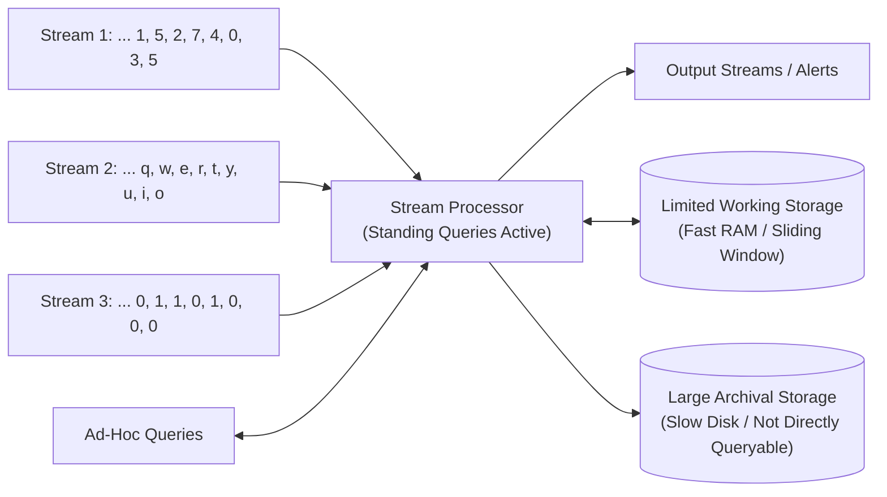
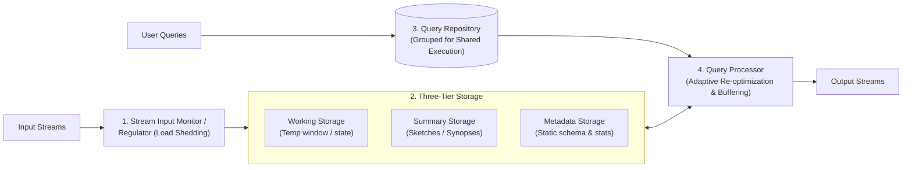

# Module 3: Mining Data Streams

**Course:** Big Data and Social Media Analytics (`26CMPC71` — VESIT 2026 NEP & Autonomy Scheme, Sem VII)  
**Course Outcome:** `CO3` — *Apply advanced techniques for emerging applications like stream analytics.* (`07` Theory Hours + Lab Experiments 5 & 6)  
**Primary Slides & Curriculum Sources Used:**
- `module_3/BDA_Mod 3 Mining Data Streams.pptx.pdf` (135 slides)
- Official Syllabus: `Final year B. E. (Computer Engineering) (Sem-VII & VIII) Batch  [2023-2027] (2026 ‘NEP & Autonomy’ Scheme).pdf` (`26CMPC71` Topics `3.1`, `3.2`, Lab Experiments 5 & 6, and Self-Learning Spark/Kafka items)

---

## Scope & Topic Checklist

| # | Topic / Subtopic | Official Syllabus Ref | Slide Coverage | Status |
|---|---|---|---|---|
| 1 | Stream Data Model, 3Vs, Concept Drift/Evolution, DSMS vs. DBMS & Architecture | `3.1` | pp. 1–27 | `[x]` |
| 2 | Stream Sources, Applications & Stream Query Types | `3.1` | pp. 17–24 | `[x]` |
| 3 | Approximate Query Answering, Sliding Windows, Batching & Fixed-Proportion Hash Sampling | `3.2` | pp. 28–40 | `[x]` |
| 4 | Fixed-Size Reservoir Sampling (Vitter's Algorithm R + Inductive Proof + Trace) | `3.2` *(Syllabus Gap)* | p. 2, p. 37 *(named, omitted)* | `[x]` |
| 5 | Filtering Streams: Bloom Filter, FPR Mathematical Analysis, Optimal $k$, Exercises & HBase/Bitly | `3.2` | pp. 41–60 *(FPR proof added)* | `[x]` |
| 6 | Counting Ones in a Sliding Window: Cost of Exact Counts ($\Omega(N)$) & DGIM Algorithm ($O(\log^2 N)$) | `3.2` | pp. 2, 61–103 *($\Omega(N)$ added)* | `[x]` |
| 7 | Decaying Windows (Exponential Decay, Most Common / Trending Elements, Corrected Trace) | Slides / MMDS `4.6` | pp. 104–114 | `[x]` |
| 8 | Counting Distinct Elements: Count-Distinct Problem & Flajolet–Martin (FM) Algorithm | `3.2` | pp. 115–135 | `[x]` |
| 9 | Lab Practicals 5 & 6 (`PR & OR` Viva): Stream Algorithms + Spark Iterative RDDs & FP-Growth | Lab Exp 5 & 6 | p. 25 *(Frequent itemsets)* + Official Docs | `[x]` |

**Assumptions & Source Notes:**
- **Zero-prior-knowledge assumption:** Probability basics (independence, expectation, median vs. mean), hashing, modulo arithmetic, binary representation, and database queries are explained from the ground up.
- **Primary textbook alignment:** The lecture deck closely follows **Chapter 4 (*Mining Data Streams*)** of *Mining of Massive Datasets* (MMDS — Leskovec, Rajaraman, and Ullman, `mmds.org`).
- **Critical slide checks performed:** Several slides contain omitted syllabus proofs (Reservoir Sampling, Bloom Filter false-positive derivation, $\Omega(N)$ exact-count proof), swapped captions (Slide 5), inconsistent hash indexing (Slide 40), and arithmetic/table errors (DGIM Slide 84 and Slides 94–95, Decaying Windows Slides 112–113, Flajolet–Martin Slides 122–124, 128, and 130 vs. 133). Every discrepancy is preserved and explicitly clarified using **`PPT says / Verified clarification / What to say in the viva`** callouts.

---

## 1. Data Stream Model, Challenges & DSMS Architecture (`26CMPC71` Topic 3.1; Slides 1–27)

### 1.1 Basic Idea: What Is a Data Stream and Why Do We Need a DSMS?

Think about how a regular database — a **Relational Database Management System (RDBMS)** / **Database Management System (DBMS)** such as MySQL or PostgreSQL — works:
1. All your data sits safely on hard disks inside tables.
2. When you run a Structured Query Language (**SQL**) query, the DBMS **pulls** rows from disk at whatever pace it chooses, scans or sorts them multiple times, and returns an exact answer.

Now imagine a very different situation:
- Thousands of stock trades happen every millisecond on the National Stock Exchange (NSE).
- A telecom router forwards millions of Internet Protocol (**IP**) packets per second.
- Millions of users click search results and post hashtags simultaneously.

This continuous, endless flow of incoming records is called a **data stream** (Slides 3–5). If you wait to write every packet or click to disk, index it, and query it tomorrow, two things go wrong:
1. **Storage explodes:** Streams are potentially **infinite in length** (Slide 26), so you cannot keep all historical records in main memory (Random Access Memory [**RAM**]) or even accessible disk storage (Slides 3, 16, 27).
2. **Latency kills usefulness:** By the time a batch SQL job finishes scanning terabytes on disk, a Denial-of-Service (**DoS**) cyberattack or fraudulent credit-card swipe has already succeeded (Slides 18, 20, 27).

To process this continuous firehose in real time, we use a **Data Stream Management System (DSMS)** (Slides 6–15) — a system specifically built to run **continuous queries** over fast, unbounded streams using bounded RAM.

### 1.2 Everyday Analogy

- **Traditional DBMS** is like **auditing a bank's printed ledger books in a vault**: all transactions are already written down, you can flip back and forth between pages as many times as you want, and you can read at your own speed.
- **DSMS** is like **counting red cars passing on a busy expressway from an overpass**: cars keep arriving at speeds you do not control, once a car passes out of sight you cannot call it back for a second look (single pass), and your notepad (RAM) is too small to write down every single license plate. So you maintain smart running tallies and compact summaries on the fly!  
*(Where the analogy stops being accurate: a DSMS can deliberately drop excess packets during overload — load shedding — or archive compressed copies to cold storage, and uses mathematical hash sketches whose accuracy can be bounded precisely.)*

### 1.3 Core Assumptions, Characteristics & the 3Vs of Stream Mining (Slides 3–6, 9–10)

Your slides highlight these defining properties of data streams:
1. **Available at all times & continuous:** Data arrives without an end (`24/7`, Slide 3–4).
2. **Ephemeral if unprocessed:** If an arriving element is not processed immediately or buffered/archived, it is **lost forever** (Slide 3).
3. **Uncontrolled arrival rate and order:** Any number of streams can enter simultaneously on their own irregular schedules, with different data types and bursty inter-arrival gaps (Slides 5, 9–10). Unlike a DBMS reading from disk, a DSMS **cannot control** how fast data arrives!
4. **Expensive random access / Single-pass constraint:** Backtracking or scanning backward across old items is infeasible (Slides 4, 12). Algorithms must execute in **one pass** within **main memory (RAM)** with tiny per-element computation time so they keep pace with the stream (Slide 27).
5. **Continuous incremental output:** Queries stay active and emit updated results incrementally as new records arrive (Slides 5, 11).

#### The 3Vs of Data Stream Mining (Slide 6)
While Module 1 introduced the 3Vs of *Big Data at rest* (Volume, Velocity, Variety), Slide 6 defines **Data Stream Mining** — extracting knowledge structures from continuous, rapid records — as facing **3 principal challenges**:
1. **Volume:** Total data flowing over time is huge and unbounded.
2. **Velocity:** Data arrives at high speed, demanding sub-second or real-time reactions.
3. **Volatility:** *"Environment is never stable and has constantly changing patterns"* (Slide 6). Unlike static historical tables where relationships stay fixed, real-world streams evolve continuously!

#### Concept Drift vs. Concept Evolution (Slide 25 — Explained Clearly)
Slide 25 lists *"Constant changing pattern: Concept-drift, Concept Evolution"* without defining them. Both are direct consequences of **Volatility** in streaming Machine Learning (ML):
- **Concept Drift:** The underlying statistical relationship $P(X, Y)$ between input features $X$ and target label $Y$ **changes over time** for *existing* classes.
  - *Example:* Before the festive Diwali season, a sudden Rs. 50,000 online purchase from a customer's account might look like credit-card fraud; during Diwali sales, the same spending pattern becomes normal. Or spammers change keywords (`"free lottery"` $\to$ `"claim reward"`), shifting what words predict `Spam` vs. `Not Spam`.
  - *Types of drift:* **Sudden/abrupt** (overnight policy or price change), **gradual** (slowly shifting user preferences), **incremental**, and **recurring** (seasonal summer vs. winter buying cycles).
- **Concept Evolution:** **Entirely new classes** (categories never seen during model training) **emerge dynamically** in the stream.
  - *Example:* A cybersecurity stream classifier trained to recognize 4 known malware families suddenly encounters a brand-new **zero-day worm** (a 5th class!), or a news/social stream suddenly births a new event category like `"COVID-19"` in early 2020. A closed-world classifier must use **novel class detection** (outlier/cluster tracking) rather than forcing the new class into an old label.

### 1.4 Traditional DBMS vs. DSMS Comparison (Slides 7–10, 16, 23–27)

| Dimension | Traditional DBMS (Database Management System) | DSMS (Data Stream Management System) |
|---|---|---|
| **Data Storage Model** | **Persistent relations** (stored tables on disk) | **Transient streams** (continuous, unbounded flows) |
| **Access Pattern** | **Random access**; multi-pass reads & backtracking allowed | **Sequential, single pass** only; random access is infeasible |
| **Control Over Data Rate** | **System-controlled (Pull):** DBMS reads disk at its own pace | **External / Uncontrolled (Push):** stream dictates arrival speed |
| **Processing Location** | Disk-backed storage + buffer pool | **Main memory (RAM)** (disk/external memory is too slow) |
| **Query Type** | **One-time / Ad-hoc** (run once, terminate, return complete table) | **Continuous / Standing** (long-running, incremental results) |
| **Query Operators** | Arbitrary (sorting, full joins, grouping over entire table) | **Non-blocking only** (windowed joins, incremental aggregates) |
| **Answer Accuracy** | **Exact** answers | Often **approximate** answers (with bounded error guarantees) |
| **Time Sensitivity** | Low/moderate latency | **Real-time / low-latency** alerts |

### 1.5 Generic DSMS Model & Abstract DSMS Architecture (Slides 7–8, 11–16)

#### A. Generic Data Stream Model (Slides 7–8, 16)
In the generic model (adapted from Stanford MMDS Ch. 4), multiple asynchronous streams enter a **Stream Processor** (`Processor`) that holds **Standing Queries** permanently and accepts occasional **Ad-Hoc Queries** from users:



**Data flow explained in plain English (Slides 7–8, 16):**
- **Incoming Streams:** Multiple streams arrive concurrently at independent, non-uniform rates. Notice the arrow labeled `<- time` on Slides 7–8: the **rightmost** element is the *most recent* (just arrived), and older elements shift leftward into the past.
- **Standing Queries:** Permanently registered queries that inspect every arriving element (e.g., *"Alert if sensor temperature exceeds 80°C"*).
- **Ad-Hoc Queries:** One-off questions asked interactively at any instant (e.g., *"How many unique visitors hit the site in the last 10 minutes?"*).
- **Limited Working Storage:** Fast main memory (or fast local store) holding only summaries, sketches, or the active **sliding window** of recent data.
- **Archival Storage:** Huge slow storage where raw stream segments may be logged for rare offline audits — **not usable** for real-time query answering because retrieval is too slow and capacity is still finite compared to an infinite stream (Slide 16).

#### B. Abstract Architecture of a Typical DSMS (Slides 13–15)
Zooming inside the box, Slide 13–15 breaks a practical DSMS into **four interacting subsystems**:



*(Note: Slide 13 contains a minor spelling typo `"Querry Processor"`.)*  
1. **Input Stream Monitor / Regulator (Slides 13–14):** Monitors incoming burst rates and regulates flow — if input surges faster than CPU/RAM can handle, it performs **load shedding** (selectively dropping packets) to prevent system crash.
2. **Storage (Slides 13–14):**
   - *Temporary Working Storage:* Holds active sliding windows or one-time query state (in RAM for low latency, or disk if slightly slower latency is tolerable).
   - *Summary Storage:* Holds compact synopses/sketches (Bloom filters, DGIM buckets, FM registers, histograms).
   - *Static Metadata Storage:* Holds stream schemas, source definitions, and query plans.
3. **Query Repository (Slide 15):** Registers long-running continuous queries and groups similar queries together so they can share scans, filters, and intermediate computations (**shared processing**).
4. **Query Processor (Slide 15):** Talks to the Input Monitor, dynamically **re-optimizes query execution plans** when stream arrival rates shift, buffers tuples temporarily, and streams results continuously to users.

#### C. Six Query Requirements in the Data Stream Generic Model (Slides 11–12)
1. **Order-based and time-based operations:** Queries must understand arrival sequence (`last 1,000 tuples`) and timestamps (`last 5 minutes`).
2. **Approximate summary structures:** Because complete history cannot be stored, synopses/sketches must be used.
3. **No blocking operators:** Streaming query plans **must NOT** use operators that require the entire input before emitting any output!
   - *Blocking operator example:* Full `SORT`, computing global `MEDIAN` over an infinite stream, or naive `EXCEPT`/`NOT IN` across the whole stream — they stall forever waiting for the stream to end!
   - *Non-blocking operator example:* `FILTER/SELECTION` (emits matching tuples immediately), running `MAX`/`SUM`, or windowed `JOIN` (joins tuples within a bounded time window).
4. **Single-pass only (no backtracking):** Once an item leaves RAM, you cannot go back to re-read it.
5. **Fast anomaly reaction:** Real-time monitoring apps must detect and alert on unusual spikes immediately.
6. **Parallel and shared execution:** For scalability, many continuous queries must share work and run in parallel.

### 1.6 Stream Sources, Applications & Query Types (Slides 5, 17–24)

> [!WARNING]
> **PPT Verification Check — Swapped Image Captions (`BDA_Mod 3` Slide 5):**
> - **PPT says:** At the bottom of Slide 5, the middle photo (an agent sitting at a telephone/computer desk in a call center) is captioned **"Sensor data"**, while the right chart (a red temperature time-series plot labeled `Temperature [C]` vs `Time (UTC)` from `SBECTD16p4586` ocean sensor at `48°39.0799' N / 123°29.1612' W`) is captioned **"Call center records"**.
> - **Verified clarification:** Those two captions were **accidentally swapped** when the slide was made. The desk photo represents **Call center records**, and the ocean temperature chart (`VENUS` underwater observatory sensor) represents **Sensor data**.
> - **What to say in the viva:** Give clean domain examples of **Network traffic**, **Sensor data** (e.g., ocean temperature or industrial IoT readings), and **Call center / telecom CDR records** without mixing up the captions.

#### Four Major Stream Application Categories (Slides 17–21)
1. **Network Traffic Analysis (Slide 18):** Internet Service Providers (ISPs) monitor router packets to detect congestion, **Intrusion Detection Systems (IDS)**, and **Denial-of-Service (DoS)** attacks by comparing the current traffic window against known attack signatures.
2. **Financial Applications (Slide 19):** High-frequency stock feeds for online `hold` / `sell` / `buy` alerts — e.g., finding stocks priced between `Rs. 200 to 500` with heavy buying in the last hour after tax-cut news, or stocks trading `> 10%` above their `100-day moving average` with volume `> 1 million shares`.
3. **Transaction Log & Clickstream Analysis (Slides 4, 20):** Web clickstreams, **Call Detail Records (CDRs)**, and **Automated Teller Machine (ATM)** / credit-card swipes — used both for real-time ad personalization and **fraud detection** (monitoring location + average spend to catch impossible travel or abnormal purchases).
4. **Sensor Networks (Slide 21):** Industrial monitoring, **weather/ocean monitoring** (temperature + ocean current streams joined to issue **cyclone/tsunami alerts**), and **smart power grids** (aggregating electricity consumption by location and user type).

#### Types of Stream Queries (Slides 23–24)
Queries are classified along two axes: **Evaluation Lifetime** (One-time vs. Continuous) and **Submission Timing** (Predefined vs. Ad-Hoc):

| Query Type | Definition (Slides 23–24) | Example |
|---|---|---|
| **One-Time Query** | Evaluated **once** over a point-in-time snapshot of the stream/working storage. | *"What is the current price of stock X right now?"* |
| **Continuous (Standing) Query** | Evaluated **continuously** as new data arrives; updates and emits incremental results over time. | *"Output the maximum price of stock X every hour"* or *"Compute running count/average."* |
| **Predefined Query** | Supplied to the DSMS **before** any relevant data starts arriving (usually continuous). | Fraud-detection rules deployed before live payments begin. |
| **Ad-Hoc Query** | Issued **online after** the stream has already started (can be one-time or continuous) to inspect current state. | An engineer typing a query mid-outage to check packet drops in the last 5 minutes. |

> [!NOTE]
> **PPT Verification Check — Stock Alert Example (`BDA_Mod 3` Slide 23):**
> - **PPT says:** Under **One time queries**, Slide 23 writes *"Ex: Stock price checker may alert when a stock price crosses particular price point."*
> - **Verified clarification:** A standing alert that keeps watching a live stream until a threshold is crossed is actually a **continuous (standing) query** (or event-trigger query) while waiting, though it may fire **one** alert once the threshold hits! A pure **one-time query** evaluates an instant snapshot (e.g., *"Check right now whether Stock X > Rs. 500"*).
> - **What to say in the viva:** *"A one-time query runs once on a snapshot (like checking the current stock price right now), whereas a continuous query runs persistently as new ticks arrive (like tracking hourly maximums or continuously watching for a price threshold crossing)."*

*(Slide 22 Quick Quiz: **"Data mining"** is the essential process where intelligent methods are applied to extract data patterns.)*

### 1.7 Viva Preparation — Stream Data Model & DSMS

- **Quick definition:** A **Data Stream Management System (DSMS)** is a specialized data processing engine designed to run **continuous, non-blocking queries** in **real time** over unbounded, rapid, externally pushed data streams using **bounded main memory** and **single-pass** approximate summaries.
- **Explain it to the examiner (30–60 seconds):** *"Sir/Ma'am, unlike a traditional DBMS where static tables sit on disk and the database pulls data at its own speed, a data stream arrives continuously at high velocity and outside our control. Because the stream is infinite, we cannot store all history or scan backward; if we don't process an item immediately in RAM, it's lost. A DSMS handles this using an **Input Regulator** (for load shedding during bursts), **Working and Summary Storage** in memory, a **Query Repository** for shared continuous queries, and an adaptive **Query Processor** that uses non-blocking operators to give real-time incremental answers. It also deals with **Volatility**, including **Concept Drift** (patterns shifting over time) and **Concept Evolution** (brand-new classes appearing)."*
- **Practical example:** In credit-card fraud detection, a predefined continuous query monitors live swipe streams in RAM against recent location and spending patterns to block suspicious transactions in milliseconds rather than hours later in a batch database.
- **Examiner follow-ups:**
  1. *Q: Why are blocking operators banned in DSMS query plans?*  
     **A:** A blocking operator (like full `SORT` or global `MEDIAN`) must consume the **entire** input before producing its first output tuple. Since a data stream never ends, a blocking operator would wait forever and run out of memory! We fix this by applying operators over bounded **sliding windows**.
  2. *Q: Differentiate between Concept Drift and Concept Evolution.*  
     **A:** In **Concept Drift**, the existing classes remain the same, but the feature-to-label relationship shifts over time (e.g., spam keywords changing). In **Concept Evolution**, **new, previously unseen classes** emerge in the stream (e.g., a new strain of cyberattack).
  3. *Q: What happens when stream velocity suddenly spikes above system capacity?*  
     **A:** The **Input Stream Monitor/Regulator** buffers short bursts or performs **load shedding** (intelligently dropping or sampling packets) while the Query Processor re-optimizes the query plan.
  4. *Q: Can we answer live stream queries from Archival Storage?*  
     **A:** No — archival storage is slow disk/tape meant only for rare offline forensic investigations, not real-time continuous queries (Slide 16).
- **Common mistakes to avoid:** Saying a DSMS stores the whole stream in RAM; confusing **Variety** (multiple formats) with **Volatility** (unstable, shifting patterns over time); calling `SORT` a streaming-friendly operator.

---

## 2. Approximate Query Answering & Stream Sampling (`26CMPC71` Topic 3.2; Slides 28–40 + Gap Fill)

### 2.1 Why Approximate Answers? Four Core Techniques (Slides 28–36)

Because streams are infinite (`Slide 26`) and external disk I/O is far too slow (`Slide 27`), exact answers across unbounded history are often impossible. Instead, DSMS engines produce **high-quality approximate answers** with mathematical error/confidence bounds using four strategies (Slide 29):

1. **Sliding Windows (Slides 30–31):** Evaluate queries only over the **most recent $N$ elements** (or last $T$ minutes).
   - *Strength:* Deterministic (no random luck involved), well-defined, and prioritizes recent data — which is usually what users actually care about (recent traffic, recent trending topics).
2. **Batch Processing / Micro-Batching (Slides 32–33):** Buffer incoming elements briefly and compute results periodically.
   - *When useful:* Ideal for **bursty streams** where peak rate exceeds processing speed, because the system buffers peaks and catches up during quiet periods.
   - *Key trade-off:* Does **not** introduce value inaccuracy, but sacrifices **timeliness** (you get an exact answer for a moment in the *recent past* rather than the exact present instant).
3. **Synopses / Sketches / Histograms / Wavelets (Slide 28):** Maintain tiny fixed-space mathematical summaries in RAM — such as **Bloom Filters**, **Flajolet–Martin sketches**, and **DGIM buckets** (covered in Sections 3–6!).
4. **Sampling (Slides 34–36):** Skip most incoming tuples and compute the answer on a **representative sample** (a small subset preserving the statistical properties of the whole stream).
   - *Caution (Slide 34):* Sampling works well for sums, averages, and frequencies with confidence bounds, **but fails to give reliable guarantees for most stream joins** (because matching keys from two independently sampled streams rarely collide — e.g., $1/10 \times 1/10 = 1/100$ of joined pairs survive!).

### 2.2 Two Stream Sampling Problems (Slide 37)

Suppose we want a representative sample of a data stream in RAM. Slide 37 defines **two fundamentally different problems**:
1. **Problem 1 — Sample a Fixed Proportion:** Keep a fixed fraction (say $1/10$, or $a/b$) of the stream. Note: as the stream grows, the sample size also grows!
2. **Problem 2 — Maintain a Fixed-Size Sample (Reservoir Sampling):** At *any* time $k$ over an infinite stream, keep a uniform random sample of **exact fixed size $s$** in memory! *(Listed on Slides 2 and 37, omitted in the remaining slides — taught completely in Section 2.4 below!)*

### 2.3 Problem 1: Fixed-Proportion Sampling & Hash-Based User Sampling (Slides 38–40)

#### The Search-Engine Query Stream Problem (Slide 38)
- **Stream of tuples:** `(user, query, time)` arriving at a search engine.
- **Query we want to answer:** *"What fraction of queries are repeated by the same user in a single day?"* (Slide 38 phrasing: *"How often did a user run the same query in a single day"* — where we have space to store only **$1/10\text{th}$** of the query stream).

#### Why Naive Tuple-by-Tuple Random Sampling Fails!
Suppose we take the **naive solution** (Slide 38): for *each arriving tuple*, pick a random integer in `[0..9]`; keep the tuple if it equals `0`, else drop it.
Let us prove mathematically why this ruins the answer! Suppose over a day, users issue:
- $s_1$ queries **once** (`d = 1`),
- $s_2$ queries **twice** (`d = 2`),
- Ignore $d \ge 3$ for simplicity.
In the true stream, the fraction of distinct `(user, query)` pairs that were repeated twice is $\frac{s_2}{s_1 + s_2}$.  
Now apply naive `1/10` random sampling to each individual tuple:
- A query issued **once** survives into the sample with probability $\frac{1}{10}$.
- A query issued **twice** appears **twice** in the sample ONLY if *both* copies are picked: probability $\frac{1}{10} \times \frac{1}{10} = \frac{1}{100}$! Meanwhile, with probability $2 \times \frac{1}{10} \times \frac{9}{10} = \frac{18}{100}$, **one** copy survives and gets **miscounted as a non-repeated (`d=1`) query**!
- So the naive sample estimates the repeat fraction as $\frac{\frac{1}{100}s_2}{\frac{1}{10}s_1 + \frac{18}{100}s_2 + \frac{1}{100}s_2} \approx \frac{s_2}{10 s_1 + 19 s_2}$ — off by roughly a factor of **10×**!!

#### The Correct Solution: Hash on the Key (`user`) (Slides 39–40)
Instead of sampling `1/10` of *tuples*, **pick `1/10` of *users* and keep ALL queries of those selected users!**
- **How to implement without a huge user lookup table:** Apply a uniform hash function `h(user)` that maps every `user_id` deterministically into `10` buckets (`0..9`). Keep a tuple `(user, query, time)` **if and only if `h(user) == 0`**.
- Because `h(user)` always produces the same bucket for the same user, **every single search** by a selected user is kept, and **zero searches** by unselected users are kept! Thus, the repeat-query statistics inside the `1/10` sample match the entire population accurately!

#### Generalizing to Any $a/b$ Fraction (Slide 40)
- Choose the **key** (some subset of tuple components depending on the query — e.g., `user`, or `(user, query)`).
- Hash the key uniformly into **$b$ buckets**.
- Keep the tuple if its hash bucket falls in the first $a$ buckets.

> [!WARNING]
> **PPT Verification Check — Off-by-One Bucket Rule (`BDA_Mod 3` Slide 40):**
> - **PPT says (Slide 40):** *"Hash each tuple's key uniformly into $b$ buckets; Pick the tuple if its hash value is **at most $a$**."*
> - **Verified clarification (MMDS Ch. 4.2.3):** Hash buckets in modular arithmetic (`h(key) mod b`) are normally **0-indexed: $\{0, 1, \dots, b-1\}$** (just as Slide 38 uses `[0..9]`). If buckets are `0..b-1`, picking `"at most a"` (`h(key) <= a`) selects **`a + 1` buckets** (`0, 1, ..., a`), giving fraction **$(a+1)/b$** instead of $a/b$! To get an exact **$a/b$** fraction:
>   - Use **`h(key) < a`** (buckets `0` to `a - 1`) for **0-indexed** buckets `{0..b-1}`, **OR**
>   - Use **`h(key) <= a`** only if buckets are **1-indexed** `{1..b}`.
> - **What to say in the viva:** *"We hash the chosen key uniformly into $b$ buckets `{0, ..., b-1}` and accept the tuple whenever the bucket number is strictly less than $a$ (or at most $a$ if buckets are 1-indexed from `1` to `b`)."*

---

### 2.4 Problem 2 (Missing in Slides, Required by `26CMPC71` & Slide 37): Fixed-Size Reservoir Sampling (Vitter's Algorithm R)

#### Basic Idea & Why Needed
What if our RAM buffer holds **at most $s$ elements total**, and the stream length $k$ keeps growing indefinitely (`k -> infinity`)? Fixed-proportion sampling (`1/10`) would eventually grow beyond $s$ and crash RAM!  
**Reservoir Sampling** — formalized as **Algorithm R** by **Jeffrey S. Vitter (1985)** (building on Alan Waterman) — solves this in **one pass** using **exact $O(s)$ space**: at *every* time step $k \ge s$, every element seen so far has the **exact same probability $\frac{s}{k}$** of sitting in our $s$-element reservoir!

#### Everyday Analogy
Imagine a tiny VIP lounge with **$s = 3$ chairs**, and guests arrive one by one down a red carpet whose total length you don't know.
- The first 3 guests sit directly in chairs 1, 2, and 3.
- When Guest #4 arrives, they roll a 4-sided die (`1..4`): if it lands on `1`, `2`, or `3` (probability $3/4$), they replace the guest in that chair; if it lands on `4`, they walk away!
- When Guest #100 arrives, they get a $3/100$ chance to kick out a random current occupant. Intuitively, early guests got in easily when competition was small, *but* had to survive many later rounds of eviction; late guests face tough entry odds, *but* face fewer eviction rounds — and the math balances out **perfectly**!

#### Step-by-Step Algorithm (Algorithm R — 1-Indexed for Clarity)
- **Input:** Stream $x_1, x_2, x_3, \dots$ of unknown/infinite length; fixed reservoir capacity $s$.
- **Output:** Array `R[1..s]` containing a uniform random sample without replacement of the stream seen so far.
1. **Initialize:** Store the first $s$ arriving elements directly into `R[1], R[2], ..., R[s]`.
2. **Stream Loop:** For each subsequent element $x_k$ arriving at position $k = s+1, s+2, \dots$:
   - Generate a uniformly random integer $j \in \{1, 2, \dots, k\}$.
   - If $j \le s$, overwrite `R[j] = x_k` (replacing the previous occupant of slot $j$).
   - Otherwise ($j > s$), discard $x_k$.

#### Inductive Proof of Uniform Probability ($s / k$)
We prove by mathematical induction on $k \ge s$ that after $k$ elements arrive, **every element $x_1, \dots, x_k$ is in `R` with probability $\frac{s}{k}$**:
- **Base Case ($k = s$):** The first $s$ elements are placed directly into `R[1..s]`, so each is present with probability $\frac{s}{s} = 1$. True!
- **Inductive Hypothesis:** Assume after $k - 1$ elements, every prior element is in `R` with probability $\frac{s}{k-1}$.
- **Inductive Step (when $x_k$ arrives):**
  1. **New element $x_k$:** Enters `R` iff $j \in \{1, \dots, s\}$, which happens with probability $\mathbf{\frac{s}{k}}$.
  2. **Any existing element $x_i$ ($i < k$) currently in `R`:** It gets evicted ONLY if $x_k$ enters (prob $\frac{s}{k}$) **AND** picks $x_i$'s exact slot out of $s$ slots (prob $\frac{1}{s}$). Thus:
     $$P(x_i \text{ is replaced at step } k) = \frac{s}{k} \times \frac{1}{s} = \frac{1}{k}$$
     $$P(x_i \text{ survives step } k) = 1 - \frac{1}{k} = \frac{k - 1}{k}$$
     Multiplying by its prior probability of being in `R`:
     $$P(x_i \in R \text{ after step } k) = \frac{s}{k - 1} \times \frac{k - 1}{k} = \mathbf{\frac{s}{k}}$$
Both new and old elements have probability **$\frac{s}{k}$**!

#### Worked Small Numerical Trace ($s = 3$, Stream = `A, B, C, D, E, F`)
- **Steps $k=1..3$ (`A, B, C`):** Reservoir `R = [A, B, C]` (each prob $3/3 = 1$).
- **Step $k=4$ (`D` arrives):** Draw uniform $j \in \{1, 2, 3, 4\}$. Suppose $j = 2 \le 3 \implies$ replace `R[2]`. Now `R = [A, D, C]`. (Each of `A, B, C, D` had $3/4$ chance!)
- **Step $k=5$ (`E` arrives):** Draw uniform $j \in \{1, 2, 3, 4, 5\}$. Suppose $j = 5 > 3 \implies$ discard `E`. `R` remains `[A, D, C]`.
- **Step $k=6$ (`F` arrives):** Draw uniform $j \in \{1..6\}$. Suppose $j = 1 \le 3 \implies$ replace `R[1]`. Final `R = [F, D, C]`.
*(Note for high-speed optimization: Vitter's 1985 paper also introduced **Algorithms X, Y, and Z**, which avoid drawing a random number on every single tuple by jumping ahead using a random skip count!)*

### 2.5 Viva Preparation — Approximate Querying & Stream Sampling

- **Quick definition:** **Key-based hash sampling** keeps a fixed *proportion* $a/b$ of stream keys so group/repeat queries stay unbiased, whereas **Reservoir Sampling (Algorithm R)** maintains a fixed-*size* uniform random sample of $s$ items from a stream of unknown length $k$ in one pass.
- **Explain it to the examiner (30–60 seconds):** *"Sir/Ma'am, because streams are infinite, we sample rather than storing everything. There are two problems: **fixed-proportion sampling** and **fixed-size sampling**. In fixed-proportion sampling, naive per-tuple random selection breaks queries like 'how many users repeated a search' because pairs get split; instead we hash the grouping key — like `user_id` — into $b$ buckets and keep all records for keys landing in the first $a$ buckets. In fixed-size sampling, when memory holds only $s$ items, **Reservoir Sampling (Algorithm R)** fills the $s$ slots first, and for every $k$-th item ($k > s$) replaces a random slot with probability $s/k$, guaranteeing every item seen so far has an exact $s/k$ chance of being in the sample."*
- **Practical example:** Sampling `10%` of YouTube viewers by hashing `user_id mod 10 == 0` keeps every user's complete watch session intact; meanwhile, keeping a live sample of `1,000` tweets out of millions during an election uses Reservoir Sampling with $s = 1{,}000$.
- **Examiner follow-ups:**
  1. *Q: Why does naive `1/10` random sampling fail on the search-engine repeat-query problem?*  
     **A:** Repeat queries (`d = 2`) only survive as a pair with probability $(1/10)^2 = 1/100$, while `18/100` of them lose one copy and get miscounted as single queries (`d = 1`), creating a ~10× downward bias.
  2. *Q: Why can't sampling reliably estimate the size of a join between two streams?*  
     **A:** If Stream 1 and Stream 2 are independently sampled at `1/10`, a matching pair `(x, x)` survives in the joined output only with probability $1/10 \times 1/10 = 1/100$, and rare keys might miss completely. (Unless both streams are hashed on the exact **join key**!)
  3. *Q: Compare Sliding Windows, Batch Processing, and Sampling.*  
     **A:** Sliding windows give exact/near-exact recent answers deterministically; Batch processing sacrifices **timeliness** (delay) while keeping **accuracy** on bursty streams; Sampling keeps **low latency** while trading off **exactness** for a statistical estimate.
- **Common mistakes to avoid:** Saying fixed-proportion sampling always keeps memory constant (it grows linearly with stream length!); forgetting `h(key) < a` for 0-indexed buckets; thinking Reservoir Sampling requires knowing the total stream length $N$ in advance.

---

## 3. Filtering Streams: Bloom Filter with Analysis (`26CMPC71` Topic 3.2; Slides 41–60)

### 3.1 Basic Idea & Why We Need a Bloom Filter (Slides 41–44)

**Stream Filtering (Selection)** accepts stream tuples matching a condition and drops the rest (Slide 41).
- Simple conditions (e.g., `temperature > 100`) are trivial to check per tuple.
- Hard condition: **Set membership** — *"Is this incoming key $x$ inside a known target set $S$?"* when $S$ is **too huge to store in RAM**!
  - *Example:* Suppose an email gateway wants to reject spam or accept only `1 billion` known legitimate email addresses (20 bytes each = `20 GB`), or Bitly wants to check every URL click against `100 million` known malicious domains, using only `1 GB` of fast RAM.

In 1970, **Burton H. Bloom** invented the **Bloom filter**: a compact, probabilistic bit-array data structure that tests set membership in **$O(k)$ time** and tiny RAM, with one golden guarantee:
- **Zero False Negatives:** If $x \in S$, the Bloom filter **100% definitely says YES** ("may be in $S$"). If the filter says **NO**, $x$ is **definitely NOT in $S$**.
- **Possible False Positives:** Occasionally, for an element $y \notin S$, all of its checked bits happen to already be set to `1` by other elements in $S$, so the filter mistakenly says **"probably in $S$"** (Slides 42–44).

### 3.2 Everyday Analogy

Imagine a guest list of 10,000 VIPs that is too big for a security guard's pocket, so the guard carries a **small punch card with 1,000 numbered boxes** (initially blank `0`). For every VIP on the list, the guard runs 3 secret formulas on their name and punches (`1`) those 3 boxes. When someone arrives at the door, the guard runs the same 3 formulas:
- If **even one** of their 3 boxes is unpunched (`0`), they are **definitely NOT a VIP** (rejected instantly!).
- If **all 3 boxes** are punched (`1`), they are **probably a VIP** — though occasionally a random crasher's 3 boxes might all have been punched earlier by other VIPs (a **false positive**, which can then be double-checked against the master book in the back office!).

### 3.3 Notation Warning & Algorithm Steps (Slides 43–48)

> [!NOTE]
> **Notation Alert Across Slides 43–59:**
> - **Standard Theory & Slides 43–48:** $n$ = **number of bits** in the bit array $B$; $m$ = **number of elements** inserted into set $S$; $k$ = **number of hash functions**.
> - **Handwritten Slides 49–57:** Uses **`m = 5`** to mean the **bit-array size** (`5` bits, indices `0..4`)!
> - **Exercise Slide 59:** Uses **`K = 8`** to mean the **bit-array size** (`8` bits, indices `0..7`)!
> In the notes below, we standardize on **$n$ = bit array size, $m$ = elements in $S$, $k$ = hash functions** (also noting $M$ or $K$ where the slide prints it).

**Components:**
1. Bit array $B[0 \dots n-1]$ of $n$ bits, all initialized to `0`.
2. $k$ independent hash functions $h_1, h_2, \dots, h_k$, each mapping keys uniformly to $\{0, 1, \dots, n-1\}$.
3. Set $S$ of $m$ keys.

**Operations (Both $O(k)$ time!):**
- **Insert($x \in S$):** Compute $h_1(x), h_2(x), \dots, h_k(x)$ and set $B[h_i(x)] = 1$ for every $i = 1 \dots k$.
- **Lookup / Filter($y$):** Compute $h_1(y), h_2(y), \dots, h_k(y)$.
  - If **ALL** $k$ positions $B[h_i(y)] == 1$: report **Probably in $S$** (let through / escalate to full check).
  - If **AT LEAST ONE** $B[h_i(y)] == 0$: report **Definitely NOT in $S$** (reject immediately).

### 3.4 Mathematical Analysis: False Positive Rate & Optimal $k$ (`26CMPC71` 3.2 Gap Fill)

*(Slide 48 states the optimal formula $k = \frac{n}{m}\ln 2$ without deriving the False Positive Rate [FPR] required by `26CMPC71` Topic `3.2`. Here is the complete beginner-friendly derivation from Stanford MMDS Ch. 4.3!)*

Suppose we insert $m$ distinct keys into an $n$-bit array using $k$ independent, uniform hash functions (that is **$km$ independent bit-setting "dart throws"** onto $n$ targets):
1. **Probability one specific dart misses a specific bit:** $1 - \frac{1}{n}$.
2. **Probability a specific bit remains `0` after all $km$ darts:**
   $$P(\text{bit} = 0) = \left(1 - \frac{1}{n}\right)^{km} = \left[\left(1 - \frac{1}{n}\right)^n\right]^{km/n} \approx e^{-km/n}$$
   *(using the classic limit $\lim_{n \to \infty}(1 - \frac{1}{n})^n = e^{-1} \approx 0.3679$).*
3. **Probability that a specific bit has been turned to `1`:**
   $$P(\text{bit} = 1) = 1 - \left(1 - \frac{1}{n}\right)^{km} \approx 1 - e^{-km/n}$$
4. **False Positive Probability ($p$ or FPR):** When we query a non-member $y \notin S$, it produces a false positive iff all $k$ of its hash positions happen to be `1`:
   $$p \approx \left(1 - e^{-km/n}\right)^k$$

#### Finding Optimal Hash Count $k_{\text{opt}}$ (Slide 48)
Notice the trade-off:
- Too **few** hashes ($k$ small) $\implies$ easier for a query to collide with existing `1`s.
- Too **many** hashes ($k$ large) $\implies$ slower ($O(k)$) AND fills the bit array with `1`s too fast!

To minimize $p = (1 - e^{-km/n})^k$ with respect to $k$ (equivalently minimizing $\ln p$), calculus sets $\frac{d}{dk}\ln p = 0$, which occurs cleanly when **exactly half the bits in the array are `0` and half are `1`** ($e^{-km/n} = \frac{1}{2}$):
$$e^{-km/n} = \frac{1}{2} \implies -\frac{km}{n} = -\ln 2 \implies \mathbf{k_{\text{opt}} = \frac{n}{m}\ln 2 \approx 0.693 \frac{n}{m}}$$
*(This is the exact formula printed on Slide 48!)* Substituting $k_{\text{opt}}$ back gives the minimum achievable FPR:
$$p_{\min} \approx \left(\frac{1}{2}\right)^{\frac{n}{m}\ln 2} \approx (0.6185)^{n/m}$$

**Quick Numerical Interpretation:** Suppose we have **$m = 10^9$** (1 billion) spam emails and **$n = 8 \times 10^9$** bits (**1 GB** of RAM, so $n/m = 8$ bits per item):
- Optimal hashes: $k_{\text{opt}} = 8 \ln 2 \approx 5.545 \implies$ choose **$k = 6$** (or $5$).
- Resulting FPR: $p \approx (1 - e^{-6/8})^6 \approx (0.5276)^6 \approx \mathbf{0.0216}$ (**~2.16% false positives**), saving over 95% of RAM compared to storing raw email strings!

### 3.5 Worked Bloom Filter Walkthroughs (Slides 45, 49–57, and Unsolved Slide 59)

#### Example A: Wikipedia Diagram (Slide 45)
- Array size $n = 18$ bits, $k = 3$ hash functions, inserted set $S = \{x, y, z\}$.
- Colored arrows from $x$, $y$, $z$ set their respective 3 bits to `1` (some bits collide/overlap!).
- When querying $w \notin S$ (gray arrows at bottom), two of its arrows hit `1`, **but one arrow hits `0`** $\implies$ $w$ is **definitely not in $\{x, y, z\}$** and is rejected.

#### Example B: Handwritten Trace (Slides 49–57)
- Bit array size $= 5$ bits (indices `0, 1, 2, 3, 4`; slide writes `m = 5`), initially `B = [0, 0, 0, 0, 0]`.
- Hash functions: $h_1(x) = x \bmod 5$, $h_2(x) = (2x + 3) \bmod 5$.
- **Stage 1 — Insertions:**
  1. **Insert `9`:** $h_1(9) = 9 \bmod 5 = 4$; $h_2(9) = (18+3)\bmod 5 = 21 \bmod 5 = 1$. Set `B[4]=1, B[1]=1` $\implies$ `B = [0, 1, 0, 0, 1]`.
  2. **Insert `11`:** $h_1(11) = 11 \bmod 5 = 1$; $h_2(11) = (22+3)\bmod 5 = 25 \bmod 5 = 0$. Set `B[1]=1, B[0]=1` $\implies$ **`B = [1, 1, 0, 0, 1]`**.
- **Stage 2 — Membership Queries:**
  1. **Query `15`:** $h_1(15) = 0$ (`B[0] = 1`), $h_2(15) = 33 \bmod 5 = 3$ (`B[3] = 0`). Since `B[3] == 0`, **`15` is SURELY NOT present** (True Negative).
  2. **Query `16`:** $h_1(16) = 1$ (`B[1] = 1`), $h_2(16) = 35 \bmod 5 = 0$ (`B[0] = 1`). Both bits are `1`, even though `16` was never inserted! Result: **FALSE POSITIVE** (`16` reported *"probably present"*).

#### Example C: Unsolved Slide 59 Exercise (Fully Solved!)
- **Given (Slide 59):** Bit array size `K = 8` (indices `0..7`), initially `B = [0, 0, 0, 0, 0, 0, 0, 0]`.
- Hash functions: $H_1(x) = x \bmod 8$, $H_2(x) = (x + 4) \bmod 8$.

| Operation | $x$ | $H_1(x) = x \bmod 8$ | $H_2(x) = (x+4)\bmod 8$ | Bit Array `B[0..7]` / Decision |
|---|---|---:|---:|---|
| **Init** | — | — | — | `[0, 0, 0, 0, 0, 0, 0, 0]` |
| **Insert `10`** | `10` | `10 mod 8 = 2` | `14 mod 8 = 6` | `[0, 0, 1, 0, 0, 0, 1, 0]` |
| **Insert `15`** | `15` | `15 mod 8 = 7` | `19 mod 8 = 3` | **`[0, 0, 1, 1, 0, 0, 1, 1]`** |
| **Check `10`** | `10` | `2` (`B[2] = 1`) | `6` (`B[6] = 1`) | Both `1` $\implies$ **Probably Present** *(True Positive)* |
| **Check `13`** | `13` | `13 mod 8 = 5` (`B[5] = 0`) | `17 mod 8 = 1` (`B[1] = 0`) | `0` found $\implies$ **Definitely NOT Present** *(True Negative)* |

### 3.6 Real-World Applications & Limitations (Slides 46, 58, 60)

- **Apache HBase (Slide 58 + Official HBase Docs):** HBase stores data on HDFS inside immutable files called **HFiles**. When a user runs a `Get` query for a row key, checking every HFile on disk would cause slow HDFS reads. HBase stores Bloom filters (`NONE`, `ROW`, or `ROWCOL`, chunked in HFile v2/v3 as **Compound Bloom Filters**) to skip HFiles that **definitely do not** contain that row or column!
- **Bitly (Slide 58):** URL shorteners check clicked links against massive malicious-website blacklists in RAM using Bloom filters before hitting slow databases (Bitly also open-sourced **`dablooms`**, a scalable counting Bloom filter!).
- **Other applications (Slide 58):** Checking username/domain availability without hitting the master DB, spell checkers, web crawlers checking already-visited URLs, and searching keywords over encrypted files.
- **Interactive tool (Slide 46):** [Jason Davies Bloom Filter Simulator](https://www.jasondavies.com/bloomfilter/).
- **Key Limitation — Cannot Delete Elements:** If you flip a bit from `1` back to `0` to delete key $A$, you might accidentally corrupt key $B$ that also hashed to that same bit (causing **false negatives**!). *Fix:* Use a **Counting Bloom Filter**, where each bit position holds a small integer counter (e.g., 4 bits) incremented on insert and decremented on delete!

### 3.7 Viva Preparation — Bloom Filter

- **Quick definition:** A **Bloom filter** is a space-efficient, probabilistic bit-array data structure of $n$ bits and $k$ hash functions that supports $O(k)$ set-membership queries with **zero false negatives** and a tunable **false positive rate** $p \approx (1 - e^{-km/n})^k$.
- **Explain it to the examiner (30–60 seconds):** *"Sir/Ma'am, a Bloom filter solves the problem of checking whether a stream item belongs to a huge set $S$ that doesn't fit in RAM. It uses an $n$-bit array initially set to all zeros and $k$ independent hash functions. To insert an element, we hash it with all $k$ functions and set those bit positions to `1`. To check a new element, we inspect those same $k$ positions: if any bit is `0`, the element is **definitely not** in $S$; if all $k$ bits are `1`, it **may be** in $S$ — there can be false positives due to bit collisions, but never false negatives. Given $n$ bits and $m$ items, the optimal number of hashes is $k = \frac{n}{m}\ln 2$, which keeps half the bits zero and minimizes the false positive rate."*
- **Practical example:** In Apache HBase, each HFile maintains a Bloom filter on row keys so a lookup immediately skips HFiles that definitely lack the requested row, avoiding costly HDFS disk seeks.
- **Examiner follow-ups:**
  1. *Q: Why are false negatives impossible in a standard Bloom filter?*  
     **A:** Insertions only change `0`s to `1`s and never reset `1`s to `0`s. Therefore, every bit hashed by an inserted element $x \in S$ must still be `1` whenever $x$ is queried later.
  2. *Q: Why can't we delete an item from a standard Bloom filter, and how do we solve that?*  
     **A:** Setting a shared bit back to `0` could break other inserted items that hashed to the same index, introducing false negatives. A **Counting Bloom Filter** replaces each 1-bit slot with a small counter (`+1` on insert, `-1` on delete).
  3. *Q: Why is optimal $k = \frac{n}{m}\ln 2$? Does adding more hash functions always help?*  
     **A:** No! Beyond $k_{\text{opt}}$, each extra hash function sets more bits to `1`, filling the array past 50% density and actually **increasing** the false positive rate while slowing down lookups.
- **Common mistakes to avoid:** Saying Bloom filters have *"zero false positives"* (backwards — they have **zero false negatives**!); claiming a Bloom filter stores the actual keys or can list the elements inside $S$; confusing $n$ and $m$ in the formula without stating what each symbol means.

---

## 4. Counting Ones in a Sliding Window — DGIM Algorithm (`26CMPC71` Topic 3.2; Slides 61–103 + Gap Fill)

### 4.1 The Sliding-Window Bit-Counting Problem (Slides 61–65)

Suppose we have a continuous binary stream of `0`s and `1`s, and a sliding window of the **most recent $N$ bits** (Slides 62–65).
- *Real-world examples (Slide 63):*
  - **Amazon product tracking:** Keep a `0/1` stream per product (`1` if sold in transaction $t$, `0` otherwise) and ask: *"How many times was product X sold in the last $k$ sales ($k \le N$)?"*
  - **Twitter/X trending:** `1` if a post mentions a hashtag, `0` otherwise.
- **Why storing $N$ bits fails:** When $N$ is billions (or we track millions of products simultaneously), storing $N$ bits per stream in RAM is impossible (Slide 63).

### 4.2 Cost of Exact Counts: Why $\Omega(N)$ Bits Are Mathematically Required (`26CMPC71` Gap Fill — Listed on Slide 2 TOC)

Before jumping into DGIM, an examiner often asks: *"Why can't we just store a smart compressed summary and still get the **exact** count for any $k \le N$?"*  
Stanford MMDS (Ch. 4.5.1) proves by the **Pigeonhole Principle** that **any exact algorithm MUST use at least $N$ bits ($\Omega(N)$ space)**:
1. Suppose for contradiction that an exact algorithm uses strictly fewer than $N$ bits (say $N - 1$ bits) in memory.
2. With $N - 1$ bits, the algorithm can represent at most $2^{N-1}$ distinct memory states.
3. However, there are **$2^N$** possible distinct binary windows of length $N$.
4. Because $2^N > 2^{N-1}$, by the **Pigeonhole Principle**, at least **two different** window strings $w \neq x$ must map to the **exact same** memory state!
5. Compare $w$ and $x$ from right (newest bit) to left (oldest bit) and find the **first position $k$** where they disagree (say $w$ has `1` and $x$ has `0` at position $k$, while positions $1 \dots k-1$ are identical).
6. Now ask the query: *"How many `1`s are in the last $k$ bits?"* The true exact answer for $w$ is **1 larger** than for $x$, yet both share the exact same memory state and produce the identical output — so the algorithm **must fail on at least one of them**!

Therefore, **exact** counting requires **$\Omega(N)$** bits. To shrink memory exponentially down to **$O(\log^2 N)$** bits, we accept a bounded approximation using **DGIM**!

### 4.3 Datar–Gionis–Indyk–Motwani (DGIM) Algorithm: Concept & 6 Bucket Rules (Slides 66–71, 85–88)

Introduced by **Mayur Datar, Aristides Gionis, Piotr Indyk, and Rajeev Motwani (2002)** (often called **DGIM** or **Motwani Algorithm**, Slide 66), the key idea is **not** to divide the window into fixed-width time blocks, **but into exponentially growing buckets based on the number of `1`s** (Slide 85).

#### What Each Bucket Stores (Slide 86)
Instead of storing individual bits, DGIM keeps a compact list of **buckets**. Each bucket stores ONLY **two numbers**:
1. **`end_timestamp`:** The timestamp of the **rightmost (newest)** `1` inside that bucket (stored modulo $N$, or using $\lceil \log_2 N \rceil$ bits).
2. **`size`:** The number of `1`s inside the bucket — always a **power of 2** ($2^j$, so we only need to store the exponent $j$!).

#### The 6 Rules for Forming DGIM Buckets (Slides 69–71, 87–88)
*(Always recall left = **past/older**, right = **present/newer**!)*
1. Every bucket must contain **at least one `1`**.
2. The **right side** (newest position) of every bucket must strictly **start/end at a `1`** (never trail with a `0`!).
3. The **size** of a bucket equals the **number of `1`s** in it (ignore `0`s when computing bucket size).
4. Every bucket size must be a **power of 2** ($1, 2, 4, 8, \dots, 2^j$).
5. Moving leftward (into the past), bucket sizes must **never decrease** (sorted non-decreasing: older $\ge$ newer).
6. At any time, there can be **either 1 or 2 buckets** of the same size — **never 3**!  
   *(Plus the **Window Expiration Rule**, Slide 87: Drop the oldest bucket as soon as its `end_timestamp` falls outside the window of length $N$, i.e., `end_ts <= current_time - N`.)*

*(Look at Slides 70–71: Slide 70 shows an invalid `X` grouping `[101](2), [11](2), [11](2), [10001](2), [1](1)` — **four buckets of size 2**, violating Rule 6! Slide 71 fixes it with a green checkmark by merging the leftmost two size-2 buckets into `[10100011](4)`, leaving valid sizes `4, 2, 2, 1`.)*

### 4.4 How DGIM Updates & Queries Work (Slides 89–92, 96)

#### A. Update Procedure When a New Bit Arrives at `current_time = t` (Slides 89–92)
1. **Expire old bucket:** Check the leftmost (oldest) bucket. If `oldest.end_ts <= t - N`, drop it completely (none of its `1`s remain inside the last $N$ bits!).
2. **If arriving bit is `0`:** Do nothing else!
3. **If arriving bit is `1`:**
   - Create a new bucket `[end_ts = t, size = 1]`.
   - If there are now **3 buckets of size 1**, merge the **oldest two** of them into a single bucket of **size 2** — whose `end_timestamp` is the **newer** of those two merged buckets!
   - If merging creates **3 buckets of size 2**, merge the oldest two size-2 buckets into **size 4**, cascading leftward as needed.

#### B. Query Procedure: "How Many `1`s in the Last $k$ Bits?" ($k \le N$) (Slide 96)
Let the query window cover timestamps $[t - k + 1, t]$:
1. Identify all current buckets whose `end_timestamp >= t - k + 1` (i.e., their rightmost `1` lies inside the last $k$ positions).
2. **Sum the sizes of ALL these buckets EXCEPT the oldest (leftmost) one.**
3. **Add HALF (`1/2`) the size of the oldest overlapping bucket.**
*(Why half? Because DGIM only stores the bucket's right `end_timestamp`, NOT its left `start_timestamp` — we do not know how many of that oldest bucket's `1`s lie inside the $k$-bit boundary vs. before it, so half is the minimax midpoint estimate!)*

### 4.5 Error Bound ($\le 50\%$) & Space Complexity ($O(\log^2 N)$) Proofs (Slide 101)

#### Worst-Case Error Guarantee ($\le 50\%$)
Suppose the oldest bucket overlapping the $k$-bit query has size $2^j$.
- At least **1** of its `1`s (its `end_timestamp`) is guaranteed to be inside the window, and at most all **$2^j$** of them are inside. Our estimate adds **$2^{j-1}$**.
- Thus the worst-case absolute error is at most $\max(2^{j-1} - 1, \, 2^j - 2^{j-1}) = \mathbf{2^{j-1}}$ (specifically, $\le 2^{j-1} - 1$ if we overestimate when 1 bit is inside, or $\le 2^{j-1}$ if we underestimate when all $2^j$ bits are inside).
- Meanwhile, because DGIM maintains at least **1 bucket** of every smaller power $1, 2, 4, \dots, 2^{j-1}$ completely inside the query window (plus at least 1 bit from the oldest bucket), the true count $C$ satisfies:
  $$C \ge 1 + (1 + 2 + 4 + \dots + 2^{j-1}) = 1 + (2^j - 1) = \mathbf{2^j}$$
- Dividing error by true count: $\frac{\text{Error}}{C} \le \frac{2^{j-1}}{2^j} = \mathbf{0.50 = 50\%}$!  
*(Can we make the error smaller than 50%? Yes! In the full Datar et al. 2002 paper, allowing up to $r$ buckets per size instead of 2 reduces worst-case relative error to $\le \frac{1}{r - 1} \le \epsilon$, using $O(\frac{1}{\epsilon}\log^2 N)$ bits!)*

#### Space Complexity Proof: $O(\log^2 N)$ Bits (Slide 101)
1. **Bits per bucket:**
   - `end_timestamp` modulo $N$ takes $\lceil \log_2 N \rceil = O(\log N)$ bits.
   - `size` is a power of 2 ($2^j \le N \implies j \le \log_2 N$), so storing exponent $j$ takes only $\lceil \log_2(\log_2 N) \rceil = O(\log\log N)$ bits.
   - Total per bucket = $O(\log N)$ bits.
2. **Maximum number of buckets:** Since there are at most 2 buckets of each power of 2 from $2^0 = 1$ up to $2^{\lfloor \log_2 N \rfloor} \le N$, there are at most $2(\lfloor \log_2 N \rfloor + 1) = O(\log N)$ buckets.
3. **Total space:** $O(\log N)\text{ buckets} \times O(\log N)\text{ bits/bucket} = \mathbf{O(\log^2 N)\text{ bits}}$!
   *(Numerical perspective: For $N = 10^{12}$ bits — 1 trillion bits — $\log_2 N \approx 40$, so DGIM uses only a few thousand bits instead of 1 trillion bits!)*

> [!NOTE]
> **PPT Verification Check — Bucket Count Wording (`BDA_Mod 3` Slide 101):**
> - **PPT says:** *"Thus, there are at most two buckets of all sizes from $\log_2 N$ down to $1$..."*
> - **Verified clarification:** The **sizes** range from $2^{\lfloor \log_2 N \rfloor}$ (not $\log_2 N$) down to $2^0 = 1$, which gives **$\approx \log_2 N$ distinct exponents/sizes** and therefore at most **$2(\lfloor \log_2 N \rfloor + 1) = O(\log_2 N)$ buckets**.
> - **What to say in the viva:** *"There are $O(\log_2 N)$ distinct powers of 2 up to $N$, with at most 2 buckets per size, giving $O(\log_2 N)$ buckets; each bucket takes $O(\log_2 N)$ bits for its timestamp, yielding $O(\log^2 N)$ total bits."*

### 4.6 Worked DGIM Examples & Important Slide Corrections

#### Walkthrough 1: Slides 72–84 (`N = 20`, Query `k = 18`) & Slide 84 Error Flag
- Slide 74 starts with buckets (left to right): `[101011]` (`4`), `[110010001]` (`4`), `[1001]` (`2`), `0`, `[1]` (`1`).
- Slide 76 (`0` arrives): no change.
- Slide 78 (`1` arrives): new `[1]` (`1`). Now two buckets of size 1.
- Slides 79–81 (`1` arrives): creates a 3rd size-1 bucket $\implies$ merges the oldest two size-1 buckets (`[1] 0 [1]`) into `[101]` (`2`). Final buckets from left to right:
  - `[101011]` (size **4**)
  - `[110010001]` (size **4**; length 9 bits)
  - `[1001]` (size **2**; length 4 bits)
  - `0` (1 bit)
  - `[101]` (size **2**; length 3 bits)
  - `[1]` (size **1**; length 1 bit)
- Now Slide 82 asks: **"Count the number of 1's in recent 18 bits"** (which spans exactly `[110010001]` through `[1]`, because $9 + 4 + 1 + 3 + 1 = 18$ bits!).

> [!CAUTION]
> **PPT Verification Check — Query Calculation Error (`BDA_Mod 3` Slide 84):**
> - **PPT says (Slide 84):** Adds `4 + 2 + 2 + 1 = 9`, explaining *"There are 9 bits of 1's in recent 18 bits."*
> - **Verified clarification:** Even though all four `1`s of `[110010001]` happen to fall inside the 18-bit grey highlight in the visual diagram, the **DGIM algorithm does NOT store start timestamps or raw bits**! Because the previous bucket `[101011]` ends outside the last 18 bits, DGIM knows `[110010001]` is the oldest bucket whose `end_timestamp` lies in the last 18 bits, so per the **DGIM query rule (Slide 96)**, it MUST add **half** of that bucket:
>   $$\text{DGIM Estimate} = \frac{4}{2} + 2 + 2 + 1 = \mathbf{7}$$
>   *(Notice $|7 - 9|/9 = 22.2\% \le 50\%$, properly satisfying DGIM's error bound! Slide 84 got `9` — the exact count — by visually peeking at the raw bit array.)*
> - **What to say in the viva:** *"Per the true DGIM query rule, we never peek at raw bits inside a bucket; since `[110010001]` (size 4) is the oldest overlapping bucket, DGIM estimates $4/2 + 2 + 2 + 1 = 7$ (within 22.2% of the exact count 9)."*

#### Walkthrough 2: Slides 93–95 (`N = 24` Handwritten Trace) & Timestamp Corrections
- Stream on Slide 93 (`N = 24`): `101011000101110110010110`.
- Buckets shown on Slide 93: `[101011]` ($4=2^2$), `000`, `[10111]` ($4=2^2$), `0`, `[11]` ($2=2^1$), `00`, `[101]` ($2=2^1$), `[1]` ($1=2^0$), `0`.

> [!WARNING]
> **PPT Verification Check — Inconsistent Timestamps & Incomplete Final Merge (`BDA_Mod 3` Slides 94–95):**
> - **PPT says:** Slide 94 labels the 24-bit stream's bucket end timestamps as `87, 92, 95, 98, 100` (putting `100` over the `1` even though a `0` follows before new bit `101`); Slide 95 then omits the `0` before `101`/`102`, shows `102` (`1`) and `103` (`1`), and draws a purple box around the two size-4 buckets (`87` & `92`) at the bottom without completing the merge into size `8` (`2^3`).
> - **Verified clarification (Consistent Timestamps):** If the rightmost `0` of the 24-bit window is at `t = 100`, the 24 bits span `t = 77..100`, and the **actual** consistent end timestamps of the five buckets are **`82, 90, 93, 98, 99`** (not `87, 92, 95, 98, 100`)!
>   - On Slide 94 (`t = 101`, bit `0`): no bucket change (`82 > 101 - 24 = 77`).
>   - On Slide 95 (`t = 102`, bit `1`): new bucket `[102, 1]`. (`82 > 78`).
>   - Next bit `1` (`t = 103`): new `[103, 1]` $\implies$ 3 of size 1 (`99, 102, 103`) $\implies$ merge `99` & `102` into `[102, 2]` $\implies$ 3 of size 2 (`93, 98, 102`) $\implies$ merge `93` & `98` into `[98, 4]` $\implies$ 3 of size 4 (`82, 90, 98`) $\implies$ **merge `82` & `90` into `[90, 8]`**! Final buckets: `[90, 8], [98, 4], [102, 2], [103, 1]`!
> - **What to say in the viva:** Walk through the merge cascade rule clearly (`3 of size 1 -> merge oldest two -> cascade`) and know that merging two size-4 buckets creates one size-8 (`2^3`) bucket carrying the newer of their two end timestamps.

#### Walkthrough 3: Slides 98–99 (MMDS Textbook `K = 10, 5, 15`)
Stream ending (rightmost 25 bits shown on Slide 98): `1011011000101110110010110`.  
Buckets from right to left (measuring distance from right end `pos 1`):
- `[1]` (size `1`, ends at pos `2` from right)
- `[1]` (size `1`, ends at pos `3` from right)
- `[1001]` (size `2`, spans pos `5..8`, ends at pos `5` from right)
- `[11101]` (size `4`, spans pos `9..13`, ends at pos `9` from right)
- `[10110001]` (size `4`, spans pos `15..22`, ends at pos `15` from right)
- `[...101]` (size `8`, ends at pos `23` from right)

1. **Estimate for `K = 10` (Slide 98):** Buckets ending in last 10 positions (`1..10`) are sizes `1, 1, 2, 4` (the size-4 bucket ending at pos 9 straddles pos 10). Estimate $= 1 + 1 + 2 + \frac{4}{2} = \mathbf{6}$ (Exact count in `0110010110` $= \mathbf{5}$, off by $+1$).
2. **Estimate for `K = 5` (Slide 99):** Buckets ending in last 5 positions (`1..5`) are sizes `1, 1, 2` (the size-2 bucket ending at pos 5 straddles pos 5). Estimate $= 1 + 1 + \frac{2}{2} = \mathbf{3}$ (Exact count in `10110` $= \mathbf{3}$ — **Exact**!).
3. **Estimate for `K = 15` (Slide 99):** Buckets ending in last 15 positions (`1..15`) are sizes `1, 1, 2, 4, 4`. Estimate $= 1 + 1 + 2 + 4 + \frac{4}{2} = \mathbf{10}$ (Exact count in `101110110010110` $= \mathbf{9}$, off by $+1$).

#### Walkthrough 4: Unsolved Slide 100 Exercise (`N = 24` — Complete Step-by-Step Solution!)
**Given (Slide 100):** `N = 24`, initial 24-bit stream (timestamps `t = 1..24`, left = oldest `1`, right = newest `24`):  
`1 0 1 0 1 1 0 0 0 1 0 1 1 1 0 1 1 0 0 1 0 1 1 0`  
*(Note: Slides 102–103 show screenshots of this exact same problem!)*

- **A) What is the largest bucket size for $N = 24$?**
  - **General theoretical maximum for window $N = 24$:** A bucket cannot contain more than $N$ ones inside the window, and powers of 2 satisfy $2^j \le 24 \implies j_{\max} = \lfloor \log_2 24 \rfloor = 4 \implies \mathbf{2^4 = 16}$ (achieved in a continuous all-`1`s stream where a size-16 bucket ends inside the window and extends back before it; if starting from an empty stream with only 24 `1`s, the largest bucket formed is `8`).
  - **For this specific 24-bit stream (before new bits):** There are only 13 ones total, so the largest bucket in Part (B) is **`4` ($2^2$)**; after Part (D), it grows to **`8` ($2^3$)**.

- **B) Form buckets for the initial 24-bit stream (`t = 1..24`):**
  Scanning from right (`t=24`) to left (`t=1`) and merging whenever 3 of a size occur (or grouping directly per DGIM rules from right to left):
  - `[t=23, size=1]`: `1` (at pos `23`)
  - `[t=22, size=2]`: `101` (pos `20..22`)
  - `[t=17, size=2]`: `11` (pos `16..17`)
  - `[t=14, size=4]`: `10111` (pos `10..14`)
  - `[t=6, size=4]`: `101011` (pos `1..6`)
  *(Summary oldest $\to$ newest: **`[6, 4], [14, 4], [17, 2], [22, 2], [23, 1]`**.)*

- **C) Estimate number of `1`s in the last `k = 14` bits (timestamps `11..24`):**
  - Buckets with `end_ts >= 11`: `[14, 4], [17, 2], [22, 2], [23, 1]`. (Bucket `[6, 4]` has `end_ts = 6 < 11`, outside range.)
  - Oldest overlapping bucket is `[14, 4]` (half $= 4/2 = 2$).
  - **DGIM Estimate:** $\frac{4}{2} + 2 + 2 + 1 = \mathbf{7}$. *(Exact count in `01110110010110` $= \mathbf{8}$; error $= 1/8 = 12.5\% \le 50\%$.)*

- **D) Feed new bits `1 0 1 0 1 0 1 1` one at a time (`t = 25..32`) and show updated buckets:**
  *(Expiration check: at `t = 32`, `32 - 24 = 8`, so any bucket ending at `<= 8` would expire. Note that `[6, 4]` does **not** expire before `t = 30`, because already at `t = 27` it merges with `[14, 4]` into `[14, 8]`, whose end timestamp `14 > 8` stays inside the window!)*
  - `t = 25 (bit 1)`: Add `[25, 1]`. Buckets: `[6,4], [14,4], [17,2], [22,2], [23,1], [25,1]`
  - `t = 26 (bit 0)`: No change (`6 > 26 - 24 = 2`).
  - `t = 27 (bit 1)`: Add `[27, 1]` $\to$ 3 of size 1 (`23, 25, 27`) $\to$ merge `23, 25` into `[25, 2]` $\to$ 3 of size 2 (`17, 22, 25`) $\to$ merge `17, 22` into `[22, 4]` $\to$ 3 of size 4 (`6, 14, 22`) $\to$ merge `6, 14` into `[14, 8]`!  
    Buckets: **`[14, 8], [22, 4], [25, 2], [27, 1]`**.
  - `t = 28 (bit 0)`: No change.
  - `t = 29 (bit 1)`: Add `[29, 1]`. Buckets: `[14, 8], [22, 4], [25, 2], [27, 1], [29, 1]`.
  - `t = 30 (bit 0)`: No change.
  - `t = 31 (bit 1)`: Add `[31, 1]` $\to$ 3 of size 1 (`27, 29, 31`) $\to$ merge `27, 29` into `[29, 2]`.  
    Buckets: `[14, 8], [22, 4], [25, 2], [29, 2], [31, 1]`.
  - `t = 32 (bit 1)`: Add `[32, 1]`.  
    **Final Buckets at `t = 32`:** **`[14, 8], [22, 4], [25, 2], [29, 2], [31, 1], [32, 1]`**.

- **E) From Part (D) (`t = 32`), estimate number of `1`s in the last `k = 14` bits (timestamps `19..32`):**
  - Buckets with `end_ts >= 19`: `[22, 4], [25, 2], [29, 2], [31, 1], [32, 1]`. (`[14, 8]` ends at `14 < 19`, outside range.)
  - Oldest overlapping bucket is `[22, 4]` (half $= 4/2 = 2$).
  - **DGIM Estimate:** $\frac{4}{2} + 2 + 2 + 1 + 1 = \mathbf{8}$. *(Exact count in last 14 bits `01011010101011` $= \mathbf{8}$ — **Exact**!)*

### 4.7 Viva Preparation — DGIM Algorithm

- **Quick definition:** The **Datar–Gionis–Indyk–Motwani (DGIM)** algorithm approximates the count of `1`s in the most recent $k \le N$ bits of a binary sliding window using **$O(\log^2 N)$ bits** of space with at most **50% worst-case error**.
- **Explain it to the examiner (30–60 seconds):** *"Sir/Ma'am, by the Pigeonhole Principle, giving an exact count of `1`s for any $k \le N$ in a sliding window mathematically forces us to store $\Omega(N)$ bits. DGIM compresses that to $O(\log^2 N)$ bits by partitioning the `1`s into non-overlapping buckets whose sizes are powers of 2 ($1, 2, 4, 8\dots$). Each bucket stores only its right-end timestamp and its size exponent, with at most 2 buckets of any size. When a new `1` arrives, we create a size-1 bucket and cascade-merge the oldest pair whenever 3 buckets of the same size appear, while dropping buckets older than $N$. To query the last $k$ bits, we sum all overlapping buckets except the oldest one, and add **half** the oldest overlapping bucket — guaranteeing $\le 50\%$ error."*
- **Practical example:** Tracking how many times a specific item was sold on Amazon in the last 1 million transactions ($N = 10^6$), or how many router packets were dropped in the last million packets, using just a few hundred bits per item instead of megabytes.
- **Examiner follow-ups:**
  1. *Q: Prove why exact counting needs $\Omega(N)$ space.*  
     **A:** Give the Pigeonhole Principle proof (Section 4.2): $< N$ bits means $< 2^N$ states for $2^N$ bit strings, so two strings share a state and must disagree on some query $k$.
  2. *Q: Why do we add **half** of the oldest overlapping bucket during a query?*  
     **A:** Because DGIM doesn't store where a bucket begins, anywhere from $1$ to $2^j$ of its ones might lie inside the $k$-bit boundary; taking $2^{j-1}$ (half) caps the worst-case absolute error at $2^{j-1}$, which is $\le 50\%$ of the minimum true count ($\ge 2^j$).
  3. *Q: Can DGIM count the sum of positive integers (e.g., purchase amounts `1..100`) instead of just `0/1` bits?*  
     **A:** Yes! In Datar et al. (2002) & MMDS Ch. 4.5.6, each integer $v$ in binary (say $B$ bits) can be split across $B$ parallel DGIM bit-streams (with weight $2^b$ per bit position), multiplying space by $O(B)$ while keeping the same $\le 50\%$ error bound!
- **Common mistakes to avoid:** Defining bucket size as the *total number of bits* (`0`s and `1`s) instead of the *number of `1`s*; forgetting to drop expired buckets (`end_ts <= t - N`); merging the *newest* two buckets instead of the *oldest* two when 3 equal-size buckets form; adding the *full* oldest bucket instead of *half* (the Slide 84 trap!).

---

## 5. Decaying Windows — Most Common & Trending Elements (Slides 104–114)

### 5.1 Basic Idea & Why Decaying Windows Exist (Slides 104–108, 114)

A fixed sliding window of length $N$ makes an **abrupt, sharp cutoff**: an event from $N$ ticks ago gets weight `1`, and one tick later ($N+1$) its weight suddenly drops to `0` (Slide 105).  
Also, running separate DGIM structures for millions of products on Amazon or millions of Twitter hashtags doesn't scale well when we only want the **top currently popular ("trending") items** (Slide 106).

An **Exponentially Decaying Window** solves both problems smoothly (Slides 105–111):
- **Every past arrival stays in the score, but its weight shrinks exponentially over time** (Slide 110: smooth exponential decay curve of `weight` vs `time`).
- This naturally gives **recent events much higher weight** and **discounts old spam or one-off historical spikes** (Slides 108, 114)!

### 5.2 Formula & Incremental Update Rule (Slides 107–111)

Given a stream $a_1, a_2, \dots, a_t$ (for a specific element $x$, $a_i = 1$ if $x$ arrived at step $i$, or a positive weight $w_i$, and $0$ otherwise), and a small decay constant $c > 0$ (typically **$10^{-6}$ to $10^{-9}$** in large streams, Slide 109):

$$\text{Decaying Score at time } t = \sum_{i=0}^{t-1} a_{t-i} (1 - c)^i$$

**Why it is fast ($O(1)$ update per arrival):**  
We do **not** re-sum the entire past! Instead, maintain one floating-point score $S_x$ per tracked element $x$. Whenever **any** element arrives at step $t$:
1. **Multiply** every existing element's score by **$(1 - c)$**.
2. **Add** the new arrival's weight (e.g., `+1`) **only** to the element that just arrived (`S_x <- S_x * (1 - c) + a_t`).
3. *(Optional Pruning, Slide 111):* Drop elements whose score falls below a small threshold (e.g., $\theta = 1/2$) so memory stays bounded!  
   *(Key property from MMDS Ch. 4.6.2: The sum of all scores across all elements is $\le \sum_{i=0}^\infty (1-c)^i = \frac{1}{c}$, so if threshold $\theta = 1/2$, at most **$2/c$** distinct elements can ever stay tracked!)*

### 5.3 Worked Example & Forensic Correction of Slides 112–113

Slides 112–113 trace the 7-tag stream: **`fifa, ipl, fifa, ipl, ipl, ipl, fifa`** with weight `1` per arrival and **`c = 0.1`**.

> [!CAUTION]
> **PPT Verification Check — Three Errors in Worked Example (`BDA_Mod 3` Slides 112–113):**
> 1. **PPT says (`fifa`, Slide 112 Step 1):** Starts Step 1 (`fifa`) by multiplying `1 * (1 - 0.1) = 0.9` — effectively initializing `fifa` at `1` *before* Step 1 and decaying the very first arrival! By the definition on Slide 109 (`multiply current sum by (1-c), then add new weight`), before Step 1 the score is `0`, so Step 1 is `0 * 0.9 + 1 = 1.0`! That initial mistake cascades to **`2.135`** instead of **`2.187541`**.
> 2. **PPT says (`ipl`, Slide 113 Steps 4–7):** Uses `c = 0.1` in Steps 1–3, then **silently switches `c` from `0.1` to `0.01`** at Step 4! Even stranger, in Step 4 it writes `0.9 * (1 - 0.01) + 1 = 1.81` (computing `0.9 * 0.9 + 1 = 1.81`, whereas `0.9 * 0.99 + 1 = 1.891`), and then actually multiplies by `0.99` in Steps 5–7 to reach **`3.7264`** instead of **`3.02949`** under consistent `c = 0.1`!
> 3. **PPT says (Slide 113 bottom):** *"Even though both of them occurred same number of times..."* — in the 7-tag stream `fifa, ipl, fifa, ipl, ipl, ipl, fifa`, `fifa` occurred **3 times** and `ipl` occurred **4 times** (not the same number of times!).
>
> **What to say in the viva:** Show the clean consistent `c = 0.1` trace (`fifa = 2.187541`, `ipl = 3.02949`), verify via $\sum a_{t-i}(1-c)^i$, and mention that if `fifa` had appeared `4` times earlier and `ipl` `4` times more recently, `ipl` still wins because recent items decay less!

#### Side-by-Side Verified Step-by-Step Arithmetic (`c = 0.1`, $1 - c = 0.9$)

| Step $t$ | Arriving Tag | `fifa` (Verified $c=0.1$) | `fifa` (Slide 112 Error) | `ipl` (Verified $c=0.1$) | `ipl` (Slide 113 Mixed $c$) |
|---:|---|---:|---:|---:|---:|
| **0 (Init)** | — | `0` | — | `0` | — |
| **1** | **`fifa`** | $0(0.9) + 1 = \mathbf{1.0000}$ | $1(0.9) = 0.9$ *(wrong init)* | $0(0.9) + 0 = \mathbf{0.0000}$ | $0(0.9) = 0$ |
| **2** | **`ipl`** | $1.0(0.9) + 0 = \mathbf{0.9000}$ | $0.9(0.9) + 0 = 0.81$ | $0(0.9) + 1 = \mathbf{1.0000}$ | $0(0.9) + 1 = 1$ |
| **3** | **`fifa`** | $0.9(0.9) + 1 = \mathbf{1.8100}$ | $0.81(0.9) + 1 = 1.729$ | $1.0(0.9) + 0 = \mathbf{0.9000}$ | $1(0.9) + 0 = 0.9$ |
| **4** | **`ipl`** | $1.81(0.9) + 0 = \mathbf{1.6290}$ | $1.729(0.9) = 1.5561$ | $0.9(0.9) + 1 = \mathbf{1.8100}$ | $0.9(1-0.01)+1 \to 1.81$ *(typo!)* |
| **5** | **`ipl`** | $1.629(0.9) + 0 = \mathbf{1.4661}$ | $1.5561(0.9) = 1.4005$ | $1.81(0.9) + 1 = \mathbf{2.6290}$ | $1.81(0.99) + 1 = 2.7919$ *(used $c=0.01$)* |
| **6** | **`ipl`** | $1.4661(0.9) + 0 = \mathbf{1.3195}$ | $1.4005(0.9) = 1.2605$ | $2.629(0.9) + 1 = \mathbf{3.3661}$ | $2.7919(0.99) + 1 = 3.764$ *(used $c=0.01$)* |
| **7** | **`fifa`** | $1.31949(0.9) + 1 = \mathbf{2.187541}$ | $1.2605(0.9) + 1 = 2.135$ | $3.3661(0.9) + 0 = \mathbf{3.02949}$ | $3.764(0.99) + 0 = 3.7264$ *(used $c=0.01$)* |

**Cross-check using the closed-form sum** $\sum_{i=0}^{6} a_{7-i}(0.9)^i$:
- **`fifa`** arrived at $t = 1, 3, 7$ (ages $i = 6, 4, 0$): $0.9^6 + 0.9^4 + 0.9^0 = 0.531441 + 0.6561 + 1 = \mathbf{2.187541}$. Exact match!
- **`ipl`** arrived at $t = 2, 4, 5, 6$ (ages $i = 5, 3, 2, 1$): $0.9^5 + 0.9^3 + 0.9^2 + 0.9^1 = 0.59049 + 0.729 + 0.81 + 0.9 = \mathbf{3.02949}$. Exact match!
*(Winner: **`ipl`** (`3.02949 > 2.187541`).)*

### 5.4 Viva Preparation — Decaying Windows

- **Quick definition:** An **exponentially decaying window** computes a weighted sum $\sum_{i=0}^{t-1} a_{t-i}(1-c)^i$ over stream history where each past element's weight decays geometrically by $(1-c)$ per tick, enabling $O(1)$ incremental trending-item tracking.
- **Explain it to the examiner (30–60 seconds):** *"Sir/Ma'am, unlike a fixed sliding window that suddenly drops elements after $N$ steps, an exponentially decaying window lowers the influence of older items smoothly. For each tracked item, every time any new element arrives we multiply existing scores by $(1-c)$ — where $c$ is a tiny decay constant like $10^{-6}$ — and add $1$ to the item that just arrived. This highlights currently trending hashtags or products while letting old spam spikes fade away naturally. Because the sum of all scores never exceeds $1/c$, pruning items below a threshold like $1/2$ keeps memory strictly bounded."*
- **Examiner follow-ups:**
  1. *Q: How does choosing $c$ affect the window?*  
     **A:** Larger $c$ forgets the past quickly (behaves like a short window); smaller $c$ (like $10^{-9}$) gives a long effective memory ($\approx 1/c$ items).
  2. *Q: At most how many items can have decaying score $\ge 1/2$?*  
     **A:** Total weight of an infinite stream of `1`s is $\sum_{i=0}^\infty (1-c)^i = 1/c$. Since scores are non-negative, at most $\frac{1/c}{1/2} = \mathbf{2/c}$ items can simultaneously have score $\ge 1/2$!
- **Common mistakes to avoid:** Forgetting to decay *non-arriving* items at each step (every element decays by $(1-c)$ on every tick!); decaying the very first element before its initial arrival (`Step 1` error on Slide 112).

---

## 6. Counting Distinct Elements — Flajolet–Martin (FM) Algorithm (`26CMPC71` Topic 3.2; Slides 115–135)

### 6.1 The Count-Distinct Problem & Why Exact Counting Fails (Slides 115–118, 126)

- **Problem:** Given a stream $S = \langle s_1, s_2, \dots, s_n \rangle$ of length $n$ drawn from a huge universe $U$ ($|U| \gg n$), find **$m$**, the number of **distinct (unique)** elements in $S$ (Slide 115–116).
  - *Notation Note:* Slide 115 calls distinct count $N$, whereas Slides 121 and 126 call stream length **$n$** and distinct count **$m$**. We use **$m$ = distinct elements** and **$n$ = total stream elements**!
  - *Example (Slide 116):* $S = \{a, b, c, d, b, d\} \implies$ distinct count $m = 4$ ($\{a, b, c, d\}$).
- **Applications (Slide 117):** Unique IP addresses passing through a Google router, unique daily visitors on Amazon, distinct items sold today, spam detection (unusually huge unique vocabulary on a webpage), and DNA sequence motifs.
- **Why exact hash-set counting fails (Slide 126):** Keeping a `HashSet` or `HashMap` of all unique items seen requires **$O(m)$ memory** — fine for one small set, impossible when tracking billions of visitors or thousands of concurrent streams in RAM!

### 6.2 Flajolet–Martin (FM) Algorithm: Intuition & Procedure (Slides 119–121, 125–126)

Proposed by **Philippe Flajolet and G. Nigel Martin (1985)**, the intuition is beautifully simple:
- Suppose a uniform hash function $h(x)$ maps each item to a **random-looking binary string** of length $L \ge \log_2 |U|$ bits (e.g., 64 bits).
- Notice what happens to the **rightmost (trailing) zeros** of a uniform random binary string:
  - Ends in at least `0` trailing zeros (any string): probability **$1 = 2^0$**.
  - Ends in at least `1` trailing zero (`...0`): probability **$1/2 = 2^{-1}$**.
  - Ends in at least `2` trailing zeros (`...00`): probability **$1/4 = 2^{-2}$**.
  - Ends in at least $r$ trailing zeros: probability **$2^{-r}$**!
- Because the **same** item $x$ always hashes to the **same** binary string $h(x)$ (Slide 120), **duplicates do NOT create extra lucky hashes**! Only **distinct** elements give fresh rolls of the binary dice!
- If you see only ~4 distinct elements, you rarely see a hash ending in `0000` (probability $1/16$); if you see ~1,000 distinct elements, you will likely see a hash with ~10 trailing zeros ($2^{10} = 1{,}024$)!

#### Step-by-Step FM Algorithm (Slides 121, 125)
1. Pick a uniform hash function $h(x)$ mapping elements to binary strings of at least $\log_2 |U|$ bits.
2. Initialize $R = 0$.
3. For each arriving stream element $x$:
   - Compute $h(x)$ in binary.
   - Count $r(x) = $ **number of trailing `0`s** in $h(x)$ (Slide 121, 125).
   - Update $R = \max(R, r(x))$.
4. Output distinct-element estimate: **$\hat{m} = 2^R$**.

- **Time & Space Complexity (Slide 126):**
  - Time: **$O(n)$** (single pass, $O(1)$ per stream item).
  - Space: **$O(\log m)$ bits** (or $O(\log |U|)$ bits) — only stores the maximum tail length $R$ (or a tiny bitmap of length $L$), an exponential drop from $O(m)$!

### 6.3 Worked Examples & Forensic Slide Corrections (Slides 122–128)

#### Example 1: `S = {1, 3, 2, 1, 2, 3, 4, 3, 1}` with $h(x) = (3x + 1) \bmod 5$ (Slides 122–125 & 128)

> [!CAUTION]
> **PPT Verification Check — Table Swaps & Modulo Typos (`BDA_Mod 3` Slides 122–124 & 128):**
> - **Slides 122–123:** Stream header prints `31` without a comma (`3, 1`). More importantly, in **Row 5 (`S = 2`)** the table prints `h(3) = 10 mod 5 -> 0`, and in **Row 6 (`S = 3`)** it prints `h(2) = 7 mod 5 -> 2` — **rows 5 and 6 got swapped**!
> - **Slide 124:** Rows 2–9 mistakenly change `mod 5` to **`mod 2`** in both `h(x)` and `Hashed output S'`, while leaving the old `mod 5` `Eq Binary` column untouched — AND Row 6 claims `0010` has **`2`** trailing zeros (it has **`1`**, as Row 3 wrote!).
> - **Slide 128 (`Ex 2`):** Row 4 (`S = 1`) prints `Hashed output S' = 0` instead of `4` (even though `h(1) = 4 mod 5` and `Eq Binary = 0100`).
> - **Toy-example `h(3)=0` (`0000`) caveat:** In a full 64-bit hash, all-zero hash is vanishingly rare ($2^{-64}$), or textbooks treat $r(0) = 0$ / ignore `0` (as Slide 124 marks `0000 -> 0` in orange!) because treating `0000` as $r=4$ on a tiny `mod 5` example would give $2^4 = 16$ for just 4 distinct numbers. (Standard textbook rule: when $h(x) = 0$ on a $b$-bit hash, $r(0)$ is either `b` or excluded/undefined in $2^R$ toy demos; in Slide 124's demo, `0000` is treated as `0` so $R = 2 \implies 2^2 = 4$ matches the true distinct count `{1, 2, 3, 4} = 4`!)

**Corrected Trace Table for `S = {1, 3, 2, 1, 2, 3, 4, 3, 1}`, $h(x) = (3x + 1) \bmod 5$:**

| Stream Item $x$ | Calculation $(3x+1) \bmod 5$ | Hashed Value $h(x)$ | 4-Bit Binary | Trailing Zeros $r(x)$ *(with $0000 \to 0$ convention per Slide 124)* |
|---:|---|---:|---|---:|
| `1` | $(3(1)+1)\bmod 5 = 4$ | `4` | `0100` | `2` |
| `3` | $(3(3)+1)\bmod 5 = 10 \bmod 5 = 0$ | `0` | `0000` | `0` *(degenerate `0`)* |
| `2` | $(3(2)+1)\bmod 5 = 7 \bmod 5 = 2$ | `2` | `0010` | `1` |
| `1` | `4` | `4` | `0100` | `2` |
| **`2` *(fixed row 5)*** | $(3(2)+1)\bmod 5 = 2$ | **`2`** | **`0010`** | **`1`** |
| **`3` *(fixed row 6)*** | $(3(3)+1)\bmod 5 = 0$ | **`0`** | **`0000`** | **`0`** |
| `4` | $(3(4)+1)\bmod 5 = 13 \bmod 5 = 3$ | `3` | `0011` | `0` |
| `3` | `0` | `0` | `0000` | `0` |
| `1` | `4` | `4` | `0100` | `2` |

$\implies R = \max r(x) = 2 \implies \hat{m} = 2^R = 2^2 = \mathbf{4}$ (matches actual distinct count $|\{1,2,3,4\}| = 4$!). *(Note: On Slide 128 `Ex 2` with `S = {1, 3, 2, 1}`, actual distinct count is `3`, and $2^R = 4$ shows why single-hash FM estimates can only output powers of 2!)*

---

#### Unsolved Slide 127 Exercise 1 (Fully Solved!)
**Given (Slide 127):** Stream = `3, 1, 4, 1, 5, 9, 2, 6, 5` (actual distinct elements $= |\{1, 2, 3, 4, 5, 6, 9\}| = \mathbf{7}$). Treat each hash `mod 32` as a **5-bit binary integer**.

##### Part (a): $h(x) = (2x + 1) \bmod 32$
| $x$ | $2x + 1$ | $\bmod\,32$ | 5-bit Binary | Tail Length $r(x)$ |
|---:|---:|---:|---|---:|
| `3` | `7` | `7` | `00111` | `0` |
| `1` | `3` | `3` | `00011` | `0` |
| `4` | `9` | `9` | `01001` | `0` |
| `1` | `3` | `3` | `00011` | `0` |
| `5` | `11` | `11` | `01011` | `0` |
| `9` | `19` | `19` | `10011` | `0` |
| `2` | `5` | `5` | `00101` | `0` |
| `6` | `13` | `13` | `01101` | `0` |
| `5` | `11` | `11` | `01011` | `0` |

- **$R = 0 \implies$ Estimate $\hat{m} = 2^0 = \mathbf{1}$**!
- *Viva insight:* Why is $2x+1 \bmod 32$ terrible? Because $2x + 1$ is **always odd**, so its least significant bit is always `1`, forcing $r(x) = 0$ for every integer!

##### Part (b): $h(x) = (3x + 7) \bmod 32$
| $x$ | $3x + 7$ | $\bmod\,32$ | 5-bit Binary | Tail Length $r(x)$ |
|---:|---:|---:|---|---:|
| `3` | `16` | `16` | `10000` | **`4`** |
| `1` | `10` | `10` | `01010` | `1` |
| `4` | `19` | `19` | `10011` | `0` |
| `1` | `10` | `10` | `01010` | `1` |
| `5` | `22` | `22` | `10110` | `1` |
| `9` | `34` | `2` | `00010` | `1` |
| `2` | `13` | `13` | `01101` | `0` |
| `6` | `25` | `25` | `11001` | `0` |
| `5` | `22` | `22` | `10110` | `1` |

- **$R = 4 \implies$ Estimate $\hat{m} = 2^4 = \mathbf{16}$**. (Note `gcd(3, 32) = 1`, so $3x+7 \bmod 32$ is a bijection — a valid hash, just overestimated due to lucky `16`.)

##### Part (c): $h(x) = 4x \bmod 32$
| $x$ | $4x$ | $\bmod\,32$ | 5-bit Binary | Tail Length $r(x)$ |
|---:|---:|---:|---|---:|
| `3` | `12` | `12` | `01100` | `2` |
| `1` | `4` | `4` | `00100` | `2` |
| `4` | `16` | `16` | `10000` | **`4`** |
| `1` | `4` | `4` | `00100` | `2` |
| `5` | `20` | `20` | `10100` | `2` |
| `9` | `36` | `4` | `00100` | `2` |
| `2` | `8` | `8` | `01000` | `3` |
| `6` | `24` | `24` | `11000` | `3` |
| `5` | `20` | `20` | `10100` | `2` |

- **$R = 4 \implies$ Estimate $\hat{m} = 2^4 = \mathbf{16}$**.
- *Viva insight:* $4x \bmod 32$ is also a **poor** hash function because every output is a multiple of 4 (always $\ge 2$ trailing zeros, forcing $\hat{m} \ge 4$ even for 1 item, and causing collisions like $h(1) = h(9) = 4$)!

### 6.4 Combining Estimates & Resolving Slide 130 vs. Slide 133 Contradiction (Slides 129–135)

A single hash function $h$ only produces powers of 2 ($1, 2, 4, 8, \dots$) and has huge variance (Slides 128–129). So we run FM with **many independent hash functions** and combine them — **but how?**

1. **Trap 1 — Taking the Arithmetic Mean Only (Slide 131):**
   - **Fails because of extreme outliers!** An occasional unlucky hash with extra trailing zeros doubles/quadruples $2^R$; mathematically, the expected value $\mathbb{E}[2^R]$ actually diverges ($\infty$)!
   - *(Slide 131 Diagram Clarification: Slide 131 draws arrows labeled `r1, r2, ..., rk` directly into a `Mean` box. Be careful: you do **not** compute the mean of raw tail counts `r_i` directly as a substitute for `2^{R_i}` — each hash produces a distinct-count estimate $\hat{m}_i = 2^{R_i}$, and averaging $\hat{m}_i$ is what blows up!)*
2. **Trap 2 — Taking the Median Only (Slide 132):**
   - **Fails because of power-of-2 quantization!** Median ignores outliers nicely, *but* the median of a list of powers of 2 ($2^R$) is still stuck at a power of 2 (`256` or `512`). If the true $m = 400$, median alone can never get close to `400`!

> [!WARNING]
> **PPT Verification Check — Combining Estimates Contradiction (`BDA_Mod 3` Slide 130 vs. Slide 133):**
> - **PPT Slide 130 says:** *"First, group the hash functions into small groups, and take their **average**. Then, take the **median of the averages**."* (**Median of Group Means**)
> - **PPT Slide 133 says:** *"Create `k-l` [typo for $k \cdot l$] hash functions, and split them into $k$ distinct groups, each of size $l$. Within each group use the **median** for aggregating the $l$ results. Finally take the **mean** of $k$ group estimates as the final estimate."* (**Mean of Group Medians** — exact reverse!)
> - **Verified clarification (MMDS Ch. 4.4.3 & Flajolet–Martin 1985):**
>   1. **Standard MMDS textbook method is Slide 130 — Median of Group Means:** Partition hash functions into $k$ groups of size $l$ (e.g., $l \approx O(\log n)$); compute the **arithmetic mean** of the $2^{R_i}$ estimates *inside* each group (which removes power-of-2 discreteness so numbers like `400` become possible), then take the **median across the group means** (which kills any group corrupted by an extreme $2^R$ outlier!).
>   2. **Why Slide 133 reverses it:** Mean-of-Medians (Slide 133) also avoids powers of 2 (averaging group medians) and resists isolated single-hash outliers inside a group, *but* has weaker theoretical tail guarantees because an unusually high group median can still bias the final outer mean upward. (Meanwhile, the **original 1985 Flajolet–Martin paper** did *Stochastic Averaging*: splitting elements into $m$ buckets, finding $R_i$ per bucket, taking the mean $\bar{R}$ of the *exponents*, and computing $\hat{m} \approx \frac{m}{\varphi} 2^{\bar{R}}$ with $\varphi \approx 0.77351$ — the basis of modern **HyperLogLog**!)
> - **What to say in the viva:** *"In the standard MMDS textbook formulation, we combine multiple FM estimates using **Median of Group Means**: we group the hash functions, average the $2^R$ estimates within each group to escape powers of 2, and take the median across groups to eliminate outlier spikes."*

#### Quiz Clarifications (Slides 134–135)
- **Slide 134 Quiz:** *"The FM-sketch algorithm uses the number of zeros the binary hash value ends in to make an estimation. Which of the following statements is true about the hash tail?"* — Slide highlights **`Any specific bit pattern is equally suitable to be used as hash tail`**.
  - *Clarification:* Under uniform hashing, the probability of ending in $r$ `0`s (`...1000..0`) is $2^{-r}$, which is identical to ending in $r$ `1`s (`...0111..1`) or any specific length-$r$ suffix pattern! In practice, **trailing `0`s** (or leading `0`s in HyperLogLog) are chosen because nested tails `0, 00, 000, ...` are cleanly indexed by a single integer $r$ and counted in one CPU instruction.
- **Slide 135 Quiz:** *"The FM-sketch algorithm can be used to:"* $\to$ **`Estimate the number of distinct elements`**.

### 6.5 Viva Preparation — Flajolet–Martin Algorithm

- **Quick definition:** The **Flajolet–Martin (FM) algorithm** is a single-pass, **$O(\log m)$-space** probabilistic algorithm that estimates the number of **distinct elements** $m$ in a stream by tracking $R = \max r(x)$, the longest trailing-zero tail among binary hash values, and estimating $\hat{m} = 2^R$ (refined across many hashes via **median of group means**).
- **Explain it to the examiner (30–60 seconds):** *"Sir/Ma'am, finding exact distinct counts in a stream requires $O(m)$ space to store every unique key. Flajolet–Martin shrinks that to $O(\log m)$ bits using hashing. We hash every incoming element to a binary string and count its **trailing zeros** $r(x)$, remembering the maximum $R$ seen so far. Because seeing $r$ trailing zeros happens with probability $2^{-r}$, seeing a higher $R$ implies we've observed roughly $2^R$ **distinct** elements — and duplicates always hash identically, so they never inflate $R$. To smooth out variance without falling prey to outliers (mean alone) or power-of-2 steps (median alone), we divide many hash functions into small groups, take the **mean** inside each group, and then take the **median** of those group means."*
- **Practical example:** Counting unique IP addresses hitting a DDoS-protected router or unique daily searchers on a large e-commerce homepage without keeping millions of IDs in a RAM `HashSet`.
- **Examiner follow-ups:**
  1. *Q: Why don't repeated duplicate items in the stream break the FM estimate?*  
     **A:** Because hash functions are deterministic — the same element $x$ always produces the exact same binary string $h(x)$ and the same trailing zero count $r(x)$, so repeating $x$ a million times does not change $R = \max r(x)$.
  2. *Q: Why does a simple mean fail, a simple median fail, and Median-of-Means succeed?*  
     **A:** Mean is ruined by rare huge $2^R$ outliers; Median is always locked to powers of 2 (`256, 512`); Median-of-Means averages within groups to break powers of 2, then takes the median across groups to discard outlier-corrupted groups.
  3. *Q: What modern algorithm succeeded Flajolet–Martin?*  
     **A:** **HyperLogLog (HLL)** (Flajolet et al., 2007), used in Redis, BigQuery, and Spark (`approx_count_distinct`), which uses harmonic means across registers for ~1–2% accuracy in just a few kilobytes!
- **Common mistakes to avoid:** Averaging raw `r_i` values directly inside `2^R` instead of averaging `2^{R_i}` estimates (Slide 131 trap); forgetting that $2x+1 \bmod 32$ always has 0 trailing zeros; confusing **Bloom filter** (set membership) with **FM** (distinct count).

---

## 7. Lab Practicals 5 & 6 (`PR & OR` Viva) Connections (`26CMPC71` CO3)

Your official `26CMPC71` lab syllabus pairs Module 3 directly with **Experiment 5** and **Experiment 6** for the 25-mark **Practical & Oral (`PR & OR`)** exam:

### 7.1 Lab Experiment 5 — Implementing Data Stream Algorithms (Python Reference Intuition)
Official task: *"Implementing DGIM algorithm / Bloom Filter / Flajolet–Martin algorithm using any programming language."*

- **Bloom Filter in Python (Core Logic):**
  - Allocate bit array `bits = [0] * n` (or `bytearray`/`bitarray`).
  - Use $k$ independent hash functions (e.g., `hashlib.sha256` with different seeds or double hashing `h_i(x) = (h1(x) + i * h2(x)) % n`).
  - `add(x)`: set `bits[idx] = 1` for all $k$ indices.
  - `contains(y)`: `return all(bits[idx] == 1 for idx in indices(y))`.
- **DGIM in Python (Core Logic):**
  - Keep a list/deque of `[end_timestamp, size]` pairs ordered oldest $\to$ newest, plus counter `t` and window `N`.
  - On each bit `b`: increment `t`; pop left while `buckets` and `buckets[0][0] <= t - N`; if `b == 1`, append `[t, 1]` and scan backwards merging oldest two of any triple with equal size.
  - On `query(k)`: select buckets with `end_ts >= t - k + 1`; return `sum(size of all except oldest) + oldest.size / 2`.
- **Flajolet–Martin in Python (Core Logic):**
  - Map item `x` to $L$-bit integer `hv = hash_fn(x)`.
  - Count trailing zeros cleanly using bitwise trick: `r = (hv & -hv).bit_length() - 1` (handling `hv == 0` carefully as `L` or `0`), update `R = max(R, r)`, return `2 ** R` (or median-of-means across $k \times l$ hashes).

### 7.2 Lab Experiment 6 — Apache Spark: Iterative Algorithms & Frequent Itemset Mining
Official task: *"Apache Spark – Iterative Algorithms and Frequent Itemset Mining: Implement an iterative algorithm using Spark."* (Also echoed in Self-Learning Topic 4 and Slide 25 `"Frequent item sets"`!)

#### A. Why Apache Spark Excels at Iterative Algorithms (Official Spark Docs)
- **The MapReduce Bottleneck:** In Hadoop MapReduce, iterative algorithms (such as PageRank, K-Means clustering, or Logistic Regression gradient descent) must read input data from **HDFS disk** and write intermediate outputs back to **HDFS disk** at every single iteration — creating massive disk I/O, serialization, and network overhead!
- **Spark's Solution (`RDD` Persistence / Caching):** A **Resilient Distributed Dataset (RDD)** is Spark's fault-tolerant, partitioned collection of records operated in parallel via lazy transformations (`map`, `filter`) and actions (`count`, `collect`, `reduce`) along a **Directed Acyclic Graph (DAG)** lineage.
  - By calling **`rdd.cache()`** (shorthand for **`rdd.persist(StorageLevel.MEMORY_ONLY)`**; in Python serialized as `MEMORY_ONLY_SER`, or `MEMORY_AND_DISK` if RAM overflows), Spark retains the working dataset **in memory across iterations**, avoiding recomputing the lineage or re-reading HDFS every loop!
  - If a worker node crashes, Spark automatically recomputes *only* the lost partitions using the RDD's deterministic lineage graph.
  - *(Clean up with `rdd.unpersist()` once iterations finish!)*

```python
# Conceptual PySpark Iterative Loop (caching static graph/data in RAM)
data = sc.textFile("hdfs:///input/points.txt").map(parse_point).cache()
centroids = initial_centroids

for iteration in range(10):
    # 'data' stays in RAM across all 10 iterations instead of re-reading HDFS!
    clusters = data.map(lambda p: (closest_centroid(p, centroids), (p, 1)))
    centroids = clusters.reduceByKey(add_points).mapValues(compute_mean).collectAsMap()
```

#### B. Frequent Itemset Mining in Spark MLlib (`FP-Growth`)
- **What Is Frequent Itemset Mining?** Finding groups of items that co-occur frequently in transaction baskets (Market Basket Analysis — e.g., `{Bread, Butter} => {Milk}`).
  - **Support:** Fraction of transactions containing itemset $X$. Filtered by `minSupport`.
  - **Confidence** of rule $X \implies Y$: $\frac{\text{Support}(X \cup Y)}{\text{Support}(X)}$ (probability $Y$ appears given $X$ is in the basket). Filtered by `minConfidence`.
- **Why FP-Growth Beats Apriori:**
  - **Apriori** generates huge sets of candidate itemsets and scans the database **repeatedly** (bad for Big Data / iterative I/O).
  - **FP-Growth (Frequent Pattern Growth)** compresses transactions into a compact **Frequent Pattern Tree (FP-Tree)** in just **2 scans** and mines frequent itemsets recursively **without candidate generation**!
- **Spark's Parallel FP-Growth (`pyspark.ml.fpm.FPGrowth`):** Spark MLlib implements **Parallel FP-Growth (PFP)** across distributed partitions:
  ```python
  from pyspark.ml.fpm import FPGrowth
  fpGrowth = FPGrowth(itemsCol="items", minSupport=0.5, minConfidence=0.6)
  model = fpGrowth.fit(df)
  model.freqItemsets.show()      # frequent combinations
  model.associationRules.show()  # X -> Y rules with confidence & lift
  ```

#### Likely Lab `PR & OR` Viva Questions (Exp 5 & 6)
1. *Q: Why is `cache()` or `persist()` critical for iterative algorithms in Spark?*  
   **A:** Without caching, Spark lazily re-executes the entire RDD lineage from disk/HDFS on every loop iteration whenever an action runs. Caching keeps intermediate partitions in RAM across iterations, eliminating repeated disk I/O.
2. *Q: What is the difference between `cache()` and `persist()` in PySpark?*  
   **A:** `cache()` is a convenience shorthand using the default storage level (`MEMORY_ONLY` in Scala/Java; `MEMORY_ONLY_SER` / serialized in Python), whereas `persist(StorageLevel)` lets you choose `MEMORY_AND_DISK`, `DISK_ONLY`, or replicated levels like `MEMORY_ONLY_2`.
3. *Q: Why does Spark MLlib implement FP-Growth instead of Apriori?*  
   **A:** Apriori requires multiple full passes and explodes candidate pairs in memory; FP-Growth builds a compact FP-Tree without candidate generation, and Spark's Parallel FP-Growth (PFP) distributes conditional FP-Trees across worker partitions cleanly.

---

## 8. Module 3 Summary, Key Terms, Comparisons & High-Priority Viva Questions

### 8.1 Module 3 Summary
A **data stream** is continuous, fast, unbounded, volatile (**Concept Drift** and **Concept Evolution**), and cannot be stored in full or accessed randomly. A **DSMS** handles streams via an Input Regulator (load shedding), Working/Summary/Metadata Storage, a shared Query Repository, and an adaptive Query Processor using **non-blocking, single-pass** operators. Because exact answers over unbounded windows are infeasible (e.g., exact window bit-counting requires $\Omega(N)$ space), stream mining relies on five core techniques:
1. **Hash-Based & Reservoir Sampling:** Hash on grouping keys for unbiased $a/b$ proportions; **Algorithm R** keeps a uniform fixed-size $s$ sample ($s/k$ probability).
2. **Bloom Filters:** Test set membership in $O(k)$ time with zero false negatives and tunable FPR $p \approx (1 - e^{-km/n})^k$ minimized at $k = \frac{n}{m}\ln 2$.
3. **DGIM:** Count `1`s in the last $k \le N$ bits using $O(\log^2 N)$ bits and power-of-2 buckets with $\le 50\%$ error.
4. **Decaying Windows:** Track trending items smoothly with $O(1)$ updates $S \leftarrow S(1-c) + a_t$, suppressing old spam spikes.
5. **Flajolet–Martin (FM):** Count distinct elements in $O(n)$ time and $O(\log m)$ bits using max trailing zeros $2^R$ smoothed by **Median of Group Means**.

### 8.2 Key Terms and Acronyms

| Acronym / Term | Expansion & Plain-Language Meaning |
|---|---|
| **DSMS** | Data Stream Management System (manages continuous queries over unbounded rapid streams) |
| **3Vs (Streams)** | Volume, Velocity, **Volatility** (unstable environment, shifting patterns) |
| **Concept Drift** | Statistical relationship $P(X, Y)$ of existing classes shifts over time in a stream |
| **Concept Evolution** | Entirely new, previously unseen classes emerge dynamically in a stream |
| **Blocking Operator** | Operator needing the entire input before emitting output (e.g., full `SORT` — banned in unbounded streams) |
| **Load Shedding** | Deliberately dropping incoming stream tuples during overload to keep latency low |
| **Algorithm R** | Vitter's (1985) Reservoir Sampling algorithm keeping an exact $s$-item uniform random sample ($s/k$ prob) |
| **FPR** | False Positive Rate — probability a Bloom filter falsely accepts a non-member ($p \approx (1 - e^{-km/n})^k$) |
| **DGIM** | Datar–Gionis–Indyk–Motwani algorithm (counting `1`s in sliding windows in $O(\log^2 N)$ bits, $\le 50\%$ error) |
| **FM** | Flajolet–Martin algorithm (estimating distinct count $m \approx 2^R$ via max trailing zeros in $O(\log m)$ space) |
| **RDD / DAG** | Resilient Distributed Dataset / Directed Acyclic Graph (Spark's fault-tolerant lineage & caching abstraction) |
| **FP-Growth / PFP** | Frequent Pattern Growth / Parallel FP-Growth (candidate-free frequent itemset mining in Spark MLlib) |

### 8.3 Master Comparison: Module 3 Stream Algorithms

| Algorithm | Problem Solved | Key Idea / Structure | Space Complexity | Accuracy / Error Guarantee | Key Limitation |
|---|---|---|---|---|---|
| **Key-Hash Sampling** | Keep $a/b$ fraction preserving user/group behavior | Hash key uniformly into $b$ buckets, keep `< a` | Grows as $\frac{a}{b}n$ | Unbiased for key-grouped aggregates | Fails on unaligned joins; size grows with $n$ |
| **Reservoir Sampling (Alg. R)** | Uniform sample of fixed size $s$ | Replace random slot $1..s$ with prob $s/k$ | **$O(s)$** fixed | Exact uniform $s/k$ inclusion prob | Doesn't prioritize recent window without bias tweaks |
| **Bloom Filter** | Set membership (`is x in S?`) | $n$-bit array + $k$ independent hashes | **$O(n)$ bits** ($n \ll |S| \cdot \text{item bytes}$) | **0% False Negatives**; FPR $\approx (1 - e^{-km/n})^k$ | Cannot delete items (needs Counting BF); false positives |
| **DGIM** | Count `1`s in last $k \le N$ bits | Power-of-2 buckets `(end_ts, size)` ($\le 2$/size) | **$O(\log^2 N)$ bits** | **$\le 50\%$** worst-case error (tunable to $\epsilon$) | Approximate; basic form handles `0/1` bits only |
| **Decaying Window** | Find currently trending / frequent items | Multiply scores by $(1-c)$, add arrival weight | **$O(1/c)$** tracked items (with $\theta=1/2$) | Smooth recency weighting; dampens spikes | Must tune $c$ and threshold $\theta$ |
| **Flajolet–Martin** | Count distinct elements ($m$) | Max trailing zeros $R$ in $h(x) \implies 2^R$ | **$O(\log m)$ bits** per hash | Combined via **Median of Group Means** | High single-hash variance; power-of-2 steps |

### 8.4 High-Priority Practice Viva Questions (Theory + Numericals + `PR & OR` Lab)

1. **Differentiate between a traditional DBMS and a DSMS on at least five dimensions.** *(Answered in Section 1.4)*
2. **Draw and explain the Abstract DSMS Architecture. What role does the Input Stream Regulator play?** *(Answered in Section 1.5B)*
3. **Explain the difference between Concept Drift and Concept Evolution with real-world examples.** *(Answered in Section 1.3)*
4. **Why are blocking operators invalid in stream query plans? Contrast One-Time vs. Continuous and Predefined vs. Ad-Hoc queries.** *(Answered in Sections 1.5C & 1.6)*
5. **In the `(user, query, time)` search stream, why does naive random sampling fail, and how does key-hash sampling fix it? What is Reservoir Sampling?** *(Answered in Sections 2.3 & 2.4)*
6. **Prove why Reservoir Sampling (Algorithm R) gives every item exact probability $s/k$.** *(Answered in Section 2.4)*
7. **Explain Bloom Filters, derive the False Positive Rate $p \approx (1 - e^{-km/n})^k$, and state optimal $k$. Why are false negatives impossible?** *(Answered in Sections 3.3, 3.4 & 3.7)*
8. *(Numerical)* **Given $K=8$, $H_1=x \bmod 8$, $H_2=(x+4) \bmod 8$, insert `10, 15` and check `10, 13`.** *(Solved in Section 3.5C)*
9. **Prove via the Pigeonhole Principle why exact counting of `1`s in a sliding window of size $N$ requires $\Omega(N)$ bits.** *(Answered in Section 4.2)*
10. **List the 6 DGIM bucket rules, trace how buckets merge when a new `1` arrives, explain the query rule (`+ 1/2 oldest`), and prove $O(\log^2 N)$ space & $\le 50\%$ error.** *(Answered in Sections 4.3–4.5)*
11. **Why do Decaying Windows beat fixed sliding windows for trending topics? Trace `fifa, ipl, fifa, ipl, ipl, ipl, fifa` for $c=0.1$.** *(Answered in Sections 5.1–5.3)*
12. **Explain the Flajolet–Martin algorithm. Why do both pure Mean and pure Median fail when combining multiple hash estimates, and how does Median-of-Means fix both?** *(Answered in Sections 6.2 & 6.4)*
13. *(Lab `PR & OR`)* **Why does Apache Spark beat Hadoop MapReduce on iterative algorithms (`cache()` / `persist()`), and why does Spark MLlib use FP-Growth instead of Apriori?** *(Answered in Section 7.2)*

---

## 9. Topics Flagged for Clarification / Slide Discrepancies Summary

| Slide(s) | Issue Observed in Deck | Verified Clarification in Notes |
|---|---|---|
| Slide 5 | Swapped image captions (`Sensor data` vs. `Call center records`) | Ocean temperature chart = Sensor data; call-center agent photo = Call center records. |
| Slide 23 | Classifies continuous price threshold alert under `"One time queries"` | Snapshot check (`> Rs. 500 right now?`) is one-time; persistent threshold watch is continuous. |
| Slide 40 | `"hash value is at most a"` for $a/b$ fraction | With 0-indexed buckets `0..b-1`, use `< a` (use `<= a` only for 1-indexed `1..b`). |
| Slides 2, 37 | **Reservoir Sampling** & **Cost of Exact Counts ($\Omega(N)$)** named in TOC/list but omitted | Added full Algorithm R + inductive proof + numerical trace, and Pigeonhole $\Omega(N)$ proof. |
| Slides 48–59 | Bloom Filter FPR formula omitted; `m=5` & `K=8` notation clashes with `n` | Standardized notation, derived $p \approx (1 - e^{-km/n})^k$, solved Slide 59 exercise. |
| Slide 84 | DGIM query adds `4 + 2 + 2 + 1 = 9` instead of `4/2 + 2 + 2 + 1 = 7` | DGIM never reads raw bits; true DGIM estimate is **`7`** (`22.2% <= 50%` error). |
| Slides 94–95 | Timestamp gaps (`87, 92, 95, 98, 100`) don't match 24-bit stream; final merge left incomplete | Corrected to consistent `82, 90, 93, 98, 99` and completed final `[90, 8]` merge. |
| Slide 101 | Says sizes range `"from log2 N down to 1"` | Exponents range `0..log2 N` (sizes $2^j$ up to $N$), yielding $O(\log_2 N)$ buckets. |
| Slides 112–113 | `fifa` step 1 multiplied by `0.9` (`2.135`); `ipl` switched `c=0.1 -> 0.01` (`3.7264`); false equal-count claim | Verified consistent $c=0.1$: **`fifa = 2.187541`**, **`ipl = 3.02949`** (`fifa`: 3×, `ipl`: 4×). |
| Slides 122–124, 128 | Swapped `h(2)/h(3)` rows 5–6; `mod 2` typo; `0010 -> 2` typo; Slide 128 `0` typo | Corrected entire trace table and solved Slide 127 Exercise 1 `(a), (b), (c)`. |
| Slides 130 vs. 133 | Slide 130 teaches **Median of Means**, Slide 133 teaches **Mean of Medians** (`k-l` typo) | Confirmed standard MMDS Ch. 4 method is **Median of Group Means** (Slide 130). |

---

## 10. Sources and Further Reading

- **Course Slides & Official Curriculum:**
  - `module_3/BDA_Mod 3 Mining Data Streams.pptx.pdf` (135 slides)
  - VESIT `26CMPC71` Official Syllabus PDF (2026 NEP & Autonomy Scheme — Topics `3.1`, `3.2`, Lab Exp 5 & 6)
- **Verified External Sources (All HTTP `200 OK` Verified on 2026-11-19):**
  - **S04 / S16 / S17:** [Mining of Massive Datasets (`mmds.org`)](http://www.mmds.org/) — Jure Leskovec, Anand Rajaraman, and Jeffrey D. Ullman, Chapter 4 (*Mining Data Streams*), plus official lecture PDFs [Part 1 (`ch04-streams1.pdf`)](http://www.mmds.org/mmds/v2.1/ch04-streams1.pdf) and [Part 2 (`ch04-streams2.pdf`)](http://www.mmds.org/mmds/v2.1/ch04-streams2.pdf) (DSMS, Key-Hash Sampling, Bloom Filter FPR & optimal $k$, Flajolet–Martin & Median-of-Means, DGIM $\Omega(N)$ / $O(\log^2 N)$ / 50% proofs, Decaying Windows).
  - **S18 & S19:** [NIST Dictionary of Algorithms and Data Structures — Reservoir Sampling](https://xlinux.nist.gov/dads/HTML/reservoirSampling.html) & [Wikipedia — Reservoir Sampling](https://en.wikipedia.org/wiki/Reservoir_sampling) (referencing J. S. Vitter, *"Random Sampling with a Reservoir"*, *ACM TOMS*, 1985 — Algorithm R, inductive proof, and Algorithm Z).
  - **S20 & S21:** [Wikipedia — Bloom Filter](https://en.wikipedia.org/wiki/Bloom_filter) (referencing B. H. Bloom, *CACM*, 1970) & [Jason Davies Interactive Bloom Filter](https://www.jasondavies.com/bloomfilter/) (linked on Slide 46).
  - **S22 & S23:** [Apache HBase Reference Guide — Bloom Filters (`#blooms`)](https://hbase.apache.org/book.html#blooms) (`NONE`, `ROW`, `ROWCOL`, HFile v2/v3 Compound Bloom Filters) & [Bitly `dablooms` GitHub Repository](https://github.com/bitly/dablooms) (scalable counting Bloom filter).
  - **S24 & S25:** [Wikipedia — Flajolet–Martin Algorithm](https://en.wikipedia.org/wiki/Flajolet%E2%80%93Martin_algorithm) (referencing Flajolet & Martin, *JCSS*, 1985) & [Wikipedia — HyperLogLog](https://en.wikipedia.org/wiki/HyperLogLog) (modern successor).
  - **S26 & S27:** [Wikipedia — Data Stream Management System](https://en.wikipedia.org/wiki/Data_stream_management_system) & [Wikipedia — Concept Drift](https://en.wikipedia.org/wiki/Concept_drift) (supported by Gama et al., 2014 *ACM CSUR* & Masud et al., 2011 *IEEE TKDE* on Concept Drift & Concept Evolution).
  - **S28, S29, S30 & S31:** [Apache Spark — RDD Programming Guide (Persistence/Caching)](https://spark.apache.org/docs/latest/rdd-programming-guide.html), [Apache Spark MLlib — Frequent Pattern Mining (`#fp-growth`)](https://spark.apache.org/docs/latest/ml-frequent-pattern-mining.html#fp-growth), [Apache Spark Streaming Programming Guide](https://spark.apache.org/docs/latest/streaming-programming-guide.html), and [Apache Kafka Official Documentation](https://kafka.apache.org/documentation/) (supporting `26CMPC71` Lab Exp 6 & Self-Learning Topics).

---

## 11. Module 3 Coverage Verification Report

| Item / Slide Section | Verification Status | Notes |
|---|---|---|
| `26CMPC71` Topic `3.1`: Stream Data Model, DSMS, Sources, Queries, Issues (Slides 1–27) | **Covered** | All characteristics, 3Vs + Concept Drift & Evolution, DBMS vs DSMS, Generic & Abstract DSMS architectures, 6 query requirements, 4 app domains, query taxonomy + Slide 5 & 23 checks. |
| `26CMPC71` Topic `3.2`: Stream Sampling + Reservoir Sampling (Slides 28–40 + Gap) | **Covered** | Approximation strategies, sliding windows, micro-batching, key-hash $a/b$ sampling (+ Slide 40 `< a` clarification), and full Algorithm R + inductive proof + trace. |
| `26CMPC71` Topic `3.2`: Bloom Filter with Analysis (Slides 41–60) | **Covered** | Full FPR derivation $p \approx (1 - e^{-km/n})^k$, optimal $k$, HBase/Bitly apps, Slide 49–57 trace + solved Slide 59 exercise. |
| `26CMPC71` Topic `3.2`: DGIM + Cost of Exact Counts (Slides 61–103 + Gap) | **Covered** | Pigeonhole $\Omega(N)$ proof, 6 rules, update/merge/query, $\le 50\%$ & $O(\log^2 N)$ proofs, MMDS examples, solved Slide 100 (`k=14` before/after `10101011`), Slide 84 & 94–95 corrections. |
| Decaying Windows (Slides 104–114) | **Covered** | Formula, $O(1)$ update, threshold bound, full corrected `fifa/ipl` table fixing Slides 112–113 errors. |
| `26CMPC71` Topic `3.2`: Count-Distinct & Flajolet–Martin (Slides 115–135) | **Covered** | Intuition, $O(n)/O(\log m)$ bounds, Slide 122–128 corrections, solved Slide 127 Ex 1 `(a–c)`, Median-of-Means vs Mean-of-Medians resolution (Slide 130 vs 133), quiz clarifications. |
| Lab Practicals 5 & 6 (`PR & OR` Viva) | **Covered** | Python stream implementations + Spark RDD `cache()`/`persist()` iterative execution & MLlib Parallel FP-Growth. |
| Unresolved / Unreadable Files | **None** | All 135 pages of `BDA_Mod 3 Mining Data Streams.pptx.pdf` inspected cleanly (text + screenshots). |
