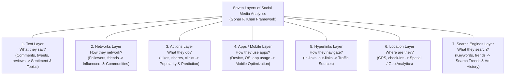
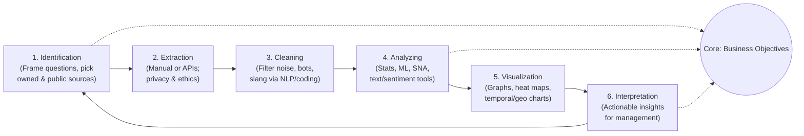

# Module 4: Social Network Structure, Measures & Visualization (and Social Media Analytics Overview)

**Course:** Big Data and Social Media Analytics (`26CMPC71` — VESIT 2026 NEP & Autonomy Scheme, Sem VII)  
**Course Outcome:** `CO4` — *Understand the concept of Social Media Analytics and its significance.* (`08` Theory Hours + Lab Experiments `7`, `9`, and `10` for `PR & OR` Viva)  
**Primary Slides & Curriculum Sources Used (in `26CMPC71` Pedagogical Order):**
1. `module_4/Mod4 Social Network Structure, Measures & Visualization.pdf` (193 slides — *actually Chapter 1: Social Media Analytics: An Overview* = `26CMPC71` Topic `4.1`; note Slides 136–193 duplicate Slides 77–134)
2. `module_4/Mod4B.pptx.pdf` (175 slides — *leftover Chapter 2 cover title "Social Media Analytics: An Overview", actual content: Social Network Structure, Measures & Visualization* = `26CMPC71` Topic `4.2`)
3. `module_4/Mod4d.pdf` (29 slides — *Chapter 2 Subtopic: Social Media Network Analytics* = `26CMPC71` Topic `4.3`, Part A)
4. `module_4/Mod4C.pdf` (45 slides — *Clustering of Social-Network Graphs & Clique Percolation Method* = `26CMPC71` Topic `4.3`, Part B)
5. Official Syllabus: `Final year B. E. (Computer Engineering) (Sem-VII & VIII) Batch  [2023-2027] (2026 ‘NEP & Autonomy’ Scheme).pdf` (`26CMPC71` Topics `4.1`–`4.3` and Lab Experiments `7`, `9`, `10`)

---

## Scope & Topic Checklist

> [!IMPORTANT]
> **File Organization Note (`4.1 -> 4.2 -> 4.3`):**  
> Even though the first PDF is named `Mod4 Social Network Structure, Measures & Visualization.pdf`, its actual slides teach **Chapter 1: Social Media Analytics: An Overview** (`26CMPC71` Topic `4.1`), with zero graph theory inside. Meanwhile, `Mod4B.pptx.pdf` teaches Topic `4.2` (*Structure, Measures & Visualization*), and `Mod4d.pdf` + `Mod4C.pdf` teach Topic `4.3` (*SM Network Analytics, Graph Clustering & Clique Percolation Method*). These notes follow the official **`26CMPC71` sequence (`4.1 -> 4.2 -> 4.3` + Lab Exps 7, 9, 10)** so your understanding builds smoothly from zero background.

| # | Topic / Subtopic | Official Syllabus Ref | Slide / Lab Coverage | Status |
|---|---|---|---|---|
| 1 | Global Social Media Facts, Scope, Metrics & Evolution | `4.1` | `Mod4` pp. 1–32 | `[x]` |
| 2 | Web 1.0/2.0/3.0, Core Characteristics & 8 Categories of Social Media | `4.1` | `Mod4` pp. 33–64 | `[x]` |
| 3 | Social Media Landscape, Need for SMA & SMA in Small vs. Large Organizations | `4.1` | Listed `Mod4` p. 33 & `26CMPC71` `4.1` *(omitted in slides — added from syllabus & sources)* | `[x]` |
| 4 | SMA Applications, Definition (Art & Science), SMA vs. Traditional BA, Seven Layers | `4.1` | `Mod4` pp. 65–98 | `[x]` |
| 5 | 4 Types of Analytics (Descriptive, Diagnostic, Predictive, Prescriptive), SMA Cycle, Challenges & Tools | `4.1` | `Mod4` pp. 99–135 *(136–193 duplicate)* | `[x]` |
| 6 | Graph Basics, Representations (Matrix, List, Edge List, XML), Neighborhood & Degree | `4.2` | `Mod4B` pp. 1–29 | `[x]` |
| 7 | Subnetworks (Singleton, Dyad, Triad, Cliques, Ego Networks), Paths, Connectedness, Bridges, Hubs + Solved Exercises | `4.2` | `Mod4B` pp. 30–57 *(Dyad/Triad filled)* | `[x]` |
| 8 | Network Measures: Degree Distribution, Density & 1.5-Ego Local Clustering Coefficient | `4.2` | `Mod4B` pp. 58–76, 128 | `[x]` |
| 9 | Four Centrality Measures (Degree, Closeness, Betweenness, Eigenvector) + Worked `Fig 3.4` | `4.2` | `Mod4B` pp. 77–112 | `[x]` |
| 10 | Connectivity (Cohesion), Freeman Network Centralization ($NC_D, NC_C, NC_B$) + Solved Exercise | `4.2` | `Mod4B` pp. 113–128 | `[x]` |
| 11 | Tie Strength (Granovetter 1973/1974) & Trust (McKnight 1998, Johnson-George & Swap 1982, Inference) | `4.2` | `Mod4B` pp. 129–155 | `[x]` |
| 12 | Network Visualization: Guidelines, Pre-Attentive Processing, Layouts, Feature Mapping, Hairballs & Simplification | `4.2` | `Mod4B` pp. 156–175 | `[x]` |
| 13 | Social Media Network Analytics: Purposes (Multiplexity), Taxonomies, 12 SM Network Types, Structural Holes, Diameter, Clustering Coefficient & Tools | `4.3` | `Mod4d` pp. 1–29 *(Structural Holes & Diameter filled)* | `[x]` |
| 14 | Graph Clustering, Disjoint vs. Overlapping Communities & Clique Percolation Method (CPM) + Worked MU Exam Solutions | `4.3` | `Mod4C` pp. 1–45 | `[x]` |
| 15 | Lab Connections (`PR & OR` Viva): Exps 7, 9, 10 & **Louvain Community Detection** vs. CPM | Lab `7, 9, 10` | `26CMPC71` Lab Syllabus + NetworkX | `[x]` |

**Assumptions & Source Notes:**
- **Zero-prior-knowledge assumption:** Graph theory (vertices, edges, matrices, shortest paths), linear algebra (eigenvalues/eigenvectors), percentages/regression, and Python `NetworkX` are taught from scratch before formulas are applied.
- **Primary textbooks reflected in slides:** Your professor's slides draw heavily on two official `26CMPC71` textbooks: **Gohar F. Khan** (*Seven Layers of Social Media Analytics*, 2015) for Parts `4.1` and `4.3` (`Mod4`, `Mod4d`), and **Jennifer Golbeck** (*Analyzing the Social Web*, 2013) for Part `4.2` (`Mod4B` Figures 2.6–6.1).

---

# Part 4.1 — Social Media Analytics Overview (`Mod4` Slides 1–135; `26CMPC71` Topic 4.1)

## 1. Global Social Media Usage Facts, Scope & Core Metrics (`Mod4` pp. 1–32)

### 1.1 Global Social Media Landscape Snapshot (Oct 2024 Slides, pp. 2–9)
Before diving into algorithms, why do businesses invest heavily in analyzing social platforms? Your slides cite global adoption benchmarks (DataReportal / We Are Social / Meltwater **Digital October 2024 Global Statshot** and Search Logistics infographics):
- **Global Scale (`Mod4` p. 3, Oct 2024):** **5.22 billion** active social media **user identities** worldwide (`63.8%` of total global population; `86.3%` of adults aged 18+; `94.5%` of all internet users), growing `+5.2%` year-on-year (`+256 million` identities). *(Slide 2 shows an earlier global summary graphic listing 7.99B population, 5.48B mobile users, 5.07B internet users, and 4.74B active social media users — DataReportal advisory explicitly notes "user identities" may exceed unique individuals because people maintain multiple or business accounts.)*
- **Time & Demographics (`Mod4` p. 3, p. 9):** Users average **2 hours 19 minutes/day** (Oct 2024 GWI data; an older Search Logistics graphic on p. 9 cites `144 minutes/day` = `72 hours/month` = `5.7 years` over a lifetime) across an average of **6.8 platforms per month**, split `46.3%` female and `53.7%` male user identities.
- **Platform Ranking — Active User Index (`Mod4` p. 4, Aug 2024 data.ai mobile handset index):** YouTube (`100.0`), WhatsApp (`85.7`), Facebook (`83.2`), Instagram (`71.4`), Facebook Messenger (`48.8`), TikTok (`47.1`), Telegram (`33.4`), Snapchat (`24.4`), X/Twitter (`22.3`), Pinterest (`19.0`), Discord (`12.3`), LinkedIn (`11.5`), Threads (`9.2`), LINE (`7.0`), Reddit (`6.5`). *(Note: China is excluded in this index, and TikTok is blocked in India.)*
- **Multi-Platform Audience Overlap (`Mod4` p. 5, GWI Q2 2024):** Almost **no users are exclusive to a single platform**! Look at the *"Unique to Platform"* column: only `1.1%` of YouTube users, `0.6%` of Facebook users, `0.2%` of X users, and `0.1%` of Instagram/TikTok/Reddit users use *only* that app (highest is LINE at `4.5%`). For example, `80.5%` of X users also use YouTube and `87.1%` also use Instagram — meaning brands must analyze **cross-platform behavior**, not one app in isolation.
- **Why People Use Social Media (`Mod4` pp. 6–7):** Broadly split into **Entertainment** (connecting with friends/family, watching videos, passing time) and **Work** (connecting with customers, advertising, brand updates). GWI's top specific motivations are *keeping in touch with friends/family* (`51.5%`), *filling spare time* (`39.0%`), *reading news* (`34.4%`), *finding content* (`30.4%`), *seeing what's trending* (`29.1%`), and *finding products to buy* (`26.9%`).
- **Social Media Addiction Risk (`Mod4` p. 8):** Slide 8 cites industry estimates of over `210 million` people experiencing social media addiction and elevated mental-health risk among teens spending `>5 hours/day`. *(Treat Search Logistics infographic numbers on pp. 8–9 as rough industry estimates rather than clinical epidemiology.)*

### 1.2 Scope of Social Media Analytics & the 6 Metric Categories (`Mod4` pp. 10–32)

**Social Media Analytics (SMA)** measures performance across five major pillars (`Mod4` pp. 10–32):

#### Pillar 1: Measurement of Social Media Metrics (`Mod4` pp. 11–16)
Every metric answers a specific business question:

| Category | Metric Name | Slide Formula / Definition | Plain-Language Meaning & Beginner Tip |
|---|---|---|---|
| **1. Engagement** | Likes / Reactions, Comments, Shares / Retweets | Counts of user interactions on a post | Likes = low effort; Comments = deeper thought; Shares = endorsement/advocacy |
| **1. Engagement** | **Click-Through Rate (CTR)** | Percentage of viewers who click a link in your post: $\frac{\text{Clicks}}{\text{Impressions}} \times 100$ | Measures how compelling your call-to-action or link preview is |
| **1. Engagement** | **Engagement Rate** | $(\text{Total Engagements} \div \text{Total Followers}) \times 100$ | *Worked example:* `250` likes+comments+shares on a page with `5,000` followers $\implies \frac{250}{5000}\times 100 = 5\%$. *(Note: many modern tools also compute Engagement Rate by **Reach** or **Impressions** when algorithms show posts to non-followers.)* |
| **2. Reach & Impressions** | **Impressions** vs. **Reach** | **Impressions** = total times displayed; **Reach** = **unique users** who saw it | If 1 person scrolls past your reel 3 times, **Reach = 1**, **Impressions = 3**! Always $\text{Impressions} \ge \text{Reach}$. |
| **2. Reach & Impressions** | **Virality Rate** | $(\text{Shares} \div \text{Impressions}) \times 100$ | Measures how often viewers amplify content by sharing it (`50` shares / `2,000` impressions $= 2.5\%$) |
| **3. Audience Growth** | **Follower Growth Rate** & Unfollow Rate | $(\text{New Followers} \div \text{Total Followers}) \times 100$; Unfollow count | Tracks net audience momentum over time |
| **4. Conversion** | **Conversion Rate** | $(\text{Conversions} \div \text{Clicks}) \times 100$ | Out of people who clicked, how many completed the target goal (purchase, signup, download)? |
| **4. Conversion** | Lead Gen, **CPC**, **ROI** | Leads = sign-ups/inquiries; **Cost Per Click (CPC)** = Ad spend $\div$ clicks; **Return on Investment (ROI)** = revenue vs. investment | Connects social activity directly to money (`ROI = (Net Gain / Cost) × 100`) |
| **5. Customer Experience** | Response Time, Sentiment, **CSAT** | Avg reply time; positive/negative/neutral tone; **Customer Satisfaction Score (CSAT)** from feedback | Measures service quality and brand reputation |
| **6. Video Metrics** | Views, Watch Time, Completion Rate | Total plays, cumulative minutes watched, `%` watching the entire video | Critical for YouTube, Instagram Reels, and TikTok recommendation algorithms |

#### Pillars 2–5: Four Analytical Angles & Evolution (`Mod4` pp. 17–32)
- **Audience Analysis (`Mod4` pp. 17–22):** Profiling *who* engages with you across four lenses:
  1. **Demographics:** Age, gender, location, language, education & occupation.
  2. **Psychographics:** Hobbies, values & beliefs, buying behavior, pain points/challenges.
  3. **Behavioral Analysis:** Active hours, preferred formats (Reels vs. carousels), engagement frequency, brand tags/mentions.
  4. **Audience Sentiment Analysis:** Using **Natural Language Processing (NLP)** — automated computer understanding of human text — to classify comments/reviews as positive, negative, or neutral and gauge brand perception.
- **Network Analysis (`Mod4` p. 23):** Examining connections between users to see *how information spreads* (virality, fake news), *who key influencers are*, and *how communities form*. *(Covered deeply in Parts 4.2 and 4.3!)*
- **Content Analysis (`Mod4` pp. 24–25):** Comparing performance across formats — Images, Short/Long Videos, Text posts/threads, Live Streams, Stories & Polls. *(Slide example: A brand discovers Instagram Reels drive `3x` more engagement than static images and shifts budget to video.)*
- **Competitor Analysis (`Mod4` pp. 26–27):**
  - *Direct Competitors:* Same product/service (Nike vs. Adidas).
  - *Indirect Competitors:* Same target audience with different offerings (e.g., Netflix vs. mobile gaming competing for evening leisure time).
  - Five steps: (a) Identify competitors, (b) Content strategy, (c) Engagement & performance, (d) Follower growth & demographics, (e) Paid ad strategy.
- **Evolution of Social Media Analytics (`Mod4` pp. 29–30):**
  1. *Pre-2000s:* Early blogs, forums, message boards; minimal analytics tools.
  2. *Rise of Web 2.0 (2000s):* MySpace, LinkedIn, Facebook; initial data collection tools emerge.
  3. *Growth of Social Media (2010s):* Twitter, Instagram, YouTube surge; SMA becomes vital for business.
  4. *Tech Advancement (2012–2015):* Machine Learning (ML) and NLP tools unlock sentiment/topic insights.
  5. *Business Adoption (2015–2022):* Organizations embed social metrics into mainstream decision-making.
  6. *Real-Time Data & AI (2022–now):* Real-time streaming and Artificial Intelligence (AI) drive instant decisions and predictions.
- **Initial Tools Snapshot (`Mod4` pp. 31–32):** Data scraping (`Scrapy`, `BeautifulSoup`, `Apify`), Visualization (`Tableau`, `Power BI`, `Gephi`), NLP (`NLTK`, `Stanford CoreNLP`, `TextBlob`), Network analysis (`Gephi`, `Cytoscape`, `NodeXL`), ML (`scikit-learn`, `TensorFlow`, `Keras`), Management (`Hootsuite`, `Buffer`, `Sprout Social`), Sentiment (`Sentiment140`, `NLTK`, `TextBlob`), Social listening (`Mention`, `Hootsuite Insights`, `Brand24`).

---

## 2. Web Foundations, Core Characteristics & 8 Types of Social Media (`Mod4` pp. 33–64)

### 2.1 Internet vs. World Wide Web & Web 1.0 $\to$ 2.0 $\to$ 3.0 (`Mod4` pp. 35–37)
Beginners often mix up "the Internet" and "the Web":
- **Internet:** The physical global hardware network of computers, smartphones, switches, routers, cables, and satellites.
- **World Wide Web (WWW):** One software service running *on top of* the Internet — interlinked hypertext documents (websites) viewed through browsers.

| Generation | Nickname | Flow & User Role | Key Idea & Examples |
|---|---|---|---|
| **Web 1.0** | Read-only Web | **One-way** (one-to-many); users are **passive readers** | Static pages built by developers; readers cannot comment or contribute |
| **Web 2.0** | Participatory / Social Web | **Two-way & many-to-many**; users create **User-Generated Content (UGC)** | Blogs, wikis, podcasting, social tagging, Facebook, YouTube |
| **Web 3.0** | Semantic Web / Linked Data | **"Web of Data"**; machine-readable links across datasets | Uses **Resource Description Framework (RDF)** so software apps can query relationships between facts automatically |

> **Beginner Note on Web 3.0 (`Mod4` p. 37):** In academic/textbook definitions (Tim Berners-Lee / Gohar Khan), **Web 3.0** refers to the **Semantic Web** (structured machine-readable linked data using RDF, so a search engine understands *"Tom Hanks" $\to$ actedIn $\to$ "Apollo 13"* rather than just matching text strings). In recent industry usage, some also use "Web3" for blockchain-based decentralized apps — mention the **Semantic Web + RDF** definition from your slides first!

### 2.2 What Is Social Media & Its 8 Core Characteristics (`Mod4` pp. 38–40)
- **Definition (`Mod4` pp. 38–39):** Social media is any easy-to-use Internet-based platform (public like Facebook/YouTube or proprietary/purpose-built) that enables users to create, collaborate, and exchange content (text, video, audio, graphics) in a **many-to-many** context.
- **8 Core Characteristics (`Mod4` p. 40):**
  1. **Many-to-Many:** Anyone can broadcast to and interact with many others (unlike TV's one-to-many).
  2. **Participatory:** Blurs the line between media creators and consumers.
  3. **User Owned:** Content is largely created and driven by users (`UGC`).
  4. **Conversational:** Built around two-way replies, threads, and dialogue rather than one-way broadcasts.
  5. **Openness:** Few barriers to posting, commenting, sharing, and voting.
  6. **Mass Collaboration:** Thousands of strangers co-create value together (e.g., Wikipedia articles, open-source software).
  7. **Relationship Oriented:** Centered on building and maintaining social ties (friends, followers, groups).
  8. **Free and Easy to Use:** Zero financial cost to join and minimal technical skill required.

### 2.3 Access Mechanisms & 8 Categories of Social Media (`Mod4` pp. 41–64)

**Authentication / Access Split (`Mod4` pp. 41–43):**
1. **Internet-based social media:** Accessed primarily via email/account login across web or mobile apps (e.g., Facebook, LinkedIn, Cyworld, Google+).
2. **Smartphone-based social media:** Registered and accessed via **mobile phone number** (e.g., KakaoTalk, WhatsApp; *note Slide 43 prints `"KaKao Talk, Tender"` — `"Tender"` is a typo for **Tinder**, which supports phone-number verification*).

**8 Categories of Social Media (`Mod4` pp. 44–64):**

1. **Social Networking Sites (SNS) (`Mod4` pp. 45–46):** Platforms focused primarily on building and maintaining personal/professional relationships (e.g., Facebook, Instagram, LinkedIn, and formerly Google+). Businesses use Facebook Fan Pages for advertising and customer interaction, governed by business review questions (goal alignment, moderation ownership, naming, content policy, legal mandate, feedback analytics, security).
2. **Content Communities (`Mod4` pp. 47–49):** *"A group of people joining online around an object of interest held in common."* Examples: YouTube (video), Reddit (discussion/links), Pinterest (visuals/ideas), DeviantArt (art), Medium (writing), Flickr *(slide typo `"Flicker"`)* (photos), Quora (Q&A). Businesses use YouTube for ads, product education, and training.
3. **Blogs (`Mod4` pp. 50–53):** Online personal or organizational spaces (e.g., WordPress, Blogger — *note Slide 50 prints `bloggers.com`, whereas the actual platform domain is `blogger.com`*) publishing regular posts. Four key features:
   - **Interactivity** (reader comments), **Archives** (reverse-chronological order — newest first), **Subscription** (email/RSS alerts), **Focused** (centered on a clear niche/topic).
4. **Microblogs (`Mod4` pp. 54–59):** Miniature blogging for short real-time updates (text, images, links), exemplified by **Twitter (now X)**. Key terms taught in slides: **Tweet**, **Retweet (RT)**, **Direct Message (DM)**, **Following**, **Followers**, **Mention (`@`)**, and **Hashtags (`#`)**.

> [!WARNING]
> **PPT Verification Check — Twitter/X Post Character Limit & DM Rules (`Mod4` Slides 55–56):**
> - **PPT says:** Slide 55 defines a tweet as *"a one hundred forty-character message"* and states DMs *"can only be sent to people following you"*.
> - **Verified clarification ([X Developer Docs — Counting Characters](https://docs.x.com/fundamentals/counting-characters) & [Twitter / X history](https://en.wikipedia.org/wiki/Twitter)):**
>   1. **Character limit:** Twitter doubled its standard limit from `140` to **`280` characters** in **2017** (with weighted Unicode counting: emojis and Chinese/Japanese/Korean [CJK] characters count as `2`, any shortened `t.co` URL counts as `23`, and attached media costs `0`). Since **2023**, paid **X Premium** subscribers can write long-form posts up to **`25,000` characters** (earlier raised to 4,000/10,000, then 25,000).
>   2. **DM permissions:** Modern X allows users to toggle *"Allow message requests from everyone"* or *"Verified users"* — so DMs are no longer strictly restricted only to mutual/inbound followers depending on privacy settings.
> - **What to say in the viva:** *"Historically, tweets were capped at 140 characters as mentioned in our notes, which was expanded to 280 characters for standard accounts in 2017 — and up to 25,000 characters for X Premium subscribers today."*

5. **Online Collaborative Projects / Wikis (`Mod4` pp. 60–61):** Tools enabling users to collaboratively create, edit, and monitor shared content (e.g., Wikipedia, Google Sites).
6. **Folksonomies or Social Tagging (`Mod4` p. 62):** Organizing and indexing content from the *user's own perspective* through collaborative tags (e.g., social bookmarking like `del.icio.us`). *(Think "folk + taxonomy" — bottom-up tagging by regular users rather than a rigid top-down library catalog!)*
7. **Virtual Worlds (`Mod4` p. 63):** Computer-generated 3D environments where users interact as avatars via text/voice — including social/gaming worlds (*Second Life*), remote campuses (*VirBELA*), and *Medical Virtual Reality (VR)* surgical simulations.
8. **Mobile Apps & Purpose-Built Platforms (`Mod4` pp. 39, 44, 64):** Special-purpose mobile tools used on the move (messaging, social networking, shopping), plus custom enterprise/purpose-built collaboration portals.

> [!NOTE]
> **PPT Verification Check — Retired Platforms Mentioned in Part 4.1 (`Mod4` pp. 42, 45, 60, 62):**
> - **Google+ (pp. 42, 45):** Shut down for consumer and brand accounts on **April 2, 2019** ([Google Blog](https://blog.google/innovation-and-ai/technology/safety-security/expediting-changes-google-plus/), [Wikipedia](https://en.wikipedia.org/wiki/Google%2B)).
> - **Wikispaces (p. 60, `"wiki-spaces"`):** Closed free/classroom sites on **July 31, 2018**, and private sites on **January 31, 2019** ([Wikipedia](https://en.wikipedia.org/wiki/Wikispaces)).
> - **Del.icio.us (p. 62):** Early Web 2.0 bookmarking pioneer; largely inactive/archived since 2017 after Pinboard's acquisition.
> - **What to say in the viva:** Cite Facebook, Instagram, LinkedIn, and Wikipedia as active examples, and briefly note that Google+ (2019) and Wikispaces (2018–2019) are historical examples from the textbook era.

### 2.4 Viva Preparation — Web Evolution, Core Characteristics & Categories
- **Quick definition:** Social media comprises Web 2.0 Internet/mobile platforms enabling many-to-many User-Generated Content (UGC), conversation, and mass collaboration across categories like SNS, content communities, blogs, microblogs, wikis, folksonomies, virtual worlds, and mobile apps.
- **Explain it to the examiner (30–60s):** *"Sir/Ma'am, social media grew out of the shift from Web 1.0 — static, read-only websites — to Web 2.0, which enabled two-way, many-to-many User-Generated Content, while Web 3.0 adds machine-readable linked data using RDF. Its core traits are being participatory, conversational, open, user-owned, relationship-oriented, and free to use. We classify platforms into eight categories: social networking sites like LinkedIn, content communities like YouTube, blogs like WordPress, microblogs like X/Twitter, collaborative wikis like Wikipedia, folksonomies for user-driven tagging, 3D virtual worlds, and mobile apps."*
- **Examiner follow-ups:**
  1. *Q: What is the difference between a Blog and a Microblog?*  
     **A:** Blogs host long-form, deep-dive posts arranged in reverse-chronological archives (e.g., WordPress), while microblogs emphasize rapid, concise real-time updates, hashtags (`#`), and instant sharing (e.g., X/Twitter).
  2. *Q: Why is a "Folksonomy" different from a traditional taxonomy?*  
     **A:** A taxonomy is designed top-down by experts using fixed categories, whereas a folksonomy emerges bottom-up as everyday users assign their own free-form tags to bookmarks, photos, or posts.

---

## 3. Syllabus Gap Fill (`26CMPC71` 4.1 & `Mod4` p. 33): Landscape, Need for SMA & Small vs. Large Organizations

> [!IMPORTANT]
> **Why This Section Exists:** Both your official `26CMPC71` syllabus (`4.1`) and `Mod4` Slide 33 (*Chapter 1 Contents*) explicitly list **Social Media Landscape**, **Need for Social Media Analytics (SMA)**, and **SMA in small & large organizations** — yet the slide deck skips directly from Slide 64 to Applications! Below is complete, viva-ready coverage for all three topics.

### 3.1 Social Media Landscape
- **Basic Idea:** The **social media landscape** is the complete ecosystem of platforms, channels, audiences, and media types through which individuals and brands interact online. Rather than one monolithic network, it spans specialized spaces:
  - *Publishing & Blogging:* WordPress, Medium, Substack.
  - *Microblogging & Real-Time News:* X (Twitter), Threads, Bluesky.
  - *Professional & Personal Networking:* LinkedIn, Facebook.
  - *Visual & Short-Form Video:* Instagram, YouTube, TikTok, Pinterest, Snapchat.
  - *Messaging & Private Dark Social:* WhatsApp, Telegram, Discord, Slack.
  - *Forums, Q&A & Reviews:* Reddit, Quora, Google Reviews, Trustpilot.
- **Three Strategic Media Types in the Landscape:**
  1. **Owned Media:** Channels the company controls (official website, brand blog, official YouTube/Instagram handle).
  2. **Paid Media:** Sponsored posts, targeted display/video ads, paid influencer collaborations.
  3. **Earned Media:** Organic mentions, shares, word-of-mouth, reviews, and viral hashtags created voluntarily by customers.
- **Why Landscape Awareness Matters:** As shown in `Mod4` Slide 5, `99%+` of users span multiple platforms. A teenager might discover a sneaker on Instagram Reels (visual discovery), search reviews on Reddit/YouTube (validation), and share a link privately in a WhatsApp group ("dark social").

### 3.2 Need for Social Media Analytics (SMA)
Why can't a manager simply scroll through comments manually and guess what customers think?
1. **Scale & Speed Exceed Human Reading:** Thousands of brand mentions, reviews, and hashtags arrive every minute across platforms, languages, and formats.
2. **Proactive Crisis Detection & Reputation Protection:** Detecting a sudden spike in negative sentiment (e.g., a product defect or service outage) within minutes prevents a small complaint from becoming a PR disaster.
3. **Evidence-Based Marketing & ROI:** Proves which campaigns drive real website clicks, leads, and sales rather than "vanity metrics" like empty likes.
4. **Voice of the Customer & Product Innovation:** Unfiltered social feedback reveals bugs, missing features, and emerging consumer tastes faster than slow quarterly surveys.
5. **Competitive Benchmarking & Influencer Discovery:** Shows how competitors perform ("share of voice") and identifies authentic opinion leaders who actually drive engagement.

### 3.3 SMA in Small vs. Large Organizations
While *both* small and large businesses need social analytics, their **goals, budgets, team structures, and toolchains** differ dramatically:

| Dimension | Small Organizations (Startups, Local Cafés, SMEs) | Large Organizations (Multinationals, Banks, Global Brands) |
|---|---|---|
| **Primary Objectives** | Brand awareness, local footfall/sales, direct customer replies, low-cost lead generation | Multi-market brand health, 24/7 crisis monitoring, competitive benchmarking, churn/demand forecasting |
| **Team & Skills** | 1–2 multitaskers (founder or social media marketer); little dedicated data science staff | Dedicated cross-functional teams: social listening analysts, data engineers, NLP/ML scientists, PR crisis desk |
| **Budget & Tools** | Free or low-cost native & SaaS tools: **Meta/Facebook Insights, Google Analytics (GA4), YouTube Studio, Buffer, Hootsuite Basic, Google Trends** | Enterprise platforms & custom pipelines: **Sprinklr, Emplifi (formerly Socialbakers), Meltwater, Brandwatch**, plus Python/Spark/Kafka NLP & graph systems |
| **Data Scale & Complexity** | Hundreds to thousands of posts/comments; mostly owned-page metrics + local hashtags | Millions of global multilingual posts, cross-platform dark/public feeds, CRM + ERP integration |
| **Analytics Maturity** | Mostly **Descriptive** (what got likes/clicks this week?) and basic **Diagnostic** | Full spectrum from **Descriptive $\to$ Diagnostic $\to$ Predictive $\to$ Prescriptive** optimization |
| **Governance & Risk** | Informal posting policies; low regulatory overhead | Strict compliance, privacy policies (GDPR/DPDP), multi-tier approval workflows, legal risk teams |

### 3.4 Viva Preparation — Landscape, Need & Small vs. Large Organizations
- **Explain it to the examiner (30–60s):** *"Sir/Ma'am, the social media landscape is a multi-platform ecosystem spanning networking, video, microblogging, messaging, and review forums, across owned, paid, and earned media. We need Social Media Analytics because human managers cannot manually track thousands of multilingual comments arriving every second — SMA turns noisy posts into measurable ROI, product feedback, and early crisis alerts. Small organizations mainly use free native tools like Meta Insights and Google Analytics for descriptive engagement and local conversions, whereas large enterprises deploy dedicated data teams and enterprise listening or custom NLP pipelines for real-time crisis detection, competitor benchmarking, and predictive forecasting."*
- **Common mistakes to avoid:** Assuming only giant companies can do SMA (a local coffee shop checking Instagram reach and discount conversions is already doing SMA!), or confusing **owned media** (your official page) with **earned media** (unpaid customer shares/reviews).

---

## 4. SMA Definition, SMA vs. Traditional BA, Seven Layers, 4 Types, Cycle, Challenges & Tools (`Mod4` pp. 65–135)

### 4.1 Ten Business Applications & Indicator Mapping (`Mod4` pp. 65–76)
Your slides highlight **10 core applications** (`Mod4` pp. 65–74):
1. Sentiment Analysis, 2. Audience Segmentation, 3. Brand Monitoring, 4. Campaign Analysis (conversion funnel), 5. Content Analysis, 6. Market Research, 7. Social Listening, 8. Crisis Management, 9. Competitor Analysis, 10. Customer Service (plus Customer Journey, Lead Gen, Influencer Marketing, Event Promotion).

Slides 75–76 map raw social metrics to **4 Marketing/Communication Performance Indicators**:
- **Social Media Presence:** Number & frequency of posts.
- **Exposure** (*times content is viewed*): Visits, comments, clickthroughs, video views, pageviews, ratings.
- **Reach** (*unique people reached*): Followers/fans, likes, discussion participants, unsubscribed followers, follower demographics.
- **Engagement** (*people actively sharing/discussing*): Shares/retweets, downloads, mentions/tags, discussion volume, user-generated follow-up content, `#` and `@` feature usage.

### 4.2 SMA Definition ("Art and Science") & SMA vs. Traditional Business Analytics (`Mod4` pp. 77–85, 97–98)
- **Official Slide Definition (`Mod4` p. 77):** *"Social Media Analytics is the **art and science** of extracting valuable hidden insights from vast amounts of **semistructured and unstructured** social media data to enable informed and insightful decision making."*
  - **Why Science? (`Mod4` p. 78):** It uses systematic identification, extraction, statistical modeling, NLP, and graph algorithms.
  - **Why Art? (`Mod4` p. 79):** It requires human judgment to interpret messy context (sarcasm, culture) and align insights with business goals.
- **Core Purpose (`Mod4` pp. 83–85):** Enable informed decision-making and know customers better by answering concrete questions (e.g., sentiment polarity, top influencers and network positions, website traffic drivers, customer geography, trending keywords, competitor performance).

**Comparison 1 — Data & Architectural Differences (`Mod4` p. 82 / p. 97, 13-Row Slide Table):**

| Social Media Analytics (SMA) | Traditional Business Analytics (BA) |
|---|---|
| Semi-structured and unstructured data (tweets, videos, JSON) | Structured tabular data (SQL tables, rows/columns) |
| Data is **not** analytics-friendly (needs heavy cleaning/NLP) | Data is already analytics-friendly (clean schemas) |
| **Real-time** streaming data | Mostly **historical** batch data |
| **Public** data (open posts, comments, trends) | **Private** internal company data |
| Stored in **third-party** platform databases (Meta, X, Google) | Stored in **business-owned** databases / warehouses |
| Boundary-less (across the public Internet) | Bound within the **business intranet** |
| High volume | Medium to high volume |
| Highly diverse, multilingual, multi-format | Uniform format |
| Widely shared over the Internet | Shared only within the organization |
| **More sharing** creates greater value/impact (network effect) | **Less sharing** (secrecy/exclusivity) creates competitive value |
| **No business control** over raw platform data or API rules | **Tightly controlled** by the business |
| Socialized data (opinions, networks) | Organizational data (ERP, payroll, inventory) |
| **Informal** in nature (slang, emojis, sarcasm) | **Formal** in nature (invoices, ledgers) |

**Comparison 2 — Business Aspects (`Mod4` p. 98, 6-Row Slide Table):**
- *Data Sources:* Social platforms (Facebook, X, Instagram, LinkedIn, TikTok, YouTube) vs. ERP, CRM, financial reports, supply chain, sales.
- *Metrics Used:* Likes, shares, comments, reach, engagement rate, sentiment, hashtag performance vs. revenue, profit margins, churn/retention, market share, supply-chain efficiency.
- *Tools Used:* Hootsuite, Sprout Social, Buffer, Brandwatch, Google Analytics, **Socialbakers** vs. Tableau, Power BI, Google Analytics, SAP, IBM Cognos, SQL, Python, Excel.
- *Example Use Case:* Tracking how a viral campaign impacts brand awareness vs. analyzing how seasonal sales trends affect inventory management.

> [!NOTE]
> **PPT Verification Check — `Socialbakers` $\to$ `Emplifi` (`Mod4` p. 98):**
> - **PPT says:** Slide 98 lists `Socialbakers` under SMA Tools.
> - **Verified clarification ([Emplifi — Wikipedia](https://en.wikipedia.org/wiki/Socialbakers)):** Socialbakers was acquired by Astute in 2020 and officially **rebranded as Emplifi in June 2021**.

### 4.3 Seven Layers of Social Media Analytics (`Mod4` pp. 86–94)
Introduced by **Dr. Gohar F. Khan** (*Seven Layers of Social Media Analytics*, 2015), this framework breaks customer behavior into **seven complementary data layers** (`Mod4` pp. 86–94). Look at the **7-question customer mapping** on Slide 87:



**Why seven layers instead of just counting likes?** A single layer tells an incomplete story. For instance, a video might get `10,000` Likes (**Actions**), yet **Text** comments might be sarcastic complaints, **Location** might show those viewers aren't even in your serviceable country, and **Networks** might reveal all likes came from a small bot cluster!

### 4.4 Four Types (Levels) of Analytics (`Mod4` pp. 99–113)
Note that Slide 99 shows a 3-bubble diagram (*Descriptive, Predictive, Prescriptive*), while Slides 103–110 expand this to the standard **4 levels of analytics** moving from *Hindsight* to *Foresight* (`Mod4` p. 103):

1. **Descriptive Analytics (*"What happened / What is happening?"* — Hindsight):** Summarizes historical social data into reports, dashboards, charts, and counts (likes, views, monthly sales).
   - *Ice Cream Case (`Mod4` p. 104):* Sales line chart across Regions 1–6 shows Ice Cream X dropped in **Region 2** in 2016 compared to 2015.
   - *Coffee Shop (`Mod4` p. 109):* *"Engagement and sales dropped by 25% this month."*
   - *Coca-Cola (`Mod4` p. 110):* *"`#ShareACoke` campaign increased social media engagement by 30%."*
2. **Diagnostic Analytics (*"Why did it happen?"* — Hindsight):** Drills down into root causes using correlations, competitor overlays, and sentiment breakdowns.
   - *Ice Cream Case (`Mod4` p. 105):* Region 2 market-value bar chart reveals a new **Local Ice Cream** brand entered in 2016, eating into X, Y, and Z's share.
   - *Coffee Shop (`Mod4` p. 109):* *"Posting frequency decreased, no discounts were offered, and competitors launched new campaigns."*
   - *Coca-Cola (`Mod4` p. 110):* *"Engagement dropped due to negative health-related discussions."*
3. **Predictive Analytics (*"What is likely to happen?"* — Foresight):** Uses statistical models, regression, and ML on accumulated historical data to forecast future outcomes.
   - *Ice Cream Case (`Mod4` p. 106):* Regression equation for Region 2:
     $$\text{Sales} = 5.6 + 1.2 \times \text{Advertisement Exp} + 0.5 \times \text{Discount}$$
     - **Variable check:** `5.6` is baseline sales (intercept) when ad spend and discount are zero; each `1` unit increase in `Advertisement Exp` adds `1.2` units of sales, and each `1` unit of `Discount` adds `0.5` units of sales.
     - **Worked numerical check:** If `Advertisement Exp = 10` and `Discount = 4`, then predicted $\text{Sales} = 5.6 + 1.2(10) + 0.5(4) = 5.6 + 12 + 2 = \mathbf{19.6}$.
   - *Coffee Shop (`Mod4` p. 109):* *"Sales will decline further unless a new campaign is introduced."*
   - *Coca-Cola (`Mod4` p. 110):* *"Sustainability campaigns will attract more positive interactions."*
4. **Prescriptive Analytics (*"What is the best course of action?"* — Foresight):** Uses optimization and scenario rules on top of predictions to recommend concrete actions.
   - *Ice Cream Case (`Mod4` p. 107):* (1) Increase Advertising Expense by `10%`, (2) Offer a `5%` Discount for `2` months.
   - *Coffee Shop (`Mod4` p. 109):* *"Increase posts, launch promotions, run contests, and improve customer service."*
   - *Coca-Cola (`Mod4` p. 110):* *"Increase summer ad spend and collaborate with influencers."*

**Google Trends vs. Actual Sales Example — Maruti Baleno (`Mod4` pp. 111–113):**
Look closely at the Google Trends screenshots on Slides 111–112 alongside the August 2022 sales table on Slide 113!
- In Slide 113, **Maruti Suzuki Baleno** is #1 in sales (`18,418` units in Aug 2022, vs. Swift/Alto/others), yet on Slides 111–112 the red line for **`balleno`** sits flat near `<1` while `Suzuki Alto` (`100`), `Suzuki Swift` (`58`), and `Suzuki Ertiga` (`35`) sit much higher!
- **Why?** Two critical analytics lessons from this exact slide screenshot:
  1. **Spelling/Cleaning error:** The analyst typed **`"balleno"`** (misspelled with double `l`!) instead of `"Baleno"`.
  2. **Search Term vs. Topic:** Look at the Google Trends warning banner on p. 111: *"Note: This comparison contains both Search terms and Topics, which are measured differently."* `Suzuki Alto` (*City car*), `Suzuki Swift` (*Compact car*), and `Suzuki Ertiga` (*Multi-utility vehicle*) are **Google Topics** (aggregating all languages/spellings/related queries), whereas `balleno` was entered as an exact **Search term**! Garbage-in (`balleno`) produces misleading flat trends — proving why **Step 3 (Cleaning)** and careful query framing matter!

### 4.5 Social Media Analytics Cycle (`Mod4` pp. 114–124)
The **SMA Cycle** is a continuous 6-step loop orbiting **Business Objectives** (`Mod4` p. 114):



1. **Step 1 — Identification (`Mod4` pp. 115–117):** Define the business question (10 framing questions on p. 116: What to find out? Standard KPIs? Data sources? Quality checks? Statistical methods? ETL? Target audience? Visuals? Gaps? Continuous improvement?) and choose **owned platforms** (official X, Facebook pages, blogs, YouTube) plus **non-official platforms** (Google Trends, public search streams).
2. **Step 2 — Extraction (`Mod4` pp. 118–120):** Gather metrics (comments, likes, mentions, impressions, shares, conversions, engagement time, clicks) manually for small sets or via **Application Programming Interfaces (APIs)** for large sets. **Crucial ethics/privacy rule (`Mod4` p. 118):** Respect user privacy, platform Terms of Service, and data-handling policies!
3. **Step 3 — Cleaning (`Mod4` p. 121):** Remove noise, spam, bots, irrelevant text, and duplicates using automated filtering/NLP/clustering or manual coding.
4. **Step 4 — Analyzing (`Mod4` p. 122):** Apply statistical, ML, NLP, or graph algorithms while preserving data integrity and understanding tool limits.
5. **Step 5 — Visualization (`Mod4` p. 123):** Turn results into network graphs, topical charts, temporal timelines, geospatial maps, trees, or heat maps for executives.
6. **Step 6 — Interpretation (`Mod4` p. 124):** Translate numbers into business action using two strategies: (1) producing **easily consumable analytical results** (clear executive dashboards), and (2) **improving analytics consumption capabilities** (training decision-makers to read insights).

### 4.6 Challenges & Layer-Wise SMA Tools (`Mod4` pp. 125–134)
**Three Core Challenges (`Mod4` pp. 125–128):**
1. **Volume and Velocity:** Millions of posts appear every second; capturing and analyzing at scale is tough.
2. **Diversity:** Multilingual users, cross-cultural slang, varying across time and space — separating signal from noise is time-consuming.
3. **Unstructuredness:** Poor grammar, abbreviations (`idk`, `fyi`), acronyms, sarcasm, and **emoticons/emojis** break rigid SQL/rule-based parsers.

**Layer-Wise Tools Summary (`Mod4` pp. 130–132) with Modern Verification:**

| Layer | Slide Tools (`Mod4` pp. 130–132) | Verified Modern Status / Viva Note |
|---|---|---|
| **Text** | `Discovertext`, `Lexalytics`, `Tweet Archivist`, `Twitonomy`, `Netlytic`, `LIWC`, `Voyant` | `Lexalytics` acquired by InMoment (2021); X/Twitter API paywall limits free scraping in `Twitonomy`/`Tweet Archivist`/`Netlytic` |
| **Actions** | `Lithium`, `Twitonomy`, `Google Analytics`, `SocialMediaMineR` | `Lithium` rebranded as **Khoros**; **Google Analytics 4 (GA4)** replaced Universal Analytics |
| **Network** | `NodeXL`, `UCINET`, `Pajek`, `NetMiner`, `Flocker`, `Netlytic`, `Reach`, `Mentionmapp` | `NodeXL` active via **Social Media Research Foundation**; Python `NetworkX` & `Gephi` also standard; Twitter-only web apps (`Flocker`, `Reach`) affected by X API changes |
| **Mobile** | `Countly`, `Mixpanel`, `Google Mobile Analytics` | `Google Mobile Analytics` evolved into **Google Analytics for Firebase / GA4** |
| **Location** | `Google Fusion Table`, `Tweepsmap`, `Trendsmap`, `Followerwonk`, `Esri Maps`, `Agos` | **RETIRED:** **Google Fusion Tables** was shut down on **December 3, 2019** ([Google Workspace Updates](https://workspaceupdates.googleblog.com/2018/12/google-fusion-tables-to-be-shut-down-on.html)) — modern alternatives include **Kepler.gl**, **QGIS**, **Carto**, and **Looker Studio** |
| **Hyperlinks** | `Webometrics Analyst`, `VOSON` | Academic link-analysis tools covered in Module 5 |
| **Search Engines** | `Google Trends` | Active free Google search-volume trend tool |

*(Note on Slide 133: `"Case Study: The Underground Campaign that Scored Big"` is an empty 3-bullet placeholder in the slide deck; its textbook concept illustrates combining multiple layers — e.g., location, text, and actions — to measure viral guerrilla/subway marketing campaigns.)*

### 4.7 Viva Preparation — Seven Layers, Types & SMA Cycle
- **Quick definition:** The **Seven Layers of SMA** (Gohar F. Khan) organize social analytics into Text, Networks, Actions, Apps/Mobile, Hyperlinks, Location, and Search Engines, executed iteratively through a 6-step cycle (Identification $\to$ Extraction $\to$ Cleaning $\to$ Analyzing $\to$ Visualization $\to$ Interpretation).
- **Explain it to the examiner (30–60s):** *"Sir/Ma'am, Social Media Analytics is both a science—using tools like NLP and graph mining—and an art of aligning insights with business objectives. Unlike traditional Business Analytics, which analyzes structured, private, historical data inside an intranet, SMA handles unstructured, real-time, public data hosted on third-party platforms. Following Gohar Khan's framework, we look across seven layers—Text, Networks, Actions, Apps, Hyperlinks, Location, and Search Engines—and move across four maturity levels: Descriptive (what happened), Diagnostic (why), Predictive (what will happen), and Prescriptive (what action to take), running continuously around the six-step SMA cycle."*
- **Examiner follow-ups:**
  1. *Q: Why is "Cleaning" critical in the SMA cycle? Give an example from our course.*  
     **A:** Social text has slang, bots, typos, and emojis. Even a small query mistake — like searching misspelled `"balleno"` as a raw term instead of the `Baleno` topic in Google Trends — makes the #1 selling hatchback look like it has zero search interest!
  2. *Q: What is the difference between Descriptive and Diagnostic analytics?*  
     **A:** Descriptive reports *what* changed (sales dropped `25%` in Region 2), while Diagnostic uncovers *why* (a local competitor entered and posting frequency dropped).
- **Common mistakes to avoid:** Calling Google Fusion Tables an active tool (shut down Dec 2019); confusing Impressions with Reach; forgetting to include **Business Objectives** at the center of the SMA Cycle.

---

# Part 4.2 — Social Network Structure, Measures & Visualization (`Mod4B` Slides 1–175; `26CMPC71` Topic 4.2)

## 5. Graph Basics & Network Representations (`Mod4B` pp. 1–29)

### 5.1 Basic Idea & Social Network Terms (`Mod4B` pp. 3–14)
A **social network** models social structure using two fundamental building blocks:
- **Nodes / Actors / Vertices ($V$):** The entities in the network ($V = \{v_1, v_2, \dots, v_n\}$, graph size $|V| = n$). In social graphs, nodes represent people, organizations, countries, websites, words, or companies (`Mod4B` pp. 6–7).
- **Edges / Ties / Links ($E$):** Connections between pairs of nodes ($E = \{e_1, e_2, \dots, e_m\}$, edge count $|E| = m$). In social settings, ties capture **6 relationship types** (`Mod4B` p. 9):
  1. *Kinship* (mother of, spouse of)
  2. *Other role-based* (boss of, teacher of, friend of)
  3. *Cognitive/perceptual* (knows, aware of what someone knows)
  4. *Affective* (likes, trusts)
  5. *Interactions* (gives advice, talks to, fights with, lends money to)
  6. *Affiliations* (belongs to the same club/company, physically near)

**Three Relationship Variations (`Mod4B` pp. 10–14):**
1. **Undirected vs. Directed Graphs:**
   - *Undirected edge:* Symmetric/mutual tie (e.g., Facebook friends, co-starring in a movie). $e(v_1, v_2)$ and $e(v_2, v_1)$ are identical.
   - *Directed edge (**arc**):* One-way asymmetric tie (e.g., X/Twitter `A` follows `B`, or `John` sends email to `Mary`). Arrow points from source to target.
2. **Unweighted vs. Weighted Ties:**
   - *Unweighted:* Binary (`1` = connected, `0` = not connected).
   - *Weighted:* Edge carries a numeric weight representing **strength, rank, frequency, or probability** (e.g., `300` emails sent vs `75` returned on p. 10, or in the **Apollo 13** co-star graph on p. 12: *Tom Hanks* and *Gary Sinise* co-starred in `4` other movies like *The Green Mile*, drawn with a thicker line weight `4`, vs weight `1` for others!).

### 5.2 Four Ways to Represent a Graph (`Mod4B` pp. 15–29)
Visual node-link drawings are intuitive for humans, but computers and linear algebra algorithms need structured representations (`Mod4B` p. 16):

1. **Adjacency Matrix (a.k.a. Sociomatrix) (`Mod4B` pp. 17–20):**
   - An $n \times n$ grid $A$ where entry $A_{ij} = 1$ if there is an edge between $v_i$ and $v_j$ (or the edge weight $w_{ij}$ for weighted graphs, p. 20), and $0$ otherwise.
   - Diagonal entries ($A_{ii}$) represent **self-loops** (usually `0` or `-` in simple social networks).
   - **Undirected graphs** have a **symmetric** matrix ($A_{ij} = A_{ji}$, p. 27); **directed graphs** are usually **asymmetric** ($A_{ij}$ = edge from row $i$ to column $j$, e.g., p. 19: `A -> B` and `A -> C` puts `1` in row `A` cols `B,C`, while `C -> A` puts `1` in row `C` col `A`).
   - **Key Limitation (`Mod4B` p. 17):** Real social media networks have millions of nodes where each user connects to only a tiny fraction — so their adjacency matrices are **very sparse** (mostly zeros), wasting $O(n^2)$ memory!
2. **Adjacency List (`Mod4B` pp. 21–23):**
   - Stores each node paired with a list of its connected neighbors (e.g., `v2: v1, v3, v4` on p. 21), saving huge memory on sparse graphs (`O(n + m)`).
   - *(Note on Slide 22–23: Golbeck's textbook slides informally refer to a pair-by-pair list like `Tom Hanks, Bill Paxton, 1` as an "adjacency list, also called an edge list", while computer science distinguishes an **Adjacency List** [node $\to$ list of neighbors, Slide 21] from an **Edge List** [list of `(u, v)` pairs, Slide 24]. Know both terms!)*
3. **Edge List (`Mod4B` pp. 24–27):**
   - Simply lists every edge as an endpoint pair `(u, v)` (plus optional weight).

> [!CAUTION]
> **PPT Verification Check — Edge List Direction Error (`Mod4B` Slide 26):**
> - **PPT says:** Look closely at the directed graph (left) and Adjacency Matrix (bottom right) on Slide 26 (`1->2`, `1->3`, `2->3`, `2->4`, **`4->3`** — matching Slide 25 where John `[4]` asks Mary `[3]` *"Mary, are you hungry?"*, and row 4 col 3 in the matrix is `1` while row 3 col 4 is `0`). However, the **Edge list table** at the top right mistakenly prints **`3 | 4`** instead of **`4 | 3`**!
> - **What to say in the viva:** *"In a directed edge list, vertex order matters: the edge goes from node 4 to node 3, so it must be written `(4, 3)`, matching the adjacency matrix row 4, column 3 = 1."*

4. **XML Standard Format (`Mod4B` p. 29):** Extensible Markup Language tags like `<Person><name>Tom Hanks</name><connection>Bill Paxton</connection>...</Person>` provide human- and machine-readable graph exchange (used in formats like GraphML/GEXF).

### 5.3 Neighborhood & Degree (`Mod4B` p. 28)
- **Neighborhood $N(v)$:** Set of all nodes directly connected to node $v$. In directed graphs, split into **incoming neighbors** $N_{in}(v)$ and **outgoing neighbors** $N_{out}(v)$.
- **Degree $d_i$:** Number of edges connected to node $i$ (size of its neighborhood, $|N(i)|$). In directed graphs:
  - **In-degree ($d_i^{in}$):** Number of edges pointing *toward* node $i$ (e.g., Twitter/X followers).
  - **Out-degree ($d_i^{out}$):** Number of edges pointing *away* from node $i$ (e.g., Twitter/X accounts you follow).

---

## 6. Subnetworks, Paths, Connectedness, Bridges, Hubs & Solved Exercises (`Mod4B` pp. 30–57)

### 6.1 Subnetworks: Singletons, Dyads, Triads, Cliques & Ego Networks (`Mod4B` pp. 30–48)
A **subnetwork (subgraph)** is any subset of nodes and edges taken from a graph (`Mod4B` p. 30, `Fig 2.6`).

1. **Singleton (`Mod4B` pp. 32–36):** A node with degree `0` (zero edges, e.g., Node `A` in `Fig 2.6`). Common in social platforms as inactive accounts, **lurkers** (read without posting), new buyers/sellers with no transactions yet, fake/test/spam accounts, unanswered emails, or uncited papers. *Why study singletons?* They reveal ghost-account rates, network engagement health, and potential spam/fraud.
2. **Dyad & Triad (`Mod4B` pp. 30–31 — *Definitions Omitted in Slides*):**
   - Look at `Fig 2.6` (Slide 30) and Slide 31: the deck lists `Singleton`, `Dyad`, `Triad`, then jumps straight from `Singleton` (p. 36) to `Cliques` (p. 37)! Here are the exact missing definitions for your viva:
   - **Dyad:** A subnetwork of **two nodes** and the tie (or absence of tie) between them — e.g., **`B–C`** in `Fig 2.6`! It is the smallest unit of social relationship (in a directed graph, a dyad can be null [no edges], asymmetric [one-way], or mutual [two-way]).
   - **Triad:** A subnetwork of **three nodes** and the ties among them — e.g., **`D–E–F`** in `Fig 2.6`! Triads are crucial for studying **transitivity** (*"if A is friends with B and B is friends with C, how likely are A and C to become friends?"* — a **closed triad** / triangle vs. an **open triad** missing one edge).
3. **Cliques (`Mod4B` pp. 37–40):** A **clique** is a subset of nodes where **every node is directly connected to every other node** in that subset (a complete subgraph). A **$k$-clique** has $k$ vertices and $\frac{k(k-1)}{2}$ edges (e.g., a 3-clique is a triangle `D–E–F`, a 4-clique has `6` edges). Real examples: close friend circles, small workplace teams, frequent co-authors. Important for community detection, influence, and fast information spread.
4. **Egocentric Networks (`Mod4B` pp. 41–48):** Focuses on one individual (**ego**) and their direct contacts (**alters**):
   - **Level 1.0 Ego Network:** Ego + all direct alters + edges between Ego and Alters (`Fig 2.8a`).
   - **Level 1.5 Ego Network:** Level 1.0 **plus** all edges *between the alters themselves* (`Fig 2.8b`).
   - **Level 1.5 Ego Network *without Ego*:** Only the alters and the edges between them (`Fig 2.8c`, p. 42 bottom right) — used to compute the ego's **local clustering coefficient**! Notice how removing ego `3` on p. 42 turns alter `4` into an **isolate** (singleton inside the ego network).
   - **Level 2.0 Ego Network:** Level 1.5 **plus** alters' own alters (`2` hops away from Ego, `Fig 2.8d`, p. 45).
   - *Applications (`Mod4B` pp. 46–48):* Personal social capital, leadership analysis, word-of-mouth marketing, social support/mental health, organizational connectors, epidemic contact tracing, and political activism.

### 6.2 Paths, Geodesics, Connectedness, Bridges & Hubs (`Mod4B` pp. 49–55)
- **Path & Path Length (`Mod4B` p. 49):** A sequence of connected nodes traversed along edges; length = **number of edges** (not nodes!). In `Fig 2.7`, path `M–P–F–O–C` has length `4`.
- **Shortest Path / Geodesic Distance (`Mod4B` p. 50):** The path between two nodes with the minimum number of edges. Multiple geodesics can tie — e.g., from `F` to `E` in `Fig 2.7`, there are **3** shortest paths of length `2`: `F–A–E`, `F–B–E`, and `F–Q–E`.
- **Connectedness (`Mod4B` pp. 51–52):**
  - Undirected graph is **connected** if a path exists between every pair of nodes.
  - **Strongly Connected Digraph (`Fig 4.61a`):** Every vertex is reachable from every other vertex **following edge directions** (check `Fig 4.61a`: `1->2->4->3->2` and `4->1`, `1->3` creates directed cycles reaching everyone).
  - **Weakly Connected Digraph (`Fig 4.61b`):** Not every pair has a valid *directed* path (`1->2`, `4->3->2`, `4->1` — no edge leaves `2`, so `2` cannot reach anyone!), **but** if arrows are ignored (treated as undirected), the graph is connected.
- **Connected Components, Bridges & Hubs (`Mod4B` pp. 53–55):**
  - **Connected Components:** Maximal connected subgraphs of a disconnected network (e.g., p. 54 has 3 components: `{D,E,F}`, `{B,C}`, and singleton `{A}`).
  - **Bridge:** An edge whose removal **increases the number of connected components** (disconnects two otherwise separate groups — e.g., edge **`P–F`** in `Fig 2.7`!).
  - **Hub:** A node with unusually many connections compared to typical nodes (e.g., node **`P`** in `Fig 2.7` with degree `9`).

### 6.3 Complete Worked Solutions to Slide 56 & Slide 57 Exercises (`Mod4B` pp. 56–57)

**Solved Exercise 1 (`Mod4B` Slide 56):**  
Graph edges visible in Slide 56 diagram: `A–B, B–C, B–D, C–E, D–E, D–G, E–F, E–G, E–H, G–H`.
- **a. Nodes:** **`8`** (`A, B, C, D, E, F, G, H`).
- **b. Edges:** **`10`**.
- **c. Directed or undirected:** **Undirected** (no arrowheads).
- **d. Adjacency List:**
  - `A`: `B` | `B`: `A, C, D` | `C`: `B, E` | `D`: `B, E, G`
  - `E`: `C, D, F, G, H` | `F`: `E` | `G`: `D, E, H` | `H`: `E, G`
- **e. Adjacency Matrix ($8 \times 8$, symmetric):**
  | | A | B | C | D | E | F | G | H |
  |---|---|---|---|---|---|---|---|---|
  | **A** | 0 | 1 | 0 | 0 | 0 | 0 | 0 | 0 |
  | **B** | 1 | 0 | 1 | 1 | 0 | 0 | 0 | 0 |
  | **C** | 0 | 1 | 0 | 0 | 1 | 0 | 0 | 0 |
  | **D** | 0 | 1 | 0 | 0 | 1 | 0 | 1 | 0 |
  | **E** | 0 | 0 | 1 | 1 | 0 | 1 | 1 | 1 |
  | **F** | 0 | 0 | 0 | 0 | 1 | 0 | 0 | 0 |
  | **G** | 0 | 0 | 0 | 1 | 1 | 0 | 0 | 1 |
  | **H** | 0 | 0 | 0 | 0 | 1 | 0 | 1 | 0 |
- **f. Shortest path length from `A` to `F`:** **`4`** (`A–B–C–E–F` or `A–B–D–E–F` — 4 edges).
- **g. Largest clique & count:** **Size `3` (3-cliques / triangles)**, and there are **`2`** such cliques: **`{D, E, G}`** and **`{E, G, H}`** (no 4-clique exists because `D` does not connect to `H`).
- **h. Connected components:** **`1`** (the entire graph is connected).
- **i. 1.5-ego network for `E` (without `E`):** Nodes are `E`'s neighbors **`{C, D, F, G, H}`**; edges among them are **`D–G`** and **`G–H`** only. Therefore, **`C` and `F` have no edges to other alters $\implies$ `2` singletons** (`C` and `F`)!
- **j. Any hubs?** **Yes, node `E`** (degree `5`, connected to `5` of the `7` other nodes — highest degree in the graph; `B, D, G` follow at degree `3`).

**Solved Exercise 2 (`Mod4B` Slide 57):**  
Graph vertices: `A` through `N` (`14` nodes). Edges: `L–M`; `K–J, J–F, G–F, H–F`; `A–D, A–E, D–C, D–B, C–B, B–E` (`11` edges total).
- **a. Singletons:** **`2`** singletons: **`I`** and **`N`**.
- **b. Largest connected component:** Two components tie at **`5` nodes each**: **`{A, B, C, D, E}`** (5 nodes, 6 edges — denser!) and **`{F, G, H, J, K}`** (5 nodes, 4 edges). Mention both 5-node components!
- **c. Bridges in the network:** **`5` bridges** — removing any one disconnects a node/group: **`L–M`**, **`K–J`**, **`J–F`**, **`G–F`**, **`H–F`**. *(Component `{A,B,C,D,E}` has zero bridges because every edge lies on a cycle!)*
- **d. Adjacency List:** `A:[D,E]`, `B:[C,D,E]`, `C:[B,D]`, `D:[A,B,C]`, `E:[A,B]`, `F:[G,H,J]`, `G:[F]`, `H:[F]`, `I:[]`, `J:[F,K]`, `K:[J]`, `L:[M]`, `M:[L]`, `N:[]`.
- **e. Adjacency Matrix:** A $14 \times 14$ symmetric binary matrix with `1`s at the `11` edge pairs above (so `22` ones total) and all zeros in rows/columns `I` and `N`.

---

## 7. Network Measures: Degree Distribution, Density & Local Clustering (`Mod4B` pp. 58–76, 128)

### 7.1 Degree Sequence & Degree Distribution (`Mod4B` pp. 58–64)
- **Degree Sequence $\pi(d)$:** List of degrees of all $n$ nodes: $\pi(d) = \{d_1, d_2, \dots, d_n\}$.
- **Degree Distribution $p_d$:** The fraction of nodes with degree $d$:
  $$p_d = \frac{n_d}{n}$$
  where $n_d$ is the number of nodes having degree $d$ and $n$ is total nodes.
- **Social Media Example (`Mod4B` pp. 63–64):** On Facebook, degree = friend count; on X/Twitter, in-degree = followers and out-degree = followees. Plotting degree ($x$-axis) vs. count/fraction of nodes ($y$-axis) produces a **right-skewed / heavy-tailed distribution**: **many users have few connections, and a small handful of hubs have huge friend counts**.

> [!WARNING]
> **PPT Verification Checks — Degree Table & Directed Graph Count Mismatches (`Mod4B` pp. 55, 58–61, 76):**
> 1. **`Fig 2.7` (p. 55) vs. `Fig 3.1` (p. 58) vs. `Table 3.3` (p. 59):** Between `Fig 2.7` and `Fig 3.1`, an edge `K–L` appears in `Fig 3.1` (making `K=3, L=3` instead of `2, 2`). Even more importantly, **in `Fig 3.1` (p. 58) AND Slide 79**, edge `F–O` is drawn so **`F` has degree `5`** (Slide 79 explicitly writes: *"F has a relatively low degree centrality of 5"*) and **`O` has degree `3`**, whereas **`Table 3.3` & `Table 3.4` (p. 59) and the bar chart (p. 60)** omit `F–O` and print `F=4, O=2` (inherited textbook erratum!).
> 2. **`Fig 3.2` (p. 61) Degree Arithmetic Error:** Slide 61 says *"In degree of node A = 2, Out degree of node A = 3, Degree of Node A = 2+3 = 5"*. However, inspecting the actual `Fig 3.2` diagram on Slide 61 shows `G -> A` (in), `I -> A` (in), `A -> L` (out), and `A -> H` (out) — only **4** edges (`in=2, out=2, total=4`), not `out=3`! *(And Slide 76's `Fig 3.7` caption refers to `Figure 3.2` from Golbeck's book, which used nodes `A–H` rather than the `A,G,H,I,K,L,M,N` directed graph pasted on Slide 61.)*
> - **What to say in the viva:** Always state the general rule cleanly (*total degree in a directed graph = in-degree + out-degree*) and mention that you count directly from the drawn edges on the question paper.

### 7.2 Network Density (`Mod4B` pp. 65–71, 128)
- **What it measures:** How close a network is to being completely connected — the ratio of **actual edges ($e$)** to **maximum possible edges**:
  $$\text{Density}_{\text{directed}} = \frac{e}{n(n-1)} \qquad \text{Density}_{\text{undirected}} = \frac{e}{\frac{n(n-1)}{2}} = \frac{2e}{n(n-1)}$$
  *(Note: Why divide by 2 in undirected graphs? Because $A\text{–}B$ and $B\text{–}A$ are the same edge! Also check Slide 68: complete graph $K_n$ has $n(n-1)/2$ edges — e.g., $K_4=6, K_5=10, K_8=28, K_{12}=66$.)*
- **Slide Worked Example (`Mod4B` pp. 70–71, `Fig 3.6`):**
  - Network `(a)`: $n=8, e=5 \implies \text{Density} = \frac{5}{8(7)/2} = \frac{5}{28} \approx \mathbf{0.179}$ (`17.9%`).
  - Network `(b)`: $n=8, e=16 \implies \text{Density} = \frac{16}{28} \approx \mathbf{0.571}$ (`57.1%`).
- **Solved Exercise (`Mod4B` Slide 128):**
  - Graph nodes: `{L, M, N, O, P, Q, R}` $\implies n = 7$.
  - Edges visible on Slide 128: `Q–P, Q–M, P–M, M–L, L–N, L–O, N–O, O–R` $\implies e = 8$.
  - Maximum possible undirected edges $= \frac{7 \times 6}{2} = 21$.
  - **Density** $= \frac{8}{21} \approx \mathbf{0.381}$ (`38.1%`).

### 7.3 Local Clustering Coefficient via 1.5-Ego Density (`Mod4B` pp. 72–76)
- **Intuition:** Measures *"how well do my friends know each other?"* — formally defined as the density of a node's **1.5-egocentric network with the ego node excluded** (`Mod4B` pp. 72–73):
  $$CC(\text{ego}) = \frac{m_{\text{between alters}}}{\frac{n_{\text{alters}}(n_{\text{alters}}-1)}{2}}$$
- **Slide 74 Worked Example:** Ego has `5` alters (`Alter 1`–`5`), with `4` edges connecting alters (`1–2, 3–4, 4–5, 3–5`). So $CC = \frac{4}{5(4)/2} = \frac{4}{10} = \mathbf{0.4}$.
- **Solved Exercise (`Mod4B` Slide 75 — "Find Density of A's egocentric network 3.6(b)"):**
  1. In `Fig 3.6(b)` (Slide 75), node `A` connects directly to **`5` alters**: **`B, C, E, F, H`** (`16` total graph edges: `A–B, A–C, A–E, A–F, A–H, B–C, B–F, B–H, C–E, C–F, C–G, C–H, D–E, D–G, D–H, E–H`).
  2. Edges *between those 5 alters* (excluding `A`): `B–C, B–F, B–H, C–E, C–F, C–H, E–H` = **`7` edges**.
  3. **Standard 1.5-ego density excluding ego `A` (Local Clustering Coefficient of `A`):**
     $$\text{Density}_{\text{1.5-ego without A}} = \frac{7}{5(4)/2} = \frac{7}{10} = \mathbf{0.70}$$
  4. *(If an examiner asks for the 1.5-ego network **including** ego `A`: `n=6` nodes `{A,B,C,E,F,H}`, `5+7 = 12` edges, possible edges $= 6(5)/2 = 15$, so density $= 12/15 = \mathbf{0.80}$ — always clarify which convention you computed!)*

---

## 8. Four Node Centrality Measures (`Mod4B` pp. 77–112)

Centrality asks: **"Which nodes are the most important in the network?"** Because "importance" has different meanings (popularity vs. speed vs. gatekeeping vs. elite influence), we have **four distinct centrality measures** (`Mod4B` p. 77).

### 8.1 Degree Centrality (`Mod4B` pp. 78–82)
- **What it measures:** Direct connections — simply the **degree** of a node (number of incident edges; normalized version divides by $n-1$).
- **Slide Example (`Mod4B` p. 79):** In `Fig 3.1`, Node `P` has the highest degree centrality (`9`), while bridge node `F` has `5` (same as `D`).
- **Two Key Limitations (`Mod4B` pp. 80–82):**
  1. **Peripheral Hub Problem (`Fig 3.3`, p. 81):** The center of an isolated star-like cluster on the far edge of a graph gets a high degree even though it is far from the main dense core!
  2. **Quantity vs. Quality (`Mod4B` p. 82):** Alice (`500` random acquaintances) beats Bob (`50` connections who are all Fortune-500 CEOs) on raw degree, even though Bob is far more influential!

### 8.2 Closeness Centrality (`Mod4B` pp. 83–87)
- **What it measures:** How **fast or independently** a node can reach all other nodes via shortest paths (`Mod4B` p. 83).

> [!WARNING]
> **PPT Verification Check — Two Opposite Conventions for Closeness Centrality (`Mod4B` pp. 83–86 vs. p. 87):**
> - **PPT says (Slides 83–86, Golbeck convention):** Defines Closeness Centrality as the **average shortest path length** from node $i$ to all $n-1$ other nodes: $\bar{d}(i) = \frac{1}{n-1}\sum_{j\neq i} d(i,j)$. Here, **LOWER values indicate MORE central nodes** (`Fig 3.4`: `D = 12/7 = 1.71` is more central than `A = 24/7 = 3.43`).
> - **PPT also says (Slide 87, Freeman / NetworkX standard):** Defines normalized Closeness Centrality as the **reciprocal** of average distance (equivalently $n-1$ divided by **farness** $\sum d(i,j)$):
>   $$CC(i) = \frac{N - 1}{\sum_{j \neq i} d(i,j)}$$
>   Here, **HIGHER values indicate MORE central nodes** (Slide 87 example: $B$ has farness `4` $\implies CC(B) = \frac{5-1}{4} = \mathbf{1.00}$, while $A$ has farness `6` $\implies CC(A) = 4/6 = 0.67$, and $D, E$ have farness `7` $\implies 4/7 = 0.57$).
> - **What to say in the viva:** *"Closeness centrality can be reported either as average shortest-path distance (where smaller is better, like Golbeck's 1.71 for node D) or as its normalized inverse $(N-1)/\sum d(i,j)$ (where larger up to 1.0 is better, like Freeman's formula). Both rank the exact same node #1 — they are exact mathematical reciprocals!"*

### 8.3 Betweenness Centrality (`Mod4B` pp. 88–101)
- **What it measures:** **Brokerage / Gatekeeping power** — how often a node lies on the **shortest paths (geodesics)** between other pairs of nodes (`Mod4B` p. 88). High-betweenness nodes control information flow and act as bottlenecks or bridges.

> [!NOTE]
> **PPT Verification Check — Formula Subscript Typo (`Mod4B` Slide 89):**
> - **PPT says:** Slide 89 prints $BC(v) = \sum_{u,v \in V} \left(\frac{\sigma_{uw}(v)}{\sigma_{uw}}\right)$. Notice the typo `u,v ∈ V` under $\sum$ (missing `w` and forgetting `u ≠ v ≠ w`!).
> - **Verified formula ([Freeman 1978/1979](https://doi.org/10.1016/0378-8733(78)90021-7)):** For an undirected graph, sum over all unordered pairs $\{u, w\}$ excluding $v$:
>   $$BC(v) = \sum_{\substack{u < w \\ u,w \neq v}} \frac{\sigma_{uw}(v)}{\sigma_{uw}}$$
>   where $\sigma_{uw}$ = total shortest paths between $u$ and $w$, and $\sigma_{uw}(v)$ = how many pass through $v$. *(Normalized version divides by $\frac{(n-1)(n-2)}{2}$ to scale into $[0,1]$.)*

**Verified Slide Examples (`Mod4B` pp. 90–100):**
- **Bowtie Graph (`Mod4B` pp. 90–91):** 6 nodes (`A–B–C` triangle linked via `C–D` bridge to `D–E–F` triangle). All 6 cross-pairs `(A,D), (A,E), (A,F), (B,D), (B,E), (B,F)` have 1 geodesic passing through both `C` and `D` $\implies BC(C) = 6, BC(D) = 6$, while $A, B, E, F = 0$.
- **6-Node Graph (`Mod4B` pp. 92–98):** `E–A–B–C–F–E` pentagon-like ring plus `B–D–C` triangle. Pairs contributing:
  - `BC(A) = 1.5` (`B–E` via `A` = `1/1`, `D–E` splits `D–B–A–E` vs `D–C–F–E` = `1/2`).
  - `BC(B) = 2.5` (`A–C=1`, `A–D=1`, `D–E=0.5`).
  - `BC(C) = 2.5` (`B–F=1`, `D–F=1`, `D–E=0.5`).
  - `BC(D) = 0` (`B` and `C` already touch directly!).
  - `BC(E) = 1` (`A–F=1`), `BC(F) = 1.5` (`C–E=1`, `D–E=0.5`).
- **8-Node Graph (`Mod4B` pp. 99–100):** `0, 2` split geodesics from `1` to `3,4,5,6,7` (`5 × 1/2 = 2.5` each); `3` and `4` bridge `{0,1,2}` and `{5,6,7}` (`BC(3)=12, BC(4)=12`); `5` bridges `6,7` to `{0..4}` (`BC(5)=10`); `BC(1)=BC(6)=BC(7)=0`.

**Complete Solved Exercise (`Mod4B` Slide 101 — `Fig 3.4` Betweenness Centrality for ALL 8 Nodes):**  
Edges of `Fig 3.4`: `A–B, B–C, C–D, D–E, D–H, E–H, E–F, E–G, H–G, G–F` (`8` nodes $\implies \binom{8}{2} = 28$ pairs).
- **`A` and `F` (`BC = 0`):** Every geodesic starting/ending elsewhere never needs to pass *through* `A` (degree 1) or `F` (`E` and `G` already touch directly, so `E–F–G` is length 2 vs `E–G` length 1!). Thus **`BC(A) = 0`**, **`BC(F) = 0`**.
- **`B` (`BC = 6.0`):** `B` sits on the unique shortest path from `A` to all 6 nodes `{C, D, E, F, G, H}` ($6 \times 1 = 6$); no other pair needs `B`.
- **`C` (`BC = 10.0`):** `C` sits on the unique shortest path between `{A, B}` (`2` nodes) and `{D, E, F, G, H}` (`5` nodes) $\implies 2 \times 5 = 10$.
- **`D` (`BC = 12.0`):** `D` sits on the unique shortest path between `{A, B, C}` (`3` nodes) and `{E, F, G, H}` (`4` nodes) $\implies 3 \times 4 = 12$. (Notice `D–E–F` vs `D–H–G–F` is shorter via `E`, so `D` doesn't lie on any internal `{E,F,G,H}` path.)
- **`E` (`BC = 6.5`):**
  - Between `{A, B, C, D}` (`4` nodes) and `F`: unique shortest path goes `...–D–E–F` (`4 × 1 = 4`).
  - Between `{A, B, C, D}` (`4` nodes) and `G`: two equal-length paths (`D–E–G` and `D–H–G`, both length 2 from `D`), so `E` gets `1/2` for each of `{A,B,C,D}` $\implies 4 \times 0.5 = 2.0$.
  - Between `F` and `H`: two paths (`F–E–H` and `F–G–H`), so `E` gets `1/2 = 0.5`.
  - Total: $4 + 2.0 + 0.5 = \mathbf{6.5}$.
- **`H` (`BC = 2.0`):** Gets `1/2` for `{A, B, C, D}` reaching `G` ($4 \times 0.5 = 2.0$). Note that `F–H` routes via `F–E–H` or `F–G–H` (neither passes through `H` as an intermediate node), giving total **`2.0`**.
- **`G` (`BC = 0.5`):** Only lies on one of the two shortest paths between `F` and `H` (`F–G–H` vs `F–E–H`) $\implies \mathbf{0.5}$.
- **Final Ranking (`Fig 3.4`):** `D (12.0) > C (10.0) > E (6.5) > B (6.0) > H (2.0) > G (0.5) > A = F (0.0)`.

### 8.4 Eigenvector Centrality (`Mod4B` pp. 102–112)
- **Basic Idea (`Mod4B` pp. 102, 106–107):** *"It is not how many friends you have. It is who they are."* A node's centrality score is proportional to the **sum of the centrality scores of its neighbors**:
  $$Ax = \lambda x \quad \iff \quad x_i = \frac{1}{\lambda} \sum_{j \in N(i)} x_j$$
  where $A$ is the adjacency matrix, $x$ is the **principal eigenvector** corresponding to the largest eigenvalue $\lambda$.
- **Power Iteration Method — 4 Steps (`Mod4B` p. 108):**
  1. **Start:** Assign every node initial score `1` ($x^{(0)} = [1, 1, \dots, 1]^T$).
  2. **Update:** Replace each node's score with the sum of its neighbors' current scores ($x_{\text{new}} = A x_{\text{old}}$).
  3. **Rescale:** Divide every score by the largest score in that round (so max = `1`, or rescale to unit Euclidean length $\sqrt{\sum x_i^2}=1$ at the end). *Note: the factor you divide by converges to $\lambda$!*
  4. **Repeat:** Stop when scores stop changing significantly.
- **Worked Examples (`Mod4B` pp. 109–111):**
  - *4-Node Example (`Mod4B` p. 109):* Triangle `A–B–C` with tail `C–D`.
    - Round 0: `[1, 1, 1, 1]`.
    - Round 1 sums: `A=B=1+1=2`, `C=1+1+1=3`, `D=1`. Divide by max (`3`): **`[0.67, 0.67, 1.00, 0.33]`**.
    - Round 2 sums: `A=B=0.67+1=1.67`, `C=0.67+0.67+0.33=1.67`, `D=1`. Divide by max (`1.67`): **`[1, 1, 1, 0.60]`**.
    - Round 3 sums: `A=B=2`, `C=2.6`, `D=1`. Divide by `2.6`: **`[0.77, 0.77, 1.00, 0.38]`**.
    - Converged max-normalized limit: `[0.855, 0.855, 1.00, 0.461]`. Rescaled to **unit L2 length** ($\sqrt{0.855^2 + 0.855^2 + 1^2 + 0.461^2} \approx 1.635$): **`A = B = 0.52`, `C = 0.61`, `D = 0.28`**.
  - *5-Node Example (`Mod4B` pp. 110–111):* Same graph plus `D–E`. Notice `A`, `B`, and `D` all have **degree `2`**, yet **`A = B = 0.50`** easily beat **`D = 0.34`** (while `C = 0.60`, `E = 0.16`) because `A` and `B` connect to high-status `C` and each other, whereas `D` connects to `C` and low-status `E`!
- **Python NetworkX Call (`Mod4B` p. 112):** `nx.eigenvector_centrality(G)` returns the exact L2-normalized principal eigenvector scores! *(Caveat: on disconnected or certain directed graphs with sinks/sources, standard eigenvector centrality can assign 0 to non-strongly-connected parts — which is why Google PageRank adds damping/teleportation in Module 6!)*

### 8.5 Viva Preparation — The 4 Node Centralities
- **Quick definition:** Centrality quantifies node importance in a graph via **Degree** (count of direct ties), **Closeness** (shortest average distance to all nodes), **Betweenness** (fraction of shortest paths passing through the node), and **Eigenvector** (recursive prestige inherited from influential neighbors).
- **Explain it to the examiner (30–60s):** *"Sir/Ma'am, there isn't one single definition of 'most important person' in a network, so we use four centralities. Degree centrality counts direct friends — fast to compute, but misses connection quality or peripheral hubs. Closeness centrality measures how quickly a node can reach everyone else on average. Betweenness centrality measures brokerage — how often a node lies on shortest paths connecting others, like a bridge between two departments. Finally, Eigenvector centrality measures prestige using $Ax = \lambda x$, meaning a node scores higher when connected to other important nodes rather than lots of isolated accounts."*
- **Common mistakes to avoid:** Mixing up the two Closeness formulas (average path length $\to$ lower is better vs. normalized reciprocal $\to$ higher is better); forgetting to exclude the target node $v$ from pairs $(u, w)$ in Betweenness; forgetting that Eigenvector scores are normalized (either max=1 or unit L2 norm).

---
## 9. Connectivity (Cohesion), Network Centralization & Solved Exercise (`Mod4B` pp. 113–128)

### 9.1 Connectivity / Cohesion (`Mod4B` pp. 113–115)
- **Why Density Isn't Enough:** Density tells us *what percentage* of edges exist, whereas **Connectivity (Cohesion)** tells us *how evenly those edges are distributed* (`Mod4B` p. 115).
- **Definition (Vertex Connectivity $\kappa(G)$):** The **minimum number of nodes** that must be removed to disconnect the graph into separate components (or reduce it to a trivial graph).
  - `Fig 3.4` (`Mod4B` p. 113): **Connectivity = `1`** because removing single node `B`, `C`, or `D` splits `A` away from the dense cluster! (A node whose removal disconnects the graph is called an *articulation point* or *cut vertex*.)
  - `Fig 3.8` (`Mod4B` p. 114): **Connectivity = `2`** because removing any single node leaves the remaining 6 nodes connected — you must remove at least `2` nodes (for instance, `{D, E}` or `{D, C}`) to break the network apart!

### 9.2 Network Centralization (`Mod4B` pp. 116–127)
While **node centrality** scores a single node, **Network Centralization** (Freeman, 1978/1979) is a **whole-network score from `0` to `1`** measuring *how heavily the entire network is dominated by one central node* (`Mod4B` p. 116):
- **Star Network (`NC = 1`):** One hub controls every connection; remove it and the network shatters completely.
- **Ring / Lattice Network (`NC = 0`):** Every node has the exact same centrality; zero structural inequality.

**General Freeman Centralization Formula:**
$$NC = \frac{\sum_{i=1}^{n} (C_{\max} - C_i)}{\max \sum_{i=1}^{n} (C_{\max} - C_i)}$$
The numerator sums the gap between the top node's score ($C_{\max}$) and every node's score ($C_i$); the denominator divides by the **largest theoretically possible sum of gaps** for a graph of $n$ nodes (achieved by a **star graph**).

| Type | Formula on Slides (`Mod4B` pp. 117–126) | Worked Slide Values & Viva Clarification |
|---|---|---|
| **Degree Centralization ($NC_D$)** | $NC_D = \frac{\sum_{i=1}^{n}(C_{D\max} - C_{Di})}{(n-1)(n-2)}$ | In an $n$-node star, center has degree $n-1$ and $n-1$ leaves have degree $1$, giving max sum $(n-1)[(n-1)-1] = (n-1)(n-2)$.<br>• **6-node Star (`p. 121`):** $\frac{5(5-1)+(5-5)}{4 \times 5} = \frac{20}{20} = \mathbf{1}$.<br>• **6-node Ring (`p. 121`):** $\frac{6(2-2)}{20} = \mathbf{0}$.<br>• **9-node Graph (`p. 123`):** Center `v*` has deg `4`, 4 inner nodes deg `2`, 4 tips deg `1`. Numerator $= (4-4) + 4(4-2) + 4(4-1) = 0 + 8 + 12 = 20$. Denominator $= (9-1)(9-2) = 56$. $NC_D = \frac{20}{56} = \frac{5}{14} \approx \mathbf{0.36}$. |
| **Closeness Centralization ($NC_C$)** | $NC_C = \frac{\sum_{i=1}^{n}(C^*_{C\max} - C^*_{Ci})}{\frac{(n-2)(n-1)}{2n-3}}$ | Uses **normalized closeness** $C^*_{Ci} = \frac{n-1}{\sum_{j} d(i,j)} \in (0, 1]$.<br>• **6-node Star (`p. 125`):** Center has farness $5 \implies C^*_C = \frac{5}{5} = 1$. Each leaf is distance `1` to center and `2` to 4 leaves $\implies$ farness $1 + 4(2) = 9 \implies C^*_C = \frac{5}{9}$. Gap per leaf $= 1 - \frac{5}{9} = \frac{4}{9}$. Numerator $= 5 \times \frac{4}{9} = \frac{20}{9}$. Denominator $= \frac{4 \times 5}{2(6)-3} = \frac{20}{9}$. Result $= \mathbf{1}$. |
| **Betweenness Centralization ($NC_B$)** | $NC_B = \frac{\sum_{i=1}^{n}(C^*_{B\max} - C^*_{Bi})}{n-1}$ | **Important clarification:** Notice the asterisk `*` on $C^*_{Bi}$ (`p. 126`)! This formula requires **normalized node betweenness** $C^*_{Bi} = \frac{2 \cdot BC(i)}{(n-1)(n-2)} \in [0, 1]$ (in a star, center $= 1$ and $n-1$ leaves $= 0$, so numerator $= n-1$). *If using raw/unnormalized $BC(i)$, the denominator becomes $\frac{(n-1)^2(n-2)}{2}$!* |

### 9.3 Complete Worked Solution to Slide 127 Exercise (`Mod4B` p. 127)
*(This uses the exact same 8-node, 10-edge graph as Slide 56: `A–B, B–C, B–D, C–E, D–E, D–G, E–F, E–G, E–H, G–H`.)*
- **a. Degree distribution:**
  - Node degrees: `A:1, F:1, C:2, H:2, B:3, D:3, G:3, E:5`.
  - Counts $n_d$ and fractions $p_d = n_d/8$:
    - Degree `1`: `2` nodes (`A, F`) $\implies p_1 = 2/8 = 0.25$
    - Degree `2`: `2` nodes (`C, H`) $\implies p_2 = 2/8 = 0.25$
    - Degree `3`: `3` nodes (`B, D, G`) $\implies p_3 = 3/8 = 0.375$
    - Degree `5`: `1` node (`E`) $\implies p_5 = 1/8 = 0.125$
- **b. Density:** $\frac{10}{8(7)/2} = \frac{10}{28} = \frac{5}{14} \approx \mathbf{0.357}$ (`35.7%`).
- **c. 1.5 egocentric network of node `G`:**
  - *Including ego `G`:* Nodes `{G, D, E, H}` (`4` nodes); edges `G–D, G–E, G–H, D–E, E–H` (`5` edges, density $= 5/6 \approx 0.833$).
  - *Excluding ego `G` (for local clustering of `G`):* Alters `{D, E, H}` (`3` nodes) with edges `D–E` and `E–H` (`2` edges out of `3` possible $\implies CC(G) = \mathbf{2/3 \approx 0.667}$).
- **d. Highest degree:** Node **`E`** with degree **`5`**.
- **e. Lowest degree:** Nodes **`A`** and **`F`** tied with degree **`1`**.
- **f. Highest closeness centrality:** Node **`E`**! Distance sums from `E`: `D(1), C(1), G(1), H(1), F(1), B(2), A(3)` $\implies$ farness $= 10$, average distance $= 10/7 = \mathbf{1.429}$ (or normalized $CC(E) = 7/10 = \mathbf{0.70}$ — better than runner-up `D` at $7/11 = 0.636$).
- **g. Highest degree centrality:** Node **`E`** (degree `5`, normalized $5/7 \approx 0.714$).
- **h. Degree Centralization ($NC_D$):**
  - $C_{D\max} = d(E) = 5$.
  - Numerator $= (5-1)+(5-3)+(5-2)+(5-3)+(5-5)+(5-1)+(5-3)+(5-2) = 4+2+3+2+0+4+2+3 = \mathbf{20}$.
  - Denominator $= (8-1)(8-2) = 7 \times 6 = \mathbf{42}$.
  - $NC_D = \frac{20}{42} = \frac{10}{21} \approx \mathbf{0.476}$ (`47.6%`).
- **i. Cohesion (Vertex Connectivity):** **`1`** (removing single node `B` disconnects `A`, or removing `E` disconnects `F`!).

*(And remember Slide 128's Density Exercise was solved in Section 7.2: $n=7, e=8 \implies \text{Density} = \frac{8}{21} \approx 0.381$.)*

---

## 10. Tie Strength & Trust (`Mod4B` pp. 129–155)

### 10.1 Tie Strength & Granovetter's "Strength of Weak Ties" (`Mod4B` pp. 129–145)
- **What is Tie Strength?** How close, intense, and durable a social relationship is (`Mod4B` pp. 129–130):
  - **Strong Ties:** Close friends, family, trusted teammates — frequent, deep, intimate interactions.
  - **Weak Ties:** Acquaintances, classmates you rarely chat with, colleagues in other departments, old LinkedIn contacts (`Mod4B` pp. 131–133).
- **Mark Granovetter (1973 / 1974) — *The Strength of Weak Ties* (`Mod4B` pp. 134–137):**
  - **Core Paradox:** Intuitively, you might expect your closest friends (**strong ties**) to help you most in a job search. Granovetter proved the opposite: **weak ties are far more valuable for accessing novel information, job leads, and cross-group knowledge!**
  - **Why?** Your close friends move in the **same tight cluster** and already know the same openings and news you do (redundant information). Acquaintances (**weak ties**) act as **bridges** into *completely different social circles*!
  - **Examples from Slides:**
    - *Job Search / Anna UX Switch (`Mod4B` p. 135):* Anna's marketing best friend (strong tie) has no UX contacts; an old college acquaintance (weak tie) refers her to a UX hiring manager!
    - *Granovetter (1974, *Getting a Job*) Real Cases (`Mod4B` pp. 136–137):* **Carl Y.** driving a cab runs into an old friend who makes him labor relations manager; **George C.** meets his fiancée's downstairs candy-shop manager neighbor (weak tie), who gets him into a chain trainee program jumping his salary from `$8,000` to `$30,000`!
- **Granovetter's 4 Principles (Dimensions) of Tie Strength (`Mod4B` pp. 138–141):**
  > *"The strength of a tie is a combination of the **amount of time**, the **emotional intensity**, the **intimacy (mutual confiding)**, and the **reciprocal services** which characterize the tie."*
  1. **Amount of Time:** Time spent together, duration of relationship, interaction frequency.
  2. **Emotional Intensity:** Closeness/affection felt toward each other.
  3. **Intimacy (Mutual Confiding):** Sharing private secrets or personal matters.
  4. **Reciprocal Services (Exchange of Favors):** Personal, financial, or professional favors (picking up dry cleaning, lending money, making introductions).
- **Additional Measurement Factors & Social Media Proxies (`Mod4B` pp. 142–144):**
  - *Other conceptual factors (`p. 142`):* **Structural features** (number of mutual friends), **Social Distance** (similarity in age, education, occupation, background), **Emotional Support** (comfort during crises like job loss).
  - *Automated Social Media Proxies (`pp. 143–144`, Gilbert & Karahalios style features):*
    - *Intimacy:* Days since last message, mutual friend count, count of "intimate" words via NLP.
    - *Intensity:* Word count exchanged on walls/comments, depth (back-and-forth length) of inbox/email threads.
    - *Reciprocal services:* Links shared on each other's walls, shared apps/groups.
    - *Social distance:* Age difference, difference in educational degrees or occupations.
  - *Tie Strength & Network Structure (`Fig 5.1`, p. 145):* Dense family cluster (`Mom, Dad, Brother, Sister-in-Law`) joined by thick **strong ties**, while `Roommate` connects only via thin **weak ties** to `Mom` and `Dad` (missing ties to `Brother` and `Sister-in-Law`).

### 10.2 Trust in Social Networks (`Mod4B` pp. 146–155)
Trust drives real-world risk-taking: loaning money, sharing secrets, taking movie/hotel advice, lending a car, or writing reference letters (`Mod4B` p. 146).

- **McKnight, Cummings, & Chervany (1998) — 4 Ways Trust Forms (`Mod4B` pp. 147–149):**
  1. **Calculation-based trust:** Rational cost-benefit decision (e.g., trusting a supplier who consistently delivers on time).
  2. **Personal-based trust:** Shaped by upbringing, personality, and general **propensity to trust** (`p. 152`).
  3. **Cognition-based trust:** Instant first-impression trust built on shared background, beliefs, or values (e.g., two students from the same hometown meeting at university).
  4. **Institution-based trust:** Trust backed by external guarantees, rules, or laws (e.g., trusting banks because deposits are insured and regulated).
- **Two Key Properties of Trust (`Mod4B` pp. 150–151):**
  1. **Asymmetry (`p. 150`):** Trust is **directed**, not symmetric ($A$ trusting $B$ does not mean $B$ trusts $A$ equally — e.g., young children trust parents completely, while parents don't trust toddlers with knives or driving!).
  2. **Context and Time (`p. 151`):** Trust is **domain-specific** — you trust a friend to recommend a movie, *not* to repair your car engine; you trust your boss to edit a report, *not* perform surgery. Occasionally trust **transfers across contexts** over time (e.g., trusting a reliable coworker to recommend a plumber).
- **Measuring Trust — Johnson-George & Swap (1982) (`Mod4B` pp. 152–153):** Categorizes interpersonal trust into 4 facets: (1) trust with **material possessions**, (2) **belief about reliability**, (3) trust with **secrets**, and (4) trust regarding **physical safety**.
- **Two Trust Inference Methods (`Mod4B` pp. 154–155):**
  1. **Network-based trust inference (`Fig 6.1`, p. 154):** Predicting how much a `Source` node should trust an unfamiliar `Sink` node by propagating trust weights (e.g., `1`–`10` scale) along directed paths (`Source -> A -> Sink` or `Source -> B -> D -> H -> Sink`) — higher-trust, shorter, and multi-path routes increase inferred trust.
  2. **Similarity-based trust inference (`p. 155`):** Inferring trust from shared likes, dislikes, ratings, and opinions (*homophily*: people who agree with you on past items are likely trustworthy recommenders).

### 10.3 Viva Preparation — Tie Strength & Trust
- **Quick definition:** **Tie strength** measures relationship closeness along four Granovetter dimensions (time, emotional intensity, intimacy, reciprocal services); **Trust** is a directed, asymmetric, context-dependent expectation of reliability inferred via social network paths or profile similarity.
- **Explain it to the examiner (30–60s):** *"Sir/Ma'am, Mark Granovetter's 'Strength of Weak Ties' showed that while strong ties — like family and close friends — provide emotional support, they circulate redundant information within the same tight circle. Weak ties — acquaintances across different groups — act as bridges that bring novel job leads and fresh ideas. We measure tie strength via time spent, emotional intensity, mutual confiding, and reciprocal favors. Similarly, Trust in social networks is asymmetric and context-specific, forms through calculation, personality, shared cognition, or institutional guarantees, and can be inferred computationally either along weighted network paths or from user similarity."*
- **Common mistakes to avoid:** Saying "weak ties are useless" (Granovetter proved the exact opposite for novel information!); treating trust as undirected/symmetric.

---

## 11. Network Visualization & Scale Issues (`Mod4B` pp. 156–175)

### 11.1 Why Visualize & Readability Guidelines (`Mod4B` pp. 156–160)
Information visualization leverages human **pre-attentive visual processing** (`Fig 4.1`–`4.2`: spotting one grey circle among black squares, or an outlier point at `x=2, y=5`, instantly without conscious calculation).

**Dunne and Shneiderman (2009) — 4 Graph Readability Guidelines (`Mod4B` p. 158):**
1. **Every node is visible** (minimize node occlusion/overlap).
2. **For every node, you can count its degree** (edges shouldn't overlap indistinguishably).
3. **For every link, you can follow it from source to destination** (minimize confusing edge crossings).
4. **Clusters and outliers are identifiable** at a glance.

### 11.2 Six Graph Layout Algorithms (`Mod4B` pp. 161–167)
Using the same sample graph (`Fig 4.3` — central star around `a`, chain `b-b1-b2-b3-b4`, dense cluster `a1..a10`), Slides 162–167 show how dramatically layouts change readability:
- **Random Layout (`Fig 4.4`):** Places nodes at random coordinates $\implies$ messy edge crossings; hides clusters and hub `a`.
- **Circular Layout (`Fig 4.5`):** Places all nodes around a single circle $\implies$ clean perimeter, good for seeing degree from `a` or symmetries, but dense inner chords hide sub-clusters.
- **Grid Layout (`Fig 4.6`):** Snaps nodes to neat rows/columns $\implies$ hides topology and creates diagonal clutter.
- **Force Atlas (`Fig 4.7`):** A **force-directed** algorithm (nodes repel like magnets while edges pull like springs) $\implies$ tightly pulls dense cluster `a1..a10` apart from hub `a` and stretches chain `b..b4`, revealing structure cleanly!
- **Harel-Koren Fast Multiscale (`Fig 4.8`):** Fast multi-scale aesthetic layout $\implies$ cleanly separates hub `a`, radial spokes, chain `b..b4`, and cluster `a1..a10` with minimal overlaps.
- **Cluster-Boxed / Group-in-a-Box Layout (`Fig 4.9`):** Groups detected communities into sized rectangular boxes (dark-blue hub box, light-blue dense clique box, green chain box) with inter-cluster edges shown cleanly between boxes!

### 11.3 Visualizing Network Features, Hairball Scale Issues & Simplification (`Mod4B` pp. 168–175)
- **Feature Mapping (`Mod4B` pp. 168–172):**
  - *Labels (`Fig 4.10`):* Helpful on tiny graphs, unreadable overlapping black blob on dense YouTube graphs unless selectively filtered!
  - *Node Color (`Fig 4.11`, `4.14`):* Encodes numeric degree (darker = higher degree) or categorical **community/cluster membership** (white vs. black YouTube clusters).
  - *Node Size (`Fig 4.12`):* Encodes metrics like **clustering coefficient** (bigger nodes in the upper-left dense cluster vs. tiny nodes on the star hub/chain!).
  - *Edge Width (`Fig 4.13`):* Encodes **edge weight / tie strength** (thick edges along the bottom-right chain vs. thin bridge links).
- **Scale Issues — "Hairballs" (`Mod4B` pp. 173–174):**
  - `Fig 4.15`: `11,000` nodes and `40,000` edges $\implies$ giant unreadable grey "hairball".
  - `Fig 4.16`: Even a tiny network of ~100 U.S. Senators becomes unreadable if it is **too dense** (edges linking senators who voted together $\ge 40\%$ of the time)!
- **Graph Simplification Solutions (`Mod4B` p. 175):**
  1. Collapse dense clusters into **single super-nodes** and aggregate inter-cluster edges into single weighted edges.
  2. Replace common structural motifs (fans, cliques, chains) with compact **representative glyph shapes** (Dunne & Shneiderman motif simplification).
  3. Filter or show **only part of the graph at a time** (ego-view, degree thresholding, interactive zoom).

---

# Part 4.3 — Social Media Network Analytics, Graph Clustering & CPM (`Mod4d` & `Mod4C`; `26CMPC71` Topic 4.3 + Lab Exp 10)

## 12. Social Media Network Analytics, Taxonomies, Structural Holes, Diameter & Clustering Coefficient (`Mod4d` pp. 1–29)

### 12.1 Definition & 5 Core Purposes (`Mod4d` pp. 1–9)
- **What is SM Network Analytics (`Mod4d` p. 2)?** Constructing, analyzing, and understanding social media networks (rooted in Graph Theory, Sociology, Information Science, and Communication Science, `p. 9`) to extract business insights.
- **5 Purposes of Network Analysis (`Mod4d` p. 3):**
  1. **Understand overall network structure:** node count, link count, density, clustering coefficient, and diameter.
  2. **Find influential nodes & rankings:** degree, betweenness, and closeness centralities.
  3. **Find important links & weights:** edge weight, edge betweenness, link centrality.
  4. **Find cohesive subgroups:** pinpointing communities within a network.
  5. **Investigate multiplexity:** **comparing different types of links simultaneously** among the same nodes (e.g., *friends vs. enemies*, or *retweet ties vs. reply ties* among the same X/Twitter users!).
- **5 Common Network Terms (`Mod4d` pp. 4–9):**
  - *Network:* Group of nodes connected by links.
  - *Social Networks:* Real-world (classmates) vs. Online (Twitter follow-following).
  - *Social Network Site:* Purpose-built software facilitating social ties (Facebook, LinkedIn; *note Google+ on p. 7 shut down April 2019*).
  - *Social Networking:* The human act of forming, expanding, and maintaining social ties.
  - *Social Network Analysis (SNA):* The scientific discipline studying those networks.

### 12.2 Four Network Taxonomies & 12 Social Media Network Types (`Mod4d` pp. 10–16)

**4 Ways to Classify Networks (`Mod4d` pp. 10–15, `Fig 1`):**
1. **Based on Existence (`p. 11`):**
   - *Explicit Networks:* Exist by default because the platform explicitly asks users to link (e.g., Facebook friends, LinkedIn connections, X followers).
   - *Implicit Networks:* Hidden / do **not** exist by default — must be constructed intentionally by tools from shared behavior (e.g., two users who never follow each other but repeatedly comment on the same posts or use the same hashtag!).
2. **Based on Direction (`p. 12`):** Directed vs. Undirected.
3. **Based on Mode (`p. 13`):**
   - *One-Mode Network:* Single type of node (e.g., Person–Person).
   - *Two-Mode (**Bipartite**) Network:* Nodes belong to **two distinct classes** (`Fig 1` shows blue circles + red squares, e.g., Users $\leftrightarrow$ YouTube Videos or Authors $\leftrightarrow$ Research Papers, where edges only connect across the two classes).
   - *Multimode Network:* Multiple heterogeneous node classes connected together (e.g., Users + Hashtags + URLs + Locations).
4. **Based on Weights (`p. 14`):** Weighted (thick/thin edges encoding tie strength) vs. Unweighted.

**12 Common Social Media Network Types (`Mod4d` p. 16):**
`Friendship Networks`, `Follow-Following Networks`, `Fan Network`, `Group Network`, `Professional Networks`, `Content Networks`, `Co-authorship Networks`, `Co-commenter Networks` (implicit: comment on same post), `Co-like`, `Co-occurrence Network` (words/hashtags appearing together), `Geo Co-existence Network` (checking in at same place), `Hyperlink Networks`.

### 12.3 Node & Network Properties — Filling Omitted Definitions (`Mod4d` pp. 17–19)
Slides 17–18 list **Node-Level Properties** (`Degree`, `Betweenness`, `Eigenvector`, **`Structural Holes`**) and **Network-Level Properties** (`Clustering Coefficient`, `Density`, `Components`, **`Diameter`**, `Average Degree`), without defining **Structural Holes** or **Diameter**. Learn both cleanly for your viva:

1. **Structural Holes (Ronald S. Burt, 1992 — Missing from `Mod4d` p. 17):**
   - **Definition:** A **structural hole** is the **absence of a direct link (a gap)** between two non-redundant groups/clusters of contacts ([Burt 1992](https://doi.org/10.4159/9780674029095); [Wikipedia](https://en.wikipedia.org/wiki/Structural_holes)).
   - **Why it matters:** A person (broker) whose network spans structural holes — connecting two otherwise disconnected groups — gains **information and control advantages** (early access to non-redundant ideas from both sides, and power as the sole intermediary!). Notice how Burt's *Structural Holes* extends Granovetter's *Weak Ties* from tie strength to *network gap geometry*.
2. **Network Diameter (Missing from `Mod4d` p. 18):**
   - **Definition:** In a connected graph, the **diameter $D$** is the **longest shortest path** between any pair of nodes in the entire network — equivalently, the maximum vertex eccentricity $\max_{v \in V} \max_{u \in V} d(v, u)$ ([Wikipedia — Distance in graph theory](https://en.wikipedia.org/wiki/Distance_(graph_theory))).
   - **Example:** In `Fig 3.4` (`Mod4B` p. 84), `A` to `F` (or `A` to `G`) has shortest path length `5`, and no pair has a longer shortest path — so **Diameter = `5`**! *(Real social networks exhibit "small-world" behavior with tiny diameters like "six degrees of separation".)*
3. **Local & Global Clustering Coefficient (`Mod4d` p. 19):**
   - **Local Clustering Coefficient of node $v$:**
     $$CC(v) = \frac{2 N_v}{K_v(K_v - 1)}$$
     where $K_v$ = degree of node $v$ (number of neighbors), and $N_v$ = number of direct links *between neighbors of $v$*. *(Note: $\frac{2N_v}{K_v(K_v-1)} = \frac{N_v}{K_v(K_v-1)/2}$ — it is mathematically **identical** to the 1.5-ego alter density formula from `Mod4B` Slide 74!)*
   - **Slide 19 Worked Whiteboard Example:** Node $v$ has `4` neighbors ($K_v = 4$, pink nodes in sketch), and only `1` brown link connects two of those neighbors ($N_v = 1$). Therefore:
     $$CC(v) = \frac{2 \cdot 1}{4 \cdot 3} = \frac{2}{12} = \frac{1}{6} \approx \mathbf{0.167}$$
   - **Global / Average Clustering Coefficient (`Mod4d` p. 19):**
     $$CC(G) = \text{average}_{v \in G} \; CC(v) = \frac{1}{n} \sum_{v \in V} CC(v)$$
     *(Convention: nodes with $K_v < 2$ have $CC(v) = 0$.)*

### 12.4 Network Analytics Tools & Legacy Notes (`Mod4d` pp. 20–29)
- **NodeXL (`Mod4d` pp. 20, 26, 29):** Microsoft Excel add-in (`Edges`, `Vertices`, `Groups`, `Group Vertices`, `Overall Metrics` worksheets shown in Slide 26) for importing social graphs, computing metrics, and visualizing networks without coding.
- **UCINET + Netdraw (`Mod4d` p. 21):** Classic Windows SNA software package (90-day trial) bundled with Netdraw visualization.
- **Pajek (`Mod4d` p. 22):** Windows tool (`mrvar.fdv.uni-lj.si/pajek/`) free for non-commercial analysis of **large networks**.
- **NetMiner (`Mod4d` p. 23):** Commercial large-network SNA/visualization tool (28-day trial).
- **Flocker, Reach, Mentionmapp (`Mod4d` pp. 24–25, 27):** Twitter/X-focused tools for real-time retweet/mention and hashtag influencer networks.

> [!WARNING]
> **PPT Verification Check — Outdated Links & Retired Domains (`Mod4d` pp. 24–29):**
> - **CodePlex (`http://nodexl.codeplex.com/`, p. 29):** Microsoft shut down CodePlex in **December 2017** (read-only archive retired **October 2021**, [Wikipedia](https://en.wikipedia.org/wiki/CodePlex)). NodeXL is actively maintained today by the **Social Media Research Foundation** ([NodeXL — Wikipedia](https://en.wikipedia.org/wiki/NodeXL); [NodeXL Graph Gallery](https://www.nodexlgraphgallery.org/)).
> - **Book companion URL (`http://7layersanalytics.com/`, p. 29):** Do **not** visit this old URL — the domain expired and now points to an unrelated third-party site.
> - **Legacy Twitter tools (`Flocker`, `Reach`, `Mentionmapp`):** Built on older free Twitter streaming APIs that are now heavily restricted/paywalled under X's current API tiers.
> - *(Note on Slide 28: `"Case Study: Do Social Media Networks Reflect Social Culture?"` is an unpopulated 3-bullet placeholder in the slide deck.)*

---

## 13. Graph Clustering & Clique Percolation Method (`Mod4C` pp. 1–45)

### 13.1 Graph Clustering, Similarity & Disjoint vs. Overlapping Communities (`Mod4C` pp. 1–12)
- **What is a Community (`Mod4C` pp. 3–4)?** A collection of individuals with **dense relationship patterns within the group** and **sparse links outside the group** (e.g., school friends, research groups). Communities act as a readable summary of the whole network.
- **Why Find Communities (`Mod4C` p. 12)?** Behavior analysis, location-based interaction analysis, recommender systems, link prediction, customer marketing, media use, security/fraud detection, and social studies.
- **Standard Clustering & Distance Measure (`Mod4C` pp. 5–6):**
  - Weighted/labeled graphs can cluster by edge similarity (e.g., Slide 5 co-authorship count: `A1–A6 = 4`, `A1–A2 = 3`, `A1–A5 = 1`).
  - Most social graphs are **unlabeled**, so Slide 6 defines a binary edge distance:
    $$d(x, y) = \begin{cases} 0 & \text{if edge } (x, y) \text{ exists} \\ 1 & \text{if no edge } (x, y) \text{ exists} \end{cases} \quad (\text{or } 1 \text{ and } \infty)$$
  - **Mathematical Nuance to Mention in Viva:** Strictly speaking, setting $d(x,y) = 0$ for *distinct* connected nodes $x \neq y$ makes this a **similarity indicator, not a formal metric distance** (because a mathematical metric requires $d(x,y)=0 \iff x=y$ and the triangle inequality!). In standard graph theory, an edge has length `1` and $d(x,x)=0$. Using `(1, ∞)` fixes that!
- **Disjoint vs. Overlapping Communities (`Mod4C` pp. 7–9):**
  - **Disjoint:** Every node belongs to **strictly one** community (e.g., Louvain, Girvan-Newman).
  - **Overlapping:** A node can belong to **more than one** community simultaneously — **more natural** for real life (you belong to a college friend circle, a family group, *and* an internship team at the same time!).

### 13.2 Clique Percolation Method (CPM) (`Mod4C` pp. 10–38)
Introduced by **Palla, Derényi, Farkas, & Vicsek (2005)** in *Nature* ([DOI: 10.1038/nature03607](https://doi.org/10.1038/nature03607); [arXiv:physics/0506133](https://arxiv.org/abs/physics/0506133)), **CPM** discovers **overlapping communities** using one key intuition (`Mod4C` p. 11):
- *Internal community edges are dense enough to form cliques; inter-community bridge edges rarely form cliques.*

**Three Core Definitions (`Mod4C` pp. 13–28):**
1. **$k$-clique:** A complete subgraph of $k$ vertices where every pair is connected ($k=3$ is a triangle, $k=4$ has 6 edges, $k=5$ has 10 edges).
2. **Adjacent $k$-cliques (`Mod4C` p. 18):** Two $k$-cliques are **adjacent** if they share **$k - 1$ nodes** (for $k=3$, two triangles sharing $3-1 = \mathbf{2}$ nodes, i.e., sharing an edge!).
3. **$k$-clique community (`Mod4C` p. 25):** The **union of all $k$-cliques** that can be reached from one another through a chain of adjacent $k$-cliques.

**CPM Algorithm — 5 Steps (`Mod4C` pp. 30–32):**
- **Input:** Social graph $G$ and clique size $k$.
- **Output:** Set $C$ of discovered (possibly overlapping) communities.
1. **Extract all $k$-cliques** present in $G$.
2. **Build the Clique Graph $G_c$:** Create one node in $G_c$ for each $k$-clique, and add an edge in $G_c$ whenever two $k$-cliques share **$k - 1$ vertices**.
3. **Find Connected Components** in $G_c$.
4. **Form Communities:** Each connected component in $G_c$ (the union of vertices in its cliques) forms one community.
5. **Return $C$**, the set of all communities.

**Check of All Worked Examples in `Mod4C`:**
- **Intro 6-Node Graph (`Mod4C` pp. 19–28, $k=3$):** Clique 1 and Clique 2 share $k-1=2$ nodes $\implies$ merge into **Community 1** (4 nodes). Clique 3 only shares **1 node** with Clique 2 (not $k-1=2$!), so Clique 3 stays separate as **Community 2**, **overlapping** on that 1 shared vertex!
- **Ex 3: 8-Node Clique Computation (`Mod4C` p. 29):** Lists six 3-cliques `A:(1,2,3)`, `B:(1,2,8)`, `C:(2,6,5)`, `D:(2,4,5)`, `E:(4,5,6)`, `F:(2,4,6)` and one 4-clique `G:(2,4,5,6)`. *(Note: for $k=3$, `A` & `B` share `{1,2}` $\to$ `{1,2,3,8}`; `C, D, E, F` form `{2,4,5,6}`; node `7` is excluded because `{3,6,7}` has no `3–6` edge!)*

> [!CAUTION]
> **PPT Verification Check — Typo in 9-Node Clique Graph (`Mod4C` pp. 34–35 vs. p. 36):**
> - **PPT says:** Slide 33 correctly lists all seven 3-cliques of the 9-node graph: `{1,2,3}`, `{1,3,4}`, `{4,5,6}`, `{5,6,7}`, `{5,6,8}`, `{5,7,8}`, **`{6,7,8}`**. However, the clique-graph diagram on **Slides 34 and 35** mistakenly prints **`{5,7,8}` TWICE** and omits `{6,7,8}`! Look at **Slide 36** — the corrected clean diagram fixes the bottom-right bubble back to **`{6,7,8}`**!
> - **Verified CPM result ($k=3$):** Two components in $G_c$ yield **`{1, 2, 3, 4}`** and **`{4, 5, 6, 7, 8}`**, overlapping at **node `4`**! Notice **node `9`** (connected only to `7`) belongs to **zero 3-cliques**, so CPM leaves node `9` outside both communities!

- **10-Node Graph (`Mod4C` p. 37, $k=3$):** Eight triangles (`{1,2,3}`, `{1,3,4}`, `{2,5,6}`, `{5,6,7}`, `{5,6,8}`, `{6,7,8}`, `{5,7,8}`, `{5,7,9}`) produce two communities: **`{1, 2, 3, 4}`** and **`{2, 5, 6, 7, 8, 9}`**, overlapping at **node `2`**, while peripheral node **`10`** is excluded.
- **Protein Network (`Mod4C` p. 38, $k=3$):** Three overlapping communities: **`{v1, v2, v3}`**, **`{v3, v4, v5, v6, v7, v8}`**, and **`{v8, v9, v10}`** (overlapping at `v3` and `v8`).

### 13.3 Complete Solved Exercises & MU Exam Paper Corrections (`Mod4C` pp. 39–45)

#### Solved Example 1 (`Mod4C` p. 39 — `A–G` Graph, $k=3$)
- **Given Graph:** Nodes `A, B, C, D, E, F, G`; Edges: `A–B, A–C, B–C` (left triangle), bridge `B–D`, and right square with diagonal `D–E, E–F, D–F, D–G, F–G`.
- **Step 1 (Extract 3-cliques):**
  - $C_1 = \{A, B, C\}$
  - $C_2 = \{D, E, F\}$
  - $C_3 = \{D, F, G\}$
  *(Note: edge `B–D` is a single bridge, not part of any triangle.)*
- **Step 2 (Construct Clique Graph $G_c$ for $k-1 = 2$ shared nodes):**
  - $C_1$ shares `0` nodes with $C_2$ and $C_3$ $\implies$ isolated vertex in $G_c$.
  - $C_2 = \{D, E, F\}$ and $C_3 = \{D, F, G\}$ share **`2` nodes (`{D, F}`)** $\implies$ edge $C_2\text{–}C_3$ in $G_c$.
- **Step 3 (Connected Components $\to$ Communities):**
  - **Community 1:** **`{A, B, C}`**
  - **Community 2:** **`{D, E, F, G}`** *(disjoint in this graph because bridge `B–D` lies outside triangles).*

#### Solved Exercise 1: MU COMP May 2016 (`Mod4C` pp. 40–42, $k=3$)
- **Original Question Graph (`p. 40`):** Three triangles `{A,B,C}`, `{D,E,F}`, `{G,H,I}` connected by single inter-cluster links `B–D`, `C–G`, and `F–H`.
- **Literal CPM Result (`p. 41`):**
  - All 3-cliques are `Clique 1 = {A,B,C}`, `Clique 2 = {G,H,I}`, and `Clique 3 = {D,E,F}`.
  - They share **`0` common nodes** (`k-1 = 2` required)! Therefore, **no cliques merge** — CPM strictly yields **3 separate trivial 3-clique communities** (`{A,B,C}`, `{D,E,F}`, `{G,H,I}`), which is why Slide 41 notes *"No common nodes in clique so no community can be formed"* (i.e., no *merged/overlapping* multi-clique community forms!).
- **Slide 42 *"Temporary Link `C–H`"* Walkthrough:**
  - Wait — why does adding a single temporary edge **`C–H`** create a community merge?
  - Because `C` already connects to `G` and `H` already connects to `G`! Adding `C–H` forms a **brand-new 3-clique `{C, G, H}`**!
  - Now `{C, G, H}` shares **`2` nodes (`{G, H}`)** with `Clique 2 = {G, H, I}`, so they merge into **Community 1 = `{C, G, H, I}`**, overlapping with `{A, B, C}` at node `C` (`{A, B, C}` only shares `1` node `C` with `{C, G, H}`, so it still does not merge into `{C,G,H,I}`)!

#### Solved Exercise 2: MU IT May 2016 (`Mod4C` pp. 43–45, $k=3$)

> [!CAUTION]
> **PPT Verification Check — Critical Diagram Discrepancy in MU IT May 2016 (`Mod4C` p. 43 vs. pp. 44–45):**
> - **PPT says (Original Exam Paper Scan, Slide 43):** Edges drawn are `1–3, 1–2, 1–8, 3–7, 3–2, 2–8, 2–6, 2–4, 7–6, 6–5, 5–4` — notice **`2–5` and `6–4` are MISSING** from the scanned exam paper on Slide 43!
> - **PPT solution (Slides 44–45):** Silently adds edges **`2–5`** and **`6–4`** (turning `{2, 4, 5, 6}` into a 4-clique identical to Ex 3 on Slide 29!), yielding six 3-cliques `a:{1,2,3}`, `b:{1,2,8}`, `c:{2,4,5}`, `d:{2,4,6}`, `e:{2,5,6}`, `f:{4,5,6}` (and 4-clique `g:{2,4,5,6}`), producing **two communities `C1 = {2, 4, 5, 6}` and `C2 = {1, 2, 3, 8}` overlapping at node `2`**!
> - **What happens on the literal Slide 43 scan without `2–5` and `6–4`?** Only two 3-cliques exist (`{1,2,3}` and `{1,2,8}`), giving **only one community `{1, 2, 3, 8}`** (since `{2,4,5,6}` would just be an empty 4-cycle without chords!).
> - **What to say in the viva / exam:** Point out that on the original May 2016 scan `2–5` and `6–4` were omitted, show the literal 2-triangle answer (`{1,2,3,8}`), AND show the intended textbook solution (with `2–5` and `6–4`, yielding `{1,2,3,8}` and `{2,4,5,6}` overlapping at `2`)!

### 13.4 Viva Preparation — CPM & Graph Clustering
- **Quick definition:** **Clique Percolation Method (CPM)** detects **overlapping** network communities by extracting all $k$-cliques, connecting pairs that share $k-1$ vertices into a clique graph $G_c$, and taking the union of vertices in each connected component of $G_c$.
- **Explain it to the examiner (30–60s):** *"Sir/Ma'am, real social communities overlap because one person can belong to a family group, a college group, and a sports club simultaneously. Disjoint clustering forces every user into just one box, whereas Palla et al.'s Clique Percolation Method (CPM) discovers overlapping communities. Given a parameter $k$ — typically 3 for triangles — CPM finds all $k$-cliques, treats two $k$-cliques as adjacent if they share $k-1$ nodes, and merges all reachable adjacent cliques into one community. Any node lying on a triangle edge connecting two clique chains naturally belongs to both communities, while isolated nodes outside triangles remain unassigned."*
- **Examiner follow-ups:**
  1. *Q: What happens if $k$ is chosen too large (e.g., $k=6$) vs. too small ($k=2$)?*  
     **A:** If $k=2$, a 2-clique is just an edge sharing $k-1=1$ node, so every connected component collapses into one giant community! If $k$ is too large, sparse real-world graphs may contain almost no $k$-cliques, missing most communities. Typically $k=3$ or $4$.
  2. *Q: What are the limitations of CPM?*  
     **A:** Finding all maximal cliques is computationally expensive on massive graphs, peripheral low-degree nodes (like node `9` in Slide 33) are left unassigned, and results are sensitive to $k$.

---

## 14. Lab Experiments 7, 9 & 10 Connection (`PR & OR` Viva — Including Louvain Method)

Your official `26CMPC71` practical syllabus maps three experiments directly to Module 4 (`CO4`):
- **Lab Exp 7 (`CO4, CO5`):** *Study of Social Media Platforms and Analytics Tools* (Facebook, X/Twitter, YouTube; Facebook Insights, Google Analytics, Netlytic, Brand24; page-level, post-level, and member-level engagement metrics; business applications).
- **Lab Exp 9 (`CO4, CO6`):** *Structure-Based Social Media Analytics Model* (detecting communities and identifying influencers using centralities on a business social graph).
- **Lab Exp 10 (`CO4, CO6`):** *Community Detection / Clustering Algorithm for Social Media Data* — explicitly names **Clique Percolation** and the **Louvain Method**!

### 14.1 Louvain Community Detection Method (Required by Lab Exp 10, `26CMPC71`)
Since `Mod4C` covers CPM deeply but does not cover **Louvain**, here is everything you need for your `PR & OR` viva!

- **Origin & Purpose:** Introduced by **Blondel, Guillaume, Lambiotte, & Lefebvre (2008)** ([arXiv:0803.0476](https://arxiv.org/abs/0803.0476); [DOI: 10.1088/1742-5468/2008/10/p10008](https://doi.org/10.1088/1742-5468/2008/10/p10008)), the **Louvain Method** is a fast, hierarchical, greedy **disjoint** community-detection algorithm designed to handle networks with millions of nodes.
- **Core Idea — Modularity ($Q$) Optimization:**
  - **Modularity $Q \in [-0.5, 1]$** measures how much denser the edges *inside* communities are compared to what you would expect purely by random chance (preserving node degrees):
    $$Q = \frac{1}{2m} \sum_{i,j} \left[ A_{ij} - \frac{k_i k_j}{2m} \right] \delta(c_i, c_j)$$
    where $A_{ij}$ is edge weight between $i$ and $j$, $k_i, k_j$ are node degrees, $m$ is total edge weight, and $\delta(c_i, c_j) = 1$ if $i$ and $j$ are in the same community, else `0`. Higher $Q$ $\implies$ stronger community structure!
- **How Louvain Works — Two Repeated Phases:**
  - *Initialization:* Put every node into its own separate community ($n$ singleton communities).
  - **Phase 1 (Greedy Local Moving):** Visit each node $i$ and check the modularity gain $\Delta Q$ from moving $i$ into each neighbor's community. Move $i$ to the neighbor community giving the **largest positive $\Delta Q$** (if none is positive, keep $i$ where it is). Repeat across all nodes until no single-node move improves $Q$ (local maximum reached).
  - **Phase 2 (Network Aggregation):** Compress each discovered community into a **single super-node**. Edges between two communities become a single weighted edge between super-nodes (sum of cross-edge weights), and internal edges become a weighted **self-loop** on the super-node.
  - **Repeat Passes:** Run Phase 1 and Phase 2 again on the compressed super-graph until modularity $Q$ stops increasing!
- **Python Implementation (Lab Exp 10):**
  ```python
  import networkx as nx

  # Overlapping CPM (k=3)
  cpm_comms = list(nx.community.k_clique_communities(G, k=3))

  # Disjoint Louvain (modularity optimization)
  louvain_comms = nx.community.louvain_communities(G, resolution=1, seed=42)
  modularity_score = nx.community.modularity(G, louvain_comms)
  ```
- **Concrete Side-by-Side Run on the `Mod4C` 9-Node Graph (Slide 33/36):**
  - **CPM (`k=3`):** `[{1, 2, 3, 4}, {4, 5, 6, 7, 8}]` — node `4` overlaps in **both** communities, while peripheral node `9` is **left out**!
  - **Louvain:** `[{1, 2, 3, 4}, {5, 6, 7, 8, 9}]` ($Q \approx 0.347$) — strictly **disjoint** (node `4` joins `{1,2,3,4}`), and **every node including `9` is assigned**!

### 14.2 Practical Viva Tips for Lab Experiments 7, 9 & 10
- **Exp 7 (*Engagement Levels*):** Be ready to distinguish **page-level** metrics (total followers, follower growth rate, page views), **post-level** metrics (impressions, reach, CTR, likes, comments, shares, virality rate), and **member-level** metrics (top commenters, active contributors, sentiment per user).
- **Exp 9 (*Structure-Based Model*):** Explain *why* a brand wants both **centralities** (Degree/Eigenvector/Betweenness to pick influencers or cross-group bridge accounts) and **community detection** (to segment target audiences organically rather than only by age/gender).
- **Exp 10 (*Resolution & Determinism*):** Explain that `seed` matters in Louvain because greedy node visiting order can slightly change ties, and `resolution` (`> 1` $\implies$ smaller communities, `< 1` $\implies$ larger communities) tunes community granularity (and note that in very large graphs Louvain can exhibit a *resolution limit* merging tiny cliques, later addressed by the Leiden algorithm).

---

## 15. Module Summary, Key Terms, Comparisons, Viva Questions & Sources

### 15.1 Module 4 Summary
Module 4 bridges **Social Media Analytics fundamentals (`4.1`)** with **Social Network Analysis (`4.2`–`4.3`)**. Under Topic `4.1`, SMA applies both science (APIs, NLP, ML, graph math) and art (business alignment) to messy, public, real-time Web 2.0/3.0 social data across **Gohar Khan's Seven Layers** (Text, Networks, Actions, Apps/Mobile, Hyperlinks, Location, Search Engines), moving from Descriptive $\to$ Diagnostic $\to$ Predictive $\to$ Prescriptive insights through the 6-step **SMA Cycle**. Under Topic `4.2`, networks are modeled as nodes and ties (Matrices, Lists, Edge Lists, XML), analyzed using subnetworks (singletons, dyads, triads, cliques, 1.0/1.5/2.0 ego networks), global structure (degree distribution, density, connectivity, diameter, Freeman centralization), **four centralities** (Degree, Closeness, Betweenness, Eigenvector), **Granovetter's weak ties**, **trust inference**, and **readability-guided visualization** (Force Atlas, Harel-Koren, simplification). Under Topic `4.3` and Lab Exp 10, networks are categorized by existence, direction, mode, and weight, evaluated for **structural holes** and **clustering coefficients**, and partitioned into communities via **CPM** (overlapping $k$-clique chains) and **Louvain** (fast greedy modularity optimization).

### 15.2 Key Terms and Acronyms

| Term / Acronym | Expansion & Plain-Language Meaning |
|---|---|
| **SMA / SNA** | Social Media Analytics / Social Network Analysis |
| **BA** | Business Analytics (traditional structured, internal, historical enterprise analytics) |
| **UGC / RDF** | User-Generated Content (Web 2.0) / Resource Description Framework (Web 3.0 Semantic Web data model) |
| **CTR / CPC / ROI / CSAT** | Click-Through Rate / Cost Per Click / Return on Investment / Customer Satisfaction Score |
| **KPI / NLP / API** | Key Performance Indicator / Natural Language Processing / Application Programming Interface |
| **Sociomatrix** | Adjacency matrix $A_{ij}$ representing network ties (very sparse in social media) |
| **Singleton / Dyad / Triad** | 1-node isolate / 2-node pair / 3-node triplet (open vs. closed triangle) |
| **Ego & Alters** | Focal node (**ego**) and its direct contacts (**alters**) in a 1.0, 1.5, or 2.0 egocentric network |
| **Geodesic / Diameter** | Shortest path between two nodes / longest shortest path across the entire connected graph |
| **Bridge / Cut Vertex** | Edge (or node) whose removal increases the number of connected components |
| **Structural Hole** | Absence of a link between two separate clusters, giving brokerage advantage to a spanning node (Burt 1992) |
| **Multiplexity** | Simultaneous presence and comparison of multiple relationship types among the same actors |
| **CPM / $G_c$** | Clique Percolation Method (Palla et al. 2005) / Clique Graph connecting $k$-cliques that share $k-1$ nodes |
| **Modularity ($Q$) / Louvain** | Measure of intra-community edge density vs. random expectation / fast two-phase greedy community detection (Blondel et al. 2008) |

### 15.3 Important Comparisons

#### A. Four Node Centrality Measures
| Measure | Core Question | Best For Finding | Key Limitation |
|---|---|---|---|
| **Degree** | How many direct links do I have? | Active/popular hubs (many friends) | Ignores connection quality (`Fig 82`) & peripheral cluster hubs (`Fig 3.3`) |
| **Closeness** | How fast can I reach everyone? | Fast broadcasters / independent nodes | Undefined or awkward across disconnected components without harmonic variants |
| **Betweenness** | How often do I sit on shortest paths? | Bridges, brokers, gatekeepers, bottlenecks | Slow on huge graphs; zero for dense-clique interior nodes |
| **Eigenvector** | How important are my neighbors? | Prestigious VIPs linked to other VIPs | Can collapse to `0` outside strongly connected cores in directed graphs (solved by PageRank) |

#### B. Disjoint vs. Overlapping Community Detection & CPM vs. Louvain
| Aspect | Clique Percolation Method (CPM) | Louvain Method |
|---|---|---|
| **Community Type** | **Overlapping** (a node can belong to multiple communities) | **Disjoint** (hierarchical partition; each node gets 1 community per level) |
| **Core Mechanism** | Extract $k$-cliques; merge cliques sharing $k-1$ vertices (`Mod4C`) | Greedily maximize **Modularity $Q$** via local moves + supernode aggregation (`Lab Exp 10`) |
| **Coverage of Nodes** | Leaves peripheral non-clique nodes (e.g., degree-1 leaves) unassigned | Assigns **every** node in the graph to a community |
| **Speed & Scale** | Exponential worst-case clique enumeration on dense graphs | Very fast ($O(m)$ empirically); scales to millions of nodes |
| **Determinism** | Deterministic for a given $k$ | Depends slightly on node iteration order (`seed`) |

### 15.4 High-Priority Practice Viva Questions (Likely Questions for Oral & `PR & OR`)

1. **Explain the difference between Social Media Analytics (SMA) and Traditional Business Analytics (BA).** *(Answered in Section 4.2)*
2. **Name and explain Gohar Khan's Seven Layers of Social Media Analytics with one real example for each.** *(Answered in Section 4.3)*
3. **Explain Descriptive, Diagnostic, Predictive, and Prescriptive analytics using a single running example (e.g., Ice Cream or Coffee Shop).** *(Answered in Section 4.4)*
4. **Why is "Cleaning" critical in the 6-step SMA Cycle? What mistake happened in the Maruti Baleno Google Trends slide?** *(Answered in Sections 4.4 & 4.5)*
5. **What is the difference between Reach and Impressions, and how are Engagement Rate and Virality Rate computed?** *(Answered in Section 1.2)*
6. **Why do we use Adjacency Lists or Edge Lists instead of Adjacency Matrices for social media graphs?**  
   *Answer:* Real social networks are **very sparse** (most pairs of users are not connected), so an $n \times n$ matrix wastes $O(n^2)$ memory storing zeros, whereas Edge/Adjacency Lists store only existing edges in $O(n + m)$ space.
7. **Compare 1.0, 1.5, and 2.0 Egocentric Networks. How is a 1.5-ego network used to calculate Local Clustering Coefficient?** *(Answered in Sections 6.1 & 7.3)*
8. **Distinguish Degree, Closeness, Betweenness, and Eigenvector centrality — and explain the two Closeness conventions.** *(Answered in Section 8)*
9. **What is the difference between Node Centrality and Network Centralization? What are $NC_D$ for a Star vs. a Ring network?**  
   *Answer:* Centrality scores an individual node; Network Centralization ($0$ to $1$) measures how unevenly centrality is concentrated around one dominant node across the whole graph. Star $= 1.0$ (max centralization), Ring $= 0.0$ (zero centralization).
10. **Explain Granovetter's "Strength of Weak Ties" and Ronald Burt's "Structural Holes." How are they connected?**  
    *Answer:* Granovetter showed weak ties bridge separate tight circles to bring novel information (like job leads), while Burt formalized the **gap** between disconnected clusters as a **structural hole**, showing that nodes spanning those holes hold brokerage and social-capital advantages.
11. **What are Dunne & Shneiderman's 4 graph readability guidelines, and how do we solve "hairball" scale issues?** *(Answered in Section 11)*
12. **Walk through the Clique Percolation Method (CPM) steps for $k=3$. How does CPM differ from the Louvain algorithm taught in Lab Exp 10?** *(Answered in Sections 13 & 14)*

---

## 16. Sources and Further Reading

- **Course Slides & Official Curriculum:**
  - `module_4/Mod4 Social Network Structure, Measures & Visualization.pdf` (Dr. Rohini Temkar — *Chapter 1: Social Media Analytics: An Overview*)
  - `module_4/Mod4B.pptx.pdf` (Dr. Rohini Temkar — *Social Network Structure, Measures & Visualization*, incorporating figures from Jennifer Golbeck, *Analyzing the Social Web*)
  - `module_4/Mod4d.pdf` (Dr. Rohini Temkar — *Social Media Network Analytics*)
  - `module_4/Mod4C.pdf` (*Clustering of Social-Network Graphs & Clique Percolation Method*)
  - VESIT `26CMPC71` Official Syllabus PDF (2026 NEP & Autonomy Scheme, Topics `4.1`–`4.3` & Lab Experiments `7`, `9`, `10`)
- **Verified External Sources (Consulted & Checked 2026-11-19):**
  - **S08:** [Google Workspace Updates — Google Fusion Tables Turndown (Dec 3, 2019)](https://workspaceupdates.googleblog.com/2018/12/google-fusion-tables-to-be-shut-down-on.html) — Confirms Google Fusion Tables shutdown (`Mod4` p. 132).
  - **S16:** [DataReportal — Digital 2024 October Global Statshot Report](https://datareportal.com/reports/digital-2024-october-global-statshot) — Primary report behind `Mod4` pp. 3–5 & 7 global social media identity, time-spent, and platform overlap charts.
  - **S17:** [X Developer Platform — Counting Characters](https://docs.x.com/fundamentals/counting-characters) & [Wikipedia — Twitter](https://en.wikipedia.org/wiki/Twitter) — Verifies 280-char standard limit (2017), weighted Unicode/`t.co` URL rules, and expanded limit for subscribed accounts (2023).
  - **S18:** [Google Blog — Expediting Changes to Google+](https://blog.google/innovation-and-ai/technology/safety-security/expediting-changes-google-plus/) & [Wikipedia — Google+](https://en.wikipedia.org/wiki/Google%2B) — Confirms Google+ consumer/brand shutdown on April 2, 2019.
  - **S19:** [Wikipedia — Wikispaces](https://en.wikipedia.org/wiki/Wikispaces) — Confirms July 2018 (free/classroom) and January 2019 (private) shutdown (`Mod4` p. 60).
  - **S20:** [Wikipedia — Emplifi (Socialbakers)](https://en.wikipedia.org/wiki/Socialbakers) — Confirms Socialbakers acquisition by Astute (2020) and rebrand to Emplifi (June 2021) (`Mod4` p. 98).
  - **S21:** [Freeman, L. C. (1978/1979), *Centrality in Social Networks: Conceptual Clarification*, *Social Networks* (DOI)](https://doi.org/10.1016/0378-8733(78)90021-7) — Authoritative source for Degree, Closeness, Betweenness, and Network Centralization formulas (`Mod4B` pp. 87, 89, 117–126).
  - **S22:** [Granovetter, M. S. (1973), *The Strength of Weak Ties*, *American Journal of Sociology* (DOI)](https://doi.org/10.1086/225469) — Foundational theory and 4 tie-strength dimensions (`Mod4B` pp. 130–141).
  - **S23:** [Burt, R. S. (1992), *Structural Holes*, Harvard University Press (DOI)](https://doi.org/10.4159/9780674029095) & [Wikipedia — Structural holes](https://en.wikipedia.org/wiki/Structural_holes) — Fills omitted definition on `Mod4d` p. 17.
  - **S24:** [Wikipedia — Distance (graph theory)](https://en.wikipedia.org/wiki/Distance_(graph_theory)) — Formal graph geodesic and Network Diameter definitions (`Mod4d` p. 18).
  - **S25:** [McKnight, Cummings, & Chervany (1998), *Initial Trust Formation in New Organizational Relationships* (DOI)](https://doi.org/10.2307/259290) & [Johnson-George & Swap (1982), *Measurement of Specific Interpersonal Trust* (DOI)](https://doi.org/10.1037/0022-3514.43.6.1306) — Verifies trust formation types and 4 measurement facets (`Mod4B` pp. 147–153).
  - **S26:** [Dunne, Shneiderman et al. (2015), *Readability metric feedback for aiding node-link visualization designers*, *IBM JRD* (DOI)](https://doi.org/10.1147/jrd.2015.2411412) — Published extension of Dunne & Shneiderman (2009) readability work (`Mod4B` p. 158).
  - **S27:** [Wikipedia — NodeXL](https://en.wikipedia.org/wiki/NodeXL), [NodeXL Graph Gallery](https://www.nodexlgraphgallery.org/), & [Wikipedia — CodePlex](https://en.wikipedia.org/wiki/CodePlex) — Confirms NodeXL maintenance by SMR Foundation and CodePlex retirement (2017–2021) (`Mod4d` pp. 20, 26, 29).
  - **S28:** [Palla, Derényi, Farkas, & Vicsek (2005), *Uncovering the overlapping community structure of complex networks in nature and society*, *Nature* (DOI)](https://doi.org/10.1038/nature03607) & [arXiv:physics/0506133](https://arxiv.org/abs/physics/0506133) — Foundational CPM paper (`Mod4C` pp. 10–45).
  - **S29:** [Blondel, Guillaume, Lambiotte, & Lefebvre (2008), *Fast unfolding of communities in large networks*, *J. Stat. Mech.* (DOI)](https://doi.org/10.1088/1742-5468/2008/10/p10008) & [arXiv:0803.0476](https://arxiv.org/abs/0803.0476) — Original Louvain community detection paper (`26CMPC71` Lab Exp 10).
  - **S30:** [NetworkX Official Documentation — `louvain_communities`](https://networkx.org/documentation/stable/reference/algorithms/generated/networkx.algorithms.community.louvain.louvain_communities.html), [`k_clique_communities`](https://networkx.org/documentation/stable/reference/algorithms/generated/networkx.algorithms.community.kclique.k_clique_communities.html), & [`eigenvector_centrality`](https://networkx.org/documentation/stable/reference/algorithms/generated/networkx.algorithms.centrality.eigenvector_centrality.html) — Verified Python implementations for `Mod4B` p. 112 and Lab Exps 9 & 10.
  - *(Note: Textbook citation **Gohar F. Khan (2015)**, *Seven Layers of Social Media Analytics: Mining Business Insights from Social Media Text, Actions, Networks, Hyperlinks, Apps, Search Engine, and Location Data*, CreateSpace, ISBN `978-1507823200`, is listed in the official `26CMPC71` syllabus and slides; its legacy companion URL `7layersanalytics.com` is no longer maintained by the author.)*

---

## 17. Module 4 Coverage Verification Report

| Item / Slide Section | Verification Status | Notes |
|---|---|---|
| `Mod4 Social Network Structure...pdf` (pp. 1–193; `26CMPC71` `4.1`) | **Covered** | Mapped as Topic `4.1`; handled pp. 136–193 duplication; verified Oct 2024 stats, 6 metric categories, Web 1/2/3, 8 characteristics, 8 categories (updated X `140->280/25,000`, flagged Google+/Wikispaces), SMA vs BA tables, Seven Layers, 4 analytics types (regression + Baleno/`"balleno"`), 6-step SMA cycle, challenges, and tools (flagged Fusion Tables, Socialbakers->Emplifi). |
| `26CMPC71` `4.1` Omitted Slide Items (*Landscape, Need for SMA, Small vs. Large Orgs*) | **Covered** | Explicitly added in Section 3 (listed on `Mod4` p. 33 TOC & `26CMPC71` `4.1`, omitted in deck). |
| `Mod4B.pptx.pdf` (pp. 1–175; `26CMPC71` `4.2`) | **Covered** | Graph basics, representations (flagged p. 26 `4->3` vs `3|4` error), filled Dyad/Triad definitions, solved pp. 56–57, flagged `Fig 2.7/3.1/3.2` mismatches, Density + solved p. 128 & p. 75, reconciled Closeness conventions, fixed p. 89 Betweenness typo + solved p. 101 `Fig 3.4`, Eigenvector Power Iteration, Connectivity & Freeman Centralizations + solved p. 127, Granovetter Tie Strength, Trust models, Visualization layouts & hairball simplification. |
| `Mod4d.pdf` (pp. 1–29; `26CMPC71` `4.3` Part A) | **Covered** | 5 purposes (multiplexity), taxonomies, 12 SM network types, filled missing Structural Holes & Diameter, Local/Global Clustering Coefficient (`1/6` worked), tools & CodePlex/domain/API status notes. |
| `Mod4C.pdf` (pp. 1–45; `26CMPC71` `4.3` Part B) | **Covered** | Community concepts, non-metric `d(x,y)=0` note, Disjoint vs Overlapping, CPM 5-step algorithm, all worked examples (fixed duplicated `{5,7,8}` / missing `{6,7,8}` on pp. 34–35), solved Ex 1 (`A–G` p. 39), walked through MU COMP May 2016 (`C–H` temporary link) & MU IT May 2016 (flagged missing `2–5` & `6–4` on scan p. 43 vs solution pp. 44–45). |
| Lab Exps `7`, `9`, `10` (`PR & OR` Viva) & **Louvain Method** | **Covered** | Full beginner explanation of Modularity $Q$ & two-phase Louvain, NetworkX code, and concrete comparison against CPM on the 9-node graph. |
| Unresolved / Unreadable Files | **None** | All 4 Module 4 PDFs (442 total pages) + official `26CMPC71` syllabus PDF visually inspected cleanly. Two empty slide case-study stubs (`Mod4` p. 133, `Mod4d` p. 28) are explicitly noted. |
