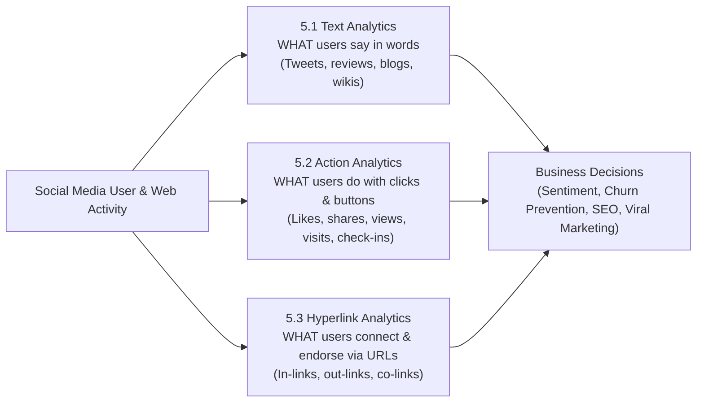
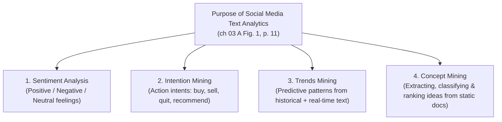
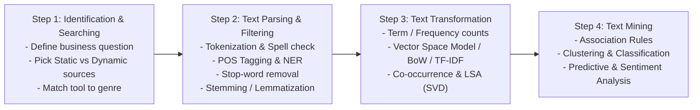
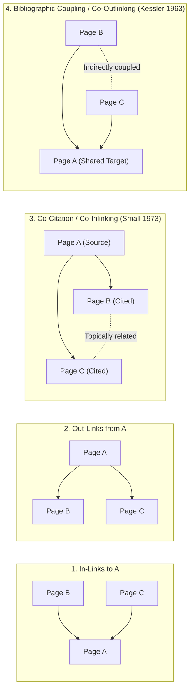

# Module 5: Social Media Text, Action & Hyperlink Analytics

**Course:** Big Data and Social Media Analytics (`26CMPC71` — VESIT 2026 NEP & Autonomy Scheme, Sem VII)  
**Course Outcome:** `CO5` — *Apply text, action, and hyperlink analytics techniques to extract business insights from social media data.* (`06` Theory Hours + Lab Experiments 7 & 8 + Self-Learning Content-Based SM Analytics)  
**Primary Slides & Curriculum Sources Used:**
- `module_5/ch 03 A Text Analytics.pptx.pdf` (30 slides — *Chapter 3: Social Media Text Analytics*, compiled by Dr. Rohini Temkar)
- `module_5/ch 03 B Action Analytics.pptx.pdf` (24 slides — *Chapter 5: Social Media Actions Analytics*, compiled by Dr. Rohini Temkar)
- `module_5/ch 03 C Hyperlink Analytics.pptx.pdf` (36 slides — *Module 5: Social Media Text, Action & Hyperlink Analytics*, compiled by Dr. Rohini Temkar)
- Official Syllabus (`26CMPC71` Topics `5.1`, `5.2`, `5.3`, Lab Experiments 7 & 8 for the `25`-mark Practical & Oral [`PR & OR`] exam, and Self-Learning Topic: *Twitter Sentiment Analysis with TextBlob / VADER*)

---

## Scope & Topic Checklist

| # | Topic / Subtopic | Official Syllabus Ref | Slide Coverage | Status |
|---|---|---|---|---|
| 1 | Text Analytics Foundations & Types of SM Text (Static vs. Dynamic) | `5.1` | `ch 03 A` pp. 1–10 | `[x]` |
| 2 | Four Purposes of Text Analytics (Sentiment, Intention, Trends, Concept Mining) | `5.1` | `ch 03 A` pp. 11–17 (Fig. 1) | `[x]` |
| 3 | Four Steps in Text Analytics (Identification, Parsing/Filtering, Transformation, Mining) | `5.1` | `ch 03 A` pp. 18–25 (Fig. 2) | `[x]` |
| 4 | Text Analytics Tools, Semantria Tutorial & Customer Opinions Case Study | `5.1` | `ch 03 A` pp. 26–29 | `[x]` |
| 5 | Lab Exp 8 & Self-Learning: Content-Based SM Analytics (TextBlob & VADER) | Lab Exp 8 / Self-Learning | `26CMPC71` Syllabus + Official Docs | `[x]` |
| 6 | Action Analytics Foundations & Business Value | `5.2` | `ch 03 B` pp. 1–4 | `[x]` |
| 7 | Fourteen Common Social Media Actions & Web Metrics (Bounce Rate, Session Duration, Clickstream) | `5.2` | `ch 03 B` pp. 5–20 | `[x]` |
| 8 | Action Analytics Tools, Legacy Clarifications, Cover-More Case Study & Hootsuite | `5.2` + Lab Exp 7 | `ch 03 B` pp. 21–24 | `[x]` |
| 9 | Hyperlink Foundations & Types (In-Links, Out-Links, Co-Links; Co-Citation vs. Bibliographic Coupling; Inter- vs. Intra-Linking) | `5.3` | `ch 03 C` pp. 1–10 (Fig. 1) | `[x]` |
| 10 | Three Types of Hyperlink Analytics (Environment, Link Impact, Social Media Hyperlink Analysis + Khan et al. 2014) | `5.3` | `ch 03 C` pp. 11–25 (Fig. 2) | `[x]` |
| 11 | Hyperlink Analytics Tools, VOSON Tutorial (`LinLog`, `Indegree*`), & YouTube Virality Case Study | `5.3` | `ch 03 C` pp. 26–36 (Fig. 3) | `[x]` |

**Assumptions & Source Notes:**
- **Zero-prior-knowledge assumption:** Natural Language Processing (NLP), linear-algebra text representations (Vector Space Model, TF-IDF, Latent Semantic Analysis), web analytics metrics, Search Engine Optimization (SEO), and webometrics/bibliometrics are explained from scratch.
- **Why the deck headers read "Chapter 3", "Chapter 5", and "Module 5":** The lecture decks follow Gohar F. Khan's *Seven Layers of Social Media Analytics* textbook structure (where Layer 1 = Text [Ch. 3], Layer 3 = Actions [Ch. 5], and Layer 4 = Hyperlinks [Ch. 6], while Network Analytics [Ch. 4] is covered in Module 4). All three correspond directly to `26CMPC71` Module 5 (`5.1`, `5.2`, `5.3`).
- **Textbook Case Study Stubs (`ch 03 A` p. 28, `ch 03 B` p. 22, `ch 03 C` p. 34):** All three case-study slides contain only three template headings (*The Problem / The Solutions / The Results*). Where verifiable primary sources exist (such as the Hootsuite **Cover-More Group** case study and Khan & Vong's 2014 **YouTube Virality** paper), those verified facts are presented; where full proprietary textbook text is unavailable, a **clearly labeled illustrative walkthrough** is provided instead of inventing unverified figures.

---

## Big Picture: How Module 5's Three Layers Fit Together

Remember from Module 4 that **Social Media Analytics (SMA)** has seven layers. Module 5 covers the three **content and behavioral trace layers** right alongside social networks:



Think of analyzing a restaurant launch online:
- **Text Analytics** reads *what* customers write in reviews (`"The biryani was amazing, though delivery took 50 minutes"`).
- **Action Analytics** counts *how* users behave (`12,000 video views`, `900 likes`, `300 shares`, `45% bounce rate` on the menu page).
- **Hyperlink Analytics** traces *which websites and influencers link to* the restaurant's site (`food blogs -> restaurant.com`, or links inside viral tweets driving traffic).

---

# PART 5A: Social Media Text Analytics (`ch 03 A`, `26CMPC71` Topic 5.1)

## 1. What Is Text Analytics & Why It Exists (`ch 03 A` pp. 3–4)

### 1.1 Basic Idea (Assuming Zero Background)
When you open a spreadsheet, data sits neatly in columns like `Age = 21` or `Price = 499`. Computers love numbers because computers can immediately add, sort, and average them.

Human language on social media—tweets, Instagram captions, Amazon reviews, WhatsApp chats, Wikipedia pages—is **unstructured text**: messy sentences full of slang, emojis, typos, sarcasm, and shifting grammar. **Social media text analytics** (also called **text mining**) is the automated process of extracting, analyzing, and interpreting hidden business insights from textual elements of social media content (`ch 03 A` p. 3).

### 1.2 Why Do We Need It?
1. **Sheer Scale (`~80%` Textual Data):** Slide 4 notes that **approximately 80% of data inside organizations is textual** (matching the Gartner rule of thumb from Module 1), including emails, support tickets, reviews, and social posts. Humans cannot read millions of daily messages manually.
2. **Roots in Two Disciplines (`ch 03 A` p. 4):** Text analytics combines:
   - **Natural Language Processing (NLP):** Teaches computers how human sentences are structured (grammar, parts of speech, names, word roots).
   - **Data Mining (DM) & Machine Learning (ML):** Finds statistical patterns, clusters, categories, and predictions across millions of processed texts.
3. **Real-World Forum Example (`ch 03 A` p. 4):** **`Flyertalk.com`** — one of the world's largest online frequent-flyer and travel forums where passengers post detailed complaints, airline seat reviews, and loyalty discussions. Airlines cannot read every forum thread manually, so text analytics turns thousands of messy FlyerTalk posts into clear feedback charts (e.g., `"baggage complaints rose 30% on Route X"`).

### 1.3 Everyday Analogy
Imagine a college fest receives **10,000 handwritten feedback slips** in a box. Reading them one by one takes weeks. Text analytics is like hiring an automated sorting team that (1) shreds filler words, (2) sorts slips into *Happy*, *Angry*, and *Wants Refund* piles, and (3) highlights the top recurring complaint (`"sound system"`).  
*(Where the analogy stops being accurate: humans naturally catch sarcasm like `"Yeah, great Wi-Fi, took only 2 hours to load a page!"`, whereas simple keyword algorithms can misread `"great"` as positive unless trained with context or rule-based NLP.)*

### 1.4 Viva Preparation — Text Analytics Foundations
- **Quick definition:** Social media text analytics (text mining) is the application of Natural Language Processing (NLP) and data mining techniques to extract structured, actionable business insights—such as sentiment, intent, trends, and concepts—from unstructured textual User-Generated Content (UGC).
- **Explain it to the examiner (30–60 seconds):** *"Sir/Ma'am, roughly 80% of enterprise and social data is unstructured text like tweets, customer reviews, emails, and forum posts on sites such as FlyerTalk. Traditional SQL tables cannot directly analyze raw human sentences. Social media text analytics bridges **NLP**—which parses grammar, removes noise, and converts words into numbers—and **Data Mining**—which classifies sentiment, discovers intent to buy or quit, and spots emerging trends at massive scale."*
- **Practical example:** An airline scrapes 50,000 passenger posts from **`Flyertalk.com`** and X/Twitter, filters noise via NLP, and finds a sudden spike in negative sentiment mentioning `"Mumbai T2 baggage belt"`—allowing operations to fix the bottleneck before ratings drop further.
- **Examiner follow-ups:**
  1. *Q: Why can't we just store social media text in MySQL and query it with `LIKE '%complaint%'`?*  
     **A:** Exact keyword search misses synonyms (`"delay"` vs `"late"`), ignores spelling errors, fails to connect negation (`"not bad"` vs `"bad"`), and cannot cluster thousands of emerging topics automatically.
- **Common mistakes to avoid:** Treating text analytics as simple `Ctrl+F` keyword counting (text mining handles grammar, word variants, co-occurrence, and sentiment polarity, not just exact substring matches).

---

## 2. Types of Social Media Text: Static vs. Dynamic Text (`ch 03 A` pp. 5–10)

Every piece of social media and organizational text falls into one of two broad categories, and **both** are analyzed (`ch 03 A` p. 5):

### 2.1 Static Text (`ch 03 A` pp. 6–7)
- **Basic idea:** Longer, more structured/edited documents (typically **several paragraphs or pages**) that are generated, updated, or deleted **less frequently**.
- **Purpose (`p. 6`):** Primarily created to **inform, educate, and elaborate** thoroughly on a topic.
- **Slide Examples (`pp. 6–7`):** Wiki content (e.g., Wikipedia articles), blog pages, Word documents, corporate reports, emails, and news transcripts.
- **What analytics suits it best?** **Concept mining**, topic modeling, summarization, and document classification.

### 2.2 Dynamic Text (`ch 03 A` pp. 8–10)
- **Basic idea:** Short, **real-time, user-generated** text (often a single line or a couple of sentences) expressing immediate opinions or reactions, **updated or deleted frequently**, and highly diverse in tone (social, political, economic, personal, cultural, or business issues).
- **Five Dynamic Text Examples (`ch 03 A` p. 10):**
  1. **Tweets (Posts on X):** Short real-time microblog posts containing text, links, images, or videos.
  2. **Comments:** Written reactions expressing opinions beneath social posts, YouTube videos, or news articles.
  3. **Discussions:** Multi-user Q&A threads organized by topic on internet forums (e.g., `Flyertalk.com`, Reddit).
  4. **Conversations (Chatting):** Instant real-time message exchanges between two or more people via dedicated messaging tools (WhatsApp, Messenger, Slack); **mostly private in nature** (limiting public scraping due to privacy).
  5. **Reviews:** Customer or expert evaluations of products/services combining star ratings with descriptive opinion text (TripAdvisor, Amazon, IMDb).

> [!WARNING]
> **PPT Verification Check — Twitter/X Character Limit (`ch 03 A` Slide 10):**
> - **PPT says:** *"Tweets are short messages (**up to 140 characters**) posted on Twitter, which may include text, images, video, or links."*
> - **Verified clarification (`docs.x.com/fundamentals/counting-characters`):** Twitter originally launched with a 140-character limit (chosen for SMS compatibility), but doubled the standard limit to **280 characters** in November 2017. Currently on **X** (formerly Twitter):
>   - **Standard (free) accounts** allow up to **280 characters** per post (where any URL wrapped via `t.co` counts as a flat **23 characters**, most emojis and CJK characters count as **2 characters**, and attached images/videos/GIFs count as **0 characters**).
>   - **X Premium subscribers** can post long-form posts up to **25,000 characters**.
> - **What to say in the viva:** *"Historically, tweets were capped at 140 characters—as noted in our slides—before Twitter expanded standard posts to **280 characters** in 2017, and today X Premium accounts support long posts up to **25,000 characters**."*

### 2.3 Comparison: Static Text vs. Dynamic Text

| Dimension | Static Text (`ch 03 A` pp. 6–7) | Dynamic Text (`ch 03 A` pp. 8–10) |
|---|---|---|
| **Typical Length** | Long (multiple paragraphs to full documents) | Short (phrases to a few sentences) |
| **Update / Deletion Frequency** | Low — updated or deleted infrequently | High — real-time, created/edited/deleted frequently |
| **Primary Purpose** | Inform, educate, document, elaborate | Express immediate opinions, feelings, complaints, reactions |
| **Language Style** | Cleaner grammar, formal or semi-formal | Informal, slang, emojis, hashtags, abbreviations, typos |
| **Slide Examples** | Wikis, blog pages, Word docs, corporate reports, emails, news transcripts | Tweets/X posts, comments, forum discussions, private chats, product reviews |
| **Best-Suited Analytics** | Concept mining, document categorization, summarization | Sentiment analysis, intention mining, real-time trend detection |

### 2.4 Viva Preparation — Static vs. Dynamic Text
- **Quick definition:** **Static text** consists of longer, infrequently updated informational documents (wikis, reports, blogs), while **dynamic text** consists of short, real-time, frequently changing opinionated user posts (tweets, comments, reviews, forum discussions, chats).
- **Explain it to the examiner (30–60 seconds):** *"Social media text falls into two main types. **Static text** includes longer documents like wikis, blog posts, corporate reports, emails, and news transcripts that are updated rarely and written mainly to inform or educate. **Dynamic text** includes short, real-time, opinionated user messages—tweets, comments, forum discussions, private chats, and product reviews—that change or get deleted frequently. Note that while slides list Twitter's historical 140-character cap, standard X posts today allow **280 characters** and X Premium allows **25,000 characters**."*
- **Practical example:** A company's **official annual sustainability PDF report** is **static text** (long, edited yearly to inform), whereas the **3,000 angry X/Twitter replies and comments** reacting to that report within one hour are **dynamic text**.
- **Examiner follow-ups:**
  1. *Q: Why is dynamic text harder for NLP pipelines than static text?*  
     **A:** Dynamic text is short (less context per post), noisy (misspellings like `"gr8"`, hashtags `#EpicFail`, emojis, code-mixing like Hinglish), and context-dependent (sarcasm and trending memes).
- **Common mistakes to avoid:** Quoting `140` characters as X/Twitter's *current* limit without clarifying `280` (standard) and `25,000` (Premium); forgetting that **private conversations/chats** are largely inaccessible to public web scrapers.

---

## 3. Four Purposes of Text Analytics (`ch 03 A` pp. 11–17, Fig. 1)

Figure 1 of `ch 03 A` (Slide 11) organizes the **four core purposes** of social media text analytics around one central goal:



### 3.1 Purpose 1: Sentiment Analysis (`ch 03 A` pp. 12–13)
- **What it does:** Analyzes and categorizes social media text—**mostly dynamic text**—as **positive, negative, or neutral** to determine how customers feel about a product, service, brand, or public issue.
- **How scoring works (`p. 13`):** Tools such as **Semantria** detect sentiment-bearing phrases, assign each phrase a score on a **logarithmic scale** (explained simply: diminishing-return scaling prevents repeating one mild word 10 times from misleadingly beating strong phrases, and combines phrase polarity with modifiers/negations), and aggregate phrase scores to yield sentence-level and document-level sentiment.
- **Example:** Tracking launch-day tweets about a smartphone: `72% positive` (`"battery lasts 2 days!"`), `18% negative` (`"camera lags in low light"`), `10% neutral` (`"launched at ₹29,999"`).

### 3.2 Purpose 2: Intention Mining (`ch 03 A` pp. 14–15)
- **What it does:** Discovers explicit or implicit **user intentions**—such as **`buy, purchase, sell, recommend, quit, desire, wish`**—inside comments, product reviews, tweets, and blog posts.
- **Two Direct Business Actions (`p. 14`):**
  1. **Acquire potential customers (Lead Generation):** Spotting purchase intent early (*`"Anyone recommend a good gaming laptop under ₹80k? Ready to buy today"`* $\to$ brand replies with a product link/promo).
  2. **Retain existing customers (Churn Prevention):** Detecting `"quit"` / `"cancel"` intent early (*`"So fed up with my bank app crashing, switching to another bank this week"`* $\to$ support intervenes before cancellation).

### 3.3 Purpose 3: Trends Mining (`ch 03 A` p. 16)
- **What it does:** Also referred to in Slide 16 as **predictive analytics**—analyzes large volumes of **historical and real-time** social media text (tweets, comments) using **Machine Learning (ML), Data Mining, and Social Network Analysis (SNA)** to anticipate future events, emerging customer needs, or product opportunities.
- **Example:** Noticing a steady 3-month spike in skincare forum posts mentioning `"fragrance-free barrier serum"` before any mainstream brand launches one, guiding R&D to launch that product early.

### 3.4 Purpose 4: Concept Mining (`ch 03 A` p. 17)
- **What it does:** Extracts core **ideas and concepts** primarily from **large collections of static text** (wiki articles, web pages, Word documents, news transcripts), and employs algorithms to **classify, cluster, and rank** those ideas.
- **Example:** Analyzing 5,000 customer support transcripts and internal wiki manuals to rank the top conceptual failure themes (`"Authentication timeout"`, `"Payment gateway webhook drop"`, `"Invoice PDF encoding"`).

### 3.5 Comparison of the Four Purposes

| Purpose | Primary Question Answered | Typical Input Text | Example Output |
|---|---|---|---|
| **Sentiment Analysis** | *How do users feel?* | Mostly **Dynamic** (tweets, reviews, comments) | Polarity class (Pos/Neg/Neu) or numeric score |
| **Intention Mining** | *What is the user about to do?* | **Dynamic** (posts, reviews, forum Qs) | Intent tags: `buy`, `quit`, `recommend`, `sell` |
| **Trends Mining** | *What is rising or coming next?* | **Historical + Real-Time** streams | Emerging topic forecasts, demand spikes |
| **Concept Mining** | *What core ideas are inside these docs?* | Mostly **Static** (wikis, reports, transcripts) | Extracted, clustered, ranked key concepts |

### 3.6 Viva Preparation — Four Purposes of Text Analytics
- **Quick definition:** The four purposes of social media text analytics are **Sentiment Analysis** (classifying positive/negative/neutral emotion), **Intention Mining** (detecting action intents like buying or quitting), **Trends Mining** (forecasting emerging patterns from historical and live text), and **Concept Mining** (extracting and ranking ideas from large static documents).
- **Explain it to the examiner (30–60 seconds):** *"Sir/Ma'am, businesses run text analytics for four main purposes. First, **Sentiment Analysis** measures whether dynamic posts are positive, negative, or neutral—for instance scoring phrases in product reviews. Second, **Intention Mining** looks specifically for action words like 'buy', 'recommend', or 'quit' so sales teams can capture leads and support teams can stop churn. Third, **Trends Mining** combines historical and real-time text with ML to predict upcoming demand. Finally, **Concept Mining** extracts, clusters, and ranks core themes from large static documents like wikis and transcripts."*
- **Practical example:** When a telecom company monitors tweets: **Sentiment** flags a `-0.7` spike in anger; **Intention** catches `"switching to Jio tomorrow"` (`quit` intent); **Trends** predicts outage chatter rising in Pune; and **Concept Mining** ranks the recurring root topics inside internal support manuals.
- **Examiner follow-ups:**
  1. *Q: How is Intention Mining different from Sentiment Analysis?*  
     **A:** Sentiment captures *feeling*, while Intention captures *planned action*. Someone can write a **neutral-sentiment** tweet with **high purchase intent** (`"Does anyone know where to buy X in Mumbai?"`), or a **negative-sentiment** review without quitting (`"Love the food, hated waiting 20 mins"` vs `"Canceling my membership today"`).
- **Common mistakes to avoid:** Confusing *Concept Mining* (typically static documents) with *Sentiment Analysis* (mostly dynamic text); thinking a positive sentiment automatically implies purchase intent.

---

## 4. Four Steps in Text Analytics (`ch 03 A` pp. 18–25, Fig. 2)

> [!NOTE]
> **PPT Visual Observation (`ch 03 A` Slide 18, Figure 2):**
> When viewing `ch 03 A` Slide 18 visually as a PDF, the four inner quadrant titles inside the white circle appear invisible (white text over white background in the export), though the underlying PDF text layer preserves them cleanly alongside the four outer bullet boxes: **1. Source Identification** (top-right) $\to$ **2. Text Parsing & Filtering** (bottom-right) $\to$ **3. Text Transformation** (bottom-left) $\to$ **4. Text Mining** (top-left). Below is the complete, unambiguous pipeline matching Slides 18–25.



Let us trace **one running example sentence** across all four steps so nothing stays abstract:  
> Suppose an airline asks: *"Why are flyers unhappy with Mumbai Terminal 2 check-in?"* and pulls this raw post:  
> **`"Flyers were waiting 45 mins at Mumbai T2!! Worst check-in experience ever :("`**

### 4.1 Step 1: Identification and Searching (`ch 03 A` p. 19)
- **What happens:** You never collect "the whole internet" blindly. Start by defining the **desired business question**, then locate the right **sources** (e.g., `Flyertalk.com` forum threads, TripAdvisor reviews, X posts mentioning `@AirlineSupport`, or static policy docs).
- **Why genre matters (`p. 19`):** Short, emoji-rich tweets need different extractors and APIs than 10-page PDF corporate reports or forum threads.

### 4.2 Step 2: Text Parsing and Filtering (`ch 03 A` p. 20 & Fig. 2)
This step cleans messy text and builds a structured dictionary of meaningful terms using **NLP**.

> [!WARNING]
> **PPT Typo Check (`ch 03 A` Slide 20):**
> - **PPT says:** *"The next step is to parse, clean, and filter the text, and create a dictionary of words using **NPL**, which is mostly based on machine learning techniques."*
> - **Verified clarification:** `"NPL"` is a typographical transposition for **NLP (Natural Language Processing)**.
> - **What to say in the viva:** Always say **NLP (Natural Language Processing)**.

Here are the **five core NLP operations** listed on Slide 18 & Slide 20, explained from scratch:

1. **Tokenization:** Splitting raw text into individual word/symbol units (**tokens**).  
   - Example: `["Flyers", "were", "waiting", "45", "mins", "at", "Mumbai", "T2", "!!", "Worst", "check-in", "experience", "ever", ":("]`
2. **Spell Checking & Normalization (`p. 20`):** Fixing typos (`"experince"` $\to$ `"experience"`), lowercasing (where appropriate—note VADER uses ALL CAPS as an intensity boost!), and removing HTML/broken characters.
3. **Stop-Word Removal (`pp. 18, 20`):** Filtering ultra-common grammatical glue words (`were`, `at`, `the`, `is`, `in`, `a`) that appear in almost every document and add little topical signal.  
   - *Important viva caveat:* **Do not blindly strip negation words** (`not`, `never`, `no`, `n't`) if your downstream task is **Sentiment Analysis**—removing `"not"` turns `"not good"` into `"good"`!
4. **Part-of-Speech (POS) Tagging (`pp. 18, 20`):** Assigning grammatical roles (Noun `NN`, Verb `VB`, Adjective `JJ`, Adverb `RB`) to each word in context using statistical/ML taggers (e.g., `nltk.pos_tag`).  
   - *Why it matters:* Resolves ambiguity—`"book"` in `"I want to book a flight"` (`Verb`) vs. `"I read a book"` (`Noun`).
5. **Named Entity Extraction / Recognition (NER) (`pp. 18, 20`):** Identifying proper real-world entities such as **People**, **Organizations**, **Locations** (`Mumbai T2`), and **Product/Service names**. Enables tracking *which* brand or airport a complaint targets!
6. **Stemming vs. Lemmatization (`p. 18` & NLTK docs):** Reducing inflected word forms (`waiting, waited, waits`) down to one common base representation so counts aren't split across variations:

| Feature | Stemming (`NLTK PorterStemmer`) | Lemmatization (`NLTK WordNetLemmatizer`) |
|---|---|---|
| **How it works** | Heuristic, rule-based suffix stripping (chops off endings like `-ing`, `-ed`, `-ies`) | Dictionary/morphological lookup using vocabulary + **POS tag** |
| **Output validity** | May produce **non-dictionary roots** (e.g., `"studies"` $\to$ `"studi"`, `"flies"` $\to$ `"fli"`) | Always returns a **valid dictionary lemma** (e.g., `"studies"` $\to$ `"study"`, `"better"` $\to$ `"good"`) |
| **Speed & Accuracy** | Faster, simpler, coarser (risks *over-stemming* or *under-stemming*) | Slower (requires POS/dictionary lookup), linguistically accurate |
| **Best suited for** | Large-scale search indexing / fast keyword matching | Sentiment analysis, topic modeling, NLP understanding |

### 4.3 Step 3: Text Transformation (`ch 03 A` p. 21 & Fig. 2)
Algorithms (clustering, regression, classification) cannot multiply strings like `"worst"` — they require numbers (`0`s, `1`s, weights, or vectors). **Text transformation** maps cleaned tokens into a numerical **Document-Term Matrix** using linear algebra:

1. **Bag-of-Words (BoW) & Vector Space Model (VSM) (`p. 21`):**
   - Each unique vocabulary word becomes one coordinate axis (dimension). Each document becomes a vector of numbers:
     - **Binary representation (`0`/`1`):** `1` if the word appears in the document, `0` otherwise.
     - **Term Frequency (`TF` / Terms Count — Fig. 2):** How many times term $t$ appears in document $d$.
     - **TF-IDF Weighting (`scikit-learn TfidfVectorizer`):** Gives higher weight to words frequent in *this* document yet rare across *all* documents:
       $$\text{TF-IDF}(t, d) = \text{TF}(t, d) \times \log\left(\frac{N}{\text{DF}(t)}\right)$$
       where $N$ is total documents in the corpus and $\text{DF}(t)$ is the number of documents containing term $t$. *(Intuition: `"airport"` appearing in 990 of 1,000 airline reviews gets near-zero IDF weight, while `"baggage"` appearing in 40 reviews gets strong discriminative weight!)*
   - **Small Worked VSM Example:** Suppose Vocabulary = `[mumbai, delay, luggage, food]` and two tweets are cleaned to:
     - $D_1$: `["mumbai", "delay", "delay"]` $\implies$ TF vector $[1, 2, 0, 0]$
     - $D_2$: `["mumbai", "luggage"]` $\implies$ TF vector $[1, 0, 1, 0]$
     Now cosine similarity between two vectors measures how similar two tweets are mathematically!
2. **Co-occurrence Metrics (`Fig. 2`):** Counting how often pairs of words appear together inside the same sentence, tweet, or document (feeds association analysis & semantic graphs).
3. **Latent Semantic Analysis (LSA) (`p. 21`):**
   - *The problem with simple BoW/VSM:* Matrices are gigantic and sparse (50,000 unique words!), and fail to connect **synonyms** (`"flight"` vs `"aircraft"`) or disambiguate **polysemy** (`"apple"` fruit vs `"Apple"` phone).
   - *How LSA solves it:* Applies **Truncated Singular Value Decomposition (Truncated SVD)** (`sklearn.decomposition.TruncatedSVD`) to factor the high-dimensional Term-Document matrix into a compact lower-dimensional **latent semantic (concept) space** (say 100–300 dimensions instead of 50,000). Words appearing in similar contexts collapse onto shared latent concepts! *(Note: `TruncatedSVD` works directly on sparse TF-IDF matrices without mean-centering, unlike standard PCA.)*

### 4.4 Step 4: Text Mining (`ch 03 A` pp. 22–25 & Fig. 2)
Once text is numerical vectors, data mining algorithms extract business insights (`p. 22`):

1. **Association / Association Rule Mining (`p. 23`):**
   - *Idea:* Determines the probability of **co-occurrence** of words, hashtags, or liked items across documents, expressed as rules like $X \Rightarrow Y$.
   - *Slide example (`p. 23`):* *"A user who liked social media content A and B is **90 percent likely** to also like content C"* (written `{A, B} => {C}` with **Confidence = 90%**).
   - *Two core metrics (`Support` & `Confidence` — quick numerical trace):* Suppose across **100** support tweets, `"baggage"` and `"delayed"` appear together in **15** tweets (`Support = 15/100 = 15%`), while `"baggage"` appears in **20** tweets total. Then for rule `{"baggage"} => {"delayed"}`:
     $$\text{Confidence} = \frac{\text{Tweets with both}}{\text{Tweets with "baggage"}} = \frac{15}{20} = 75\%$$
     Meaning 75% of complaints mentioning `"baggage"` also mention `"delayed"`.
2. **Clustering (`p. 24`):**
   - *Idea:* **Unsupervised** grouping of documents (or network nodes) into **non-overlapping groups** based on vector similarity—without preset answer labels.
   - > [!CAUTION]
     > **PPT Typo Check (`ch 03 A` Slide 24):**
     > - **PPT says:** *"Social media text (such as tweets or comments), for example, can be clustered into positive, negative, and **natural** categories."*
     > - **Verified clarification:** `"natural"` is a spelling typo for **neutral** (matching Slide 12: *"positive, negative, or neutral"*). Also note conceptually that grouping into *predefined* categories like Positive/Negative/Neutral is usually **Classification** (supervised) or rule-based labeling, whereas pure **Clustering** discovers unlabeled theme groups automatically!
     > - **What to say in the viva:** Always say **"positive, negative, and neutral"**, and distinguish unsupervised Clustering from supervised Classification cleanly.
3. **Classification / Categorization (`p. 25`):**
   - *Idea:* **Supervised** machine learning that assigns documents to **predefined target labels** based on learned text patterns.
   - *Slide example (`p. 25`):* Classifying incoming emails into **`Spam`** vs **`Not Spam`** based on email text; similarly classifying tweets into `Billing Issue`, `Technical Bug`, or `Praise`.
4. **Predictive Analysis & Sentiment Analysis (`pp. 12–16, 22`):** Forecasting upcoming trends/demand or scoring emotional polarity from the transformed features.

### 4.5 Viva Preparation — Four Steps in Text Analytics
- **Quick definition:** The four-step text analytics pipeline comprises **(1) Identification & Searching** (picking relevant sources for a business question), **(2) Text Parsing & Filtering** (cleaning and structuring text via NLP: tokenization, POS tagging, NER, stop-word removal, stemming/lemmatization), **(3) Text Transformation** (converting cleaned words into numerical vectors via VSM/TF-IDF and LSA), and **(4) Text Mining** (applying association, clustering, classification, predictive, and sentiment algorithms).
- **Explain it to the examiner (30–60 seconds):** *"To mine messy social media text, we follow four steps. First, **Identification and Searching** defines the business question and selects matching sources—like tweets or forum threads. Second, **Text Parsing and Filtering** uses NLP (not 'NPL'!) to tokenize words, fix spellings, remove stop words, tag parts of speech, extract named entities like brands or cities, and reduce words via stemming or lemmatization. Third, **Text Transformation** turns words into numbers—using Vector Space Models like Bag-of-Words or TF-IDF and dimensionality reduction like Latent Semantic Analysis (LSA). Finally, **Text Mining** runs algorithms like clustering, classification, association rules, and sentiment scoring on those numbers."*
- **Practical example:** Running `"Flyers waited 45 mins at Mumbai T2!!"` through the pipeline: Step 1 collects FlyerTalk/X posts; Step 2 tags `Mumbai T2` (NER), drops `"at"`, lemmatizes `"waited"` $\to$ `"wait"`; Step 3 turns `[wait, mumbai, t2]` into a TF-IDF vector; Step 4 classifies the post as `Negative` under `Airport Delay`.
- **Examiner follow-ups:**
  1. *Q: Why do we need Step 3 (Text Transformation)? Why can't K-Means or SVM run directly on sentences?*  
     **A:** Machine learning and linear-algebra algorithms compute distances, dot products, and matrix factorizations—they mathematically require fixed-length numerical vectors rather than variable-length character strings.
  2. *Q: Differentiate Clustering vs. Classification in Step 4.*  
     **A:** **Classification** is *supervised*—we already know the predefined labels (e.g., `Spam` / `Ham`, or `Positive` / `Negative`) and train on labeled examples. **Clustering** is *unsupervised*—no predefined labels exist; the algorithm groups similar texts together automatically to reveal hidden themes.
- **Common mistakes to avoid:** Saying `"NPL"` instead of `NLP`; forgetting to keep negation words (`not`, `never`) during stop-word removal for sentiment tasks; confusing stemming (rule-based chopping) with lemmatization (dictionary-valid base form).

---

## 5. Text Analytics Tools, Semantria Tutorial & Case Study (`ch 03 A` pp. 26–29)

### 5.1 Social Media Text Analysis Tools (`ch 03 A` pp. 26–27)

| Tool (Slide Ref) | Primary Purpose | Key Capabilities & Verified Current Status |
|---|---|---|
| **DiscoverText** (`p. 26`) | Social text collection, cleaning & human/ML coding | Imports, deduplicates, filters, and classifies large social/survey text streams using collaborative human coding + ML. |
| **Lexalytics / Semantria** (`pp. 26, 29`) | Enterprise NLP, sentiment & intent extraction | Extracts sentiment, entities, themes, and intent. **Verified Corporate Update:** Lexalytics acquired Semantria (2015) and was itself acquired by **InMoment in Sept 2021** (`lexalytics.com`). Today Semantria functions mainly as a cloud REST API rather than the legacy Excel plugin. |
| **Tweet Archivist** (`p. 26`) | Hashtag/keyword tweet archiving & visual summaries | Captures, archives, and visualizes tweets, top URLs, influencers, and word clouds around search hashtags (`#`). *(Subject to X API tier limits.)* |
| **Twitonomy** (`p. 26`) | Account-level X/Twitter analytics | Visualizes tweet activity, retweets, replies, mentions, hashtags, and follower interactions. |
| **Netlytic** (`p. 27`) | Cloud text + social network analyzer | Automatically summarizes online conversations (YouTube, Reddit, RSS, CSV uploads) and builds text-derived **communication networks** (also used in Lab Exp 7!). |
| **LIWC** (`p. 27`) | **Linguistic Inquiry and Word Count** (`liwc.app`) | Psycholinguistic dictionary software measuring **emotional, cognitive, structural, and psychological process** categories in speech and writing (updated to LIWC-22; legacy URL `liwc.net`). |
| **Voyant Tools** (`p. 27`) | Open-source web-based text reading & analysis (`voyant-tools.org`) | Browser tool where users upload files or paste URLs for instant word clouds (Cirrus), term frequencies, collocations, and keyword-in-context (KWIC) exploration. |

### 5.2 Semantria Excel Tutorial (`ch 03 A` p. 29)
- **What the slide walks through:** Configuring **Semantria for Excel** on a sample **TripAdvisor customer comments** spreadsheet (`7layersanalytics.com` companion dataset) to extract document sentiment scores, named entities, and themes directly inside Excel rows.
- **Modern Viva Context:** While the textbook uses Semantria's legacy Excel add-in to avoid coding, modern enterprise workflows call the Semantria/InMoment cloud NLP API—or in Python/data science labs (like Lab Exp 8), run **TextBlob** and **VADER**.

### 5.3 Case Study Stub: *"Tapping into Online Customer Opinions"* (`ch 03 A` p. 28)
- **Slide Status:** Slide 28 is a **3-bullet template stub** (*The Problem / The Solutions / The Results*) corresponding to Chapter 3 of Gohar F. Khan's *Seven Layers of Social Media Analytics* (linked with **FlyerTalk.com** on Slide 4 and **TripAdvisor reviews** on Slide 29).
- **Illustrative Walkthrough *(clearly labeled pedagogical scenario, not claimed as exact proprietary textbook figures)*:**
  - **The Problem:** An airline/hotel chain receives thousands of unstructured customer reviews across TripAdvisor and FlyerTalk; star ratings tell managers *that* scores fell (e.g., 3.1/5), but not *why*.
  - **The Solutions:** Using the 4-step pipeline (or Semantria/VADER + topic clustering), analysts scrape reviews, filter noise/stop-words, extract entities (`"check-in"`, `"Wi-Fi"`, `"legroom"`), and compute aspect-level sentiment and intent (`"never flying again"`).
  - **The Results:** Management isolates the top negative driver (e.g., slow Terminal check-in kiosks rather than cabin crew service), fixes staffing/kiosks, and monitors post-fix dynamic sentiment recovery.

---

## 6. Lab Exp 8 & Self-Learning Connection (`PR & OR` Viva): TextBlob & VADER

Your official `26CMPC71` syllabus connects Module 5 directly to **Experiment 8** (*"Build Content-Based Social Media Analytics Model — topic, issue, trend, sentiment/opinion analysis"*) and **Self-Learning** (*"Twitter Sentiment Analysis using TextBlob / VADER"*). Knowing both Python libraries is gold in your `PR & OR` oral!

### 6.1 TextBlob (`textblob.readthedocs.io`)
Built atop NLTK, `TextBlob(text).sentiment` returns a named tuple `Sentiment(polarity, subjectivity)`:
- **`polarity` $\in [-1.0, +1.0]$:** Emotional orientation (`-1.0` = extremely negative, `0.0` = neutral, `+1.0` = extremely positive).
- **`subjectivity` $\in [0.0, 1.0]$:** How much personal opinion vs. objective fact appears (`0.0` = purely factual, `1.0` = highly opinionated).
- *Strength:* Dead-simple API and exposes **subjectivity** (useful for filtering out factual news tweets from opinionated reviews).
- *Limitation:* Uses a general pattern lexicon; struggles with internet slang, emojis, ALL-CAPS emphasis, and exclamation boosters.

### 6.2 VADER (`github.com/cjhutto/vaderSentiment` — Hutto & Gilbert, ICWSM 2014)
**VADER** stands for **Valence Aware Dictionary and sEntiment Reasoner**—a lexicon- and rule-based sentiment analyzer **specifically tuned for social media text**:
- **Five Social-Media Rules built into VADER:**
  1. **Punctuation emphasis:** `"Good!!!"` scores higher positive intensity than `"Good"`.
  2. **Capitalization (word-shape):** `"AMAZING"` boosts sentiment magnitude compared to `"amazing"`.
  3. **Degree modifiers:** Boosters (`"extremely"`, `"very"`, `"uber"`) amplify polarity; dampeners (`"kind of"`, `"slightly"`) reduce it.
  4. **Negations & contractions:** Flips polarity cleanly (`"not good"`, `"wasn't very good"`).
  5. **Slang & emoticons/emojis:** Understands social tokens like `"sux"`, `"lol"`, `:)` and `:D` natively!
- **VADER Output Metrics & Official Thresholds:**
  - `pos`, `neu`, `neg`: Proportions of positive, neutral, and negative lexical tokens (summing to $\approx 1.0$).
  - **`compound` $\in [-1.0, +1.0]$:** Normalized, weighted composite sentiment score across the whole text. Standard classification thresholds (Hutto & Gilbert, 2014):
    - **Positive:** `compound >= 0.05`
    - **Neutral:** `-0.05 < compound < 0.05`
    - **Negative:** `compound <= -0.05`

### 6.3 TextBlob vs. VADER Comparison & Practical Python Snippet

| Feature | TextBlob | VADER |
|---|---|---|
| **Design Target** | General-purpose English text | **Social media, microblogs & short informal reviews** |
| **Outputs** | `polarity` $[-1, 1]$ and `subjectivity` $[0, 1]$ | `neg`, `neu`, `pos` ratios + `compound` $[-1, 1]$ |
| **Emojis, Slang, CAPS, `!!!`** | Weak / mostly ignored | **Handled explicitly by heuristic rules** |
| **Subjectivity Detection** | Yes (`0.0` fact $\to$ `1.0` opinion) | No separate subjectivity score |
| **Training Data Needed?** | No (pre-built rule/lexicon analyzer) | No (pre-built social-media lexicon + rules) |

```python
from textblob import TextBlob
from vaderSentiment.vaderSentiment import SentimentIntensityAnalyzer

analyzer = SentimentIntensityAnalyzer()
post = "The new app update is NOT bad!! Love the speed :D"

# 1. TextBlob: returns polarity [-1, 1] and subjectivity [0, 1]
tb = TextBlob(post).sentiment
# 2. VADER: returns {'neg', 'neu', 'pos', 'compound'}
vd = analyzer.polarity_scores(post)
label = "Positive" if vd["compound"] >= 0.05 else ("Negative" if vd["compound"] <= -0.05 else "Neutral")
print(f"TextBlob -> polarity={tb.polarity:.2f}, subjectivity={tb.subjectivity:.2f}")
print(f"VADER    -> compound={vd['compound']:.3f} ({label})")
```

> **Likely `PR & OR` Lab Viva Question:** *"Why do we prefer VADER over TextBlob for analyzing tweets or Instagram comments?"*  
> **Answer:** Social media posts rely heavily on capitalization, repeated exclamation marks, slang, emojis, and contractions like `"wasn't bad"`. TextBlob treats text as general prose and misses those intensity cues, whereas VADER's lexicon and five syntactic rules are specifically calibrated for social media microtext and give clear `compound` thresholds ($\pm 0.05$). However, TextBlob is still useful when you also need a **subjectivity** score to separate factual news from opinions.

---

# PART 5B: Social Media Action Analytics (`ch 03 B`, `26CMPC71` Topic 5.2)

## 7. What Is Action Analytics & Why It Matters (`ch 03 B` pp. 2–4)

### 7.1 Basic Idea
Writing a full paragraph takes effort. Clicking **Like**, **Share**, **Subscribe**, or **Check-in** takes half a second. Slide 2 calls user actions **"the cash cow of social media"** because they act as fast, lightweight **symbolic reactions / social expressions** that reveal user feelings without requiring written text.

**Social Media Actions Analytics** deals with extracting, analyzing, and interpreting insights contained in the actions performed by social media users (`ch 03 B` p. 3).

### 7.2 Why Do Businesses Care? (`ch 03 B` pp. 3–4)
1. **Measure Popularity and Influence:** Quantify whether an idea, product, or campaign is actually resonating or spreading (`p. 3`).
2. **Three Core Marketing Outcomes (`p. 4`):**
   - **Increasing Revenue** (e.g., clicks and shares funnel buyers to checkout),
   - **Building Brand Value** (strong likes, mentions, and endorsements signal trust),
   - **Customer Loyalty** (repeat visits, pinning, and active community participation).

---

## 8. The Fourteen Common Social Media Actions & Web Metrics (`ch 03 B` pp. 5–20)

Slide 5 lists **14 common social media actions**, which Slides 6–20 define individually. Every single one is explained below along with the key web analytics formulas from Slide 9!

### 8.1 Expressive Reactions: Like & Dislike (`pp. 6–7`)
1. **Like or "Like" Buttons (`p. 6`):** Allows users to express a **symbolic positive reaction** toward products, services, people, ideas, information, or places (e.g., Facebook/LinkedIn/Instagram Likes & modern reaction emojis).
2. **Dislike (`p. 7`):** Allows users to express **negative feelings** toward posted content (e.g., Reddit downvotes, YouTube dislike button). *(Platform update: YouTube hid public dislike counts in late 2021 to reduce targeted harassment, though creators still view dislike ratios inside YouTube Studio.)*

### 8.2 Virality & Reach: Share (`p. 8`)
3. **Share (`p. 8`):** Allows users to redistribute posted content to their own followers/connections (Repost/Retweet, Facebook Share, WhatsApp forward). Crucially, shares act as **word-of-mouth distribution**, channeling new visitors from social networks back to a brand's website. *(Recall from Module 4: $\text{Virality Rate} = (\text{Shares} / \text{Impressions}) \times 100$.)*

### 8.3 Traffic & Retention Actions: Visitors, Visits (Sessions) & Revisits (`p. 9`)
4. **Visitors, Visits (Sessions), and Revisits (`p. 9`):**
   - **Visitor:** A person who visits your website or blog.
   - **Visit (Session):** One continuous period of interaction on the site by a visitor (in Google Analytics, a session ends after 30 minutes of inactivity by default).
   - **Revisits:** Repeat visits made by the *same* visitor returning later—a strong indicator of content stickiness and loyalty!
   - **Three Essential Metrics Highlighted on Slide 9:**
     1. **Unique Visitor:** A distinct person visiting your site for the first time within the reporting window (tracked via browser cookie/client ID—1 person visiting 5 times = `1 Unique Visitor`, `5 Visits/Sessions`).
     2. **Average Bounce Rate:**
        - *Slide / Traditional Universal Analytics (UA) definition (`p. 9`):* The percentage of visitors who land on a website and leave quickly without viewing any other pages (single-page sessions):
          $$\text{Bounce Rate}_{\text{UA}} = \frac{\text{Single-Page Sessions}}{\text{Total Sessions}} \times 100\%$$
        - **Verified GA4 Update (`support.google.com/analytics/answer/12195621`):** Universal Analytics was retired in 2023–2024 and replaced by **Google Analytics 4 (GA4)**. In GA4, **Bounce Rate** is defined strictly as the **percentage of sessions that were NOT Engaged Sessions** (`100% - Engagement Rate`). A session is **engaged** if it meets *any one* of: (a) lasts **longer than 10 seconds** (configurable up to 60s), OR (b) triggers **1+ key events (conversions)**, OR (c) has **2+ page/screen views**.
     3. **Session Duration (Average Session Duration):**
        $$\text{Average Session Duration} = \frac{\text{Sum of Durations of All Sessions}}{\text{Total Number of Sessions}}$$
        *(Units: seconds or `mm:ss`. Tells you how deeply visitors stay engaged rather than bouncing immediately.)*

#### Worked Numerical Example (Visitors, Bounce Rate & Session Duration)
Suppose a blog receives **1,000 total sessions** from **700 unique visitors** today (meaning `300` were **revisits**):
- `400` sessions viewed only 1 page and left within `4 seconds` (no conversion).
- `100` sessions viewed only 1 article page, read it carefully for `120 seconds` (`> 10s`), and left.
- `500` sessions viewed 3 pages each, averaging `240 seconds`.
- **Calculations:**
  - *Traditional UA Bounce Rate:* $\frac{400 + 100}{1000} \times 100\% = \mathbf{50\%}$ (penalizes single-page readers even if they read for 2 minutes!).
  - *GA4 Engaged Sessions:* $100 + 500 = 600 \implies$ **GA4 Engagement Rate** $= \frac{600}{1000} = 60\% \implies$ **GA4 Bounce Rate** $= 100\% - 60\% = \mathbf{40\%}$.
  - *Average Session Duration:* $\frac{(400\times 4) + (100\times 120) + (500\times 240)}{1000} = \frac{1{,}600 + 12{,}000 + 120{,}000}{1000} = \mathbf{133.6\text{ seconds}}$ ($\approx 2\text{m } 14\text{s}$).

### 8.4 Consumption & Navigation: Views, Page Views & Clickstream (`pp. 10–12`)
5. **View and Page Views (`p. 10`):**
   - **Views:** Total times social media content (a post, video, Reel, graphic) is watched/viewed by users.
   - **Page Views:** Each time a visitor loads a page on your company website or blog. *(Difference: 1 visit/session where a user opens Home $\to$ Pricing $\to$ Contact = **1 Visit**, **3 Page Views**.)*
6. **Clicks & Clickstream Analysis (`pp. 11–12`):**
   - **Clicks (`p. 11`):** Pressing/clicking hyperlinked content on a website, ad, or blog.
   - **Clickstream Analysis (`p. 12`):** Recording and analyzing the **exact sequence of pages and links clicked** by visitors as they navigate a site. Used for **5 goals (`p. 12`)**:
     1. Measuring **website activity**,
     2. **Website design analysis** (seeing which buttons users ignore vs. click),
     3. **Path optimization** (finding where shoppers drop off in a `Home -> Product -> Cart -> Pay` funnel),
     4. **Market research** (discovering popular product categories),
     5. **Improving overall visitor experience**.

### 8.5 Metadata, Attention & Social Graph Actions (`pp. 13–20`)
7. **Tagging (`p. 13`):** Assigning or linking extra descriptive metadata (e.g., `#BDSMA`, photo people-tags, product category tags) to content for **identification, classification, and search** purposes.
8. **Mentions (`p. 14`):** Explicit occurrence of a person, place, brand, or thing by name (`@handle` or unlinked brand name) — directly signals popularity, public buzz, and share-of-voice.
9. **Hovering (`p. 15`):** Moving the mouse cursor over social content or an advertisement (even without clicking). Used in User Experience (UX) and digital ad analytics as a **proxy for visual attention**.
10. **Check-in (`p. 16`):** Feature allowing users to announce physical arrival at a location (hotel, airport, store, café) — mined heavily for **location-based services, local offers, and foot-traffic analytics** (connects directly to Module 6 Location Analytics!).
11. **Pinning (`p. 17`):** Saving and organizing inspiring ideas, recipes, outfits, or products onto a virtual pin-board (e.g., Pinterest boards, or pinned posts at the top of profiles/channels). Signals strong future purchase intent and interest curation.
12. **Embeds (`p. 18`):** Incorporating external social media objects (YouTube video player, X post, SlideShare deck) directly inside another blog or webpage via embed code—extends content reach outside the original platform.
13. **Endorsement (`p. 19`):** Feature allowing users to formally vouch for/approve people's skills, products, or services — e.g., **LinkedIn Skill Endorsements** validating a professional's profile.
14. **Uploading and Downloading (`p. 20`):** **Uploading** = contributing new content (text, photos, videos, datasets) to a platform; **Downloading** = retrieving content/files (PDFs, whitepapers, software, media) from a platform.

### 8.6 Quick Reference Summary of All 14 Actions

| # | Action (`ch 03 B`) | Primary Signal Measured | Typical Business Use |
|---:|---|---|---|
| 1 | **Like** | Positive approval / affinity | Content popularity & feed ranking |
| 2 | **Dislike** | Negative sentiment / disapproval | Spotting unpopular features or PR backlash |
| 3 | **Share** | Advocacy & viral distribution | Referral traffic & organic reach expansion |
| 4 | **Visitors / Visits / Revisits** | Audience size, retention & stickiness | Tracking Unique Visitors, Bounce Rate, Session Duration |
| 5 | **View / Page Views** | Content consumption depth | Measuring top-performing pages & video reach |
| 6 | **Clicks (Clickstream)** | Active navigation & purchase path | Conversion funnel & UX path optimization |
| 7 | **Tagging** | Categorization & discoverability | Search indexing & hashtag campaign tracking |
| 8 | **Mentions** | Brand visibility / buzz | Share-of-voice & reputation monitoring |
| 9 | **Hovering** | Pre-click visual attention | Ad viewability & UI heatmap testing |
| 10 | **Check-in** | Physical foot traffic / presence | Geo-targeted offers & retail demand analysis |
| 11 | **Pinning** | Wishlist curation & visual discovery | Product demand forecasting (e.g., Pinterest) |
| 12 | **Embeds** | Cross-site content adoption | Off-platform video/post reach tracking |
| 13 | **Endorsement** | Peer credibility & skill validation | Talent vetting & social proof (LinkedIn) |
| 14 | **Uploading & Downloading** | Content creation vs. asset consumption | Creator activity & lead-magnet/whitepaper ROI |

### 8.7 Viva Preparation — Social Media Action Analytics
- **Quick definition:** Social media actions analytics extracts and interprets behavioral traces—such as likes, shares, clicks, views, visits, mentions, check-ins, and endorsements—to measure content popularity, user engagement, influence, and business ROI.
- **Explain it to the examiner (30–60 seconds):** *"Sir/Ma'am, while text analytics reads what people write, action analytics measures what users actually **do**—symbolic one-click reactions like likes, dislikes, shares, mentions, check-ins, and website clicks. Marketers track these actions because they directly drive revenue, brand value, and loyalty. For example, combining **Unique Visitors**, **Average Bounce Rate**, **Session Duration**, and **Clickstream Analysis** tells us not only how many users arrived from a social media share, but also whether they engaged with multiple pages or left immediately."*
- **Practical example:** An online store posts a product demo video on Instagram (`50,000 Views`, `2,400 Likes`, `450 Shares`): those shares send `1,200 Visits` from `950 Unique Visitors` to the store, where **Clickstream Analysis** reveals `60%` drop off on the shipping-fee page, prompting free-shipping coupons to raise checkout conversions.
- **Examiner follow-ups:**
  1. *Q: Differentiate Page Views, Visits (Sessions), and Unique Visitors.*  
     **A:** One **Unique Visitor** (one person/browser) can visit a site 3 separate times (**3 Visits/Sessions**, where 2 are **revisits**), and open 4 pages per visit (**12 Page Views**).
  2. *Q: Why is a high Bounce Rate not always bad on a blog or contact page?*  
     **A:** If a user lands on a blog post, reads it for 3 minutes, and leaves satisfied, legacy Universal Analytics still called it a bounce (`1 page viewed`). That is why modern **GA4** considers sessions lasting `> 10 seconds` (or converting) as **engaged sessions** rather than bounces!
- **Common mistakes to avoid:** Treating `Clicks` and `Views` as identical; ignoring that `Share` drives external traffic while `Like` stays passive; quoting outdated Universal Analytics bounce rate without mentioning GA4's engagement-based definition.

---

## 9. Action Analytics Tools, Cover-More Case Study & Hootsuite (`ch 03 B` pp. 21–24)

### 9.1 Tools Listed on Slide 21 (With Verified Present-Day Status)

| Tool (`ch 03 B` p. 21) | Primary Role | Verified Modern Status / Viva Note |
|---|---|---|
| **Hootsuite** | Multi-platform scheduling, monitoring streams & action analytics | **Active** (`hootsuite.com/plans`). **Pricing update:** Discontinued its permanent free tier and legacy `$8.99/mo` Pro plan; now uses paid per-seat plans with a 14-day free trial. |
| **Lithium $\to$ Khoros** | Enterprise online community & social engagement analytics | **Rebranded:** Lithium Technologies merged with Spredfast and became **Khoros** (`khoros.ai`). |
| **Google Analytics (`GA4`)** | Website traffic, sessions, bounce/engagement rate, clickstream & social referrals | **Active (`GA4`):** Event-based **Google Analytics 4** officially replaced Universal Analytics (UA). |
| **Facebook Insights $\to$ Meta Business Suite** | Native Facebook & Instagram page/post reach, likes, shares & audience stats | **Consolidated:** Standalone *Facebook Analytics* shut down June 2021; Page & IG insights live inside **Meta Business Suite** (`facebook.com/business/tools/meta-business-suite`). |
| **Klout** | Cross-network social influence score (`1–100`) | **Shut Down (May 25, 2018):** Acquired by Lithium in 2014 and retired in May 2018 alongside GDPR rollout (`en.wikipedia.org/wiki/Klout`). |
| **SocialMediaMineR** | R package returning social media share/action counts for lists of URLs | **Active on CRAN** (`cran.r-project.org/web/packages/SocialMediaMineR/index.html`) — though individual platform APIs have tightened over time. |
| **TweetReach** | Twitter/X reach, impressions & contributor impact reports | Acquired by Union Metrics (later Meltwater); historical Twitter/X metrics restricted by post-2023 X API pricing. |
| **Kred** | Social influence & outreach scoring (`Influence` + `Outreach`) | **Legacy/Niche** influence metric distinguishing reach from community generosity. |
| **Hashtagify** | Hashtag popularity, co-occurring tags & trend tracking | Niche hashtag intelligence tool (affected by X API shifts). |
| **Twtrland $\to$ Klear** | Influencer discovery, demographics & engagement intelligence | **Rebranded & Acquired:** Twtrland became **Klear**, now part of **Meltwater** (`meltwater.com`). |
| **TweetStats** | Visual timelines of tweet frequency, reply ratios & hourly cadence | **Legacy** Twitter account statistics site. |

> [!NOTE]
> **PPT Verification Check — Hootsuite Free & \$8.99 Pro Screenshot (`ch 03 B` Slide 23):**
> - **PPT says:** Directs students to `http://signup.hootsuite.com/plans-cc/` showing a permanent **Free** tier (up to 3 social profiles) and **Pro from \$8.99/month**.
> - **Verified clarification (`hootsuite.com/plans`):** Hootsuite retired its permanent Free plan and legacy \$8.99 Pro tier. Today Hootsuite operates on paid per-user subscription tiers (Standard, Professional, Advanced, Enterprise) with a **14-day free trial**.
> - **What to say in the viva:** Describe how Hootsuite aggregates scheduled posts, engagement streams, and action analytics dashboards across networks, and mention that the Slide 23 pricing table is a historical textbook screenshot.

### 9.2 Case Study (`ch 03 B` p. 22): Cover-More Group
- **Slide Status:** Slide 22 is a 3-bullet stub (*The Problem / The Solutions / The Results*).
- **Verified Case Context (Cover-More Travel Insurance + Hootsuite Command Center, Social Media Manager Lynton Manuel):**
  - **The Problem:** Before unified analytics, Cover-More's social media manager spent **half a day every month** manually pulling action numbers from separate networks into spreadsheets to build a "pseudo-dashboard." Meanwhile, executives and the Board viewed social media mainly as a corporate risk and demanded clear proof of **social ROI**.
  - **The Solutions:** Cover-More deployed a visual **Hootsuite Social Media Command Center** with customizable real-time widgets tracking **mentions, shares, exposure, and sentiment**—giving practitioners live operational control and executives an instant visual snapshot.
  - **The Results:** Eliminated tedious manual monthly reporting, proved measurable ROI from social engagement to leadership, and helped win new commercial travel-insurance partnerships rapidly.

### 9.3 Lab Exp 7 Connection (`26CMPC71` `PR & OR` Viva)
Notice **Experiment 7** (*"Study of Social Media Platforms & Tools — FB Insights, GA, Netlytic, Brand24; page/post/member engagement metrics"*) directly operationalizes Module 5's tools:
- **Meta Business Suite / FB Insights:** Page likes, post reach, reactions, shares, comments.
- **Google Analytics (GA4):** Referral sessions from social campaigns, engagement rate, bounce rate, average session duration, conversion paths.
- **Brand24 / Netlytic:** Mention counts, reach, sentiment, and conversation graphs.

---

# PART 5C: Social Media Hyperlink Analytics (`ch 03 C`, `26CMPC71` Topic 5.3)

## 10. Hyperlink Foundations, Types & Crucial Disambiguations (`ch 03 C` pp. 2–10)

### 10.1 Basic Idea & Why Hyperlinks Matter (`pp. 2–3, 10`)
- **What is a Hyperlink?** A clickable reference embedded on a web page or social post pointing to another web resource (page, document, file, video). Slide 2 calls hyperlinks **"the pathways of social media traffic."**
- **Symbolic Meaning (`p. 3`):** On the web, linking to another organization's site is rarely accidental—it acts like a **public endorsement or academic citation**, reflecting **five symbolic values**:
  1. **Sense of validation**,
  2. **Trust**,
  3. **Bonding**,
  4. **Authority**, and
  5. **Legitimacy**.
- **The Basic Assumption of Hyperlink Analytics (`p. 10`):**
  > *"The **number and quality** of hyperlinks pointing to a website equates to its **importance or value**."*  
  *(Notice this is the exact assumption behind Google's PageRank algorithm coming in Module 6! Quality matters as much as quantity: 1 link from `nasa.gov` or `bbc.com` is worth far more than 500 links from spam blogs.)*

### 10.2 Three Core Types of Hyperlinks (`ch 03 C` pp. 4–9)
Viewing web pages as **nodes** and clickable hyperlinks as **directed arrows**, Slide 4–9 define:
1. **In-Links (Inbound Links / Backlinks, `pp. 6–7`):** Hyperlinks originating on **other websites** and pointing **toward your website** ($B \to A$). Crucial to marketers because they drive referral traffic and boost search rankings—evaluated by both **number** and **quality**.
2. **Out-Links (Outbound Links, `p. 8`):** Hyperlinks originating **from your website** and pointing **outward to external websites** ($A \to B$). Reveal partnerships, sources cited, and information-sharing habits.
3. **Co-Links (`p. 9`):** Indirect relationships created when pages share linking sources or targets.

### 10.3 CRITICAL DISAMBIGUATION #1: Co-Citation vs. Bibliographic Coupling (`ch 03 C` Fig. 1 p. 5, p. 9 & p. 14)

> [!CAUTION]
> **Critical PPT Ambiguity Check — Co-Linking vs. Co-Citation (`ch 03 C` Slides 5, 9, 14):**
> - **PPT says:**
>   - On **Slide 5 (Figure 1, bottom-left)**, `Page A` points out to `Page B` and `Page C` ($A \to B$ and $A \to C$) with the caption: *"Page A links to both pages B and C, therefore B and C are considered to be **co-linking**."*
>   - On **Slide 5 (Figure 1, bottom-right)**, `Page B` and `Page C` both point to `Page A` ($B \to A$ and $C \to A$) with the caption: *"Pages B and C are linking to page A; therefore, B and C are connected indirectly."*
>   - Yet **Slide 9** defines **"Co-Links"** using *both* directions: (1) *"if two websites receive a link from a third website, they are considered to be connected indirectly"*, AND (2) *"if two pages link to a third page, they are also considered to be **co-linking**."* (Slide 14 repeats #2.)
> - **Verified clarification (Kessler 1963; Small 1973; Björneborn & Ingwersen / Webometrics):**
>   In information science and webometrics, those two three-node triangles have **two distinct, well-established names** (even though some introductory texts use *"co-links"* loosely for both):
>   1. **Co-Citation (or Web Co-Inlinking — Henry Small, 1973):** Page $A$ links **to both** Page $B$ and Page $C$ ($A \to B$ and $A \to C$). Because $B$ and $C$ are *cited together* by $A$, they are inferred to be topically similar (e.g., an AI blog linking to both `pytorch.org` and `tensorflow.org`).
>   2. **Bibliographic Coupling (or Co-Outlinking — M. M. Kessler, 1963):** Page $B$ and Page $C$ **both link out to** the same common Page $A$ ($B \to A$ and $C \to A$). $B$ and $C$ are *coupled* through their shared reference (e.g., two student essays both citing `wikipedia.org`).
> - **What to say in the viva:** Draw both 3-node diagrams cleanly! Say: *"In class slides, 'co-links' is used broadly for indirect links through a third page, and Figure 1 uses 'co-linking' in two places. Technically in webometrics, when one page $A$ links out to both $B$ and $C$, $B$ and $C$ are **co-cited (co-inlinked)**; whereas when two pages $B$ and $C$ both link out to the same page $A$, $B$ and $C$ exhibit **bibliographic coupling (co-outlinking)**."*



### 10.4 CRITICAL DISAMBIGUATION #2: Inter-Linking vs. Intra-Linking (`ch 03 C` Slide 2 vs. Slides 14–16)

> [!WARNING]
> **PPT Terminology Check — Inter-Linking vs. Intra-Linking (`ch 03 C` Slides 2 & 14–16):**
> - **PPT says:** Slide 2 lists `Inter-linking` and `Intra-linking`. Slide 14 then writes: *"**Inter-Linking Structure:** How pages **within the same website** are connected,"* whereas Slides 15–16 refer to that same site-internal navigation as **"internal linking structure."**
> - **Verified clarification:**
>   - **Intra-linking (Internal Linking):** Hyperlinks connecting pages **inside the same website/domain** (prefix *intra-* = within; e.g., `vesit.ves.ac.in/home` $\to$ `vesit.ves.ac.in/departments`). Improves user navigation, reduces bounce rate, and distributes PageRank internally.
>   - **Inter-linking (External Linking):** Hyperlinks connecting pages **between different websites/domains** (prefix *inter-* = between; e.g., `bbc.com` $\to$ `who.int`). Drives cross-site referral traffic and signals external authority.
> - **What to say in the viva:** Always define **Intra-linking = internal links within one website** and **Inter-linking = external links between different websites**, and politely flag that Slide 14 wrote *"Inter-Linking"* when describing internal (intra-site) linking.

### 10.5 Viva Preparation — Hyperlink Types & Disambiguations
- **Quick definition:** **In-links** are incoming hyperlinks from external sites, **out-links** are outgoing hyperlinks from a site, **co-citation** occurs when two pages are linked to by a common third page, and **bibliographic coupling** occurs when two pages link to the same third page.
- **Explain it to the examiner (30–60 seconds):** *"Sir/Ma'am, hyperlinks aren't just clickable shortcuts—they represent trust, validation, and authority between websites. An **in-link** points into our site from outside and brings SEO authority plus referral traffic; an **out-link** points from our site to external resources. When two sites share a third site, we distinguish **co-citation**—one page $A$ citing both $B$ and $C$—from **bibliographic coupling**—both $B$ and $C$ citing the same page $A$. Also, links within our own domain are **intra-links (internal links)**, while links across different domains are **inter-links**."*
- **Practical example:** If a tech review blog (`techblog.com`) links to both `samsung.com` and `apple.com` in one comparison article, `samsung.com` and `apple.com` are **co-cited** (and those are **inter-links**); if `apple.com/iphone` links to `apple.com/airpods`, that is an **intra-link (internal link)**.
- **Examiner follow-ups:**
  1. *Q: Does receiving 1,000 low-quality backlinks beat receiving 5 backlinks from major universities or news sites?*  
     **A:** No—Hyperlink Analytics weighs **both number and quality** of in-links (`ch 03 C` p. 10). Search engines discount spammy link farms and even penalize manipulative backlink schemes.
- **Common mistakes to avoid:** Swapping *inter-linking* (between sites) and *intra-linking* (within one site); calling every indirect 3-node link "co-linking" without separating co-citation from bibliographic coupling.

---

## 11. Three Types of Hyperlink Analytics (`ch 03 C` pp. 11–25)

### 11.1 Type 1: Hyperlink Environment Analysis (`ch 03 C` pp. 12–16)
- **What it is:** Analyzing the complete structural ecosystem of links surrounding a website or set of websites—inbound links, outbound links, co-links, internal (intra-linking) architecture, and link quality/authority.
- **Four Key Uses (`p. 15`):**
  1. **SEO Improvement:** Earning links from trusted high-authority sites signals credibility to search engines.
  2. **Competitor Analysis:** Inspecting who links to competitors (e.g., major tech/news outlets) to target similar outreach opportunities.
  3. **Content Strategy Optimization:** Refining internal linking so users navigate smoothly and stay longer.
  4. **Detecting Harmful / Spam Links:** Identifying toxic backlinks from link farms or spam domains that could trigger search-engine penalties.

#### Slide 16 E-Commerce Scenario & Disavow Clarification (`ch 03 C` p. 16)
Slide 16 presents a concrete audit of an e-commerce site using Ahrefs, Moz, or SEMrush:
- `50%` of backlinks come from **high-authority tech blogs** (strong positive trust),
- `20%` of outbound links lead to **partner websites**,
- `10%` of backlinks come from **spammy/low-quality sites**, which Slide 16 says *"need to be **denied**."*

> [!NOTE]
> **PPT Verification Check — `"Denied"` vs. Google Search Console Disavow (`ch 03 C` Slide 16):**
> - **PPT says:** Spammy backlinks *"need to be **denied**."*
> - **Verified clarification (`support.google.com/webmasters/answer/2648487`):** A website owner cannot unilaterally block external sites from linking to them. In Google SEO, after first asking spammy site owners to remove toxic links, you upload a UTF-8/ASCII `.txt` file (listing individual URLs or `domain:spamdomain.com`) to Google Search Console's **Disavow Links Tool**—asking Google to **ignore** those links during ranking/manual-action review (note Google recommends using Disavow only when considerable spammy links risk or cause a manual action).
> - **What to say in the viva:** Explain the e-commerce audit and say *"harmful backlinks are **disavowed** via Google Search Console's Disavow Links Tool rather than literally deleted."*

### 11.2 Type 2: Link Impact Analysis (`ch 03 C` pp. 17–20)
- **What it is:** Measuring the **overall web influence and reach of a specific URL or website** through all citations, hyperlinks, and plain-text mentions it receives across the web (blogs, news, social media).
- **Four Key Metrics (`p. 19`):**
  1. **Number of Backlinks (In-links):** Total external pages linking to the target URL.
  2. **Authority of Referring Domains:** Reputation of linking sources (a `.gov` or `.edu` link outweighs 100 low-tier blogs).
  3. **Mentions Without Links (Unlinked Mentions):** Even without a clickable `<a href>` link, how often is the website name or URL cited in text? (Tools like *Webometrics Analyst* measure web mentions too!)
  4. **Traffic Generated from Links:** Actual referral visits sent to the target URL from those external links.
- **Why it matters (`p. 20`):** Search engine ranking boost, brand credibility/trust, identifying which content naturally earns links ("link-worthy assets"), and benchmarking against competitors.

### 11.3 Type 3: Social Media Hyperlink Analysis (`ch 03 C` pp. 21–25)
- **What it is:** Extracting and analyzing hyperlinks **embedded inside social media posts** (tweets/X posts, Facebook posts, Instagram captions, YouTube comments, LinkedIn discussions, Reddit threads) to trace how information flows and which domains dominate attention.
- **Four Analytical Dimensions (`p. 23`):**
  1. **Source Analysis:** Identifying *which websites/domains* users share most on social media.
  2. **Engagement Tracking:** Counting likes, shares, and comments generated by posts containing a link.
  3. **Virality Measurement:** Measuring how fast and widely a link propagates across platforms.
  4. **Sentiment Analysis:** Checking whether users share the link approvingly or critically (positive, neutral, or negative context).
- **Four Real-World Uses (`p. 24`):** Social referral SEO/marketing, **Fake News / Misinformation Detection** (flagging unreliable/clickbait domains spreading rapidly), Competitor strategy analysis, and **Influencer Identification** (finding accounts consistently sharing high-impact links).

#### Landmark Academic Example: Khan, Yoon, & Park (2014) (`ch 03 C` p. 25, Fig. 2)
Slide 25 highlights the peer-reviewed study: **Gohar F. Khan, Ho Young Yoon, & Han Woo Park (2014)**, *"Social media communication strategies of government agencies: Twitter use in Korea and the USA"*, *Asian Journal of Communication*, 24(1), 60–78 (`doi:10.1080/01292986.2013.851723`).
- **What they did:** Using **NodeXL** (notice the bottom-left credit on Fig. 2!) and webometric/SNA techniques, they extracted **out-links embedded in tweets** from central South Korean government ministries (left diagram) and U.S. federal departments (right diagram).
- **Verified Comparative Finding:**
  - **South Korea (Left network):** Formed a **tightly centralized, dense, cooperative network** where ministries frequently cross-linked shared government portals and domestic platforms (such as `blog.daum.net`, `blog.naver.com`, and central ministry hubs) around shared national agendas.
  - **United States (Right network):** Operated in a **more decentralized, mission-specific structure** where individual departments (White House, Dept. of Commerce, CDC, NASA, Dept. of Energy, etc.) tailored retweets and out-links specifically to their own missions and frequently pointed outward to diverse external/private/media domains (`youtube.com`, `facebook.com`, `flickr.com`, specialized sub-agencies).

### 11.4 Comparison of the Three Hyperlink Analytics Types

| Dimension | 1. Hyperlink Environment Analysis | 2. Link Impact Analysis | 3. Social Media Hyperlink Analysis |
|---|---|---|---|
| **Core Focus** | Structural link topology of a site or group of sites | Web reach & citation impact of a specific URL/brand | URLs embedded inside social media posts/streams |
| **Links Studied** | In-links, out-links, co-links, internal (intra) links | Backlinks, referring domain authority, **unlinked mentions**, referral traffic | Embedded out-links shared inside tweets, comments, posts |
| **Primary Goal** | SEO health, site navigation, spam disavowal | Measuring online impact, credibility & benchmarking | Tracking virality, news sources, fake news & influencers |
| **Example Tool / Study** | Ahrefs, SEMrush, Moz, Screaming Frog | Webometrics Analyst, Majestic, Google Analytics | NodeXL, VOSON, BuzzSumo (**Khan et al. 2014**) |

### 11.5 Viva Preparation — Three Types of Hyperlink Analytics
- **Quick definition:** **Hyperlink environment analysis** studies a website's surrounding link architecture for SEO and spam detection; **link impact analysis** measures a URL's web citations, unlinked mentions, and referral traffic; and **social media hyperlink analysis** mines links embedded inside social posts to study information spread, virality, influencers, and misinformation.
- **Explain it to the examiner (30–60 seconds):** *"Sir/Ma'am, hyperlink analytics breaks into three levels. First, **Hyperlink Environment Analysis** inspects a site's inbound, outbound, co-link, and internal link structure—for example auditing an e-commerce site to find 50% quality tech-blog backlinks and disavowing 10% spammy links. Second, **Link Impact Analysis** asks 'how influential is this URL across the web?' by tracking backlink authority, unlinked mentions, and referral traffic. Third, **Social Media Hyperlink Analysis** extracts links inside tweets and posts—like Khan et al.'s 2014 study comparing Korean ministries' centralized out-link networks against U.S. agencies' decentralized out-link networks—to detect virality, influencers, and fake news."*
- **Practical example:** A university launches an open-source dataset URL: **Hyperlink Environment Analysis** fixes broken internal navigation links on the portal; **Link Impact Analysis** counts `.edu` backlinks and plain-text news mentions in *The Hindu*; and **Social Media Hyperlink Analysis** tracks how fast AI researchers retweet that dataset link on X.
- **Examiner follow-ups:**
  1. *Q: Why does Link Impact Analysis measure "mentions without links"?*  
     **A:** Many news articles, tweets, and blogs mention a website or brand name (e.g., `"according to VESIT"` or plain-text `example.com`) without inserting a clickable `<a href>` tag. Counting only clickable hyperlinks misses real-world web impact!
- **Common mistakes to avoid:** Saying site owners can "delete" or "deny" third-party backlinks on someone else's domain (they ask the webmaster or **disavow** them in Google Search Console); forgetting that Social Media Hyperlink Analysis also checks *sentiment* around shared links.

---

## 12. Hyperlink Analytics Tools, VOSON Tutorial & YouTube Case Study (`ch 03 C` pp. 26–36)

### 12.1 Hyperlink Analytics Tools (`ch 03 C` pp. 26–33)

| Category | Tools (`ch 03 C` pp. 26–33) | What They Do & Verified Status |
|---|---|---|
| **Search Console & Traffic** | **Google Search Console**, **Google Analytics (GA4)** | Search Console shows actual Google-indexed backlinks, internal links, and hosts the **Disavow Links Tool**; GA4 measures **referral traffic** arriving via links. |
| **Enterprise SEO Backlink Suites** | **Ahrefs**, **SEMrush**, **Majestic SEO** (`p. 32`), **CognitiveSEO**, **Ubersuggest**, **SEO SpyGlass** | Large web crawlers tracking backlink counts, referring domains, anchor text, competitor link gaps, historical backlink growth, and domain authority/trust metrics (e.g., Majestic Trust Flow & Citation Flow). |
| **Moz Link Explorer vs. Open Site Explorer** | **Moz Link Explorer** (`p. 26`) vs. **Open Site Explorer** (`p. 29`) | **Verified Update (`moz.com/link-explorer`):** Moz **retired Open Site Explorer (`ose`) in May 2018** and replaced it with **Moz Link Explorer**, offering a much larger live link index, Spam Score, and Domain Authority (DA). |
| **Site Crawler & Content Links** | **Screaming Frog SEO Spider**, **BuzzSumo** | **Screaming Frog** crawls a website locally to audit **internal (intra) links**, broken `404` links, and redirects. **BuzzSumo** discovers which articles earn the most social shares and backlinks. |
| **Academic Webometrics & Link Networks** | **Webometrics Analyst** (`p. 27`), **VOSON** (`pp. 28, 35`) | **Webometrics Analyst** (Mike Thelwall, Univ. of Wolverhampton) measures web mentions, URL impact, and hyperlink networks. **VOSON** (Robert Ackland, ANU) builds & visualizes hyperlink networks (evolved into R packages **`vosonSML`** / `VOSONDash`). |
| **Free / Legacy Link Tools** | **OpenLinkProfiler**, **Link Diagnosis** (`p. 30`), **Advanced Link Manager** (`p. 31`), **Backlink Watch** (`p. 33`) | Earlier/free link checkers for inspecting backlink lists, anchor text, and link-building evolution (many standalone free tools from the 2010s are now defunct or superseded by Search Console, Ahrefs Free Backlink Checker, and Moz Link Explorer). |

### 12.2 Understanding the VOSON Tutorial Screenshot (`ch 03 C` p. 35, Fig. 3)
Slide 35 shows an actual hyperlink network graph constructed around `www.uberlink.com` in **VOSON (Virtual Observatory for the Study of Online Networks)**. Knowing what the dropdown controls in Figure 3 mean makes you look sharp in a viva:
- **`FDG type 1: LinLog`:** Stands for **LinLog Force-Directed Graph** layout (Andreas Noack) — a graph physics layout specifically designed to **separate tightly connected communities/clusters cleanly** rather than clumping everything into a messy hairball.
- **`Num. iterations: 20`:** Number of layout optimization steps run to settle node positions.
- **`Isolate visibility: no isolates`:** Hides nodes with zero links so the graph stays readable.
- **`Node colour: ccTLD code`:** Colors each website node by its **Country-Code Top-Level Domain** (look at the right-hand legend: Austria `.at`, Australia `.au`, Canada `.ca`, Germany `.de`, UK `.uk`, US `.us`, etc.)—letting researchers immediately spot international vs. domestic linking clusters!
- **`Node size: Indegree*`:** Scales the size of each circle proportionally to its **In-degree** (number of incoming hyperlinks / in-links)—meaning larger hubs like `uberlink.com` or `facebook.com` visually pop out as major authorities!

### 12.3 Case Study Stub: *"Hyperlinks and Viral YouTube Videos"* (`ch 03 C` p. 34)
- **Slide Status:** Slide 34 is a 3-bullet stub (*The Problem / The Solutions / The Results*).
- **Verified Research Context (Khan & Vong, 2014, *"Virality over YouTube: an empirical analysis"*, *Internet Research*, 24(5), 629–647; `doi:10.1108/IntR-05-2013-0085`):**
  - **The Problem:** Why do certain YouTube videos explode into millions of views while similar high-quality videos remain unseen? Does virality depend *only* on YouTube's internal algorithm and video length?
  - **The Solutions:** Khan & Vong collected metadata on ~100 top-viewed YouTube videos via the YouTube API alongside **webometric external network capital**—specifically **in-links and hit counts** pointing to those video URLs from external websites, blogs, and social networks.
  - **The Results:** Video virality is **not driven solely by internal YouTube platform features**. External **inbound hyperlinks (in-links)**, cross-platform embedding/sharing, and creator social capital act as powerful external catalysts that drive massive viral traffic into YouTube!

---

# End-of-Module Synthesis & Viva Revision

## 13. Module 5 Summary

Module 5 (`CO5`) covers three complementary layers of Gohar F. Khan's *Seven Layers of Social Media Analytics*:
1. **Text Analytics (`5.1`):** Mines unstructured **static** (long, infrequent: wikis, blogs, reports) and **dynamic** (short, real-time opinionated: tweets, comments, reviews, discussions, private chats) text for **Sentiment**, **Intention**, **Trends**, and **Concept Mining** via a 4-step pipeline (**Identification $\to$ NLP Parsing & Filtering $\to$ Linear-Algebra Transformation [VSM, TF-IDF, LSA] $\to$ Text Mining [Association, Clustering, Classification, Prediction, Sentiment]**), implemented in Python labs with **TextBlob** and **VADER**.
2. **Action Analytics (`5.2`):** Quantifies fast, symbolic user behaviors (**14 common actions**: Like, Dislike, Share, Visitors/Visits/Revisits, View/Page Views, Clicks/Clickstream, Tagging, Mentions, Hovering, Check-in, Pinning, Embeds, Endorsement, Uploading/Downloading) using metrics like **Unique Visitors**, **Bounce Rate** (UA vs. GA4 Engagement Rate), and **Session Duration** across tools like Hootsuite, GA4, and Meta Business Suite.
3. **Hyperlink Analytics (`5.3`):** Treats hyperlinks (**in-links, out-links, co-citation, bibliographic coupling, intra-links, inter-links**) as pathways of traffic and symbolic signals of trust/authority, spanning **Hyperlink Environment Analysis**, **Link Impact Analysis**, and **Social Media Hyperlink Analysis** using SEO suites, Webometrics Analyst, NodeXL, and VOSON.

---

## 14. Important Terms and Acronyms

| Term / Acronym | Expansion & Plain-Language Meaning |
|---|---|
| **UGC** | **User-Generated Content** — posts, reviews, videos, and comments created by everyday users |
| **NLP** | **Natural Language Processing** — computational techniques for parsing human language *(corrected from slide typo `"NPL"`)* |
| **POS Tagging** | **Part-of-Speech Tagging** — labeling tokens as Noun, Verb, Adjective, Adverb, etc. |
| **NER** | **Named Entity Recognition / Extraction** — detecting people, brands/organizations, locations, and products in text |
| **VSM / BoW** | **Vector Space Model / Bag-of-Words** — representing documents as numeric term-frequency or binary vectors |
| **TF-IDF** | **Term Frequency – Inverse Document Frequency** — weighting terms high when frequent in one doc yet rare across all docs |
| **LSA (LSI)** | **Latent Semantic Analysis (Indexing)** — reducing term-document matrix dimensions via Truncated SVD to find hidden concepts |
| **VADER** | **Valence Aware Dictionary and sEntiment Reasoner** — social-media lexicon/rule sentiment analyzer outputting `compound` score $[-1, +1]$ |
| **LIWC** | **Linguistic Inquiry and Word Count** — dictionary-based psycholinguistic text analysis software |
| **GA4** | **Google Analytics 4** — Google's modern event-based analytics platform (defines Bounce Rate $= 100\% - \text{Engagement Rate}$) |
| **SEO / SERP** | **Search Engine Optimization / Search Engine Results Page** |
| **Disavow** | Telling Google Search Console to ignore toxic/spammy backlinks *(slides informally write `"denied"`)* |
| **Co-Citation** | Two pages $B, C$ both receiving links from a common third page $A$ ($A \to B, A \to C$; Small, 1973) |
| **Bibliographic Coupling** | Two pages $B, C$ both linking out to a common third page $A$ ($B \to A, C \to A$; Kessler, 1963) |
| **VOSON / ccTLD** | **Virtual Observatory for the Study of Online Networks** / **Country-Code Top-Level Domain** (`.in`, `.au`, `.uk`) |

---

## 15. High-Frequency Exam & Viva Comparisons

*(Note: **Static vs. Dynamic Text** is compared in Section 2.3, **Sentiment vs. Intention vs. Trends vs. Concept Mining** in Section 3.5, **Stemming vs. Lemmatization** in Section 4.2, and **TextBlob vs. VADER** in Section 6.3.)*

### 15.1 In-Links vs. Out-Links vs. Co-Citation vs. Bibliographic Coupling

| Link Type | Graph Pattern | Direction / Meaning | Webometrics Name | What It Signals |
|---|---|---|---|---|
| **In-Links (Backlinks)** | $B \to A$ | Incoming links from external pages to $A$ | In-degree | Popularity, SEO trust, referral traffic |
| **Out-Links** | $A \to B$ | Outgoing links from $A$ to external pages | Out-degree | Citations, partnerships, openness |
| **Co-Citation (Co-Inlinking)** | $A \to B$ and $A \to C$ | One source $A$ cites both targets $B, C$ | Co-citation (Small, 1973) | $B$ and $C$ share topical similarity |
| **Bibliographic Coupling** | $B \to A$ and $C \to A$ | Two sources $B, C$ cite common target $A$ | Bibliographic coupling (Kessler, 1963) | $B$ and $C$ share overlapping focus |

*(Also recall: **Intra-linking / Internal linking** stays within one domain; **Inter-linking** connects different domains.)*

### 15.2 Text Analytics vs. Action Analytics vs. Hyperlink Analytics

| Dimension | Text Analytics (`5.1`) | Action Analytics (`5.2`) | Hyperlink Analytics (`5.3`) |
|---|---|---|---|
| **Data Analyzed** | Written words (static & dynamic text) | Symbolic clicks & interaction events (14 actions) | URLs & directed web links (`in`, `out`, `co-links`) |
| **What It Captures** | **Opinions, emotions, intent & concepts** | **Popularity, attention, traffic & conversion behavior** | **Trust, authority, endorsement & traffic pathways** |
| **Typical Complexity** | High (unstructured text needs heavy NLP) | Low-to-moderate (structured event counts/timelines) | Moderate (crawling + directed graph metrics) |
| **Key Tools** | Lexalytics/Semantria, TextBlob, VADER, LIWC, Voyant, Netlytic | Hootsuite, GA4, Meta Business Suite, Khoros, Klear | Google Search Console, Ahrefs, SEMrush, Moz Link Explorer, VOSON, Webometrics Analyst |

---

## 16. High-Priority Practice Viva Questions (Theory + `PR & OR` Lab)

*(Labeled as likely practice questions aligned with `ch 03 B` p. 24, `ch 03 C` p. 36, and `26CMPC71`.)*

1. **Differentiate Static Text and Dynamic Text with examples. What is X's (Twitter's) current character limit vs. the slide figure?** *(Answered in Section 2)*
2. **Explain the 4 purposes of Social Media Text Analytics and give one business use case for each.** *(Answered in Section 3)*
3. **Trace the 4 steps of the Text Analytics pipeline on a noisy tweet. Why is LSA needed after Vector Space Models?** *(Answered in Section 4)*
4. **Compare Stemming vs. Lemmatization, and Clustering vs. Classification in Text Mining.** *(Answered in Sections 4.2 & 4.4)*
5. *(Lab Exp 8 / Self-Learning)* **Compare TextBlob and VADER. What are VADER's standard `compound` score cutoffs?** *(Answered in Section 6)*
6. **Define Social Media Actions Analytics (`ch 03 B` p. 24). Why are actions called the "cash cow" of social media?** *(Answered in Section 7)*
7. **Distinguish Unique Visitors, Visits (Sessions), Revisits, and Page Views. Calculate Bounce Rate (UA vs. GA4) and Session Duration from given data.** *(Answered in Section 8.3)*
8. **What is Clickstream Analysis, Hovering, Pinning, and Embedding? How do they help businesses?** *(Answered in Sections 8.4–8.5)*
9. **Explain In-Links, Out-Links, Co-Citation, and Bibliographic Coupling (`ch 03 C` p. 36).** *(Answered in Sections 10.2–10.3)*
10. **What is the difference between Inter-Linking and Intra-Linking (Internal Linking)? What does Google's Disavow tool do?** *(Answered in Sections 10.4 & 11.1)*
11. **Compare Hyperlink Environment Analysis, Link Impact Analysis, and Social Media Hyperlink Analysis (`ch 03 C` p. 36). Summarize Khan et al. (2014).** *(Answered in Section 11)*
12. **What do `LinLog`, `ccTLD`, and `Indegree*` mean in a VOSON hyperlink network visualization?** *(Answered in Section 12.2)*

---

## 17. Sources and Further Reading

- **Course Slides & Official Curriculum:**
  - `module_5/ch 03 A Text Analytics.pptx.pdf` (Dr. Rohini Temkar)
  - `module_5/ch 03 B Action Analytics.pptx.pdf` (Dr. Rohini Temkar)
  - `module_5/ch 03 C Hyperlink Analytics.pptx.pdf` (Dr. Rohini Temkar)
  - VESIT `26CMPC71` Official Syllabus PDF (2026 NEP & Autonomy Scheme — Topics 5.1–5.3, Lab Exp 7 & 8, Self-Learning)
- **Verified External Sources (Consulted & Verified 2026-11-19):**
  - **S16 — X Developer Docs:** [Counting Characters — X Docs](https://docs.x.com/fundamentals/counting-characters) — Standard 280-char vs. 25,000-char X Premium post rules, `t.co` 23-char link counting, emoji/CJK weighting.
  - **S17 — NLTK Official API:** [`nltk.stem.porter` (`PorterStemmer`)](https://www.nltk.org/api/nltk.stem.porter.html) & [`nltk.stem.wordnet` (`WordNetLemmatizer`)](https://www.nltk.org/api/nltk.stem.wordnet.html) — Stemming vs. POS-aware lemmatization.
  - **S18 — scikit-learn Official Docs:** [`TfidfVectorizer`](https://scikit-learn.org/stable/modules/generated/sklearn.feature_extraction.text.TfidfVectorizer.html) & [`TruncatedSVD` (LSA)](https://scikit-learn.org/stable/modules/generated/sklearn.decomposition.TruncatedSVD.html) — TF-IDF vector space weighting and Latent Semantic Analysis.
  - **S19 — TextBlob Official Docs:** [TextBlob Quickstart (`0.19.0`)](https://textblob.readthedocs.io/en/dev/quickstart.html) — `Sentiment(polarity, subjectivity)` scales (`[-1, 1]` and `[0, 1]`).
  - **S20 — VADER Official Repository:** [Hutto & Gilbert (ICWSM 2014) — `vaderSentiment`](https://github.com/cjhutto/vaderSentiment) — Social-media heuristic rules and standard `compound` thresholds (`>= 0.05`, `<= -0.05`).
  - **S21 — Text Analytics Tool Status:** [Lexalytics (acquired by InMoment 2021)](https://www.lexalytics.com/) ([Wikipedia history](https://en.wikipedia.org/wiki/Lexalytics)), [LIWC-22](https://www.liwc.app/), [Voyant Tools](https://voyant-tools.org/), and [Netlytic](https://netlytic.org/).
  - **S22 — Google Analytics 4 Official Help:** [GA4 Engagement Rate & Bounce Rate](https://support.google.com/analytics/answer/12195621) & [About Analytics Sessions](https://support.google.com/analytics/answer/9191807) — Engaged session rules (`>10s`, key event, `2+` views) and Bounce Rate $= 100\% - \text{Engagement Rate}$.
  - **S23 — Action Analytics Tool Status:** [Meta Business Suite](https://www.facebook.com/business/tools/meta-business-suite), [Hootsuite Plans & Pricing](https://www.hootsuite.com/plans), [Khoros (formerly Lithium)](https://khoros.ai/), [Meltwater Influencer Marketing (Klear, formerly Twtrland)](https://www.meltwater.com/en/capabilities/influencer-marketing), [Klout Shutdown (May 2018)](https://en.wikipedia.org/wiki/Klout), and [CRAN `SocialMediaMineR`](https://cran.r-project.org/web/packages/SocialMediaMineR/index.html).
  - **S24 — Google Search Console Official Help:** [Disavow Links to Your Site](https://support.google.com/webmasters/answer/2648487) — Official `.txt` disavow workflow vs. slide `"denied"` wording.
  - **S25 — Moz Link Explorer:** [Moz Link Explorer](https://moz.com/link-explorer) & [Link Explorer Guide](https://moz.com/help/link-explorer) — Replaced retired Open Site Explorer (May 2018).
  - **S26 — Bibliometrics & Webometrics Foundations:** [Bibliographic Coupling (Kessler 1963)](https://en.wikipedia.org/wiki/Bibliographic_coupling), [Co-Citation (Small 1973)](https://en.wikipedia.org/wiki/Co-citation), and [Webometrics](https://en.wikipedia.org/wiki/Webometrics).
  - **S27 — VOSON Lab (ANU):** [VOSON Lab (`vosonlab.github.io`)](https://vosonlab.github.io/), [`vosonSML`](https://vosonlab.github.io/vosonSML/), and [CRAN `vosonSML`](https://cran.r-project.org/web/packages/vosonSML/index.html).
  - **S28 — Peer-Reviewed Studies by Gohar F. Khan (Crossref Verified):**
    - Khan, G. F., Yoon, H. Y., & Park, H. W. (2014). *"Social media communication strategies of government agencies: Twitter use in Korea and the USA."* *Asian Journal of Communication*, 24(1), 60–78 (`DOI: 10.1080/01292986.2013.851723`, [Crossref record](https://api.crossref.org/works/10.1080/01292986.2013.851723)).
    - Khan, G. F., & Vong, S. (2014). *"Virality over YouTube: an empirical analysis."* *Internet Research*, 24(5), 629–647 (`DOI: 10.1108/IntR-05-2013-0085`, [Crossref record](https://api.crossref.org/works/10.1108/IntR-05-2013-0085)).

---

## 18. Module 5 Coverage Verification Report

| Item / Slide Section | Verification Status | Notes |
|---|---|---|
| `ch 03 A` Text Analytics (pp. 1–30) | **Covered** | Static vs. dynamic text, `140` $\to$ `280 / 25,000` X char check, 4 purposes (Fig. 1), 4 steps (Fig. 2 blank circle labels restored), `"NPL"` $\to$ `NLP` & `"natural"` $\to$ `neutral` typos fixed, all 7 tools + Semantria update, Lab Exp 8 TextBlob & VADER. |
| `ch 03 B` Action Analytics (pp. 1–24) | **Covered** | All 14 actions, Unique Visitors / UA vs. GA4 Bounce Rate / Session Duration formulas & worked calculation, Clickstream analysis, all 11 tools with status updates (Hootsuite pricing, Klout shutdown, Khoros, Klear, Meta Business Suite), Lab Exp 7 alignment. |
| `ch 03 C` Hyperlink Analytics (pp. 1–36) | **Covered** | In-links, out-links, **Co-Citation vs. Bibliographic Coupling** disambiguation (Fig. 1 / p. 9), **Inter- vs. Intra-linking** fix (p. 2 / p. 14), **Disavow vs. `"denied"`** fix (p. 16), 3 hyperlink analytics types, Khan et al. (2014) Korea vs. US study, all tools (Moz Link Explorer vs. Open Site Explorer), VOSON UI walkthrough (`LinLog`, `ccTLD`, `Indegree*`), Review Qs. |
| Textbook Case Study Stubs (`ch 03 A` p. 28, `ch 03 B` p. 22, `ch 03 C` p. 34) | **Covered (with source qualification)** | Cover-More Group verified via Hootsuite customer context; Viral YouTube Videos verified via Khan & Vong (2014); Online Customer Opinions includes clearly labeled illustrative walkthrough because proprietary textbook body was not in slides. |
| Unresolved / Unreadable Files | **None** | All 90 slides across all 3 Module 5 PDFs inspected cleanly. |
