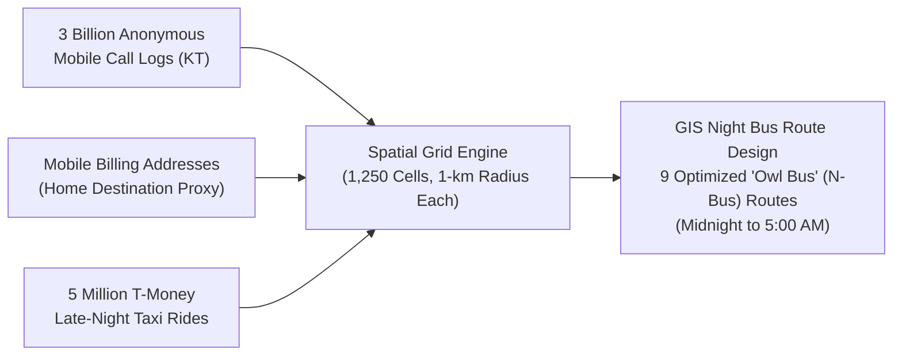
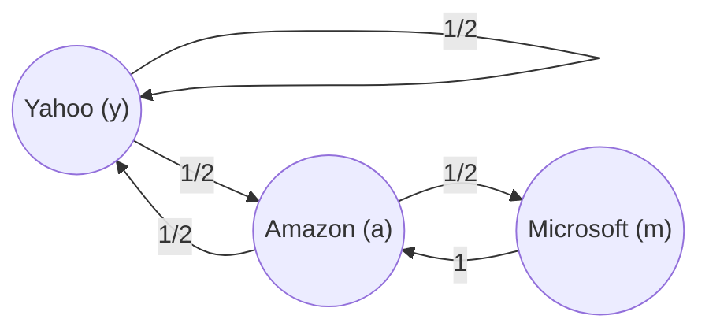

# Module 6: Social Media Location, Search Engine Analytics and Applications

**Course:** Big Data and Social Media Analytics (`26CMPC71` — VESIT 2026 NEP & Autonomy Scheme, Sem VII)  
**Course Outcome:** `CO6` — *Acquire the fundamental perspectives and hands-on skills needed to work, build the applications with big data and social media data.* (`06` Theory Hours + Lab Experiments 9, 10, & `11* Microproject`)  
**Primary Slides & Curriculum Sources Used:**
- `module_6/ch 04 A Location Analytics.pptx.pdf` (38 slides — *CHAPTER 4: Social Media Location Analytics*, compiled by Dr. Rohini Temkar)
- `module_6/ch 04 B Search Engine Analytics.pptx.pdf` (37 slides — *CHAPTER 9: Search Engines Analytics*, compiled by Dr. Rohini Temkar)
- `module_6/ch 04 -Page Rank n HITS.pptx.pdf` (26 slides — *Module 5 [legacy numbering]: 1) Page Rank Algorithm*, compiled by Dr. Rohini Temkar)
- Official Syllabus: `Final year B. E. (Computer Engineering) (Sem-VII & VIII) Batch  [2023-2027] (2026 ‘NEP & Autonomy’ Scheme).pdf` (`26CMPC71` Topics `6.1`, `6.2`, and Lab Experiments 9, 10, `11*` Microproject)

---

## Scope & Topic Checklist

| # | Topic / Subtopic | Official Syllabus Ref | Slide Coverage | Status |
|---|---|---|---|---|
| 1 | Location Analytics Foundations & Sources of Location Data (Business + Social Media) | `6.1` | `ch 04 A` pp. 1–5 | `[x]` |
| 2 | Business Data-Driven Location Analytics (Powerful Intelligence, Geo-Enrichment, Sharing) | `6.1` | `ch 04 A` pp. 6–16 | `[x]` |
| 3 | Social Media Data-Driven Location Analytics (7 Uses + Privacy Concerns & Legal Questions) | `6.1` | `ch 04 A` pp. 17–28 | `[x]` |
| 4 | Location Analytics Tools, Fusion Tables Shutdown/Replacements & Seoul "Owl Bus" Case Study | `6.1` | `ch 04 A` pp. 29–38 *(p. 35 stub expanded)* | `[x]` |
| 5 | Search Engine Types, Crawler Architecture (`Googlebot`, `robots.txt`), Directories & Metasearch | `6.2` | `ch 04 B` pp. 1–11 | `[x]` |
| 6 | Local vs. Global Search Engines *(Omitted Definition Required by Review Q3)* | `6.2` | `ch 04 B` pp. 12, 37 *(list/question only; expanded)* | `[x]` |
| 7 | Search Engine Optimization (SEO), SERP Ranking Signals & Domain Analysis Tools | `6.2` | `ch 04 B` pp. 13–26 | `[x]` |
| 8 | Search Trend Analytics, Query Syntax (`Google Trends` vs. Web Search) & Monitoring Tools | `6.2` | `ch 04 B` pp. 27–37 | `[x]` |
| 9 | PageRank Algorithm: Random Surfer, Markov Transition Matrix, Power Iteration & Worked Examples | `6.2` | `ch 04 -Page Rank n HITS` pp. 1–12, 19–26 | `[x]` |
| 10 | Dead Ends, Spider Traps & Teleportation / Taxation Formula *(Missing Formula Added + Slide 16 Fixed)* | `6.2` | `ch 04 -Page Rank n HITS` pp. 13–18 | `[x]` |
| 11 | **Bonus:** HITS Algorithm (Hubs & Authorities) *(In PPT Filename, Absent From Slides & `26CMPC71` Text)* | Supplementary | Filename only *(expanded from Kleinberg 1999 & MMDS)* | `[x]` |
| 12 | Big Data & Social Media Analytics Applications (Streaming, Recommenders, SpatioTemporal) & Microproject | `6.2` + Exp `9, 10, 11*` | Cross-module synthesis + `26CMPC71` Lab Syllabus | `[x]` |

**Assumptions & Source Notes:**
- **Zero-prior-knowledge assumption:** Geographic coordinates, IP geolocation, web crawling, inverted indexes, Markov transition matrices, eigenvectors, L1/L2 vector norms, and streaming architectures are explained from scratch before any mathematical formulas appear.
- **Deck numbering & filename quirks:** `ch 04 A` (*Chapter 4*) and `ch 04 B` (*Chapter 9*) follow chapter divisions from Gohar F. Khan's *Seven Layers of Social Media Analytics*, whereas `ch 04 -Page Rank n HITS.pptx.pdf` displays *"Module 5"* on Slide 1 (older syllabus numbering) and includes `"n HITS"` in its filename even though HITS does not appear anywhere inside its 26 slides.
- **Incomplete stubs & retired tools verified externally:** `ch 04 A` Slide 35 (*the "Owl Bus"*), `ch 04 B` Slide 12 (*Local vs. Global Search Engines*), and the missing PageRank Teleportation equation (`p. 14`) are completed from verified primary sources. Retired services appearing in the slides (`Google Fusion Tables`, `Alexa Rank`, `Google Toolbar PageRank 0–10`, `DMOZ`, `Yahoo Directory`, legacy social search tools) are clearly flagged with `PPT Verification Check` boxes so you state both slide concepts and modern reality accurately in the viva.

---

## 1. Topic 6.1 — Social Media Location Analytics (`ch 04 A`)

### 1.1 What Is Location Analytics? (`ch 04 A` pp. 1–2)

#### Basic Idea & Why We Need It
Every physical business transaction, mobile app session, food delivery order, and social media post happens **somewhere** in the physical world. If you store customer purchases or tweets only in an ordinary spreadsheet or text table, you completely miss *where* events happen and *how places influence human behavior*.

**Location Analytics** (also called **spatial analysis** or **geo-analytics**) is concerned with **mapping, visualizing, and mining the location of people, data, and other resources** (`ch 04 A` p. 2).

#### Everyday Analogy
Think of a standard spreadsheet of city hospital visits like a **telephone directory**—it lists names and numbers, but you cannot tell whether 80% of emergency cases came from a single polluted intersection. Putting those records onto a spatial analytics map turns the phonebook into an **interactive city radar**: clusters glow immediately, showing *where* ambulances should be stationed.  
*(Where the analogy stops being accurate: a simple weather radar only displays current dots, whereas enterprise location analytics overlays demographics, spending power, and movement paths to guide predictive decisions.)*

---

### 1.2 Sources of Location Data (`ch 04 A` pp. 3–5)

Before software can place anything on a map, it must collect geographic coordinates or location clues. Your slides separate **general location data sources** (`p. 3`) and **six specific social media location sources** (`pp. 4–5`).

#### A. Four General / Business Location Data Sources (`ch 04 A` p. 3)
1. **Postal Address:** Customer billing or shipping addresses (street, locality, city, postal/ZIP code). Most traditional business analytics systems rely on this. *(Prerequisite note: turning a text address like `"Chembur, Mumbai 400074"` into map coordinates is called **geocoding**.)*
2. **Latitude and Longitude:** Exact mathematical coordinates on Earth's surface (e.g., `19.0458° N, 72.8890° E` for VESIT Mumbai).
3. **GPS-Based (Global Positioning System):** A satellite-based navigation network that triangulates signals received by smartphones, vehicles, or IoT trackers to pinpoint exact real-time positions (typically accurate to a few meters outdoors).
4. **IP-Based (Internet Protocol Geolocation):** Every device connected to the public internet uses a public **IP address** assigned to an Internet Service Provider (ISP) block. GeoIP lookup databases map that IP to an approximate city, state, or country.

#### B. Six Social Media Location Data Sources (`ch 04 A` pp. 4–5)
1. **GPS-Based Location Data:** Mobile apps (Instagram, Facebook, Snapchat) request device GPS permissions to enable real-time, precise location tracking for posts, check-ins, and live maps.
2. **Geotagged Posts and Media:** Users manually attach a location tag (or embed camera Exchangeable Image File Format [EXIF] coordinates, when not stripped by platforms) to photos, videos, and posts on Instagram, X (formerly Twitter), and TikTok—supporting **location-based sentiment analysis** and **regional trend detection**.
3. **IP Address Geolocation:** Even if a user disables GPS, social platforms infer approximate region/city from their connection's public IP address—useful for regional content targeting, ads, and broad audience segmentation, though far less accurate than GPS (and easily skewed by Virtual Private Networks [VPNs] or mobile carrier gateways).
4. **Check-Ins and Location-Based Features:** Users *voluntarily* announce they are at a restaurant, airport, or concert (e.g., **Facebook Places**, **Swarm by Foursquare**). Brands mine check-ins for local loyalty offers and footfall analytics.
5. **User Profile Information:** Self-declared hometown, current city, or workplace entered in a user bio/profile—helpful for geographic and demographic audience segmentation (though profiles can be outdated or humorous/fake).
6. **Crowdsourced and Third-Party Data:** Companies aggregate anonymized mobility signals collected from mobile app Software Development Kits (SDKs) and external data brokers for market research, ad targeting, and population movement studies.

| Location Source | Typical Precision | Real-Time? | Primary Strength | Key Limitation |
|---|---|---|---|---|
| **Device GPS** | Very high (~3–15 m outdoors) | Yes | Pinpoints exact stores, roads, emergencies | Drains battery; requires explicit user OS permission |
| **Geotagged Posts / Check-ins** | High (venue-level) | Yes (at post time) | Links *sentiment + place* together | Only a small fraction of users actively geotag/check in |
| **Postal / ZIP Address** | Street to neighborhood | No (static) | Ubiquitous in CRM, billing, delivery logs | Needs geocoding; billing address may differ from current location |
| **IP Geolocation** | Low to moderate (city/ISP hub) | Yes | Works passively on desktop browsers without GPS | Mobile IPs/VPNs often point to distant carrier gateways |
| **User Profile Bio** | City / country level | No (static) | Captures self-reported home market | Frequently left blank, outdated, or fictional |

---

### 1.3 Category 1 — Business Data-Driven Location Analytics (`ch 04 A` pp. 6–16)

Your slides divide location analytics into two major categories (`p. 6`):
1. **Business Data-Driven Location Analytics** (`pp. 7–16`)
2. **Social Media Data-Driven Location Analytics** (`pp. 17–25`)

**Definition (`ch 04 A` p. 7):** *Business data-driven location analytics deals with mapping, visualizing, and mining location data to reveal patterns, trends, and relationships hidden in **tabular business data** (like sales tables, customer lists, delivery logs, or telecom records).*

#### Why Simple Static Maps Are Not Enough (`ch 04 A` p. 9)
Putting 50,000 customer pins on a basic Google Map creates an unreadable blob. Traditional static maps fail businesses in three ways:
1. They provide only a **static snapshot** of where things sit.
2. They lack deeper insights into **customer behavior, market trends, or operational efficiency**.
3. They offer **no predictive capabilities** for business planning.

To overcome these limits, business location analytics delivers three major capabilities (`p. 8`):

#### 1. Powerful Intelligence via Advanced Mapping Techniques (`ch 04 A` pp. 10–12)
1. **Clustering:** Groups nearby or similar spatial data points into meaningful visual clusters to identify market segments, high-traffic hubs, and optimal store locations.
   - *Slide Example:* A retail chain uses clustering on customer footfall patterns to pick promising locations for new stores.
2. **Heat Mapping:** Uses smooth color gradients (e.g., blue $\to$ yellow $\to$ bright red) to show the *intensity* or density of activity across regions, spotting high-demand hotspots instantly.
   - *Slide Example:* A food delivery service maps order frequency as a heat map to position riders near hungry neighborhoods before dinner rush.
3. **Data Aggregation:** Rolls up thousands of individual point records into meaningful geographic polygons (neighborhoods, postal zones, cities, states) so trends can be compared across administrative levels.
   - *Slide Example:* A telecom provider aggregates dropped-call records by cell sector/city zone to spot network congestion hotspots.
4. **Color-Coded Mapping (Choropleth Mapping):** Shades regions in distinct colors/tones to represent numeric values of a business metric, helping executives interpret regional disparities in seconds.
   - *Slide Example:* A real estate portal uses color-coded neighborhood maps to show property price variations across a city.

#### 2. Geo-Enrichment (`ch 04 A` pp. 13–15, citing Hecht 2013)
Plotting your own store sales on a map still leaves a big blind spot: *why* does Store A outperform Store B? **Geo-enrichment** enhances simple business maps by overlaying external contextual layers—such as demographics, consumer spending, lifestyle interests, and mobility trends (`Hecht 2013`)—to answer questions like *"Where do my loyal customers spend most of their time?"*

Slides (`p. 15`) highlight **four ways Geo-Enrichment enriches maps**:
1. **Demographic Insights:** Overlaying census population density, age distributions, and income levels onto maps (*e.g., a retail brand finding neighborhoods with the highest concentration of its target age/income group*).
2. **Consumer Spending Behavior:** Combining purchasing power and credit/transaction patterns (*e.g., a restaurant chain deciding where to launch a new outlet based on regional dining spend*).
3. **Lifestyle and Interests Mapping:** Adding behavioral preferences such as fitness habits, shopping preferences, or travel frequency (*e.g., a fitness brand finding high-traffic residential areas for gym promotions*).
4. **Customer Movement and Foot Traffic Analysis:** Tracking where loyal customers frequently visit before or after your venue (*e.g., a coffee shop chain discovering its regulars also visit nearby bookstores, enabling joint loyalty partnerships*).

#### 3. Collaboration and Sharing (`ch 04 A` p. 16)
Maps are intuitive visual tools across non-technical teams. Location analytics enables internal cross-department collaboration (marketing, supply chain, finance viewing one shared spatial dashboard) and external information sharing with customers (interactive store locators, delivery zones, public outage maps).

---

### 1.4 Category 2 — Social Media Data-Driven Location Analytics (`ch 04 A` pp. 17–25)

**Definition (`ch 04 A` p. 17):** *Social media data-driven location analytics relies on social media location data (most commonly **GPS** and **IP**) to mine and map the locations of social media users, user-generated content, and conversations.*

#### Seven Core Applications (`ch 04 A` pp. 18–25)
1. **Recommendation Purposes (`p. 19`):** Harvesting real-time user location to suggest nearby products, events, venues, or people as users enter a neighborhood.
   > [!NOTE]
   > **PPT Verification Check — App Name Typo (`ch 04 A` Slide 19):**
   > - **PPT says:** *"For example, Tender recommends potential social relationships based on the location of users."*
   > - **Verified clarification:** `"Tender"` is a spelling typo on the slide for **Tinder** (the location-based social/dating app that matches nearby users using GPS proximity).
   > - **What to say in the viva:** *"Location analytics powers real-time proximity recommendations—for example, dating and social apps like **Tinder** (printed as 'Tender' on the slide) or venue-discovery apps like Yelp/Foursquare."*
2. **Customer Segmentation (`p. 20`):** Grouping social media followers by country, state, or city so brands can tailor local languages, time zones, and cultural campaigns (*e.g., **Tweepsmap**, now rebranded as **Fedica**, geo-locating X/Twitter followers by city/state/country*).
3. **Advertisement (`p. 21`):** Serving hyper-targeted **location-based ads** (e.g., **geofencing**—triggering a mobile coupon or sponsored post when a user steps within 500 meters of a mall).
4. **Information Request (`p. 22`):** Answering "near me" user queries based on live coordinates (*e.g., nearest coffee shop, restaurant, ATM, or parking lot*).
5. **Alerts (`p. 23`):** Delivering location-triggered notifications such as flash store promotions, traffic jam alerts, speed-limit warnings, or severe storm warnings.
6. **Search and Rescue (`p. 24`):** Pinpointing trapped citizens, flooded roads, and emergency resource gaps from geotagged distress reports during disasters (*e.g., **Project Agos**, a geotagging/crisis-mapping platform in the Philippines for climate change adaptation and disaster risk reduction*).
7. **Navigation (`p. 25`):** Mobile GPS-driven routing and crowd-sourced congestion updates (*e.g., **Google Maps** combining GPS speed pings from millions of drivers to reroute traffic*).

---

### 1.5 Location Analytics Privacy Concerns & Legal/Ethical Questions (`ch 04 A` pp. 26–28)

#### Why Location Data Is Uniquely Sensitive (`p. 26`)
While location-based services bring convenience and business ROI, continuous collection, retention, use, and third-party disclosure of where a person goes raises severe privacy dangers. Unlike changing a leaked password, **you cannot easily change where you live, pray, work, or seek medical care**. Your slides warn (`p. 26`) that mining and storing location trails can endanger two **fundamental human rights**:
1. **Freedom of movement:** People may avoid rallies, sensitive clinics, or support groups if every movement creates a permanent searchable record.
2. **Freedom from being observed:** Constant background tracking creates pervasive surveillance by corporations, data brokers, or governments.

*(Technical note for examiners: Even "anonymized" location datasets with names stripped are easy to re-identify—knowing just a few hourly GPS points quickly reveals a person's home and office!)*

#### Six Key Privacy Questions (`ch 04 A` pp. 27–28)
Be ready to discuss these six ethical/legal questions from the slides:
1. **Informed Notice & Consent:** *Should users of location-enabled devices be clearly informed whenever location tracking is active?* (Modern OSs like Android/iOS address this via explicit runtime permission prompts and location-in-use status icons.)
2. **Storage & Retention Control:** *Should users be permitted to control how long location history is stored and delete it?* (E.g., Google Timeline auto-delete controls.)
3. **Identifiability vs. Anonymity:** *Should stored location records be personally identifiable, or should users preserve degrees of anonymity?* (Techniques like **spatial cloaking / fuzzing**—reporting a 1 km grid cell instead of exact house GPS—or ***k*-anonymity**, where a user is indistinguishable from at least $k-1$ others.)
4. **Protection Against Unreasonable Search & Seizure:** *What legal protection should a person's historical location trail have against warrantless government/police access?* (E.g., landmark legal cases requiring warrants for historical cell-site location records.)
5. **User-Configurable Granularity:** *To what extent should users choose their own level of precision/anonymity?* (E.g., iOS/Android `"Approximate"` vs. `"Precise"` location toggles.)
6. **Who Controls Disclosure:** *What level of disclosure control should be dictated by **government regulation** (such as GDPR or India's Digital Personal Data Protection [DPDP] Act), by affected individual users, or by third parties/self-regulation?*

---

### 1.6 Tools, Google Fusion Tables Update & Seoul "Owl Bus" Case Study (`ch 04 A` pp. 29–38)

#### A. Location Analytics Tools (`ch 04 A` pp. 29–34, 36)

| Tool in Slides | Slide Purpose & URL Shown | Verified Current Status & Modern Context |
|---|---|---|
| **Google Fusion Tables** (`pp. 29, 36`) | Web tool to geo-tag, store, query, and map tabular data/KML on Google Maps (`google.com/fusiontables`) | **SHUT DOWN December 3, 2019** (Google Workspace Updates notice). Replaced by **QGIS**, **Kepler.gl**, **Looker Studio**, and **Google Maps Platform / BigQuery GeoViz**. |
| **Agos / Project Agos** (`p. 30`) | Crowdsourced geotagging & disaster-reporting map (`agos.rappler.com`) | Active civic/crisis-mapping initiative by Rappler (Philippines; later expanded as Agos-eBayanihan) merging citizen hazard reports with responder maps. |
| **Tweepsmap** (`pp. 20, 31`) | Maps Twitter followers by country, state, or city (`tweepsmap.com`) | **Rebranded to Fedica** (`fedica.com`) — expanded into multi-platform audience geo-segmentation, analytics, and publishing. |
| **Trendsmap** (`p. 32`) | Real-time mapping of Twitter trends globally (`trendsmap.com`) | Original free real-time live Twitter trend map largely curtailed/pivoted following X (Twitter) API restrictions and pricing changes. |
| **Followerwonk** (`p. 33`) | Basic Twitter follower analytics: who, where located, when they tweet (`followerwonk.com`) | Acquired and integrated into **Fedica**, keeping bio search and follower demographic/location tools under Fedica's suite. |
| **Esri ArcGIS** (`p. 34`) | Enterprise **Geographic Information System (GIS)** to map, query, and analyze spatial data (`esri.com`) | Active industry-leading commercial GIS platform, heavily used for Geo-Enrichment, urban planning, and retail site selection. |

> [!WARNING]
> **PPT Verification Check — Google Fusion Tables Tutorial (`ch 04 A` Slides 29 & 36):**
> - **PPT says:** Slide 36 gives a step-by-step tutorial: *"Go to `google.com/fusiontables/` and click 'Create a Fusion Table'"*, importing Victoria, Australia's police station locations (`KML` — Keyhole Markup Language) file onto a Google Map with feature styles and heatmaps.
> - **Verified clarification (Google Workspace Updates, Dec 2018):** Google officially **shut down Google Fusion Tables on December 3, 2019**. You can no longer open or create Fusion Tables today.
> - **Modern replacements you should name in a viva:**
>   1. **QGIS** (`qgis.org`): Free, open-source desktop GIS software that opens KML, Shapefiles, and GeoJSON natively to run spatial joins and maps.
>   2. **Kepler.gl** (`kepler.gl`): Open-source, WebGL-powered browser tool (originally created at Uber) capable of plotting millions of GPS points, heatmaps, 3D hex-bins, and time-series movement arcs smoothly.
>   3. **Looker Studio + Google Maps Platform** (`lookerstudio.google.com` / `developers.google.com/maps`): Google's modern BI reporting and web mapping stack for tabular-plus-map dashboards.
> - **What to say in the viva:** *"Our textbook tutorial demonstrates KML point mapping using Google Fusion Tables—for example, plotting Victoria Police stations—though Google retired Fusion Tables in December 2019. Today, the same spatial workflow is done using open-source **QGIS** or **Kepler.gl** for heavy geospatial layers, or **Looker Studio** and **Esri ArcGIS** for business dashboards."*

#### B. Case Study Expanded (`ch 04 A` p. 35): Seoul's "Owl Bus" (N-Bus) Big Data Case Study

Slide 35 lists only a 3-bullet placeholder (`Case Study: the "Owl Bus"` $\to$ *The Problem / The Solutions / The Results*). Because this is one of the most famous smart-city location analytics case studies in the world (and directly from Gohar F. Khan's textbook), here is the complete, source-verified story:

1. **The Problem:**
   - In Seoul, South Korea, the subway and standard daytime bus networks closed between **midnight and 5:00 AM**.
   - Shift workers, cleaners, students, and hospitality staff had to rely on late-night taxis—which charged steep night surcharges, frequently refused short or outer-district trips, and were scarce.
   - Traditional transit planning failed because **daytime commuter data does not reflect nocturnal travel**, and expert guesswork could not pinpoint where late-night crowds actually moved.
2. **The Solutions (Public–Private Big Data Partnership):**
   - In **2013**, the Seoul Metropolitan Government partnered with telecommunications giant **KT Corporation** and payment card operator **T-Money** while removing all personally identifiable information (anonymizing records to protect citizen privacy).
   - **Data fused:**
     - **Over 3 billion anonymous mobile call/connection logs** (over 1 month) acted as a proxy for where "floating populations" gathered late at night (**origins**).
     - **Anonymous mobile billing addresses** acted as a proxy for where those riders lived (**destinations**).
     - **Over 5 million late-night T-Money taxi ride logs** validated actual street corridors and demand volume.
   - Seoul divided the city into **1,250 spatial cells of 1-kilometer radius** and overlaid the spatio-temporal demand in a GIS-enabled *Night Bus Route Design Support System* to trace the highest-need corridors.
3. **The Results:**
   - Launched **2 pilot routes (2013)**, then expanded after citizen demand (88.4% of 1,000 surveyed riders requested expansion) to **9 dedicated Owl Bus (`N-Bus`) routes** operating midnight–5:00 AM (and later expanded further).
   - Achieved **80–82/100 citizen satisfaction**, carried roughly **7,900 passengers per night** (by Dec 2016), and saved commuters roughly **6,000 KRW (over \$5) per ride** compared to taxis—generating an estimated **14.1 billion KRW (~ \$13 million)** in redistributed economic benefit.
   - Replaced an estimated **2.3 million car trips per year** (cutting **500 metric tons of greenhouse gas emissions/year**), increased **women's nighttime mobility by 11%**, and cut late-night **taxi passenger rejection by 8.9%**.

---

### 1.7 Viva Preparation — Location Analytics (`6.1`)

- **Quick definition:** Location analytics (spatial/geo-analytics) is the process of mapping, visualizing, and mining location-tagged business and social media data (via GPS, IP, addresses, geotags, or check-ins) to uncover geographic patterns, enrich maps with demographics/mobility, and drive location-aware decisions.
- **Explain it to the examiner (30–60 seconds):** *"Sir/Ma'am, Location Analytics turns raw geographic coordinates and addresses into actionable visual insights. It splits into two categories. **Business data-driven location analytics** maps tabular company data—using clustering, heat maps, data aggregation, color-coded maps, and **geo-enrichment**—to decide where to open stores or spot telecom congestion. **Social media data-driven location analytics** uses GPS and IP signals from posts and check-ins for nearby recommendations, regional customer segmentation, geofenced ads, emergency rescue like Project Agos, and traffic navigation. A famous real-world success is **Seoul's Owl Bus**, which combined 3 billion anonymized telecom call logs and 5 million taxi trips to design optimal midnight-to-5 AM bus routes—while reminding us of serious privacy risks like tracking movement and home addresses."*
- **Practical example:** Swiggy/Zomato using delivery **heat maps** to cluster hungry zones + **GPS rider telemetry** for live navigation + **geofenced push alerts** around lunchtime.
- **Examiner follow-ups:**
  1. *Q: Why isn't plotting simple pins on Google Maps enough for business analytics?*  
     **A:** Static pin maps hide density overlaps, reveal zero demographic or spending context, and offer no predictive power—which is why we use heat maps, clustering, regional aggregation, and geo-enrichment (`ch 04 A` pp. 9–15).
  2. *Q: Which is more accurate for social media location analytics: GPS or IP geolocation, and why?*  
     **A:** **GPS** is far more accurate (meters) because it triangulates satellite signals directly on the user's phone, whereas **IP geolocation** only maps to an ISP's regional routing gateway and breaks completely if a user uses a VPN or mobile tower miles away.
  3. *Q: How can companies do location analytics without violating user privacy?*  
     **A:** Obtain explicit opt-in consent, aggregate data into grid cells (like Seoul's 1-km cells) instead of individual trajectories, apply spatial cloaking/*k*-anonymity, minimize retention periods, and comply with privacy laws (GDPR / DPDP).
- **Common mistakes to avoid:** Saying Google Fusion Tables is still an active live Google product (it shut down Dec 3, 2019); confusing *Geo-enrichment* (adding external demographic/spending/lifestyle layers) with *Geocoding* (converting street addresses into lat/long coordinates).

---

## 2. Topic 6.2A — Search Engine Analytics (`ch 04 B`)

### 2.1 Search Engines as Gateways (`ch 04 B` pp. 1–2)

Before people visit a brand's website, read a blog, or discover a public social profile, they almost always start with a search box. Thus, **search engines act as gateways to social media and the web**, helping users discover relevant content, profiles, reviews, and discussions (`ch 04 B` p. 2).

---

### 2.2 Types of Search Engines & Architecture (`ch 04 B` pp. 3–12)

Your slides classify search engines in two complementary ways: **by how they build/collect results** (3 types, `pp. 3–11`) and **by geographic/system scope** (2 types, `p. 12`).

#### A. Three Types by Collection Mechanism (`ch 04 B` pp. 3–11)

##### 1. Crawler-Based Search Engines (`Google`, `Bing`, `pp. 4–9`)
Crawler-based engines build their massive databases **automatically without human curation**, operating in three continuous stages:

1. **Web Crawling (`p. 6`):**
   - Automated bots called **web crawlers** or **spiders** (e.g., **Googlebot**) continuously follow hyperlinks from known pages and XML sitemaps to discover new or updated URLs.
   - Crawlers download page text/media to feed the indexer and may keep a **cache** copy for fast retrieval and change comparison.
   - Website administrators (**webmasters**) place a plain-text file named **`robots.txt`** at the site root (e.g., `example.com/robots.txt`) telling crawlers which paths they may or may not request.
   > [!NOTE]
   > **Verified Clarification — What `robots.txt` Actually Controls (`Google Search Central`):**
   > - `robots.txt` primarily **manages crawler traffic** (preventing bots from overloading your server or wasting crawl budget on internal search/utility URLs).
   > - **Important exam nuance:** Blocking a page in `robots.txt` stops Googlebot from *crawling* it, **NOT strictly from indexing the URL!** If external websites link to that URL with descriptive anchor text, Google can still list the URL in search results (without a page description snippet). To guarantee a page is kept out of search results, allow crawling so Googlebot can read a **`noindex`** meta tag, or protect the page with a login/password.
2. **Indexing (`p. 7`):**
   - Like the alphabetical **index at the back of a textbook**, the search engine parses every crawled page into an **inverted index**—a massive structured database mapping every word/phrase to the exact document IDs, positions, headings, topics, and ranking factors where it appears.
   - *(Note on Slide 9 diagram `Live Google Example`:* Shows `WWW -> Crawler -> Store -> Indexer` filtering out spam/duplicates into `trash` buckets while building sorted `indexes` — historically illustrated on the slide at `~60 Trillion pages / 100 Million GB` — then feeding `Algorithms (Programs)` $\to$ `Search Interface` when a user submits a query.)*
3. **Searching & Query Optimization (`p. 8`):**
   - Before matching your query against the index, the engine uses **Natural Language Processing (NLP)** and Machine Learning (ML) to translate and rewrite your words into an **optimized query**:
     1. *Keyword extraction / stop-word filtering:* Dropping low-information filler words like `"the"`, `"and"`.
     2. *Spelling correction:* `"iphon"` $\to$ `"iPhone"`.
     3. *Synonym & related-term expansion:* `"cheap hotels"` $\to$ `"affordable accommodations"`.
     4. *Semantic intent matching:* `"how to bake a cake"` $\approx$ `"cake baking guide"`.
   - Finally, ranking algorithms score all matching pages from the index and display the **Search Engine Results Page (SERP)**.

##### 2. Directories (`p. 10`)
Listings are **manually reviewed, organized into hierarchical categories, and maintained by human editors** (like a curated yellow-pages book).
- *Slide Examples:* **Yahoo Directory**, **Open Directory (DMOZ)**, **LookSmart**.
> [!NOTE]
> **PPT Verification Check — Directory Status (`ch 04 B` Slide 10):**
> - **PPT says:** Lists Yahoo Directory, Open Directory (DMOZ), and LookSmart as a primary search engine type.
> - **Verified clarification:** Human-edited web directories could not keep up with billions of dynamic web pages. **Yahoo Directory closed in late 2014**, and **DMOZ (Open Directory Project) officially shut down on March 17, 2017** (with a volunteer community continuation at `curlie.org`), while LookSmart pivoted to ad-tech. Mention them as historically foundational examples of human-curated directories!

##### 3. Metasearch Engines (`p. 11`)
A metasearch engine **does not crawl the entire web or build its own massive index**. Instead, it takes one user query, sends it simultaneously to multiple external search engines (e.g., Google, Bing, Yahoo), **merges, deduplicates, and re-ranks** the combined results on one page.
- *Slide Examples:* **Metacrawler**, **Mamma**, **Dogpile** *(modern privacy-focused examples include DuckDuckGo's hybrid syndication or SearxNG instances).*

#### B. Search Engines Based on Scope: Local vs. Global (`ch 04 B` p. 12 & Review Q3 p. 37)

> [!IMPORTANT]
> **Omitted Syllabus/Review Topic Filled (`ch 04 B` Slide 12 & Slide 37 Q3):**  
> Slide 12 prints *"1. Local Search Engines / 2. Global Search Engines"* with zero explanation, and Slide 37 Review Question 3 explicitly asks: *"Differentiate between local and global search engines."* Below is the complete answer.

In BDSMA and Information Retrieval, **Local Search Engines** vs. **Global Search Engines** are distinguished by their **indexing boundary and geographic/domain scope** (note that "local search" carries two common meanings in practice—mention both clearly!):

| Dimension | Local Search Engine | Global Search Engine |
|---|---|---|
| **Primary Scope** | **Restricted boundary:** either (a) **Site/Enterprise/Intranet search** (searching only inside one website, e-commerce catalog, university portal, or company files via Apache Solr/Elasticsearch), OR (b) **Geographic local search** (finding nearby restaurants, clinics, stores in a specific city/neighborhood, e.g., Google Maps Local Pack, Yelp, Justdial). | **Worldwide public web:** Crawls and ranks billions/trillions of pages across countries, domains, and languages globally (e.g., `Google Search`, `Bing`). |
| **Index Size & Focus** | Smaller, specialized index (local documents, local business listings, NAP—Name/Address/Phone, hours, reviews). | Massive multi-petabyte web index spanning all topics globally. |
| **Key Ranking Signals** | Exact catalog attributes, proximity/GPS distance, local business reviews, category tags, internal site structure. | Global backlink authority (PageRank), broad content depth, domain trust, keyword relevance, global + personal context. |
| **User Intent** | *"Find a file inside our college portal"* or *"Best dentist near Chembur open now."* | *"How does PageRank work?"* or *"Latest climate report PDF."* |

---

### 2.3 Search Engine Optimization (SEO), SERP & Domain Metrics (`ch 04 B` pp. 13–26)

Your slides note (`p. 13`) that **Search Engine Analytics** covers two distinct disciplines:
1. **Search Engine Optimization (SEO)** (`pp. 14–26`)
2. **Search Engine Trend Analysis** (`pp. 27–36`)

#### A. What Is SEO and Why Do SERPs Matter? (`pp. 14–15`)
- **SEO (Search Engine Optimization):** Techniques and best practices used to improve a website's visibility and unpaid ranking on a **Search Engine Results Page (SERP)**.
- **Two Types of Results on a SERP (`p. 14`):**
  1. **Organic Results:** Unpaid listings ranked purely by the search engine's relevance and authority algorithms. *(Per Google Search Central: Google never accepts money to rank a page higher organically or crawl it faster!)*
  2. **Non-Organic Results (Paid / Sponsored Ads):** Pay-Per-Click (PPC) advertisements purchased via platforms like Google Ads (**Search Engine Marketing [SEM]**), clearly labeled *"Sponsored"* or *"Ad"*.
- **Why SERP Rank Matters (`p. 15`):** Users overwhelmingly click the top few results on Page 1; moving from Page 2 to the top 3 organic spots dramatically increases website traffic and conversions.

#### B. Four Major Search Ranking Signals (`ch 04 B` pp. 16–18)
1. **Use of Keywords (`p. 17`):** Query terms must align with words on the page—especially in prominent spots like the HTML `<title>` tag, headings (`<h1>`), URLs, and opening paragraphs (avoiding spammy keyword stuffing).
2. **Page Content (`p. 17`):** Engines reward original, helpful, well-structured content by analyzing depth, breadth, topical coverage, and freshness.
3. **Backlinks (`pp. 17–18`):** A **backlink** is an incoming hyperlink created when Website A links to Website B (illustrated by the `Moz` graphic on `p. 18`: `britishhedgehogs.org.uk` linking to `bighedgehogmap.org`). Each backlink acts as a **"vote" of credibility**—Google PageRank evaluates *both* how many sites link to you *and* how authoritative those linking sites themselves are.
4. **User Information (`p. 17`):** Personalization signals such as the searcher's physical location, search history, language settings, and device help tailor results uniquely (e.g., searching `"weather"` in Mumbai vs. London).

#### C. Qualitative PageRank & Domain Authority Screenshots (`ch 04 B` pp. 19–26)
- **Quality Beats Quantity (`p. 19`, Figure 1):** Even though `Page D` receives **four** incoming links (from `C, F, G, H`), **`Page B` ranks higher on the SERP than `Page D`** because `Page B` receives a direct endorsement from the giant, authoritative **`Page A`**.
- **Network Score Distribution (`p. 20`):** In the 11-node diagram, **`Page B` (`38.4%`)** and **`Page C` (`34.3%`)** capture over 72% of the entire network's importance because they sit at the center of mutual high-authority links plus endorsements from `E (8.1%)`, `D (3.9%)`, `F (3.9%)`, `A (3.3%)`, and five peripheral `1.6%` pages.

##### Understanding the `checkpagerank.net` Domain Analysis Screenshots (`pp. 21–26`)
Slides `21–26` show screenshots from `checkpagerank.net` for six domains (`facebook.com` [PR `9/10`, DA `100`, PA `97`], `dominos.co.in` [PR `5/10`, DA `38`, PA `41`], `frcrit.ac.in` [PR `0/10`, DA `1`, PA `1`], `fcrit.ac.in` [PR `3/10`, DA `18`, PA `1`, Alexa Global `2,189,498`, Backlinks `422`, Referring Domains `57`], `ultimatix.net` [PR `1/10`, DA `21`, PA `25`], and a **February 28, 2023** lookup for **`vesit.ves.ac.in`** [shown as PR `4/10`, `cPR Score: 3.8/10`, DA `34`, PA `36`, `Trust Flow: 8`, `Citation Flow: 24`, `Global Rank: N/A`, `Alexa USA Rank: N/A`]).

Know what each metric means—and which ones are now retired!
- **Moz Domain Authority (`DA`, `1–100`) & Page Authority (`PA`, `1–100`):** Third-party **Moz** logarithmic scores predicting how likely an entire domain (`DA`) or a specific page (`PA`) is to rank on SERPs based on linking root domains and backlink profiles. *(Important: DA and PA are third-party estimates—Google does NOT use Moz DA as a ranking signal!)*
- **Majestic Citation Flow (`CF`) & Trust Flow (`TF`) (`p. 26`):** Third-party **Majestic** link metrics:
  - **Citation Flow (`CF`):** Measures **link quantity/volume** pointing to a site regardless of link quality (`vesit.ves.ac.in`: `24`).
  - **Trust Flow (`TF`):** Measures **link quality/trustworthiness** based on proximity in the web graph to a human-curated seed set of highly trusted sites (`vesit.ves.ac.in`: `8`).
  - *Viva insight:* A site with huge `CF` and near-zero `TF` often has low-quality or spammy links; a healthy `TF:CF` balance indicates trustworthy backlinks.

> [!CAUTION]
> **Critical PPT Verification Check — Retired Metrics (`ch 04 B` Slides 20–26):**
> - **PPT says:** Slide 20 defines PageRank as *"the number of points out of ten that signifies the importance of a site to Google"*, and Slides 21–26 display `Google PageRank: X/10` (even on the Feb 2023 `vesit.ves.ac.in` screenshot!) alongside **Alexa Global Rank** (`N/A` on Slide 26!).
> - **Verified clarifications:**
>   1. **Google Toolbar PageRank (`0–10` scale) was officially retired in March/April 2016** (`Search Engine Journal` / `Search Engine Land` confirmation). Why? Webmasters abused the public 0–10 bar by buying/selling links and spamming blogs just to inflate their green PR number. Google **still uses PageRank internally** as part of its core ranking systems, but publishes **no public 0–10 PageRank score**. Third-party checkers after 2016 display frozen historic values or synthetic estimates (like `cPR Score: 3.8/10` on Slide 26).
>   2. **Alexa Rank (`alexa.com`) was permanently retired by Amazon on May 1, 2022** after 25 years (`ZDNet` / Amazon notice). That is the exact reason why the 2010s `fcrit.ac.in` screenshot (`p. 24`) showed an active numeric rank (`2,189,498`), whereas the **February 28, 2023** `vesit.ves.ac.in` screenshot (`p. 26`) prints **`Global Rank: N/A`** and **`Alexa USA Rank: N/A`**!
> - **What to say in the viva:** *"Mathematically, PageRank computes a continuous probability score (normalized between 0 and 1 across the crawled web). Historically, Google displayed a simplified 0–10 logarithmic Toolbar PageRank to the public, which it permanently retired in 2016 to curb link spam—though internal PageRank remains an active ranking signal. Similarly, Amazon retired Alexa Rank in May 2022 (which is why the 2023 `vesit.ves.ac.in` screenshot displays `N/A`), so modern SEOs rely on third-party metrics like Moz Domain Authority (`DA`), Page Authority (`PA`), and Majestic Trust/Citation Flow."*

---

### 2.4 Search Trend Analytics, Tools & Query Syntax (`ch 04 B` pp. 27–37)

#### A. What Is Search Trend Analytics? (`pp. 27–28`)
**Search Engine Trends Analytics** focuses on analyzing and understanding the **keywords people search for** over time and across regions. Rather than optimizing your website's rank (SEO), trend analytics turns aggregate search logs into **market research** to answer six business questions (`p. 28`):
1. How do people actually phrase searches for your brand?
2. When does interest spike or dip seasonally in your products/services?
3. Which keywords drive the highest search volume/interest?
4. Which countries, states, or cities are most interested in your brand?
5. What topics are currently trending across the internet?
6. How are your competitors performing in search interest compared to you?

#### B. Search Engine Analytics Tools (`ch 04 B` pp. 29–34, 36)
1. **Google Trends (`trends.google.com`, `pp. 29, 36`):** Free official Google tool displaying normalized search interest (`0` to `100`, where `100` is the peak popularity of a query in that chosen timeframe/region), geographic heat maps, and rising/top related queries.
   - *Slide 36 Tutorial (`Explore` mode):* Compares relative search interest over time for `iPhone 4`, `Samsung Galaxy S4`, and `LG Optimus One` from 2005–2015, revealing sharp launch spikes and product lifecycle decay.
2. **Google Alerts (`google.com/alerts`, `p. 31`):** Active free monitoring service that emails (or feeds via RSS) automated alerts whenever Google indexes new web pages, news, or blogs matching your saved search query.
3. **Legacy / Discontinued Tools (`pp. 30, 32–34`):**
   - **Canopy (`p. 30`, `vacommunity.org/article32`):** Visual analytics tool designed for exploring large multimedia collections (images, videos, documents); original site is no longer live.
   - **Icerocket (`p. 32`):** Legacy blog and social search engine (acquired by Meltwater; now offline).
   - **Social Mention (`p. 33`):** Early real-time social mention search & sentiment aggregator across blogs/comments; now offline (replaced by modern social listening suites such as BrandMentions/Brand24).
   - **TweetBeep (`p. 34`):** Legacy alerting service described as *"Google Alerts for Twitter"*; discontinued.

#### C. Research Query Syntax (`ch 04 B` Slide 35 Table 1 — Crucial Distinction!)

Slide 35 presents `Table 1. Executing your research correctly` directly from Google Trends syntax rules. Look carefully at the **huge difference** between **Google Trends syntax** and **standard Google Web Search syntax**:

| Query Example (`Slide 35`) | What Slide 35 (`Table 1`) Says | Verified Technical Clarification (`Google Trends Help` vs. `Google Search Help`) |
|---|---|---|
| `Social media analytics` | Searches containing `"social"`, `"media"`, and `"analytics"` in any order. | Matches official **Google Trends Help** (`tennis shoes`). Note: in Google Trends, variations/misspellings/plurals are **not** bundled automatically unless you enter a *Topic* or combine with `+`. |
| `"Social media analytics"` | Only the exact phrase inside double quotation marks. | Correct in **both** Google Trends and Google Web Search (exact phrase match, allowing words before/after). |
| `social + analytics` | Searches containing `"social"` **OR** `"analytics"`. | **Crucial nuance!** In **Google Trends**, `+` (with spaces: `tennis + squash`) truly acts as an **OR** operator (also useful to merge spelling variants like `center + centre`). In **standard Google Web Search**, Google **deprecated the `+` operator in October 2011**—you must write uppercase **`OR`** instead! |
| `social – analytics` | Includes `"social"` but excludes `"analytics"`. | **Slide typography trap!** Slide 35 prints an en-dash with spaces (`social – analytics`). Official Google Trends Help explicitly warns that **putting a space after the hyphen (`tennis - shoes`) causes `-` to be IGNORED!** You must type **`social -analytics`** (ASCII hyphen `-` immediately attached to the excluded word, zero space) in both Google Trends and Google Search. |

---

### 2.5 Viva Preparation — Search Engine Analytics (`6.2A`)

- **Quick definition:** Search engine analytics encompasses **Search Engine Optimization (SEO)**—improving organic visibility and rankings on SERPs—and **Search Trend Analytics**—mining keyword volumes, spikes, regional demand, and competitor popularity over time.
- **Explain it to the examiner (30–60 seconds):** *"Search engines act as the main gateway to websites and social media content. Crawler-based engines like Google work in three steps: **crawling** links with spiders like Googlebot (respecting `robots.txt` for crawl traffic), **indexing** parsed text into a massive inverted index, and **searching** by using NLP to rewrite user queries before ranking results using keywords, content quality, backlinks (PageRank), and user context. Search Engine Analytics has two halves: **SEO**, which boosts unpaid organic SERP traffic, and **Search Trend Analytics**, which uses tools like Google Trends and Google Alerts to track seasonal demand, regional interest, and competitor benchmarks."*
- **Practical example:** Before launching a winter jacket line in India, a brand uses **Google Trends** (`leather jacket + bomber jacket`) filtered by state to see *when* searches spike (October–December) and *which regions* search most, while optimizing product pages with descriptive `<title>` tags and earning fashion-blog backlinks (**SEO**) to rank top 3 organically on the SERP.
- **Examiner follow-ups:**
  1. *Q: Does putting `Disallow: /secret.html` in `robots.txt` guarantee the page won't appear on Google?*  
     **A:** No! `robots.txt` only stops Googlebot from *crawling* the file. If another site links to `/secret.html`, Google can still index its URL without a description snippet. To prevent indexing completely, use a `noindex` meta tag (while keeping it crawlable) or password authentication.
  2. *Q: Why did Page B outrank Page D in the slide diagram even though Page D had 4 incoming links and Page B had only 1?*  
     **A:** Because backlink ranking weighs link **quality**, not just count—Page B received a link from the highest-authority node (`Page A`), which carries far more weight than four small low-rank pages linking to `D`.
  3. *Q: What happens if you type `apple - fruit` (with a space) vs. `apple -fruit` in Google Trends?*  
     **A:** With a space (`apple - fruit`), Google Trends ignores the hyphen and searches both terms together; with no space (`apple -fruit`), it excludes searches containing `"fruit"`.
- **Common mistakes to avoid:** Claiming Google accepts payment for higher organic rankings (paid ads are separate *non-organic* SEM results); claiming Toolbar PageRank `0–10` or Alexa Rank are still live official metrics; confusing `+` as AND in Google Trends (it is **OR** in Google Trends and deprecated in standard Google Search!).

---

## 3. Topic 6.2B — PageRank Algorithm & HITS (`ch 04 -Page Rank n HITS.pptx.pdf`)

### 3.1 Prerequisite Intuition: The "Random Surfer" Model (`pp. 1–7`)

#### Basic Idea & Why Simple Link Counting Fails
Suppose you want to rank webpages purely from their hyperlink graph. A naive idea is **in-degree counting** (*whichever page has the most incoming links wins*). Why does that fail? Anyone can create 1,000 fake spam websites pointing to their own blog (`"link farms"`), unfairly beating Wikipedia!

**PageRank** (invented by Larry Page and Sergey Brin at Stanford, 1998) fixes this with a recursive principle:
> **A page is important if it is pointed to by *other important pages*—and an important page splits its endorsement evenly across all outgoing links it makes.**

#### Everyday Analogy: Academic Endorsements (or Party Rumors)
Imagine 1,000 students endorse one student—that's nice, but imagine **two Nobel Prize laureates** endorse one researcher instead. Because Nobel laureates are highly selective and authoritative, their endorsement transfers far more prestige! However, if a professor writes letters of recommendation for *100* students every year, each single endorsement carries less weight (`1/100`) than if they endorse only *2* students (`1/2`).  
*(Where the analogy stops being accurate: real people don't click links forever at uniform probability without reading anchor text or bouncing after one search.)*

#### Mathematical Formulation (`pp. 4–7`)
Imagine a **Random Surfer** who starts on a random webpage and repeatedly clicks one outgoing link chosen uniformly at random. Let $n$ be the total number of pages:

1. **Initial Probability Vector ($\mathbf{v}_0$, `p. 5`):**
   Initially, the surfer is equally likely to start at any of the $n$ pages:
   $$\mathbf{v}_0 = \begin{bmatrix} 1/n \\ 1/n \\ \vdots \\ 1/n \end{bmatrix}$$

2. **Transition Matrix ($M$, $n \times n$, `p. 6`):**
   Build an $n \times n$ **column-stochastic Markov transition matrix** $M$ where:
   $$M_{ij} = \begin{cases} \dfrac{1}{k} & \text{if page } j \text{ has } k \text{ outgoing links and one goes to page } i, \\ 0 & \text{otherwise.} \end{cases}$$
   *(Check orientation carefully! **Column $j$ = source page sending rank; Row $i$ = destination page receiving rank.**)*
   Because $M$ represents transition probabilities from each page $j$, a valid **Markov Transition Matrix** has two properties (`p. 6`):
   - Every entry is non-negative ($M_{ij} \ge 0$).
   - Every column sums to $1$ ($\sum_{i=1}^n M_{ij} = 1$) — *assuming no dead ends*.

3. **Power Iteration (`p. 7`):**
   Multiply $M$ by the current distribution vector $\mathbf{v}$ repeatedly:
   $$\mathbf{v}_1 = M\mathbf{v}_0, \qquad \mathbf{v}_2 = M\mathbf{v}_1 = M^2\mathbf{v}_0, \qquad \dots, \qquad \mathbf{v}_{t+1} = M\mathbf{v}_t$$
   Stop when $\mathbf{v}_{t+1} \approx \mathbf{v}_t$. At that **steady state**, $\mathbf{v} = M\mathbf{v}$ — meaning $\mathbf{v}$ is the **principal eigenvector** of $M$ corresponding to eigenvalue $\lambda = 1$, and $v_i$ gives the idealized PageRank (long-run surfer probability) of page $i$!

---

### 3.2 Step-by-Step Worked Examples from the Slides (`pp. 3–12, 19–26`)

#### Worked Example 1: 4-Node Intro Graph `A, B, C, D` (`pp. 3–4`)
- **Outgoing links (`p. 3`):**
  - `A` $\to$ `{B, C, D}` ($k=3$, each gets `1/3`)
  - `B` $\to$ `{A, D}` ($k=2$, each gets `1/2`)
  - `C` $\to$ `{A}` ($k=1$, gets `1`)
  - `D` $\to$ `{B, C}` ($k=2$, each gets `1/2`)
- **Transition Matrix $M$:**
  $$M = \begin{bmatrix} 0 & 1/2 & 1 & 0 \\ 1/3 & 0 & 0 & 1/2 \\ 1/3 & 0 & 0 & 1/2 \\ 1/3 & 1/2 & 0 & 0 \end{bmatrix}$$
- **First Iteration (`v0 = [1/4, 1/4, 1/4, 1/4]^T`):**
  - $\mathbf{v}_1 = M\mathbf{v}_0 = \left[\frac{1}{2}\!\left(\frac{1}{4}\right)+1\!\left(\frac{1}{4}\right),\; \frac{1}{3}\!\left(\frac{1}{4}\right)+\frac{1}{2}\!\left(\frac{1}{4}\right),\; \frac{1}{3}\!\left(\frac{1}{4}\right)+\frac{1}{2}\!\left(\frac{1}{4}\right),\; \frac{1}{3}\!\left(\frac{1}{4}\right)+\frac{1}{2}\!\left(\frac{1}{4}\right)\right]^T = \left[\frac{3}{8},\; \frac{5}{24},\; \frac{5}{24},\; \frac{5}{24}\right]^T$.
- **Steady-State Limit:** Converges to $\mathbf{v}^* = [1/3,\; 2/9,\; 2/9,\; 2/9]^T \approx [0.3333,\; 0.2222,\; 0.2222,\; 0.2222]^T$. (`A` ranks highest because `C` sends 100% of its rank to `A` and `B` sends 50%.)

#### Worked Example 2: 3-Node `Yahoo, Amazon, Microsoft` (`pp. 8–10`)

- **Transition Matrix $M$ (Order: `y, a, m`):**
  - Yahoo links to `{y, a}` $\implies$ Col 1 = $[1/2, 1/2, 0]^T$
  - Amazon links to `{y, m}` $\implies$ Col 2 = $[1/2, 0, 1/2]^T$
  - Microsoft links to `{a}` $\implies$ Col 3 = $[0, 1, 0]^T$
  $$M = \begin{bmatrix} 1/2 & 1/2 & 0 \\ 1/2 & 0 & 1 \\ 0 & 1/2 & 0 \end{bmatrix}, \qquad \mathbf{v}_0 = \begin{bmatrix} 1/3 \\ 1/3 \\ 1/3 \end{bmatrix}$$
- **Step-by-Step Iterations (`pp. 8–10`):**
  1. **Iteration 1 (`p. 8`):** $\mathbf{v}_1 = M\mathbf{v}_0 = \begin{bmatrix} \frac{1}{2}(\frac{1}{3}) + \frac{1}{2}(\frac{1}{3}) + 0 \\ \frac{1}{2}(\frac{1}{3}) + 0 + 1(\frac{1}{3}) \\ 0 + \frac{1}{2}(\frac{1}{3}) + 0 \end{bmatrix} = \begin{bmatrix} 1/3 \\ 1/2 \\ 1/6 \end{bmatrix}$. *(Check sum: $2/6 + 3/6 + 1/6 = 1$.)*
  2. **Iteration 2 (`p. 9`):** $\mathbf{v}_2 = M\mathbf{v}_1 = \begin{bmatrix} \frac{1}{2}(\frac{1}{3}) + \frac{1}{2}(\frac{1}{2}) \\ \frac{1}{2}(\frac{1}{3}) + 1(\frac{1}{6}) \\ \frac{1}{2}(\frac{1}{2}) \end{bmatrix} = \begin{bmatrix} 5/12 \\ 1/3 \\ 1/4 \end{bmatrix}$. *(Check sum: $5/12 + 4/12 + 3/12 = 1$.)*
  3. **Further Iterations (`p. 10`):**
     - $\mathbf{v}_3 = [3/8,\; 11/24,\; 1/6]^T$
     - $\mathbf{v}_4 = [5/12,\; 17/48,\; 11/48]^T$
  4. **Exact Steady-State Solution ($\mathbf{v} = M\mathbf{v}$):**
     - $y = \frac{1}{2}y + \frac{1}{2}a \implies \frac{1}{2}y = \frac{1}{2}a \implies y = a$
     - $m = \frac{1}{2}a$
     - Since $y + a + m = 1$: $a + a + 0.5a = 1 \implies 2.5a = 1 \implies a = 2/5,\; y = 2/5,\; m = 1/5$.
     - **Result:** $\mathbf{v}^* = \mathbf{[2/5,\; 2/5,\; 1/5]^T = [0.4,\; 0.4,\; 0.2]^T}$ (`Yahoo` and `Amazon` tie at `0.4`, twice as high as `Microsoft` at `0.2`).

#### Worked Example 3: 5-Node Graph `Ex 2` (`pp. 11–12`) — L1 vs. L2 Normalization Discrepancy Explained!
- **Graph edges (`p. 11`):**
  - `1` $\to$ `{3, 5}` (Col 1: `[0, 0, 1/2, 0, 1/2]^T`)
  - `2` $\to$ `{1}` (Col 2: `[1, 0, 0, 0, 0]^T`)
  - `3` $\to$ `{5}` (Col 3: `[0, 0, 0, 0, 1]^T`)
  - `4` $\to$ `{2, 3, 5}` (Col 4: `[0, 1/3, 1/3, 0, 1/3]^T`)
  - `5` $\to$ `{2, 4}` (Col 5: `[0, 1/2, 0, 1/2, 0]^T`)
- **Initial & Early Steps (`p. 12`):**
  - $\mathbf{v}_0 = [1/5,\; 1/5,\; 1/5,\; 1/5,\; 1/5]^T$
  - $\mathbf{v}_1 = [1/5,\; 1/6,\; 1/6,\; 1/10,\; 11/30]^T$ *(sum = `1`)*
  - $\mathbf{v}_2 = [1/6,\; 13/60,\; 2/15,\; 11/60,\; 3/10]^T$ *(sum = `1`)*

> [!NOTE]
> **PPT Verification Check — L1 Probability Sum vs. L2 Unit Norm (`ch 04 -Page Rank n HITS` Slide 12):**
> - **PPT says:** After starting with probability sums of `1` ($\mathbf{v}_0, \mathbf{v}_1, \mathbf{v}_2$), Slide 12 prints the converged values after 60 iterations as **`[0.4313, 0.4313, 0.3235, 0.3235, 0.6470]`** (which sums to **`2.1566`**, NOT `1.0`!).
> - **Verified mathematical explanation:**
>   1. Under **L1 probability normalization** ($\sum v_i = 1$), $M^{60}\mathbf{v}_0$ actually converges to exact probabilities **`[0.20, 0.20, 0.15, 0.15, 0.30]`** ($4/20, 4/20, 3/20, 3/20, 6/20$).
>   2. Slide 12 switched to **L2 (Euclidean) unit-norm normalization** ($\mathbf{v}/\|\mathbf{v}\|_2$, the default convention of functions like MATLAB's `eig()`):
>      $$\|\mathbf{v}\|_2 = \sqrt{0.20^2 + 0.20^2 + 0.15^2 + 0.15^2 + 0.30^2} = \sqrt{0.215} \approx 0.463681$$
>      Dividing `[0.20, 0.20, 0.15, 0.15, 0.30]` by `0.463681` yields **`[0.4313, 0.4313, 0.3235, 0.3235, 0.6470]`**!
>   3. Crucially, the **ratios and rankings are identical** (`0.6470 / 0.4313 = 1.5`, just like `0.30 / 0.20 = 1.5`): **Page 5** ranks 1st, **Pages 1 & 2** tie 2nd, and **Pages 3 & 4** tie 3rd.
> - **What to say in the viva:** *"In probability form (L1 norm summing to 1), Ex 2 converges to `[0.20, 0.20, 0.15, 0.15, 0.30]`; our slide shows the L2 unit-normalized eigenvector `[0.4313, 0.4313, 0.3235, 0.3235, 0.6470]`, which preserves the exact same ranking: Page 5 highest, then 1 & 2, then 3 & 4."*

#### Worked Example 4: 4-Node Matrix `A` (`pp. 19–21`)
- **Edges & Matrix $A$ (`p. 20`):** `1 -> {2,3,4}` (`1/3` each), `2 -> {3,4}` (`1/2` each), `3 -> {1}` (`1`), `4 -> {1,3}` (`1/2` each).
  $$A = \begin{bmatrix} 0 & 0 & 1 & 1/2 \\ 1/3 & 0 & 0 & 0 \\ 1/3 & 1/2 & 0 & 1/2 \\ 1/3 & 1/2 & 0 & 0 \end{bmatrix}$$
- **Iterations (`p. 21`):** Starting from $\mathbf{v} = [0.25, 0.25, 0.25, 0.25]^T$, Slide 21 truncates entries to 2 decimal places at every step (`Av = [0.37, 0.08, 0.33, 0.20]^T` from exact `[0.375, 0.0833, 0.3333, 0.2083]^T`), stabilizing at `A^8 v = [0.38, 0.12, 0.29, 0.19]^T` *(note sum `0.98` due to 2-decimal truncation; exact unrounded steady state is `[12/31, 4/31, 9/31, 6/31] ≈ [0.3871, 0.1290, 0.2903, 0.1935]`)*.

#### Worked Flow-Style Exam Exercises (`pp. 22–26`)
Many university exam questions give fixed starting PageRanks on source nodes and ask you to split each node's rank equally across its outgoing arrows ($\text{flow per outlink} = PR(u)/d_{\text{out}}(u)$):
1. **Exercise A (`p. 22`, repeated on `pp. 24–25`):** Given `PR(A)=12`, `PR(C)=10`. Find `PR(B)`.
   - `A` has 2 outlinks (`A->B`, `A->D`) $\implies 12/2 = 6$ each.
   - `C` has 1 outlink (`C->D`) $\implies 10/1 = 10$.
   - `D` receives `6 + 10 = 16`, so `PR(D) = 16`. `D` has 2 outlinks (`D->B`, `D->E`) $\implies 16/2 = 8$ each.
   - **`PR(B)` = `6` (from `A`) `+ 8` (from `D`) `= 14`** *(and `PR(E) = 8`)*.
2. **Exercise B (`p. 23`):** Given `PR(A)=12`, `PR(F)=5`. Find `PR(B)`.
   - `A` has 3 outlinks (`A->B, A->C, A->D`) $\implies 12/3 = 4$ each.
   - `C` receives `4` from `A`, splits across 2 outlinks (`C->D, C->F`) $\implies 2$ each.
   - `D` receives `4` (`A`) `+ 2` (`C`) `= 6`, splits across 2 outlinks (`D->E, D->F`) $\implies 3$ each.
   - *(Check `F`: receives `2` from `C` + `3` from `D` = `5`, matching given `PR(F)=5`!)* `F` has 1 outlink (`F->E`) $\implies 5$.
   - `E` receives `3` (`D`) `+ 5` (`F`) `= 8`, sends all `8` via 1 outlink (`E->B`).
   - **`PR(B)` = `4` (from `A`) `+ 8` (from `E`) `= 12`**.
3. **Exercise C (`p. 26` — Reverse Solve):** Given incoming external edge to `B = 1`, `C->D = 8`, `D->E = 6`, `PR(F) = 9`, `G` outlinks = `11` and `11`. Find `PR(A)`.
   - `D` has 3 outlinks (`D->B`, `D->E`, `D->G`). Since `D->E = 6`, each carries `6`, so `PR(D) = 6 × 3 = 18`.
   - `F` has `PR(F) = 9` and 3 outlinks (`F->D`, `F->G`, external) $\implies 9/3 = 3$ each.
   - `D`'s total `18` equals `A->D + C->D + F->D = A->D + 8 + 3` $\implies A\to D = 18 - 11 = 7$.
   - `A` has 2 outlinks (`A->B`, `A->D`), so each carries `7` $\implies$ **`PR(A) = 7 × 2 = 14`**! *(Consistency check: `B` receives `7+6+1=14`, sends `7` to `E`; `E` receives `7+6=13`, sends `13` to `G`; `G` receives `13+6+3=22`, splits `11` and `11`!)*

---

### 3.3 Problems Faced by PageRank & Teleportation / Taxation (`pp. 13–18`)

The idealized PageRank equation $\mathbf{v} = M\mathbf{v}$ breaks down on real web graphs for **two structural reasons** (`p. 13`):

#### 1. Dead Ends (`pp. 13–17`)
- **Definition:** A page with **zero outgoing links** ($d_{\text{out}} = 0$)—for example, a PDF, image, or terminal page.
- **What goes wrong:** Its column in $M$ is **all zeros** (sum $= 0$, NOT $1$), so $M$ is no longer column-stochastic. Random surfers who reach a dead end vanish, causing total PageRank across the graph to **leak to zero** ($\mathbf{v} \to [0, 0, \dots, 0]^T$).
- **Slide 17 (`Ex: Dead end`):** Removing `C`'s outgoing link from the `A, B, C, D` graph turns Column 3 into `[0, 0, 0, 0]^T`. Running `Mv` leaks rank step by step (`[1/4,1/4,1/4,1/4] -> [3/24, 5/24, 5/24, 5/24] -> [5/48, 7/48, 7/48, 7/48] -> ...`) until **every node converges to `[0, 0, 0, 0]^T`**!

> [!CAUTION]
> **Critical PPT Error Flagged & Fixed — `Dead end: Ex 3` (`ch 04 -Page Rank n HITS` Slides 15–16):**
> - **PPT says:** Slide 15 shows nodes `P, Q, R` where `R` is a **dead end** (Column `R` = `[0, 0, 0]^T` in $M$). However, Slide 16 computes:
>   `XP: 1/3 -> 2/6 -> 3/12 -> 5/24 -> ... -> 0`  
>   `XQ: 1/3 -> 1/6 -> 2/12 -> 3/24 -> ... -> 0`  
>   `XR: 1/3 -> 2/6 -> 7/12 -> 16/24 -> ... -> 1`  
>   and concludes: *"All the Page rank is trapped in R, Once a random surfer reaches R, he can never leave."*
> - **Verified correction:** Slide 16 accidentally pasted **Spider Trap** calculations from Slide 18 (`y, a, m`, where `m` has a self-loop `m -> m` giving `m_33 = 1`) onto the **Dead End** graph of Slide 15 (and even miscopied `3/6` as `2/6` in step 1)!
>   - With the **actual Dead End matrix** from Slide 15 ($M = \begin{bmatrix} 1/2 & 1/2 & 0 \\ 1/2 & 0 & 0 \\ 0 & 1/2 & 0 \end{bmatrix}$):
>     - $\mathbf{v}_1 = M\mathbf{v}_0 = \mathbf{[1/3,\; 1/6,\; 1/6]^T}$ *(sum $= 2/3$, NOT `[2/6, 1/6, 2/6]`)*
>     - $\mathbf{v}_2 = M\mathbf{v}_1 = \mathbf{[1/4,\; 1/6,\; 1/12]^T}$ *(sum $= 1/2$)*
>     - $\mathbf{v}_3 = M\mathbf{v}_2 = \mathbf{[5/24,\; 1/8,\; 1/12]^T}$ *(sum $= 5/12$)*
>     - **True Limit:** $\mathbf{[0,\; 0,\; 0]^T}$ (all rank leaks out, exactly like Slide 17!).
> - **What to say in the viva:** *"In a **Dead End**, a node has no outgoing links (all-zero column), so PageRank leaks out until all nodes approach **0**—as shown properly on Slide 17. On Slide 16 (`Ex 3`), the deck accidentally reused Spider Trap values converging to `[0, 0, 1]`, which only happens when `R` has a self-loop (`1` on the diagonal), not an all-zero dead-end column."*

#### 2. Spider Traps (`pp. 13, 18`)
- **Definition:** A node or group of nodes that **have outgoing links, but every outgoing link stays inside the group** (never linking back out to the rest of the web).
- **Slide 18 (`Ex: Spider Trap`):** Nodes `y, a, m` where `m` only links to itself (`m -> m`, so Col 3 = `[0, 0, 1]^T`).
  - Iterations: `[1/3, 1/3, 1/3] -> [2/6, 1/6, 3/6] -> [3/12, 2/12, 7/12] -> [5/24, 3/24, 16/24] -> ...` $\implies$ converges to **`[0, 0, 1]^T`**! Every surfer who enters `m` gets trapped forever, sucking 100% of PageRank into the trap.

#### 3. The Solution: Teleportation / Taxation Formula (`p. 14` + Stanford MMDS Ch. 5)
Slide 14 mentions *"a method called taxation"* in prose (*allowing a surfer to leave the current page and jump randomly to a new page*) without giving the equation. Here is the exact **Stanford MMDS Chapter 5 PageRank Equation with Teleportation (Taxation)**:

$$\mathbf{r}' = \beta M \mathbf{r} + (1 - \beta)\frac{\mathbf{e}}{n}$$

Or for an individual page $i$:
$$r'_i = \beta \sum_{j \to i} \frac{r_j}{d_j} + \frac{1 - \beta}{n}$$

**Every Symbol Explained:**
- $\mathbf{r}$ and $\mathbf{r}'$: Current and updated $n \times 1$ PageRank vectors.
- $\beta$ (**damping / link-follow factor**, typically **`0.85`**): Probability at each step that the surfer clicks a random outgoing link on the current page.
- $1 - \beta$ (**taxation / teleportation probability**, typically **`0.15`**): Probability at each step that the surfer gets bored, ignores links, and **teleports** uniformly to any of the $n$ pages on the web.
- $\mathbf{e}$: Column vector of $n$ ones $[1, 1, \dots, 1]^T$, so $\frac{\mathbf{e}}{n} = [1/n, \dots, 1/n]^T$.
- **How Dead Ends Are Fixed in Standard Stochastic PageRank:** Before applying $\beta$, any all-zero dead-end column in $M$ is replaced with $[1/n, \dots, 1/n]^T$ (meaning a surfer stuck at a dead end teleports uniformly with probability 1 on the next step), ensuring the combined Google transition matrix $G = \beta M_{\text{fixed}} + (1-\beta)\frac{1}{n}\mathbf{e}\mathbf{e}^T$ is strictly stochastic, irreducible, and aperiodic—guaranteeing unique convergence! *(Equivalently, MMDS also explains recursively stripping dead ends or re-normalizing the leaked tax `1 - sum(r')` uniformly back across all nodes.)*

##### Worked Numerical Step: Fixing the `y, a, m` Spider Trap (Slide 18) with $\beta = 0.85$
Using Slide 18's matrix $M = \begin{bmatrix} 1/2 & 1/2 & 0 \\ 1/2 & 0 & 0 \\ 0 & 1/2 & 1 \end{bmatrix}$, $n = 3$, $\beta = 0.85$, $\frac{1-\beta}{n} = \frac{0.15}{3} = 0.05$, and $\mathbf{r}_0 = [1/3, 1/3, 1/3]^T$:
- **Iteration 1:**
  $$\mathbf{r}_1 = 0.85 \begin{bmatrix} 2/6 \\ 1/6 \\ 3/6 \end{bmatrix} + \begin{bmatrix} 0.05 \\ 0.05 \\ 0.05 \end{bmatrix} = \begin{bmatrix} 0.2833 + 0.05 \\ 0.1417 + 0.05 \\ 0.4250 + 0.05 \end{bmatrix} = \begin{bmatrix} 0.3333 \\ 0.1917 \\ 0.4750 \end{bmatrix}$$
- **Converged Steady State:** Instead of collapsing to `[0, 0, 1]`, teleportation stabilizes the ranks at **`y ≈ 0.1807`, `a ≈ 0.1268`, `m ≈ 0.6926`** (summing to `1.000`). Node `m` is still strongest (as it receives links from both `a` and itself), but `y` and `a` no longer lose all their score!

---

### 3.4 Bonus Section — HITS Algorithm (Hubs and Authorities) *(Supplementary)*

> [!NOTE]
> **Why This Section Is Included:** The slide deck is named `ch 04 -Page Rank n HITS.pptx.pdf`, yet **HITS** does not appear in any of its 26 slides (and is not named in `26CMPC71` Topic `6.2`). Because examiners often spot `"n HITS"` in the file title or ask you to compare PageRank with HITS, this concise verified overview prepares you completely.

#### A. Basic Idea & Intuition (Jon Kleinberg, 1999)
While PageRank assigns every webpage **one global query-independent score**, **HITS (Hyperlink-Induced Topic Search)**—introduced by Jon Kleinberg (1999) in *"Authoritative Sources in a Hyperlinked Environment"*—is **query-dependent** and splits webpages into **two complementary roles** for a given search topic:
1. **Authorities ($a_i$):** Primary destination pages packed with credible, authoritative information on the topic (*e.g., official Python documentation, WHO health guidelines*).
2. **Hubs ($h_i$):** Curated directory/portal/resource-list pages that don't necessarily host original research themselves, but **link to many high-quality authorities** (*e.g., an "Awesome Python Resources" page*).

**Principle of Mutual Reinforcement:**
- A **good hub** points to many **good authorities**.
- A **good authority** is pointed to by many **good hubs**.

*(Note: A single page can simultaneously have both a Hub score and an Authority score!)*

#### B. How HITS Works Step by Step (`MMDS Ch. 5` & `Kleinberg 1999`)
1. **Build Query-Specific Subgraph:**
   - Run a standard text query to get top $t$ relevant pages (**Root Set**).
   - Expand it into the **Base Set** by adding pages that link *to* or are linked *from* the Root Set.
2. **Build Adjacency (Link) Matrix $L$:**
   - $L_{ij} = 1$ if page $i$ has a link to page $j$, else $0$ *(row = source $i$, col = target $j$, un-normalized by out-degree!)*.
3. **Initialize & Mutually Update + Normalize:**
   - Start with $\mathbf{h}^{(0)} = [1, 1, \dots, 1]^T$.
   - Repeat until convergence:
     $$\mathbf{a} = L^T \mathbf{h}, \qquad \text{then normalize } \mathbf{a} \leftarrow \frac{\mathbf{a}}{\|\mathbf{a}\|_2}$$
     $$\mathbf{h} = L \mathbf{a}, \qquad \text{then normalize } \mathbf{h} \leftarrow \frac{\mathbf{h}}{\|\mathbf{h}\|_2}$$
   *(Mathematically, $\mathbf{a}$ converges to the principal eigenvector of $L^T L$, and $\mathbf{h}$ to the principal eigenvector of $L L^T$.)*

#### C. Worked 4-Node HITS Numerical Example
Suppose for a topic query, the Base Set has 4 pages with edges `1 -> 3`, `1 -> 4`, `2 -> 3`, and `4 -> 3`:
$$L = \begin{bmatrix} 0 & 0 & 1 & 1 \\ 0 & 0 & 1 & 0 \\ 0 & 0 & 0 & 0 \\ 0 & 0 & 1 & 0 \end{bmatrix}, \qquad L^T = \begin{bmatrix} 0 & 0 & 0 & 0 \\ 0 & 0 & 0 & 0 \\ 1 & 1 & 0 & 1 \\ 1 & 0 & 0 & 0 \end{bmatrix}$$

Start with $\mathbf{h}^{(0)} = [1, 1, 1, 1]^T$:
- **Iteration 1:**
  1. Raw authority: $\mathbf{a}_{\text{raw}}^{(1)} = L^T \mathbf{h}^{(0)} = [0,\; 0,\; 3,\; 1]^T$.
  2. L2 norm: $\sqrt{0^2 + 0^2 + 3^2 + 1^2} = \sqrt{10} \approx 3.1623$.
  3. Normalized authority: $\mathbf{a}^{(1)} = [0,\; 0,\; 0.9487,\; 0.3162]^T$.
  4. Raw hub: $\mathbf{h}_{\text{raw}}^{(1)} = L\mathbf{a}^{(1)} = [0.9487 + 0.3162,\; 0.9487,\; 0,\; 0.9487]^T = [1.2649,\; 0.9487,\; 0,\; 0.9487]^T$.
  5. L2 norm: $\sqrt{1.2649^2 + 0.9487^2 + 0 + 0.9487^2} \approx 1.8439$.
  6. Normalized hub: $\mathbf{h}^{(1)} = [0.6860,\; 0.5145,\; 0,\; 0.5145]^T$.
- **Converged Steady State:**
  - $\mathbf{a}^* \approx \mathbf{[0.0000,\; 0.0000,\; 0.9239,\; 0.3827]^T}$
  - $\mathbf{h}^* = \mathbf{[0.7071,\; 0.5000,\; 0.0000,\; 0.5000]^T}$
- **Interpretation:** **Page 3** is the strongest **Authority** (`0.9239`, cited by everyone; zero hub score because it has no outlinks). **Page 1** is the strongest **Hub** (`0.7071`, pointing to both authorities `3` and `4`). **Page 4** acts as *both* a modest Authority (`0.3827`) and a Hub (`0.5000`).

---

### 3.5 Viva Preparation — PageRank & HITS (`6.2B`)

- **Quick definition:** **PageRank** computes a query-independent importance probability for every webpage using a random-surfer Markov chain with teleportation ($\mathbf{r}' = \beta M\mathbf{r} + (1-\beta)\frac{\mathbf{e}}{n}$), whereas **HITS** computes query-dependent **Hub** ($\mathbf{h}=L\mathbf{a}$) and **Authority** ($\mathbf{a}=L^T\mathbf{h}$) scores on a local subgraph.
- **Explain it to the examiner (30–60 seconds):** *"PageRank models a random web surfer starting uniformly on any page with probability `1/n` and clicking outgoing links according to a column-stochastic transition matrix `M`. Through power iteration `v = Mv`, pages linked by many high-ranking pages accumulate higher steady-state probabilities. On real web graphs, two structural problems break naive PageRank: **Dead Ends** (no outlinks, causing rank to leak to zero) and **Spider Traps** (closed link cycles absorbing all rank). Google solves both using **Teleportation / Taxation** (`r' = βMr + (1-β)e/n` with `β ≈ 0.85`), giving the surfer a 15% chance to jump randomly to any page. In contrast, Jon Kleinberg's **HITS** runs at query time on a relevant subgraph and computes two mutually reinforcing scores: **Authorities** (trusted content pages) and **Hubs** (good link directories)."*
- **Examiner follow-ups:**
  1. *Q: What is the difference between a Dead End and a Spider Trap?*  
     **A:** A **Dead End** has *zero* outgoing links, so probability leaks out and all nodes drop toward `0`. A **Spider Trap** *has* outgoing links, but none leave the trap (e.g., a self-loop), so all probability gets stuck inside that node/group (`[0, 0, 1]`).
  2. *Q: Why does PageRank divide a page's score by its out-degree ($1/d_j$) whereas HITS does not?*  
     **A:** PageRank models conservation of probability of a surfer choosing one link (preventing one page with 10,000 links from giving full weight to everyone), whereas HITS uses an unweighted adjacency matrix $L$ and relies on vector normalization plus query-specific Base Sets—making HITS somewhat easier to spam via link-rich hubs unless guarded against topic drift.
  3. *Q: When can a node have high PageRank even with only one incoming link?*  
     **A:** When that single incoming link comes from a very high-PageRank node with very few outgoing links (e.g., `Page B` getting a link from `Page A` in `ch 04 B` p. 19, or `Page 1` getting `100%` of `Page 2`'s outlink in `Ex 2`).
- **Common mistakes to avoid:** Transposing matrix $M$ (putting outlinks in *rows* instead of *columns* when computing $M\mathbf{v}$); forgetting to replace dead-end zero columns or apply teleportation; claiming PageRank runs separately for every user search query (PageRank is precomputed query-independently, unlike HITS!).

---

## 4. Topic 6.2C — Big Data & Social Media Analytics Applications (`26CMPC71` `6.2` & Lab Exp `9, 10, 11*`)

### 4.1 Why This Section Matters for Theory & `PR & OR` Viva
Your official `26CMPC71` syllabus (`6.2`) explicitly ends with **`Big data and social media analytics applications`**, and your practical syllabus pairs `CO6` directly with **Experiment 9** (*Structure-Based SMA Model*), **Experiment 10** (*Community Detection — Clique Percolation / Louvain*), and **Experiment `11*` Microproject** (*Real-life Big Data Application*). Below is a clear architectural synthesis tying Modules 1–6 together.

### 4.2 Major Application Categories (`26CMPC71` `6.2` + Exp `11*`)

```mermaid
flowchart TB
    subgraph S1["1. Streaming Data Analytics (Exp 11* Opt 1)"]
        A1["Social Posts / Chat / Clicklogs"] --> A2["Kafka / Flume Ingestion"]
        A2 --> A3["PySpark Streaming / Hive"]
        A3 --> A4["Live Sentiment, Trend & Anomaly Alerts"]
    end
    subgraph S2["2. Recommendation Systems (Exp 11* Opt 2)"]
        B1["User-Item Ratings / Medical / Stock Data"] --> B2["Collaborative Filtering / MLlib / Spark"]
        B2 --> B3["Movies, E-Commerce, Healthcare, Stock Signals"]
    end
    subgraph S3["3. SpatioTemporal & Graph Analytics (Exp 9, 10, 11* Opt 3)"]
        C1["GPS / Telecom / Search / Follower Graphs"] --> C2["GIS + PageRank + Community Detection"]
        C2 --> C3["Seoul Owl Bus, Crisis Rescue, Influencer & SEO Maps"]
    end
```

1. **Real-Time Streaming Social & Weblog Analytics (`Exp 11*` Option 1):**
   - *Pipeline:* High-velocity data (tweets/X streams, live chat logs, website clickstreams) is ingested reliably via **Apache Kafka** (distributed event broker; note Apache Flume from older labs was terminated Nov 2023) into **PySpark Structured Streaming** for real-time windowing/NLP sentiment (e.g., VADER/TextBlob) and stored in **HDFS / Apache Hive** for SQL trend queries.
   - *Applications:* Brand crisis detection within minutes, live e-commerce clickstream funnel analysis, and cyber/botnet traffic spike detection.
2. **Large-Scale Recommendation Systems (`Exp 11*` Option 2 + Module 1/4):**
   - *Movie & E-Commerce Recommendations:* Combines **Collaborative Filtering** (users who liked similar items, e.g., Spark MLlib ALS) and **Content-Based Filtering** (genre/text similarity) to personalize feeds—like Netflix driving ~80% of streamed hours via recommendations.
   - *Healthcare Systems:* Fuses wearable IoT vitals, Electronic Health Records (EHR), and symptom/disease search trends to recommend specialists, triage high-risk patients, and flag regional epidemic spikes early.
   - *Stock Market & Financial Prediction:* Merges historical price/volume series with real-time news and social media sentiment polarity plus credit-card fraud anomaly graphs.
3. **SpatioTemporal & Smart-City Analytics (`Exp 11*` Option 3 + Topic `6.1`):**
   - *Urban Mobility:* **Seoul's Owl Bus** fusing telecom CDR pings + taxi rides over GIS grid cells.
   - *Disaster Response:* **Project Agos** mapping geotagged flood/storm distress reports for rescue dispatch.
   - *Retail & Ad Tech:* Geo-enrichment + foot-traffic heat maps for branch expansion and geofenced coupons.
4. **Graph Structure, Influence & Community Applications (`Exp 9 & 10` + Topic `6.2`):**
   - Computing **PageRank / centralities** (`Exp 9`) to identify true influencers vs. fake-follower bots, alongside **Clique Percolation / Louvain clustering** (`Exp 10`) to segment customer communities and detect coordinated spam/link farms.

### 4.3 Viva Preparation — Applications & Microproject (`PR & OR`)
- **30–60s Spoken Summary for `PR & OR` Viva:** *"Big Data and Social Media Analytics applications unite all six modules into end-to-end pipelines. For high-velocity social, chat, or server logs, tools like **Kafka** ingest data into **PySpark** and **Hive** for real-time sentiment and trend dashboards. For personalization and forecasting, **Recommendation Systems** combine user interactions and text signals across movies, healthcare triage, and stock sentiment. And for physical-world impact, **SpatioTemporal and Graph Analytics** combine GPS/telecom data with PageRank and community detection—powering smart transit like Seoul's Owl Bus, disaster rescue like Project Agos, and influencer marketing."*
- **If the examiner asks about your Lab Exp `11*` Microproject:** State cleanly: (1) **Problem & Dataset**, (2) **Ingestion/Storage Layer** (Kafka/CSV/HDFS/MongoDB), (3) **Processing/Algorithm** (PySpark/HiveQL/Collaborative Filtering/Geo-clustering), and (4) **Business Value / Visualization** (how a manager or city uses the output!).

---

## 5. Module 6 Summary

Module 6 (`CO6`) bridges spatial geography, web search discovery, link-graph mathematics, and full-stack real-world analytics:
1. **Location Analytics (`6.1`):** Maps and mines spatial data from general (postal address, lat/long, GPS, IP) and social sources (GPS, geotags, IP, check-ins, profile bios, crowdsourced SDKs). Splits into **Business Data-Driven** (clustering, heat maps, aggregation, color-coded maps, **geo-enrichment** [`Hecht 2013`], sharing) and **Social Media Data-Driven** (7 uses: recommendations, segmentation, ads, info requests, alerts, search/rescue, navigation), bounded by serious **privacy rights** (freedom of movement & freedom from being observed). Landmark case: **Seoul Owl Bus**; retired tool note: **Google Fusion Tables** (Dec 2019) $\to$ QGIS/Kepler.gl/Looker Studio.
2. **Search Engine Analytics (`6.2`):** Covers 3 engine architectures (**Crawler-based** [crawl/`robots.txt` $\to$ index $\to$ NLP query search], **Directories** [human-edited, largely retired], **Metasearch**) plus **Local vs. Global scope**. Splits into **SEO** (organic vs. paid SERPs, keywords, content, backlinks, personalization; retired Toolbar PageRank `2016` & Alexa Rank `2022` vs. Moz DA/PA & Majestic TF/CF) and **Trend Analytics** (Google Trends, Google Alerts; `+` OR syntax inside Trends vs. `-term` without space).
3. **PageRank, Teleportation & HITS (`6.2`):** Computes global node importance via power iteration $\mathbf{v} = M\mathbf{v}$ on a column-stochastic transition matrix, fixing **Dead Ends** and **Spider Traps** via **Teleportation/Taxation** $\mathbf{r}' = \beta M\mathbf{r} + (1-\beta)\frac{\mathbf{e}}{n}$ ($\beta \approx 0.85$), supplemented by Kleinberg's query-dependent **HITS** (**Hubs** $\mathbf{h}=L\mathbf{a}$ and **Authorities** $\mathbf{a}=L^T\mathbf{h}$).
4. **Applications (`6.2` + Exp `11*`):** Real-time Kafka/PySpark/Hive streaming, Recommender Systems (Healthcare/Finance/Media), and SpatioTemporal Smart City solutions.

---

## 6. Important Terms and Acronyms

| Term / Acronym | Expansion & Plain-Language Meaning |
|---|---|
| **GIS** | Geographic Information System (software like Esri ArcGIS or QGIS for storing, analyzing, and visualizing spatial layers) |
| **GPS** | Global Positioning System (satellite-based navigation giving high-precision real-time coordinates) |
| **IP / GeoIP** | Internet Protocol address / mapping public IP blocks to approximate city/region |
| **KML / GeoJSON** | Keyhole Markup Language (XML spatial format used in Google Earth/Fusion Tables) / JSON spatial format used in modern web GIS (Kepler.gl/QGIS) |
| **Geocoding** | Converting text postal addresses (`"Chembur, Mumbai"`) into numeric `(latitude, longitude)` coordinates |
| **Geo-Enrichment** | Enhancing base maps with contextual demographic, spending, lifestyle, and foot-traffic layers (`Hecht 2013`) |
| **SEO / SEM / PPC** | Search Engine Optimization (unpaid organic rank) / Search Engine Marketing / Pay-Per-Click paid ads |
| **SERP** | Search Engine Results Page (the list of organic links + paid ads returned after a search) |
| **`robots.txt`** | Root domain text file guiding web crawlers on crawl traffic (`Allow`/`Disallow` — does *not* guarantee `noindex`) |
| **DA / PA** | Moz Domain Authority / Page Authority (`1–100` third-party predictive SEO scores) |
| **CF / TF** | Majestic Citation Flow (backlink quantity) / Trust Flow (backlink quality/trustworthiness) |
| **PR** | PageRank (Google's link-based importance score; public `0–10` Toolbar PR retired in 2016, internal algorithm remains active) |
| **HITS** | Hyperlink-Induced Topic Search (Jon Kleinberg's 1999 query-dependent **Hubs & Authorities** algorithm) |
| **DMOZ** | Directory Mozilla / Open Directory Project (historic human-edited web directory, closed 2017) |
| **GDPR / DPDP** | General Data Protection Regulation (EU) / Digital Personal Data Protection Act (India) — data & location privacy frameworks |

---

## 7. Important Comparisons

### 7.1 Business Data-Driven vs. Social Media Data-Driven Location Analytics (`ch 04 A` pp. 6–25)
| Criterion | Business Data-Driven | Social Media Data-Driven |
|---|---|---|
| **Primary Data Source** | Internal **tabular business data** (POS sales, CRM addresses, delivery logs, CDRs) | Social media **GPS & IP** pings, geotags, check-ins, profile locations |
| **Core Techniques** | Clustering, heat mapping, data aggregation, color-coded mapping, geo-enrichment | Real-time proximity matching, geofencing, crowd crisis mapping, trend mapping |
| **Primary Goal** | Strategic store placement, operational efficiency, market expansion, cross-team sharing | Hyper-local recommendations, segmentation, mobile ads, alerts, rescue, navigation |
| **Example** | Food delivery heat map; telecom regional call-congestion aggregation | **Tinder** proximity matching; **Project Agos** flood reporting; **Fedica** follower map |

### 7.2 Crawler-Based vs. Directories vs. Metasearch Engines (`ch 04 B` pp. 3–11)
| Feature | Crawler-Based | Directories | Metasearch Engines |
|---|---|---|---|
| **How Index Is Built** | **Automatic** via spiders/bots (`Googlebot`) | **Manual** curation by human editors | **No independent full web index**; queries other engines live |
| **Scale & Freshness** | Massive (billions/trillions of pages); continuously refreshed | Small; updates slowly | Depends on upstream engines queried |
| **Strength** | Comprehensive, handles long-tail & real-time queries | High human editorial categorization (historically) | Aggregates & deduplicates multiple engines in one search |
| **Examples** | **Google**, **Bing** | **Yahoo Directory** *(closed 2014)*, **DMOZ** *(closed 2017)*, **LookSmart** | **Metacrawler**, **Mamma**, **Dogpile** |

### 7.3 PageRank vs. HITS (`ch 04 -Page Rank n HITS` + Kleinberg 1999 / MMDS Ch. 5)
| Dimension | PageRank | HITS (Hubs & Authorities) |
|---|---|---|
| **Query Dependence** | **Query-independent** (computed globally offline across the crawled web) | **Query-dependent** (computed dynamically on a query's Root + Base Set) |
| **Scores Assigned** | **One score** per page ($r_i$) | **Two scores** per page: **Authority ($a_i$)** and **Hub ($h_i$)** |
| **Matrix Formulation** | Column-stochastic transition matrix $M$ ($M_{ij} = 1/d_{\text{out}}(j)$) | Binary adjacency matrix $L$ ($L_{ij} = 1$ if $i \to j$, un-normalized) |
| **Core Update Equations** | $\mathbf{r}' = \beta M\mathbf{r} + (1-\beta)\frac{\mathbf{e}}{n}$ | $\mathbf{a} = L^T\mathbf{h}$, $\mathbf{h} = L\mathbf{a}$ (with L2 normalization each step) |
| **Main Failure Modes** | Dead ends & Spider traps (solved by Teleportation) | **Topic drift** (Base Set expands off-topic) & **tightly knit community** manipulation |
| **Real-World Deployment** | Core scalable pillar of web search (Google) | Used in focused topic mining, citation/academic networks, social hub discovery |

*(Also see Section 2.2B for the full **Local vs. Global Search Engines** comparison table.)*

---

## 8. High-Priority Practice Viva Questions (Likely Questions for Oral & `PR & OR`)

1. **What is Location Analytics? Explain its two main categories and give examples.** *(Answered in Sections 1.1, 1.3, 1.4)*
2. **What are the four advanced mapping techniques under Powerful Intelligence, and what is Geo-Enrichment?** *(Clustering, Heat Mapping, Data Aggregation, Color-Coded Mapping; Geo-Enrichment overlays demographics, spending, lifestyle, foot traffic — `Hecht 2013` — Section 1.3)*
3. **Explain the Seoul "Owl Bus" case study: what data was used and how did it solve the problem?** *(3B KT call logs + billing addresses + 5M T-Money taxi trips over 1,250 1-km cells $\to$ 9 midnight-to-5 AM bus routes — Section 1.6B)*
4. **Why was Google Fusion Tables replaced, and what are two modern alternatives?** *(Shut down Dec 3, 2019; replaced by QGIS, Kepler.gl, Looker Studio — Section 1.6A)*
5. **What privacy rights are threatened by location analytics, and what safeguards help?** *(Freedom of movement & freedom from being observed; opt-in consent, spatial cloaking/*k*-anonymity, retention limits, GDPR/DPDP compliance — Section 1.5)*
6. **Explain the 3 steps of a Crawler-Based Search Engine and clarify the real role of `robots.txt`.** *(Crawling $\to$ Indexing $\to$ Searching/NLP Query Rewriting; `robots.txt` manages crawl traffic, not guaranteed `noindex` — Section 2.2A)*
7. **Differentiate between Local Search Engines and Global Search Engines.** *(Site/enterprise/geographic local scope vs. worldwide web crawl — Section 2.2B)*
8. **Compare Organic vs. Non-Organic SERP results, and list the 4 main ranking signals.** *(Unpaid algorithmic rank vs. paid PPC ads; Keywords, Page Content, Backlinks/PageRank, User Info — Section 2.3)*
9. **In the `vesit.ves.ac.in` screenshot (2023), why does Alexa Rank show `N/A` and why is `Google PageRank 4/10` misleading today?** *(Alexa retired May 1, 2022; Google retired public 0–10 Toolbar PageRank in 2016 though internal PageRank remains active — Section 2.3C)*
10. **What does the `+` sign mean in Google Trends (`social + analytics`), and why is there a space trap with `-`?** *(`+` means **OR** in Google Trends [not standard Google Search!]; `-` must attach with NO space like `social -analytics` or Trends ignores it — Section 2.4C)*
11. **Write and explain the PageRank transition equation with Teleportation/Taxation. Why is $\beta \approx 0.85$ needed?** *($\mathbf{r}' = \beta M\mathbf{r} + (1-\beta)\frac{\mathbf{e}}{n}$; cures Dead Ends [rank leaking to 0] and Spider Traps [rank trapped in absorbing loops] — Section 3.3)*
12. *(Numerical)* **Given the 3-node graph `Yahoo, Amazon, Microsoft` (`y->y, y->a, a->y, a->m, m->a`), write transition matrix $M$ and compute iteration 1 from $\mathbf{v}_0=[1/3,1/3,1/3]^T$.** *($\mathbf{v}_1 = [1/3, 1/2, 1/6]^T$, converging to $[2/5, 2/5, 1/5]^T$ — Section 3.2)*
13. *(Numerical Flow Puzzle)* **If `PR(A)=12` (`A->B, A->D`), `PR(C)=10` (`C->D`), and `D` links to `B` and `E`, find `PR(B)`.** *(`D` receives `6+10=16`, splits `8` to `B` and `8` to `E`; `PR(B) = 6 + 8 = 14` — Section 3.2)*
14. **Compare PageRank vs. HITS (Hubs & Authorities).** *(Query-independent 1 score vs. query-dependent 2 scores $\mathbf{a}=L^T\mathbf{h}, \mathbf{h}=L\mathbf{a}$ — Section 3.4 & 7.3)*
15. *(Lab `PR & OR` Microproject)* **Design a streaming social media analytics pipeline or spatio-temporal microproject using Module 1–6 tools.** *(Kafka $\to$ PySpark Streaming $\to$ Hive/MongoDB $\to$ Sentiment/Geo/PageRank dashboard — Section 4.2)*

---

## 9. Sources and Further Reading

- **Course Slides & Official Curriculum:**
  - `module_6/ch 04 A Location Analytics.pptx.pdf` (Dr. Rohini Temkar)
  - `module_6/ch 04 B Search Engine Analytics.pptx.pdf` (Dr. Rohini Temkar)
  - `module_6/ch 04 -Page Rank n HITS.pptx.pdf` (Dr. Rohini Temkar)
  - VESIT `26CMPC71` Official Syllabus PDF (2026 NEP & Autonomy Scheme)
- **Verified Authoritative External Sources (All Direct URLs Verified `200 OK`):**
  1. [Google Workspace Updates — Notice: Google Fusion Tables Turndown (Dec 3, 2019)](https://workspaceupdates.googleblog.com/2018/12/google-fusion-tables-to-be-shut-down-on.html)
  2. [Kepler.gl Official Documentation](https://docs.kepler.gl/) & [QGIS Official Resources](https://www.qgis.org/resources/hub/) & [Google Maps Platform](https://developers.google.com/maps) & [Looker Studio / Data Studio Overview](https://cloud.google.com/data-studio)
  3. [Esri — What Is GIS?](https://www.esri.com/en-us/what-is-gis/overview) & [Fedica (formerly Tweepsmap)](https://fedica.com/) & [Project Agos Map (Rappler)](https://agos.rappler.com/map)
  4. [Development Asia (ADB) — Using Big Data to Design Night Bus Routes (Seoul "Owl Bus" Case Study)](https://development.asia/case-study/using-big-data-design-night-bus-routes) & [Metropolis — Seoul Night Bus ("Owl Bus") Case Study](https://use.metropolis.org/case-studies/owl-bus-based-on-big-data-technology) & [DataImpacts — Using Data for Seoul Bus Routes (PDF)](https://dataimpacts.org/wp-content/uploads/2015/06/using-data-for-seoul-bus-routes.compressed.pdf)
  5. [Google Search Central — In-Depth Guide to How Google Search Works](https://developers.google.com/search/docs/fundamentals/how-search-works)
  6. [Google Search Central — Introduction to `robots.txt`](https://developers.google.com/search/docs/crawling-indexing/robots/intro) & [SEO Starter Guide](https://developers.google.com/search/docs/fundamentals/seo-starter-guide)
  7. [Google Trends Help — Search Tips for Trends (`+` OR, quotes, `-` no-space rule)](https://support.google.com/trends/answer/4359582?hl=en) & [Google Search Help — Refine Google Searches](https://support.google.com/websearch/answer/2466433?hl=en) & [Google Alerts](https://www.google.com/alerts)
  8. [Wikipedia — PageRank (April 2016 Toolbar PageRank Deprecation & Internal Retention)](https://en.wikipedia.org/wiki/PageRank) & [ZDNet — Amazon Alexa.com Retirement Notice (May 1, 2022)](https://www.zdnet.com/article/amazon-to-shut-down-alexa-com-ranking-site-in-may/)
  9. [Moz — Domain Authority Guide](https://moz.com/learn/seo/domain-authority) & [Majestic — Glossary (Trust Flow & Citation Flow)](https://majestic.com/help/glossary)
  10. [Wikipedia — DMOZ Shutdown (2017)](https://en.wikipedia.org/wiki/DMOZ) & [Yahoo! Directory History (2014)](https://en.wikipedia.org/wiki/Yahoo!_Directory)
  11. [Stanford MMDS — Chapter 5: Link Analysis (PageRank, Teleportation, HITS PDF)](http://www.mmds.org/mmds/v2.1/ch05-linkanalysis2.pdf) & [Wikipedia — HITS Algorithm (Kleinberg 1999)](https://en.wikipedia.org/wiki/HITS_algorithm)
  12. [Apache Kafka Quickstart](https://kafka.apache.org/quickstart/), [Apache Spark Structured Streaming Guide](https://spark.apache.org/docs/latest/structured-streaming-programming-guide.html), & [Apache Hive](https://hive.apache.org/)

---

## 10. Module 6 Coverage Verification Report

| Item / Slide Section | Verification Status | Notes |
|---|---|---|
| `ch 04 A` Location Analytics (pp. 1–38) | **Covered** | Covered all 4 general + 6 SM location sources, Business vs SM categories, 4 advanced map types, Geo-Enrichment (`Hecht 2013`), 7 SM uses (**`"Tender"` $\to$ `Tinder` fixed**), 6 privacy questions, tools (**Fusion Tables Dec 2019 shutdown + modern replacements**, `Tweepsmap -> Fedica`, `Followerwonk -> Fedica`, `Trendsmap`, `Agos`, `Esri`), and **Seoul "Owl Bus" stub (p. 35) fully expanded**. |
| `ch 04 B` Search Engine Analytics (pp. 1–37) | **Covered** | Covered 3 types (Crawler/`robots.txt`/NLP rewriting/Slide 9 architecture, Directories [`Yahoo/DMOZ` retired], Metasearch), **Local vs. Global Search Engines added (p. 12 / Q3)**, SEO & 4 ranking signals, qualitative PR diagrams (`pp. 19–20`), all 6 `checkpagerank.net` screenshots (`pp. 21–26`, **Toolbar PR 2016 & Alexa May 2022 retirements + DA/PA/TF/CF verified**), trend tools, and **Table 1 `+` OR vs `-` spacing verified**. |
| `ch 04 -Page Rank n HITS` (pp. 1–26) | **Covered** | Covered Random Surfer, $M$, power iteration, all worked examples (`A/B/C/D`, `Yahoo/Amazon/Microsoft`, `Ex 2` **L1 vs L2 discrepancy explained**, `Matrix A`, `pp. 22–26` flow puzzles), Dead Ends & Spider Traps (**Slide 16 `Ex 3` error corrected**), **Teleportation/Taxation formula + worked step added**, and **Bonus HITS section** with worked 4-node calculation & comparison table. |
| `26CMPC71` `6.2` Apps & Lab Exp `9, 10, 11*` | **Covered** | Synthesized real-time Kafka/PySpark/Hive streaming, Recommender Systems, SpatioTemporal/Smart City, and Graph/Community applications for theory & `PR & OR` microproject viva. |
| Unresolved / Unreadable Files | **None** | All 101 pages across all 3 Module 6 PDFs + official `26CMPC71` syllabus PDF visually inspected and mathematically verified. |
