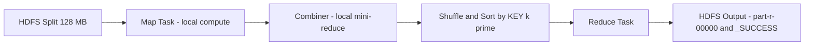
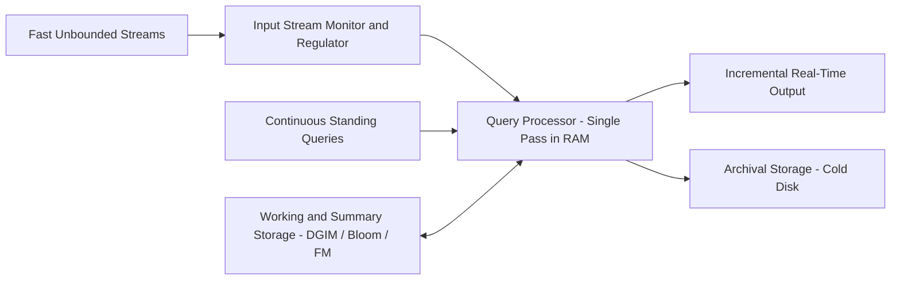
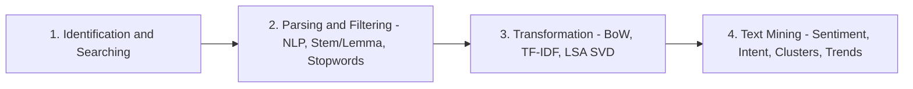

# Quick Revision Notes — BDSMA (`26CMPC71`)

> [!TIP]
> **How to use this sheet (15–30 minutes before your Viva or Exam):** This is a **high-speed cram & revision aid**, *not* a replacement for your detailed module guides (`Module_1_Notes.md`–`Module_6_Notes.md`) or practice `Final_Viva_Question_Bank.md`. Scan Sections 1–7 in order to lock in crisp definitions, exact formulas, comparisons, spoken answers, and every slide-trap correction.

---

## 1. Essential Definitions (1-Line Snapshots by Module)

### Module 1: Big Data & Hadoop (`CO1`)
- **Big Data:** Datasets whose **Volume, Velocity, and Variety** (plus **Veracity, Value**) break single-machine storage, search, and processing within useful time/cost.
- **HDFS:** Distributed **Write-Once-Read-Many (WORM)** filesystem storing huge files as `128 MB` (`64 MB` in 1.x) replicated blocks (`RF = 3`) across commodity DataNodes indexed in RAM by a NameNode.
- **YARN (`Hadoop 2.x+`):** Cluster operating layer separating resource scheduling (`ResourceManager` / `NodeManager`) from job logic (`ApplicationMaster` / `Container`).
- **Secondary NameNode:** Periodic **checkpoint helper** merging `FsImage + EditLog`—*NOT* a hot failover backup!

### Module 2: MapReduce & NoSQL (`CO2`)
- **MapReduce:** Parallel batch framework using `Map(k,v) -> <k',v'>*`, automatic key-based Shuffle & Sort, and `Reduce(k',<v'>*) -> <k',v''>*`.
- **Combiner:** Optional local mini-reducer compressing mapper output *before* shuffle; safe **only** for associative & commutative aggregations (`SUM/MAX/COUNT`, not direct `AVG`).
- **NoSQL ("Not Only SQL"):** Scale-out, schema-flexible non-relational stores across **4 patterns**: Key-Value, Wide-Column, Document, and Graph.
- **CAP Theorem:** Under a Network Partition (`P`), distributed stores choose **Consistency (`C`)** or **Availability (`A`)**; **PACELC** adds *Else (normal operation): **Latency (`L`) vs. Consistency (`C`)***.
- **BASE:** *Basically Available, Soft state, Eventually consistent* (traded against RDBMS **ACID**).

### Module 3: Mining Data Streams (`CO3`)
- **DSMS:** *Data Stream Management System* executing **continuous, non-blocking** single-pass queries over fast, unbounded streams in limited RAM.
- **Concept Drift vs. Concept Evolution:** **Drift** shifts $P(X,Y)$ for *known* classes over time; **Evolution** introduces *brand-new* unseen classes.
- **Reservoir Sampling (`Algorithm R`):** Keeps an exact uniform random sample of size $s$ over unknown stream length $k$ by replacing a random slot with prob $s/k$.
- **Bloom Filter:** Space-efficient $n$-bit + $k$-hash membership filter with **zero False Negatives** and tunable False Positives.
- **DGIM:** Counts `1`s in the last $N$ bits using exponentially sized buckets (`1 or 2` per $2^j$) in **$O(\log^2 N)$ bits** with **$\le 50\%$ worst-case error**.
- **Decaying Windows:** Smoothly down-weights older items by $(1-c)$ per tick to track currently trending elements in $O(1/c)$ space.
- **Flajolet–Martin (FM):** Estimates distinct count $m \approx 2^R$ via maximum trailing zeros $R$ in bit-hashed stream elements (`O(log m)` bits).

### Module 4: SMA Overview, Social Network Measures & Clustering (`CO4`)
- **Social Media Analytics (SMA):** Art & science of extracting actionable business insights across Gohar Khan's **7 Layers** (*Text, Networks, Actions, Hyperlinks, Location, Search Engines, Apps*).
- **Reach vs. Impressions:** **Reach** = unique users; **Impressions** = total views ($\text{Impressions} \ge \text{Reach}$).
- **Structural Hole (Burt 1992) & Weak Ties (Granovetter 1973):** A **structural hole** is a gap between clusters; **weak ties** bridge these holes to carry non-redundant job/news leads.
- **Centrality vs. Centralization:** **Centrality** scores one individual node; **Network Centralization** ($0$ to $1$) scores how unequal the whole graph is (`Star = 1.0`, `Ring = 0.0`).
- **CPM vs. Louvain:** **CPM** extracts **overlapping** communities from $k$-cliques sharing $k-1$ nodes; **Louvain** builds fast **disjoint** partitions by greedily maximizing Modularity $Q$.

### Module 5: Text, Action & Hyperlink Analytics (`CO5`)
- **Text Analytics:** Uses **NLP + Data Mining** (`~80%` unstructured data) for **4 purposes**: *Sentiment, Intention, Trends, Concept Mining* across **4 steps**: *Identify $\to$ Parse/Filter $\to$ Transform (TF-IDF/LSA) $\to$ Mine*.
- **Actions Analytics:** Tracks 14 user actions (*Likes, Shares, Views, Clickstream, Hovering, Check-ins, Pinning, Embeds, etc.*)—the monetization *"cash cow"* of social media.
- **Co-Citation vs. Bibliographic Coupling:** **Co-citation** ($A \to B, C$, Small 1973) vs. **Bibliographic Coupling** ($B, C \to A$, Kessler 1963).
- **Intra- vs. Inter-linking:** **Intra-** (internal, same domain) vs. **Inter-** (external, cross-domain).

### Module 6: Location, Search, PageRank, HITS & Apps (`CO6`)
- **Location Analytics & Geo-Enrichment (`Hecht 2013`):** Spatial mapping of GPS/IP/geotags/check-ins plus overlaying demographics/spending (`Heat Map, Clustering, Aggregation, Color-Coding`).
- **Crawler vs. Directory vs. Metasearch:** Automated bots + inverted index (`Google`) vs. human editorial catalog (`Yahoo Dir`/`DMOZ` retired) vs. live aggregator (`Dogpile`).
- **PageRank & Teleportation:** Random surfer eigenvector rank $\mathbf{r} = M\mathbf{r}$ stabilized against Dead Ends & Spider Traps via $\beta \approx 0.85$ teleportation tax.
- **HITS (`Bonus`):** Query-dependent **Hubs ($h$)** & **Authorities ($a$)** computed from binary link matrix $L$.

---

## 2. Important Formulas & Complexity Cheat Sheet

| Module | Topic | Exact Formula / Bound | Key Notes |
|---|---|---|---|
| **Mod 1** | **HDFS Blocks** | $\lceil \text{FileSize} / \text{BlockSize} \rceil$ (`128 MB` default) | Total disk = `Blocks × BlockSizes × RF` (`300 MB × 3 = 900 MB`) |
| **Mod 1** | **SI Units (2022)** | `KB(10^3) -> YB(10^24) -> Ronna(10^27) -> Quetta(10^30)` | Binary (`IEC`): $1024 = 2^{10}$ (`KiB`, `MiB`, `GiB`) |
| **Mod 2** | **Matrix-Vector / Mult** | $(Av)_i = \sum_j a_{ij}v_j$; $(AB)_{ik} = \sum_j a_{ij}b_{jk}$ | 2-step MR joins on $j$ first, then sums `(i, k)` |
| **Mod 2** | **Cassandra Strong Read/Write** | **$R + W > N$** (`e.g., QUORUM R=2, W=2, N=3`) | Guarantees overlap on at least one fresh replica |
| **Mod 3** | **Reservoir Inclusion Prob** | $P(\text{item in } R \text{ after } k) = \mathbf{s/k}$ | Maintains exact uniform random sample of size $s$ |
| **Mod 3** | **Bloom Filter FPR & Opt $k$** | $p \approx \left(1 - e^{-km/n}\right)^k$, $\quad k_{\text{opt}} = \frac{n}{m}\ln 2 \approx 0.693\frac{n}{m}$ | **0% False Negatives** (`n` bits, `m` inserted items, `k` hashes) |
| **Mod 3** | **Exact Window Count Lower Bound** | **$\Omega(N)$ bits** (Pigeonhole Principle) | Must distinguish $2^N$ bit histories |
| **Mod 3** | **DGIM Space & Error** | **$O(\log^2 N)$ bits**, query error **$\le 50\%$** | Sum enclosed buckets + **$\frac{1}{2}$** oldest overlapping bucket |
| **Mod 3** | **Decaying Window** | $S_t = \sum_{i=0}^{t-1} a_{t-i}(1-c)^i$, update: $S \leftarrow S(1-c) + a_t$ | Total score sum $\le 1/c \implies$ max tracked items $\le 2/c$ ($\theta=\frac{1}{2}$) |
| **Mod 3** | **Flajolet–Martin** | Estimate $m = 2^R$ ($R = \max r(x)$); **$O(\log m)$ bits** | Combine groups using **Median of Group Means** |
| **Mod 4** | **Social Media KPIs** | $\text{ER} = \frac{\text{Engagements}}{\text{Followers}}\times 100$, $\text{Virality} = \frac{\text{Shares}}{\text{Impressions}}\times 100$ | $\text{CTR} = \frac{\text{Clicks}}{\text{Impr}}\times 100$, $\text{Conv} = \frac{\text{Conv}}{\text{Clicks}}\times 100$ |
| **Mod 4** | **Density** | Directed: $\frac{e}{n(n-1)}$; Undirected: $\frac{2e}{n(n-1)}$ | Self-loops excluded |
| **Mod 4** | **Closeness & Betweenness** | $CC(i) = \frac{N-1}{\sum_{j\neq i} d(i,j)}$; $BC(v) = \sum_{u\neq v\neq w}\frac{\sigma_{uw}(v)}{\sigma_{uw}}$ | Avg distance ($\downarrow$ = central) vs Reciprocal $CC(i)$ ($\uparrow$ = central) |
| **Mod 4** | **Eigenvector & Local Clustering** | $A\mathbf{x} = \lambda \mathbf{x}$; $\quad CC(v) = \frac{2N_v}{K_v(K_v - 1)}$ | $CC(v)$ = density among $v$'s `1.5-ego` alters |
| **Mod 5** | **UA vs. GA4 Bounce Rate** | **UA:** $\frac{\text{Single-Page Sessions}}{\text{Total Sessions}}$; **GA4:** **$100\% - \text{Engagement Rate}$** | GA4 Engaged = `>10s`, key event, or `2+` pageviews |
| **Mod 5** | **VADER Thresholds** | Positive: **`compound >= +0.05`**; Negative: **`<= -0.05`** | TextBlob polarity $\in [-1, +1]$; subjectivity $\in [0, 1]$ |
| **Mod 6** | **PageRank w/ Teleportation** | $\mathbf{r}' = \beta M \mathbf{r} + (1 - \beta)\frac{\mathbf{e}}{n}$ (`typical` $\beta = 0.85$) | Fixes Dead Ends (`leak -> 0`) and Spider Traps (`absorb -> 1`) |
| **Mod 6** | **HITS (`Bonus`)** | $\mathbf{a} = L^T \mathbf{h}, \quad \mathbf{h} = L \mathbf{a}$ (+ L2 normalization) | **Query-dependent**: separate Authority & Hub scores |

---

## 3. Acronyms & Expansions

| Acronym | Full Form | Acronym | Full Form |
|---|---|---|---|
| **BDSMA** | Big Data and Social Media Analytics (`26CMPC71`) | **RDBMS / SQL** | Relational Database Management System / Structured Query Language |
| **HDFS / GFS** | Hadoop Distributed File System / Google File System | **YARN** | Yet Another Resource Negotiator |
| **RM / NM / AM** | ResourceManager / NodeManager / ApplicationMaster | **WORM / SPOF** | Write-Once-Read-Many / Single Point of Failure |
| **QJM / EC** | Quorum Journal Manager / Erasure Coding (Reed-Solomon) | **MPP** | Massively Parallel Processing (Shared-Nothing) |
| **MTTF** | Mean Time To Failure | **ACID** | Atomicity, Consistency, Isolation, Durability |
| **BASE** | Basically Available, Soft state, Eventually consistent | **CAP / PACELC** | Consistency, Availability, Partition Tolerance (+ Else Latency vs Consistency) |
| **ORM** | Object-Relational Mapping | **JSON / BSON** | JavaScript Object Notation / Binary JSON |
| **WAL / HQL** | Write-Ahead Log (`HBase`) / Hive Query Language | **DSMS** | Data Stream Management System |
| **DGIM / FM** | Datar–Gionis–Indyk–Motwani / Flajolet–Martin | **FPR / LSB** | False Positive Rate / Least Significant Bit |
| **RDD / DAG** | Resilient Distributed Dataset / Directed Acyclic Graph | **FP-Growth** | Frequent Pattern Growth (candidate-free itemset tree) |
| **SMA / UGC** | Social Media Analytics / User-Generated Content | **CTR / CPC / ROI / CSAT** | Click-Through Rate / Cost Per Click / Return on Investment / Customer Satisfaction |
| **CPM** | Clique Percolation Method (`Palla et al. 2005`) | **NLP / NER / POS** | Natural Language Processing / Named Entity Recognition / Part of Speech |
| **VSM / TF-IDF / LSA** | Vector Space Model / Term Freq–Inverse Doc Freq / Latent Semantic Analysis | **SVD** | Singular Value Decomposition |
| **GA4 / UA** | Google Analytics 4 / Universal Analytics | **SEO / SERP** | Search Engine Optimization / Search Engine Results Page |
| **ccTLD** | Country Code Top-Level Domain (`.in`, `.uk`, `.kr`) | **DA / PA / TF / CF** | Domain Authority / Page Authority (`Moz`) / Trust Flow / Citation Flow (`Majestic`) |
| **HITS** | Hyperlink-Induced Topic Search (`Kleinberg 1999`) | **EXIF / GIS / CDR** | Exchangeable Image File Format / Geographic Info System / Call Detail Record |

---

## 4. Key Differences Cheat Tables

### A. Big Data Storage & Processing Engines
| Comparison | Left Side | Right Side |
|---|---|---|
| **HDFS vs. HBase** | Distributed **file system** for sequential batch scans (`128 MB` blocks) | Random-read/write **NoSQL DB running ON TOP of HDFS** |
| **Hadoop 1.x vs. 2.x/3.x** | Single NameNode SPOF, `JobTracker` MR-only, `RF=3` (`200%` overhead) | QJM HA (`Active/Standby`), YARN multi-engine, **3.x EC (`~50%` overhead)** |
| **MapReduce vs. Spark** | Writes shuffle/stages to disk (`slow multi-pass ML`) | In-memory **DAG/RDD caching** (`fast iterative ML/FP-Growth`) |
| **Hive vs. Pig** | Declarative SQL (`HiveQL`) for BI analysts on structured warehouse tables | Procedural dataflow (`Pig Latin`) for programmer ETL pipelines |
| **Sqoop vs. Flume** | Bulk RDBMS $\leftrightarrow$ HDFS batch (`Attic retired June 2021`) | Streaming logs/events $\to$ HDFS (`Source-Channel-Sink`; under `Logging` 2024) |
| **`groupByKey` vs. `reduceByKey`** | Shuffles **all raw pairs** over network (`OOM risk`) | Combines locally per partition **first** (Combiner behavior) |
| **Hive Managed vs. External** | `DROP TABLE` deletes metadata **AND HDFS data** | `DROP TABLE` deletes metadata **ONLY** (HDFS data stays safe) |

### B. Databases, Streams & Networks
| Comparison | Left Side | Right Side |
|---|---|---|
| **ACID vs. BASE** | Strict immediate consistency + transactions (RDBMS) | High availability + soft state + **eventual consistency** (NoSQL) |
| **Columnar RDBMS vs. Wide-Column NoSQL** | Contiguous column disk storage for **OLAP** (`Vertica`, `Parquet`) | Sparse `RowKey -> CF:Col:TS` distributed maps for **OLTP** (`HBase`, `Cassandra`) |
| **DBMS vs. DSMS** | Persistent finite disk tables, multi-pass pull, one-time exact SQL | Infinite fast RAM streams, single-pass push, **continuous approximate** queries |
| **1-Step vs. 2-Step Matrix Mult** | 1 MR job, high tuple replication across `(i, k)` | 2 MR jobs (join on $j$, then sum `(i, k)`), far less replication |
| **Centrality vs. Centralization** | Individual node importance score | Whole-network concentration around one hub (`Star = 1`, `Ring = 0`) |
| **CPM vs. Louvain (`Exp 10`)** | **Overlapping** communities via $k$-cliques sharing $k-1$ nodes | **Disjoint** fast partition optimizing Modularity $Q$ (covers all nodes) |
| **Co-Citation vs. Bibliographic Coupling** | One source links to two targets (`A -> B, C`, Small 1973) | Two sources link to one shared target (`B, C -> A`, Kessler 1963) |
| **TextBlob vs. VADER (`Exp 8`)** | Generic polarity (`[-1, 1]`); weak on slang/emojis/ALL-CAPS | Social-media lexicon + rules (`emojis, !!, CAPS, negation`); `compound +-0.05` |
| **PageRank vs. HITS (`Bonus`)** | Global **query-independent**, 1 score, $\beta$-teleportation | **Query-dependent** Base Set, 2 scores (**Hub & Authority**) |

---

## 5. Key Workflows & Architecture Diagrams

### 5.1 MapReduce + Combiner + HDFS Pipeline (Modules 1 & 2)

*Plain-language check:* Map runs locally on DataNode blocks, an optional Combiner pre-aggregates associative/commutative totals before network transfer, Shuffle partitions/sorts strictly by **key** (never value), and Reducers write replicated output safely back to HDFS.

### 5.2 Abstract DSMS Architecture (Module 3)

*Plain-language check:* The Regulator absorbs bursts (and sheds load if needed), while the Query Processor executes continuous non-blocking queries in one pass using compact RAM sketches/windows (`DGIM`, `Bloom`, `FM`) rather than scanning unbounded history.

### 5.3 Four-Step Social Media Text Analytics Pipeline (Module 5)

*Plain-language check:* Collect relevant feeds, clean/normalize linguistic tokens (keeping negations for sentiment!), encode text numerically with TF-IDF/LSA, then mine opinions, purchase/churn intent, or clusters.

### 5.4 Hyperlink Patterns & Crawler Search Flow (Modules 5 & 6)

*Plain-language check:* `robots.txt` controls crawler traffic (`noindex` controls indexing); indexed inverted posting lists meet NLP query rewriting and teleported PageRank signals ($\mathbf{r}' = \beta M\mathbf{r} + (1-\beta)\frac{\mathbf{e}}{n}$) to build the ranked SERP.

---

## 6. Thirty-Second Spoken Viva Answers (Rehearse Aloud!)

1. **MapReduce Failure Recovery (`Mod 2`):**  
   *"Sir/Ma'am, if a **Map worker** fails, even its **completed** map tasks are restarted elsewhere because intermediate map outputs sit on that failed machine's local disk. If a **Reduce worker** fails, only **in-progress** tasks restart because completed reduce outputs are already replicated on global HDFS. Slow stragglers are handled by **Speculative Execution**."*
2. **Why Key-Hash Sampling Beats Naive Sampling (`Mod 3`):**  
   *"Naive 10% row sampling splits a single user's queries across different samples, turning repeat searchers into false one-time users. Hashing on the **`user` key** selects 10% of users while keeping **100% of every selected user's history**, keeping repeat-query ratios unbiased."*
3. **Why Bloom Filters Have 0% False Negatives & Why DGIM Needs $O(\log^2 N)$ Space (`Mod 3`):**  
   *"Inserting sets all $k$ bits to `1` and never clears them, so a real member can never hit a `0` bit—hence **zero false negatives**. Exact sliding-window `1`-counting requires $\Omega(N)$ bits by the Pigeonhole Principle, whereas DGIM groups `1`s into at most 2 power-of-2 buckets per scale (`<= log2 N` scales × `log2 N`-bit timestamps = **$O(\log^2 N)$ bits**) and halves the oldest bucket to stay within **$\le 50\%$ error**."*
4. **Centrality vs. Centralization & CPM vs. Louvain (`Mod 4`):**  
   *"Node centrality scores an individual actor (`Degree, Closeness, Betweenness, Eigenvector`), whereas network centralization (`0 to 1`) measures how concentrated power is across the whole graph (`Star = 1`, `Ring = 0`). For communities, **CPM** detects **overlapping** communities via $k$-cliques sharing $k-1$ nodes, while **Louvain (`Exp 10`)** greedily maximizes Modularity $Q$ into fast **disjoint** partitions."*
5. **Co-Citation vs. Bibliographic Coupling & GA4 Bounce Rate (`Mod 5`):**  
   *"**Co-citation** means one site $A$ links to both $B$ and $C$; **Bibliographic Coupling** means $B$ and $C$ both cite common target $A$. And in Google Analytics 4, **Bounce Rate** equals **`100% - Engagement Rate`**, so staying over 10 seconds on one article counts as engaged rather than a bounce."*
6. **PageRank Teleportation (`Mod 6`):**  
   *"In pure $M\mathbf{r}$, **Dead Ends** leak rank to `[0, 0, ..., 0]`, while **Spider Traps** absorb 100% of rank. Adding Teleportation $\mathbf{r}' = \beta M\mathbf{r} + (1-\beta)\frac{\mathbf{e}}{n}$ ($\beta \approx 0.85$) injects a small uniform random jump at every step so PageRank converges cleanly and fairly across the entire web."*

---

## 7. Top High-Priority Facts & Slide-Trap Corrections (Do Not Fall Into These!)

1. **Module 1 — Not a Backup:** Secondary NameNode checkpoints `FsImage + EditLog`; **Active/Standby + QJM** provides HA! Official SI prefixes up to $10^{27}, 10^{30}$ are **`ronna`, `quetta`** (Nov 2022), not `"brontobyte"` / `"geopbyte"`.
2. **Module 2 — Sort & Matrix Trap:** MapReduce sorts by **KEY**, *not value* (`v'` order needs Secondary Sort). In the $2\times 3 \times 3\times 2$ matrix example (`pp. 129, 132`), $m_{23}n_{32} = 6 \times 1 = \mathbf{6}$ (**NOT `10`**), making `(AB)_{2,2} = \mathbf{34}`! And Java's driver uses **`Job.getInstance(conf)`**, while Neo4j 5 uses **`FOR ... REQUIRE`** (not `ON ... ASSERT`).
3. **Module 3 — Three Classic Arithmetic Traps:**
   - **DGIM (`p. 84`):** Never add the full oldest overlapping bucket (`4+2+2+1=9`); always take **half** (`4/2+2+2+1 = 7`)!
   - **Decaying Windows (`pp. 112–113`):** With consistent $c=0.1$, `fifa = 2.187541` (`3` times) and `ipl = 3.02949` (`4` times)—slides erred at step 1 on `fifa` and silently changed $c=0.01$ on `ipl`.
   - **FM Combining (`p. 130 vs 133`):** Standard MMDS uses **Median of Group Means** (NOT Mean of Medians).
4. **Module 4 — Two Closeness Rules & CPM Scan Fixes:**
   - **Closeness (`Mod4B pp. 83–87`):** Average shortest-path distance (`lower = central`) vs. normalized reciprocal $CC(i) = \frac{N-1}{\sum d(i,j)}$ (`higher = central`).
   - **CPM (`Mod4C pp. 34–35, 43`):** 9-node cliques include **`{6,7,8}`** (not duplicated `{5,7,8}`); `MU IT May 2016` scan omitted `2–5` & `6–4` edges shown in its solution!
5. **Module 5 — Link Terms & Google Disavow:** Co-citation vs Bibliographic coupling, Intra vs Inter-linking, `"NPL"` $\to$ `NLP`, `"natural"` $\to$ `neutral`, `"denied"` $\to$ **`.txt Disavow tool`**, Twitter `140` $\to$ `280 / 25,000` Premium, **Klout** & **Open Site Explorer** retired (May 2018).
6. **Module 6 — Dead End Matrix, Trends `+` & Retired APIs:**
   - **`Dead end: Ex 3` (`p. 16`):** Slide pasted Spider Trap `[0,0,1]` onto a Dead End matrix—true limit is **`[0, 0, 0]`**! And `Ex 2` (`p. 12`) uses **L2 unit norm**, same ratios as L1 (`[0.20, 0.20, 0.15, 0.15, 0.30]`).
   - **Google Trends (`p. 35`):** `+` = **OR** in Trends only; `-` needs **zero space** (`social -analytics`).
   - **Retired Services:** Google Fusion Tables (`Dec 3, 2019` $\to$ QGIS / Kepler.gl / Looker Studio), Toolbar PageRank (`2016`), Alexa Rank (`May 1, 2022`).
